# Round 7 — شواهد بصری Cockpit (۲۰۲۶-۱۰-۲۰)

این تصاویر از اجرای واقعی SPA ساخته‌شده از شاخهٔ
`mission/sarkhati-round7-test-cockpit-2026-10-20` گرفته شده‌اند، نه mockup.
هارنس محلی فقط روترِ `/api/execution/*` را سرو می‌کند و سایر APIها ۴۰۴
می‌دهند؛ این محدودیت هارنس است و دربارهٔ آن مسیرها ادعایی نمی‌شود. داده‌های
عرضه (`TESTA`/`TESTB`) و رزرو `UNKNOWN_HOLD` fixture محلی‌اند و دادهٔ رسمی
بازار یا کارگزاری نیستند. هیچ token/cookie/حساب واقعی در تصاویر نیست.

## قبل / بعد

| قبل — Round 6 (stack قدیمی) | بعد — Round 7 (Cockpit) |
| --- | --- |
| 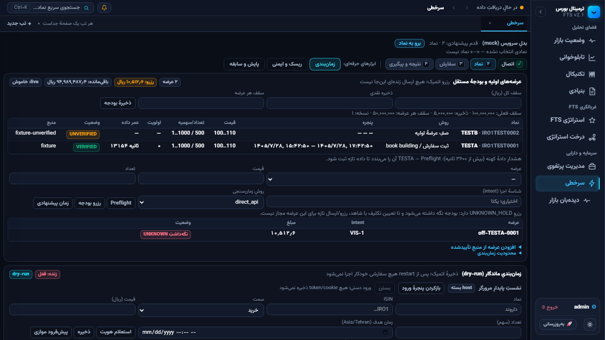 | 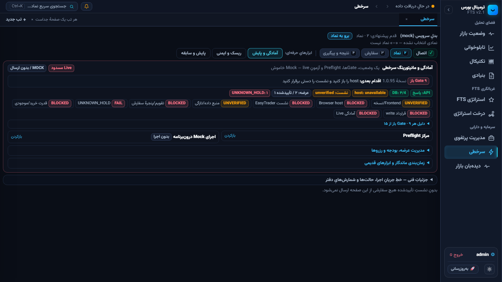 |
| 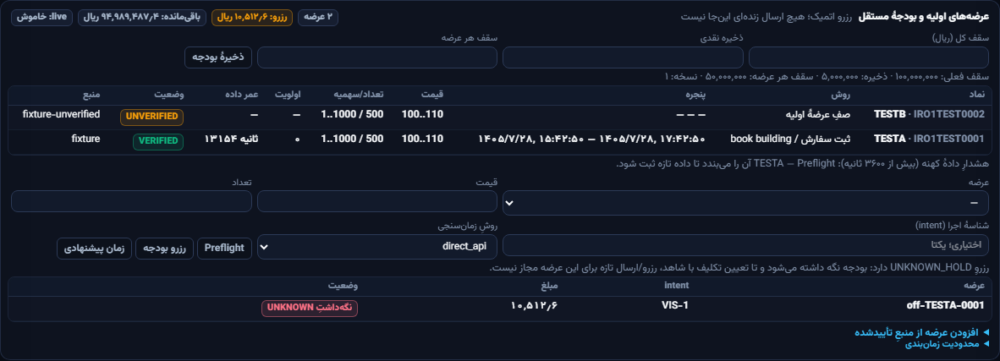 | 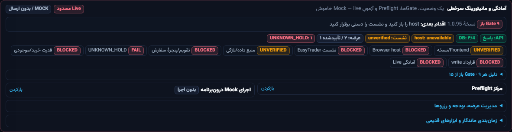 |

تصویر قبل، screenshot واقعی Round 6 از همان SPA/هارنس است؛ جعل یا بازسازی
طراحی نیست. بعد از Round 7، کارت‌های زمان‌بندی/عرضه به یک پنلِ
وضعیت‌محور با Gateهای فشرده و جزئیاتِ بازشونده تبدیل شده‌اند.

## تصاویر و سناریوها

| تصویر | viewport | سناریو | نتیجهٔ مورد انتظار |
| --- | --- | --- | --- |
|  | 1366×768 | ورود به تب «آمادگی و پایش» | Live مسدود، ۹ Gate باز، اقدام بعدی host، بدون overflow افقی |
|  | 1366×768 | پنل بسته | ارتفاع ۲۹۳px؛ وضعیت و Gateها پیش از جزئیات |
| 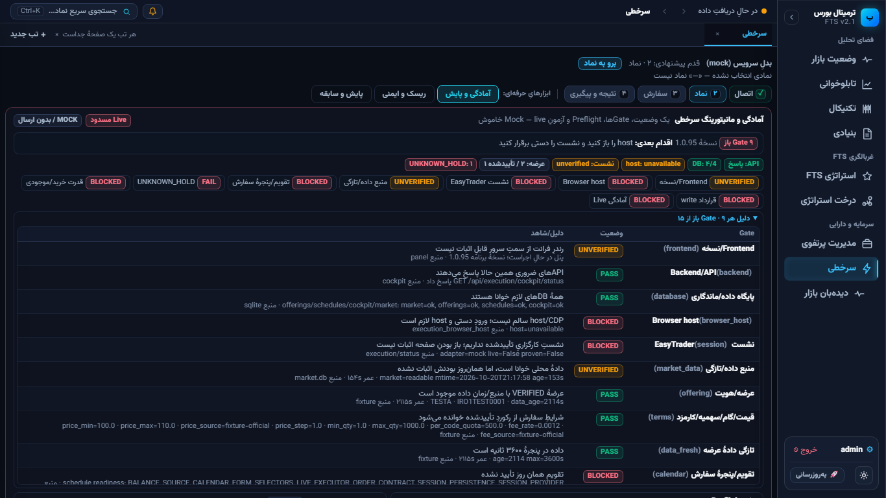 | 1366×768 | بازکردن جزئیات Gateها | دلیل/شاهد/منبع هر Gate، از جمله UNKNOWN_HOLD=FAIL |
| 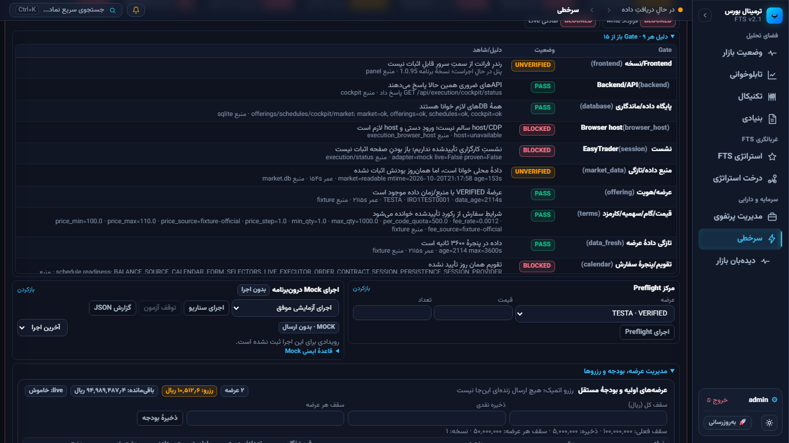 | 1366×768 | بازکردن مدیریت عرضه | TESTA با VERIFIED، اولویت ۰، عمر داده، و TESTB با UNVERIFIED |
| 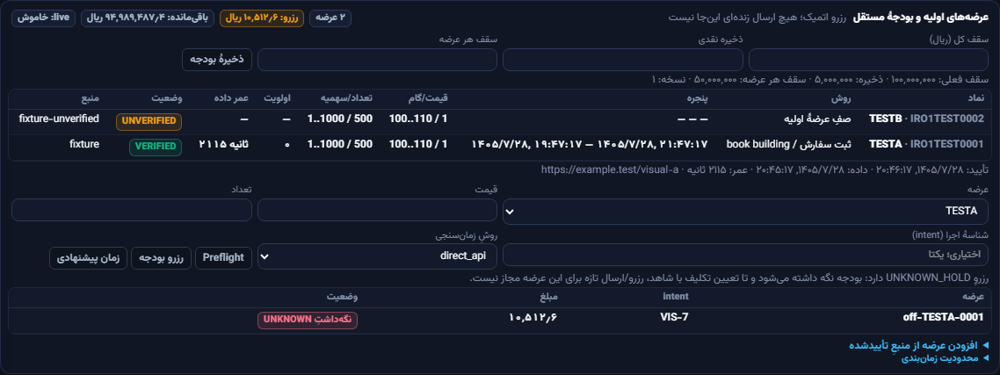 | 1366×768 | پنل عرضه (element) | ردیف TESTA با VERIFIED/اولویت ۰/عمر ۱۶۵۵s، منبع و رزرو UNKNOWN_HOLD |
| 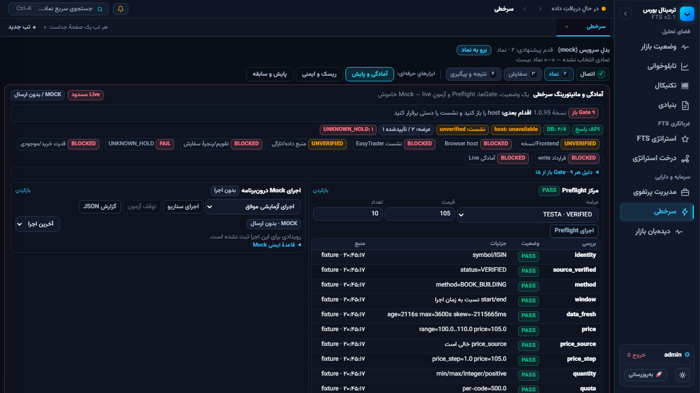 | 1366×768 | Preflight روی TESTA | PASS برای رکورد کامل؛ هنوز Live مسدود |
| 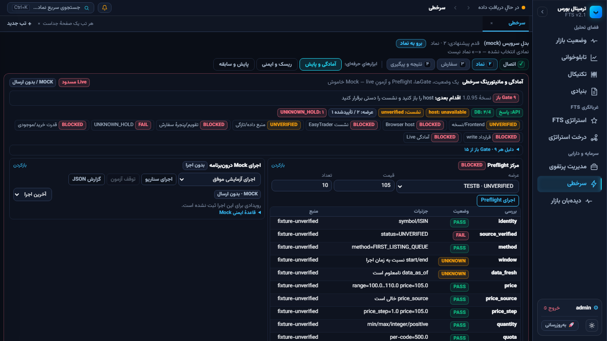 | 1366×768 | Preflight روی TESTB | `source_verified=FAIL` و Preflight مسدود |
| 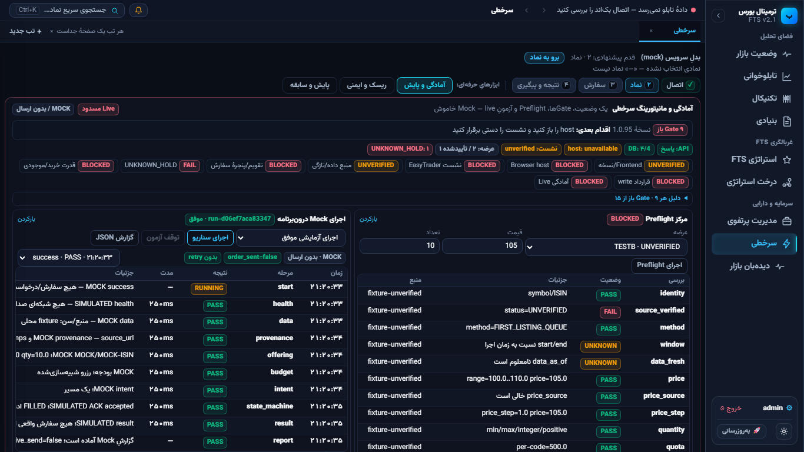 | 1366×768 | Mock success | `run-… · موفق`، `order_sent=false`، بدون retry، Timeline رویدادها |
| 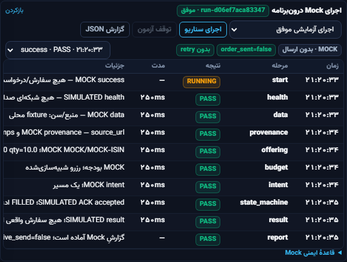 | 1366×768 | Mock success (element) | هفت رویداد از start تا report، همه با برچسب MOCK/SIMULATED |
| 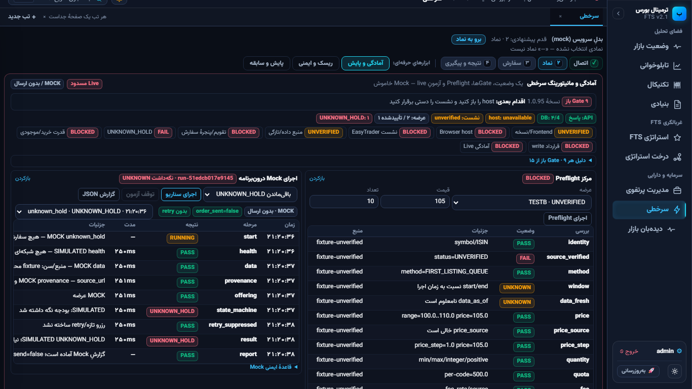 | 1366×768 | Mock unknown_hold | وضعیت نگه‌داشت UNKNOWN، بدون retry/رزرو دوم |
| 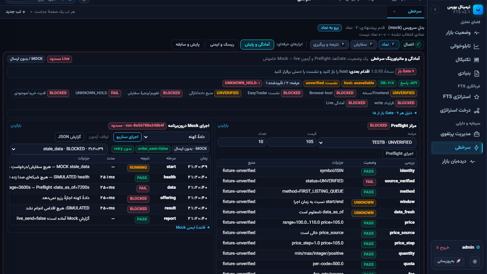 | 1366×768 | Mock stale_data | مسدود؛ دادهٔ کهنه اجازهٔ اقدام نمی‌دهد |
| 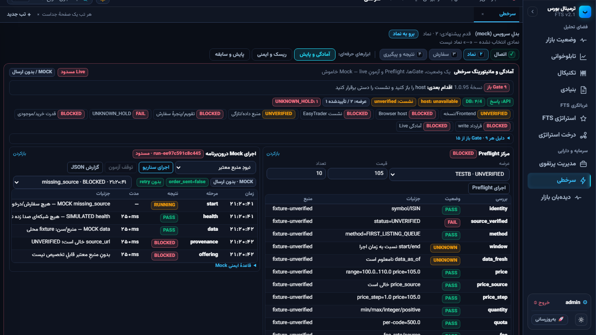 | 1366×768 | Mock missing_source | مسدود؛ منبع/اثبات غایب است |
| 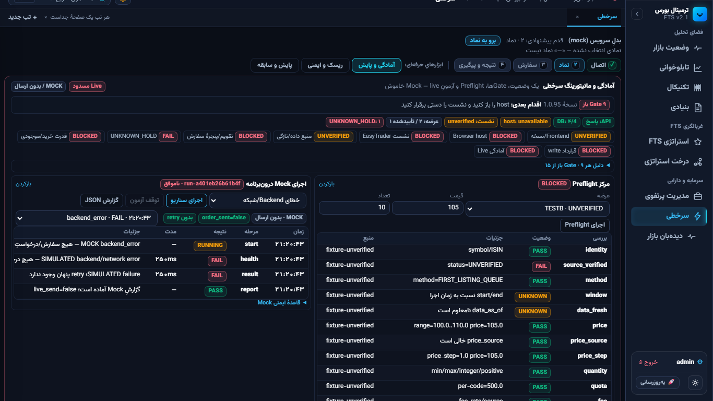 | 1366×768 | Mock backend_error | FAIL شبیه‌سازی‌شده؛ هیچ درخواستِ بیرونی ارسال نشده |
| 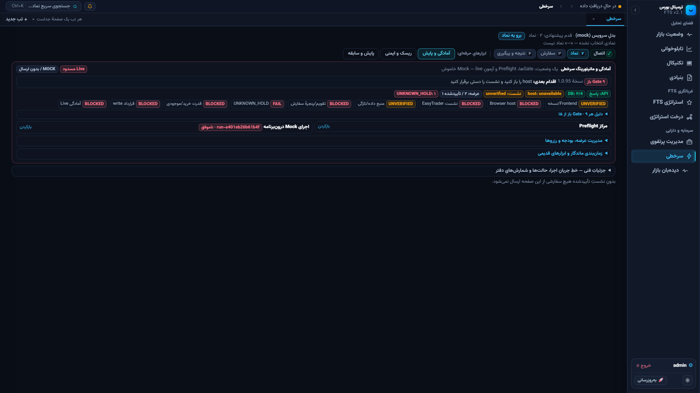 | 1920×1080 | نمای بزرگ | چیدمان بدون overflow؛ ارتفاع پنل بسته ۲۸۰px |
| 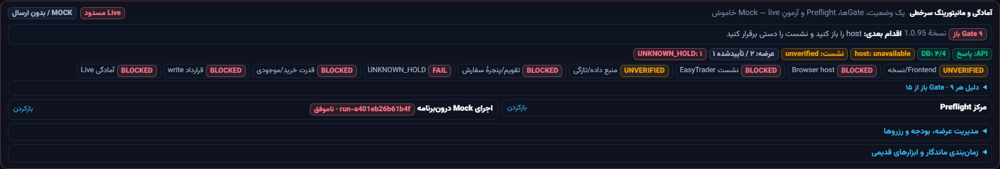 | 1920×1080 | پنل بزرگ | حفظ سلسله‌مراتب و خوانایی |
| 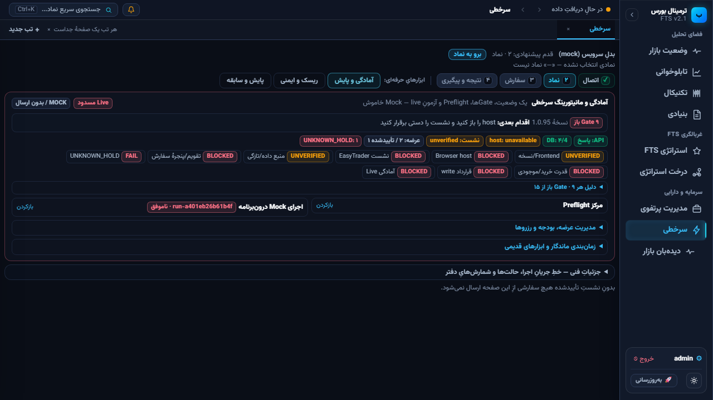 | 1280×720 | viewport کوچک‌تر | بدون overflow افقی؛ ارتفاع بسته ۳۰۵px |

## مرز واقعی/شبیه‌سازی

- `MOCK` و `SIMULATED` روی هر اجرا و رویداد دیده می‌شوند.
- هیچ دکمهٔ ارسال سفارش در این پنل نیست؛ Mock فقط در
  `execution_cockpit.db` می‌نویسد.
- Gateهای host/session/قدرت خرید/قرارداد write در این محیط مسدودند و
  `live_ready=false` است.
- تصاویر `08`/`09` سناریوهای Mock هستند؛ دادهٔ واقعی بازار نیستند.

## محدودیت هارنس

- سرور محلی فقط روترِ execution را mount می‌کند؛ ۴۰۴های سایر APIها در
  کنسول دیده می‌شوند و به این تصاویر مربوط نیستند.
- screenshotها با Chromium محلی و viewport دقیق گرفته شده‌اند؛ داوری
  زیبایی‌شناختی نهایی همچنان با مالک است.
