# Round 8 — شواهد بصری اتصال و UX سرخطی (۲۰۲۶-۱۰-۲۰)

این تصاویر از اجرای **اپ کامل Portable** ساخته‌شده از همین شاخه گرفته شده‌اند
(`http://127.0.0.1:8140`، `BORS_PORTABLE=1`، `market.db` کپی‌شده در `data/`)،
نه از هارنسی که فقط `/api/execution/*` را سرو می‌کند. پنجرهٔ host واقعی با
`POST /api/execution/browser-host` باز شد و CDP/صفحهٔ ورود از همان host خوانده شد.

محدودیت‌های صریح:

- ورود دستی مالک انجام نشد؛ بنابراین تصویر «API تأییدشده» وجود ندارد و هیچ
  ادعای اتصال کامل یا سفارش نمی‌شود.
- تصاویر `03` و `04` با fixture پاسخِ تشخیص ساخته شده‌اند و در نامشان
  `simulated` آمده است. آن‌ها وضعیت واقعی کارگزاری نیستند.
- برای `05`/`06`/`07` فید بازار با یک ردیف fixture (`فولاد`) تأمین شد؛ بک‌اند/UI
  واقعی‌اند ولی دادهٔ تابلو در آن لحظه آماده نبود. هرگز به‌جای دادهٔ زنده
  گزارش نمی‌شود.
- هیچ token/cookie/password در تصاویر یا فرایند تولید آن‌ها خوانده یا ثبت نشد.
- `adapter` در اپ Portable تست، `mock` بود؛ همین در تصویر اتصال دیده می‌شود.
  برای استفادهٔ EasyTrader باید تنظیم آداپتور + read-only ذخیره و اپ restart شود.

## اتصال

| تصویر | وضعیت |
| --- | --- |
| 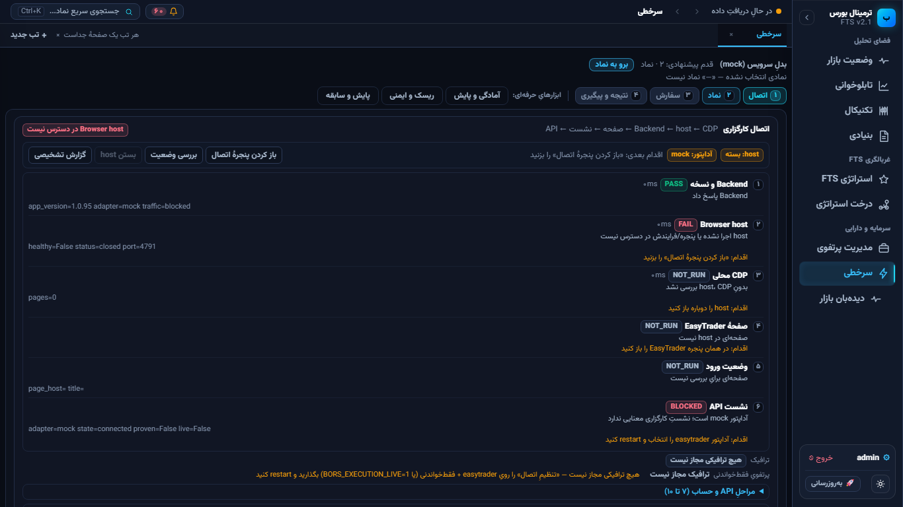 | host بسته؛ Backend پاسخ می‌دهد، CDP/صفحه NOT_RUN، آداپتور mock |
| 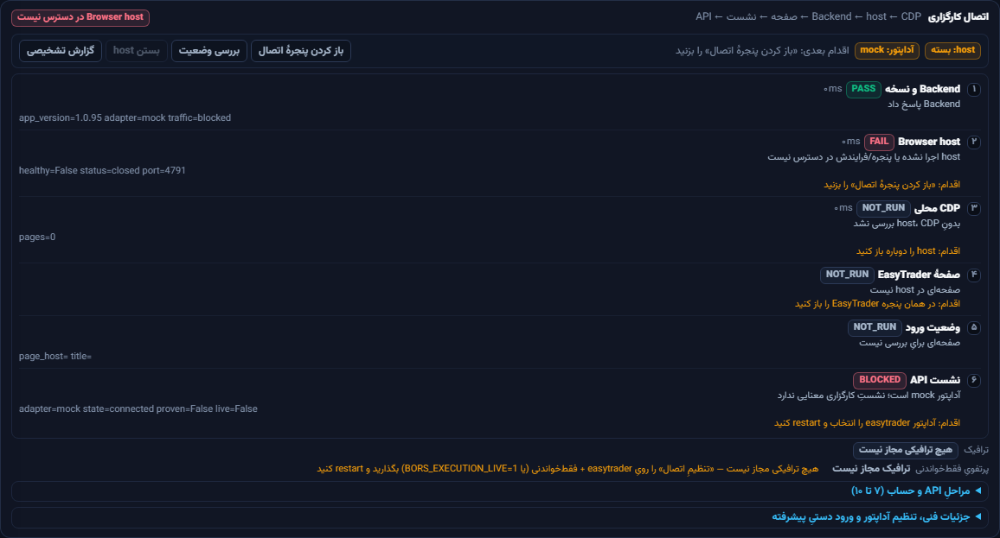 | همان پنل، شش قدم و اقدام بعدی |
| 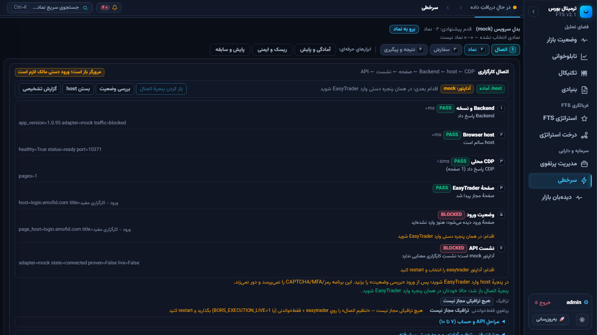 | host/CDP واقعی سالم؛ صفحهٔ `login.emofid.com`، ورود دستی لازم |
| 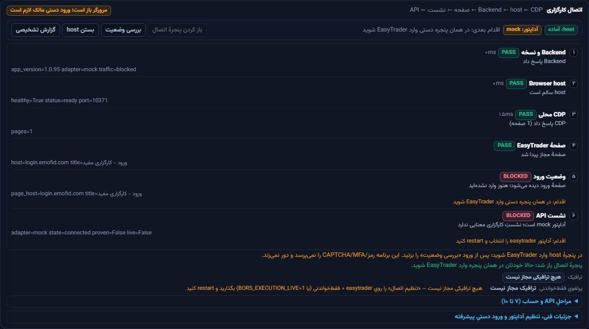 | شش قدم با ورود BLOCKED؛ نشست API نیز به‌دلیل mock مسدود |
| 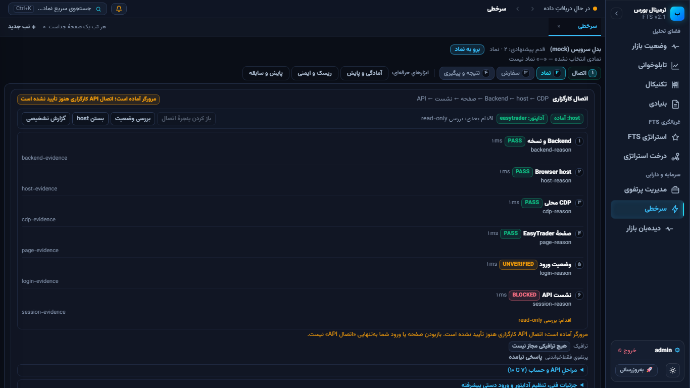 | **SIMULATED**: مرورگر آماده، API هنوز تأیید نشده |
| 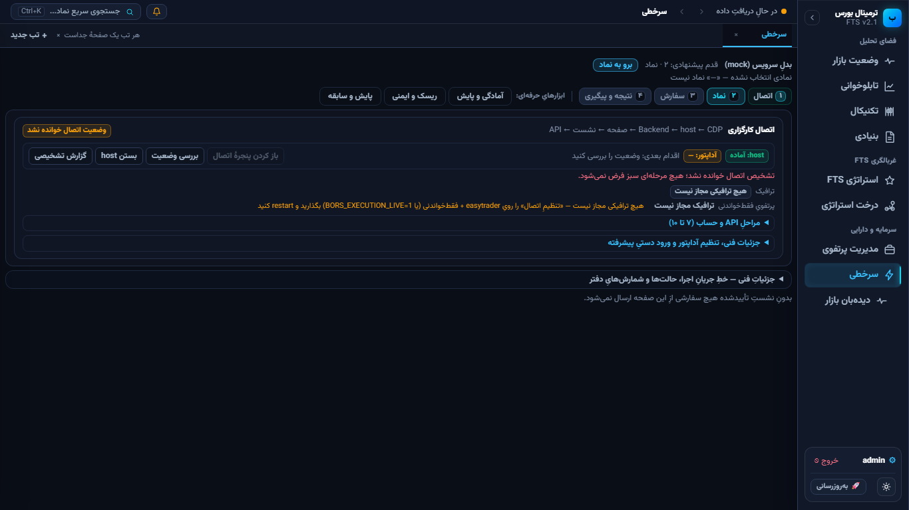 | **SIMULATED**: خطای Backend؛ هیچ Gate سبز نمی‌شود |

## مسیر اصلی و ابزارها

| تصویر | بخش |
| --- | --- |
| 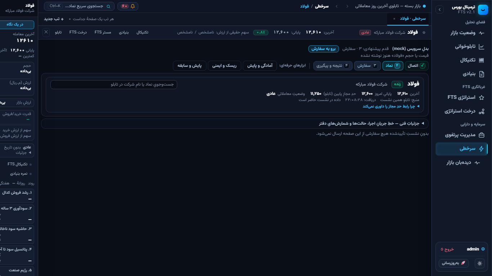 | انتخاب نماد، نام/شناسه، منبع و زمان دریافت، وضعیت داده |
| 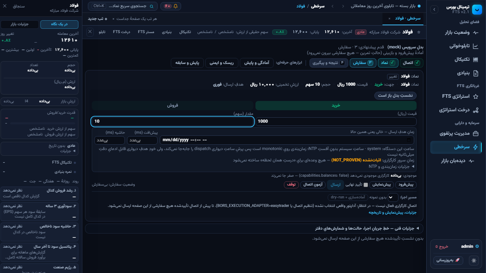 | فرم آماده‌سازی خرید/فروش، قیمت/تعداد، ارزش، تفکیک Mock و Live |
| 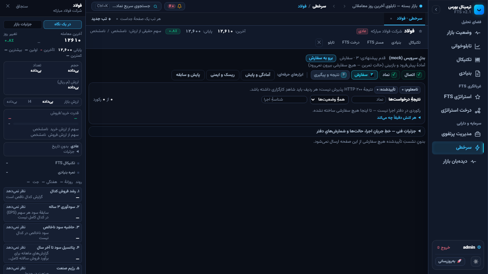 | نتیجه/پیگیری با خلاصهٔ نامعلوم/تأییدشده و پیام HTTP≠پذیرش |
| 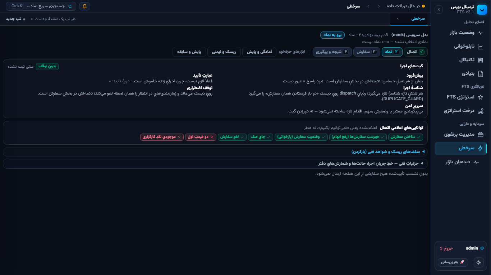 | ریسک و ایمنی؛ تصویر از execution-only harness با همان بیلد نهایی، چون اپ کامل پس از تغییر کارت ریسک بسته شده بود؛ سایر APIها در این هارنس ۴۰۴اند |
| 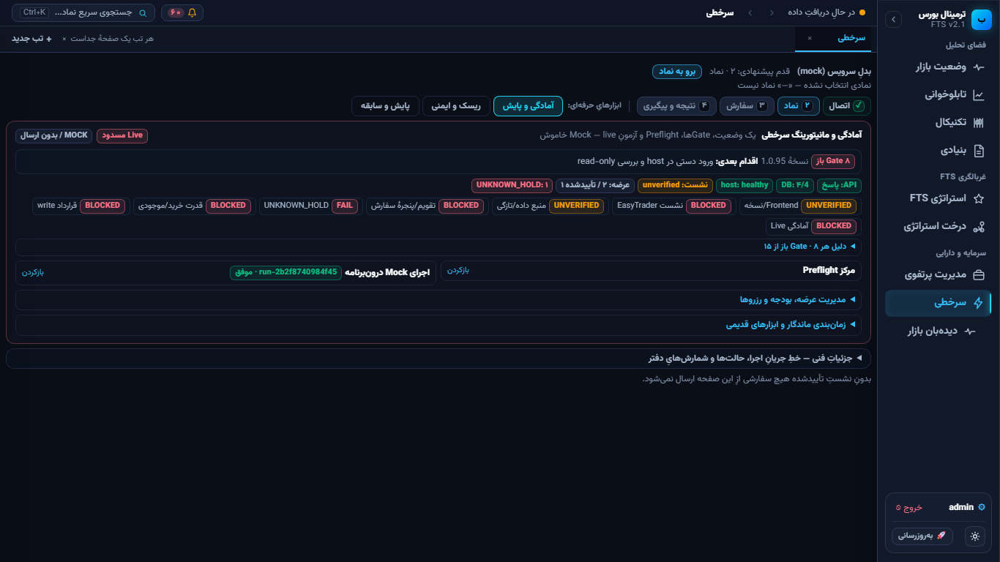 | آمادگی و پایش: Gateهای باز، host، session، بودجه و UNKNOWN_HOLD |
| 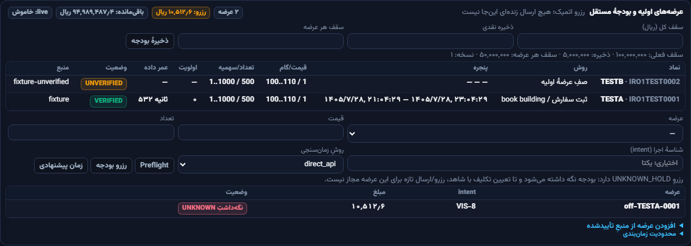 | مدیریت عرضه/بودجه/رزروها |
| 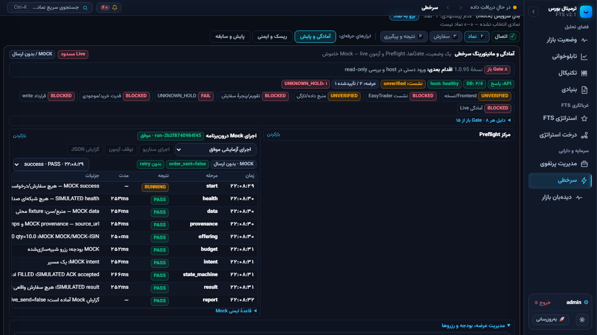 | Mock موفق و Event Timeline؛ `MOCK` و بدون ارسال |

## viewportها

| تصویر | اندازه |
| --- | --- |
| 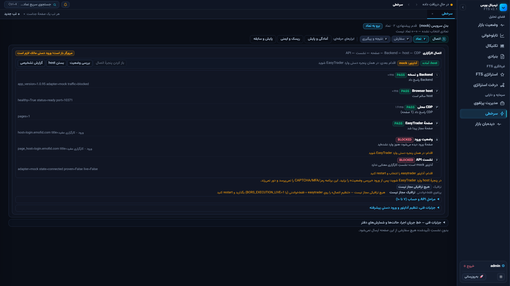 | 1920×1080؛ بدون overflow |
| 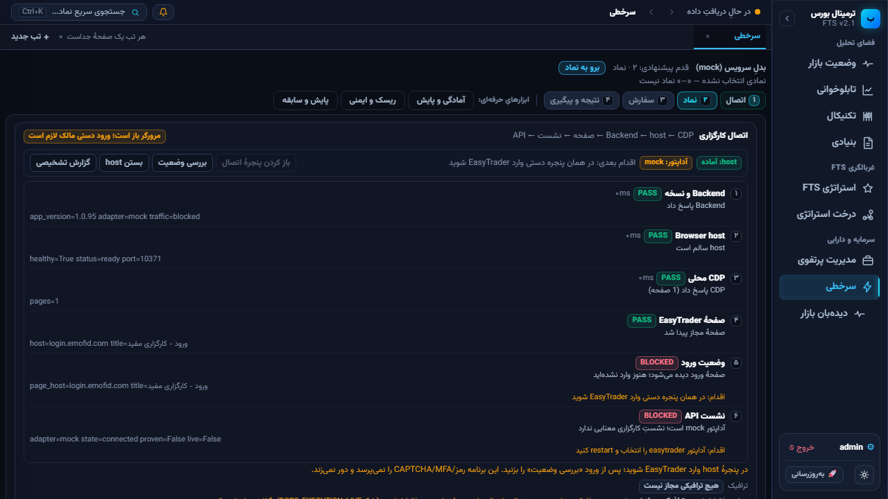 | 1280×720؛ بدون overflow |

## قبل/بعد

تصویر قبلِ معتبر برای این صفحهٔ اتصال در Round 7 ثبت نشده بود؛ برای بخش
پایش می‌توان تصویر Round 7 را با تصویر ۰۹ همین دور مقایسه کرد، اما برای
اتصال «قبل» جعل نشده است. تغییر واقعی این دور: شش قدمِ مستقل، پیام صریح
«مرورگر آماده است؛ API تأیید نشده»، و انتقال URLها/فرم قدیمی به جزئیات فنی.
