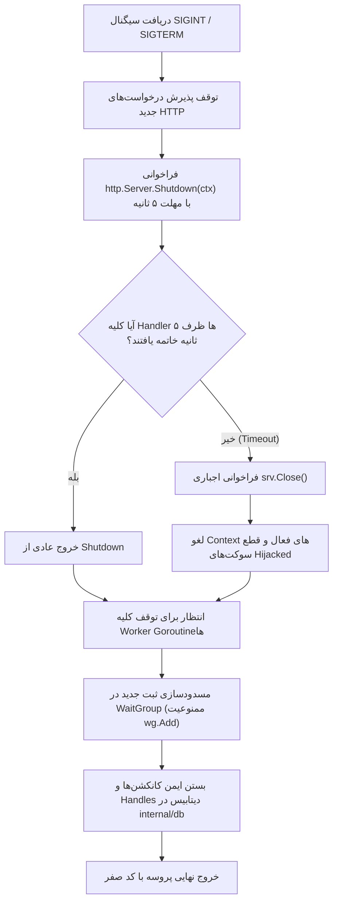

# سند ۰۲: مالکیت داده‌ها، معماری نویسنده یکتا و چرخه حیات (Data Ownership & Single Writer Architecture)

## ۱. اصل بنیادین تک‌نویسنده (Single Writer Architecture)

در طراحی معماری ذخیره‌سازی بورس‌ترمینال بر پایه SQLite، جهت تضمین ثبات صددرصدی داده‌ها و جلوگیری از بروز هرگونه خطای `database is locked` یا تخریب داده در سطح ژورنال WAL، مالکیت نوشتن به‌صورت ساختاری و در سطح معماری تعریف شده است.

> [!IMPORTANT]
> **رد ادعای کفایت `busy_timeout`:**
> صرف تنظیم عملگر `busy_timeout` (یا `_busy_timeout=5000`) هرگز تضمین‌کننده Single Writer نیست؛ این پارامتر صرفاً مدت‌زمان انتظار یک اتصال را در هنگام قفل بودن فایل مشخص می‌کند و قادر به تفکیک یا هدایت ترافیک خواندن/نوشتن میان پروسه‌ها نیست. مالکیت نوشتن باید به‌صورت ساختاری در سطح بازگشایی کانکشن‌ها، مجوزهای فایل و گیت‌های AST اعمال شود.

---

## ۲. ماتریس مالکیت و سطوح دسترسی دیتابیس‌ها

| پایگاه داده | فایل فیزیکی | تنها نویسنده مجاز (Single Writer) | وضعیت دسترسی Go (`borsd`) | وضعیت دسترسی Python | تمهیدات سیستمی اعمال‌شده |
| :--- | :--- | :--- | :--- | :--- | :--- |
| **داده‌های بازار** | `market.db` | موتور سینک پایتون (`fetch_tsetmc`) | **فقط خواندنی (`mode=ro`)** | خواندن و نوشتن (RW) | بازگشایی با URI `file:market.db?mode=ro` و اجرای دستور `PRAGMA query_only = ON` بلافاصله پس از اتصال |
| **اطلاعیه‌های کدال** | `codal.db` | موتور واکشی کدال پایتون (`codal_fetcher`) | **فقط خواندنی (`mode=ro`)** | خواندن و نوشتن (RW) | بازگشایی با URI `file:codal.db?mode=ro` و اجرای `PRAGMA query_only = ON` |
| **تنظیمات کاربر** | `user.db` | بک‌اند Go (`borsd`) | **خواندن و نوشتن (RW)** | بدون دسترسی (یا خواندن ایزوله) | در حالت عادی RW؛ در صورت فعال بودن فلگ `--read-only`، با `mode=ro` باز شده و هرگونه درج/ویرایش واچ‌لیست و سبد با خطای ساختاری ۴۰۳ مسدود می‌شود |

---

## ۳. تضمین ساختاری ممنوعیت فراخوانی مستقیم `sql.Open` (گیت معماری AST)

برای جلوگیری از خطای ناخواسته توسعه‌دهندگان در باز کردن کانکشن‌های مستقیم یا دور زدن الزامات امنیتی، یک گیت معماری ایستا بر مبنای AST (در تست `TestArchitectureNoDirectSQLOpen` در پکیج `internal/db`) اضافه شده است.

### ضوابط گیت AST:
1. هیچ فایلی خارج از پکیج `internal/db` حق فراخوانی مستقیم `sql.Open` یا استفاده از درایور خام SQLite را ندارد.
2. تمامی پکیج‌های بیزینس لاجیک (`market`, `chart`, `mstat`, `fundamental`, `watchlist`, `sync`) صرفاً ساختارهای دسترسی ارائه‌شده توسط `internal/db` (`OpenRO` و `OpenRW`) را مصرف می‌کنند.
3. در صورت ثبت هرگونه فراخوانی مستقیم در کدهای تولیدی، CI و سوئیتر تست Go بلافاصله با خطای آشکار و با ذکر نام فایل و شماره خط متوقف می‌شود.

---

## ۴. ضمانت عملکردی فلگ‌های عملیاتی

### الف) رفتار فلگ `--read-only` (Zero Disk Writes):
- **مسدودسازی کامل نوشتن در دیتابیس‌ها:** بازگشایی `market.db` و `codal.db` در حالت `mode=ro` قطعی است. `user.db` نیز به‌صورت اجباری در حالت `mode=ro` باز می‌شود.
- **انسداد نوشتن در کش‌ها و فایل‌های موقت:** هیچ فایلی اعم از لاگ دیسکی، فایل‌های استخراج موقت، کش‌های JSON یا ژورنال‌ها روی دیسک ایجاد یا تغییر داده نمی‌شوند. تمامی کش‌ها در حافظه RAM ایزوله می‌شوند.
- **تست راستی‌آزمایی:** سناریوی تست بررسی تغییرات دیسک اثبات می‌کند که هش تمام فایل‌های پوشه داده قبل و بعد از اجرای سرور تحت بار کامل کاملاً یکسان باقی می‌ماند (`fe868d4b41dc...`).

### ب) رفتار فلگ `--no-loops` (Background Invalidation):
- **جلوگیری واقعی از اجرای حلقه‌ها:** این فلگ صرفاً یک وضعیت نمایشی در خروجی `/healthz` نیست، بلکه در تابع `main.go` و سرویس‌های فعال، از فراخوانی و راه‌اندازی تمام Goroutineهای تکرارشونده و فید زنده TSETMC جلوگیری می‌کند.
- **حفظ یکپارچگی فید زنده:** تحت هیچ شرایطی فید زنده با باز کردن یک اتصال جداگانه در پس‌زمینه، محدودیت‌های Read-only و No-loops را دور نزده و در دیتابیس نمی‌نویسد.

---

## ۵. پروتکل خاتمه کنترل‌شده سرور (Graceful Shutdown)

هنگام دریافت سیگنال‌های خاتمه سیستمی (`SIGINT`, `SIGTERM`)، فرآیند خاموشی به‌صورت زیر اجرا می‌شود:

### الزامات چرخه حیات:
1. **توقف پذیرش ترافیک جدید:** روتر بلافاصله پاسخ‌های ورود جدید را متوقف می‌سازد.
2. **مدیریت اتمام مهلت ۵ ثانیه‌ای:** در صورت پایان یافتن پنجره پنج ثانیه‌ای، متد `srv.Close()` بلافاصله صدا زده می‌شود تا سوکت‌های معلق یا اتصالات ربوده‌شده (Hijacked) مسدود شوند.
3. **توالی بستن دیتابیس:** دیتابیس‌ها و دستگیره‌های فایل **تنها پس از پایان قطعی آخرین مسیر دسترسی** بسته می‌شوند تا هیچ هندلری با خطای `sql: database is closed` در میانه اجرای درخواست مواجه نشود.
