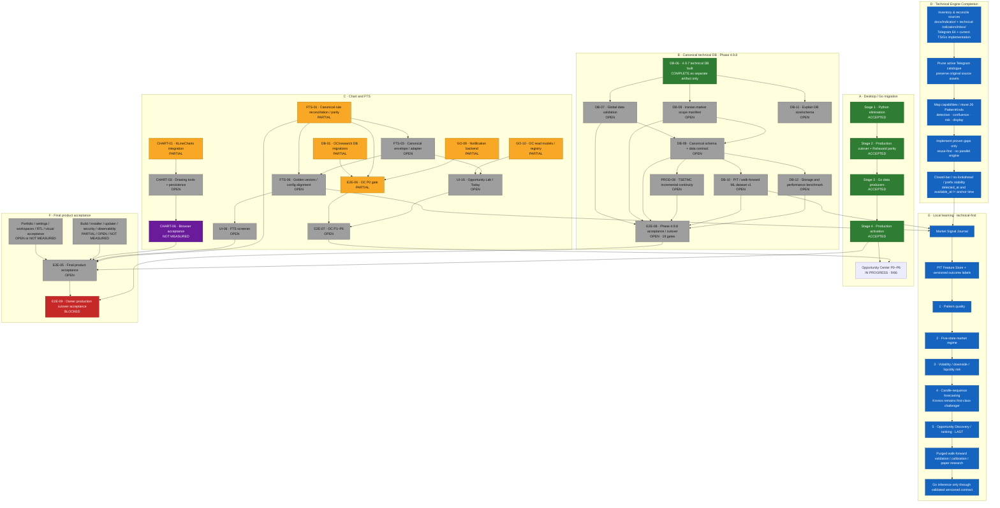

# BorsTerminal — Master Roadmap & Migration Dependency Graph

**Snapshot:** 2026-11-14  
**Active implementation branch:** `go-main @ ef6a8ba503bd`  
**Migration audit:** `docs/migration-progress-audit-2026-11-14 @ c3dcf34abab8`  
**Purpose:** one living map for desktop/runtime migration, Phase 4.9.8, Chart/FTS, technical-engine completion, and local ML.

> The migration audit is a separate documentation branch. Its status snapshot describes `go-main @ ef6a8ba5`; it is not merged into `go-main`. Re-check live code, reports, CI and commits before changing any status.

## 1. Integrated master graph

## 2. Migration critical paths

**Product acceptance critical path (from the 2026-11-14 audit):**

`CHART-01 → CHART-03 → CHART-06 → E2E-05 → E2E-09`

**Phase 4.9.8 database path:**

`DB-06 → (DB-07 + DB-08) → DB-09 → (PROD-08 + DB-10 + DB-12) → E2E-08 → E2E-09`

**FTS path:**

`FTS-01 → FTS-03 → FTS-06 → UI-06 → E2E-05`

These tracks are related but not identical blockers. Chart drawing UX is required for final product acceptance, but must not by itself block offline technical-engine calculations or ML research once canonical data and point-in-time detector outputs are valid.

## 3. Migration baseline

| Stage / workstream | Status at audited baseline |
|---|---:|
| Stage 1 · Python-elimination baseline | ACCEPTED · 3/3 |
| Stage 2 · Production cutover + Rahavard parity | ACCEPTED · 14/14 |
| Stage 3 · Go data producers | ACCEPTED · 13/13 |
| Stage 4 · Production activation + client verification | ACCEPTED · 6/6 |
| Opportunity Center P0–P6 | IN PROGRESS · 9/66 (13.6%) |
| Phase 4.9.8 / P498 | OPEN · 1/9 (11.1%) |

Independent audit metrics (do not combine into one headline percentage):

- Architecture decisions closed: **24/26 = 92.3%**.
- Implementation tasks complete: **34/111 = 30.6%**; risk-weighted **32.7%**.
- Acceptance gates passed: **24/56 = 42.9%**; among measured gates **24/27 = 88.9%**.
- Task statuses: 34 COMPLETE, 33 PARTIAL, 33 OPEN, 1 BLOCKED, 8 NOT_MEASURED, 2 DEFERRED; 3 OUT_OF_SCOPE.

## 4. Phase 4.9.8 — remaining work

| ID | Task | Status | Depends on |
|---|---|---|---|
| DB-06 | Phase 4.9.7 technical DB build + initial validation | COMPLETE* | — |
| DB-07 | Global alias, candle geometry, coverage, adjustment numeric validity, representative Rahavard parity | OPEN | DB-06 |
| DB-08 | Iranian-market scope manifest; include/exclude/quarantine; USD-rate disposition | OPEN | DB-06 |
| DB-09 | Canonical schema, shared metadata, price-basis/provenance/ingestion/revision contract, workload indexes | OPEN | DB-07 + DB-08 |
| PROD-08 | TSETMC incremental continuity, idempotent batches, conflicts, session finalization, corporate actions | OPEN | DB-09 + DB-07 |
| DB-10 | PIT, walk-forward, survivorship-safe ML dataset v1 | OPEN | DB-09 |
| DB-11 | Explain 11.9 GB footprint, SQLite pages/freelist, per-table/index sizes and mode semantics | OPEN | DB-06 |
| DB-12 | Query / RAM / storage / index-build / ingestion benchmark | OPEN | DB-09 |
| E2E-08 | 19 Phase 4.9.8 validation and cutover gates | OPEN | DB-07/08/09/10/12 + PROD-08 |

`* DB-06 is complete as a separate artifact/mission branch (technical.db: 11,897,110,528 bytes; 69,180,503 rows; initial validation passed). It is NOT yet integrated into go-main or proven consumed by Go Runtime. Do not call it operationally integrated.`

Preserve Rahavard historical adjusted OHLC values unchanged. Never overwrite them with recomputed values or silently mix raw TSETMC prices into the adjusted series. Raw/adjusted basis, provenance, action lineage, timestamps and calendar must remain explicit.

## 5. Technical Engine Completion — owner-approved next workstream

This workstream is separate from the migration WBS snapshot and must now be tracked explicitly.

1. Inventory and reconcile **`docs/Indicator/`** (the exact GitHub folder specified by the owner), `docs/technical-indicators/inbox/`, the 64-row Telegram catalogue, existing frontend indicators/overlays, and Go indicator/candleedge modules.
2. Prune only the **active** Telegram catalogue. Preserve original source files and provenance.
3. Classify every relevant source: reuse-existing, import/adapt, detection primitive, context/confluence feature, risk/target feature, visualization-only, defer or reject. Check source file type and license; do not run EX4/EX5 binaries or blindly copy unknown/restrictive-license code.
4. Reuse the existing deterministic engine and its 26 PatternKinds/registry. Implement only genuine gaps; no parallel indicator or pattern engine.
5. Make accepted indicators contribute real computed values to pattern detection/features, not merely chart menu entries. Keep visualization separate from calculation semantics.
6. Enforce closed-bar/no-lookahead/prefix stability and distinguish `detected_at` / `available_at` from geometric anchor time. A pivot's right-bars delay must be reflected in when the event becomes knowable.
7. Do not start PatternQuality training until deterministic event outputs and point-in-time timestamps are valid.

Existing Telegram triage names three candidate gaps (S/R retest-breakout, wedge/channel detection, order-block quality scoring). They are candidates only: check `docs/Indicator/` and current code before implementing anything.

## 6. ML and model sequence

`Canonical DB → deterministic technical engine + FTS correctness → Market Signal Journal → PIT Feature Store + versioned labels → PatternQuality → five-state regime → volatility/risk → candle-sequence forecasting → Opportunity Discovery/ranking`

- First model is **pattern quality/outcome scoring**, not image-based pattern recognition. The deterministic engine detects/describes patterns; ML estimates conditional outcomes.
- Begin with a calibrated, interpretable/logistic baseline; compare LightGBM/CatBoost only where out-of-sample evidence justifies them.
- Labels start after actual event availability/confirmation time, not retrospective anchor time. Unresolved/timeout remains distinct from failure.
- Use chronological purged walk-forward validation, embargo, survivorship controls, trading cost/queue assumptions, calibration and paper research.
- FTS remains deterministic and authoritative. ML never overrides a canonical FTS veto.
- Python is research/training only. Go runtime consumes model outputs only through an explicit validated, versioned inference contract.

## 7. Daily roadmap maintenance rules

- Before every update, fetch the live `go-main` HEAD and inspect task-relevant code, commits, CI and evidence. Also inspect the latest migration-audit branch if one exists; do not assume yesterday's status remains true.
- Keep the active implementation base on `go-main`; never use legacy `main` as the base.
- Update task status only with fresh evidence. A commit/report by itself is not proof of runtime integration or acceptance. Keep COMPLETE, PARTIAL, OPEN, BLOCKED, DEFERRED and NOT_MEASURED distinct.
- Preserve accepted Stage 1–4. Do not reopen them absent contradictory new evidence.
- Keep Phase 4.9.8, Technical Engine Completion, Chart/FTS, Opportunity Center and ML as linked but separately trackable streams.
- Identify today's completed work, remaining blockers, parallelizable tasks, critical path changes and next concrete tasks.
- Update this file only for roadmap status/graph changes; do not modify application code, data assets, DBs or other roadmap files as part of the daily sync.
- A daily sync may commit this documentation file directly to `go-main` only. Do not merge branches, force-push, publish releases/tags, change production behavior, overwrite archives/databases, or make owner decisions.
- If no verified status changes occurred, do not create a no-op commit; still deliver the daily status report and explicitly say no change was verified.

## 8. Source documents

- [Migration audit branch](https://github.com/johnwarchief/BorsTerminal-src/tree/docs/migration-progress-audit-2026-11-14/docs/migration-progress)
- [Migration dependency graph](https://github.com/johnwarchief/BorsTerminal-src/blob/docs/migration-progress-audit-2026-11-14/docs/migration-progress/MIGRATION-DEPENDENCIES.mmd)
- [Migration progress dashboard](https://github.com/johnwarchief/BorsTerminal-src/blob/docs/migration-progress-audit-2026-11-14/docs/migration-progress/MIGRATION-PROGRESS.md)
- [Master execution roadmap](https://github.com/johnwarchief/BorsTerminal-src/blob/go-main/docs/MASTER-EXECUTION-ROADMAP.md)
- [ML engine roadmap](https://github.com/johnwarchief/BorsTerminal-src/blob/go-main/docs/ML-ENGINE-ROADMAP.md)
- [Local algorithmic learning architecture](https://github.com/johnwarchief/BorsTerminal-src/blob/go-main/docs/research/LOCAL-ALGORITHMIC-LEARNING-ARCHITECTURE.md)
- [Telegram indicator triage](https://github.com/johnwarchief/BorsTerminal-src/blob/go-main/docs/technical-indicators/TELEGRAM-CATALOG-TRIAGE-2026-11-03.md)
- [Indicator source folder](https://github.com/johnwarchief/BorsTerminal-src/tree/go-main/docs/Indicator)
