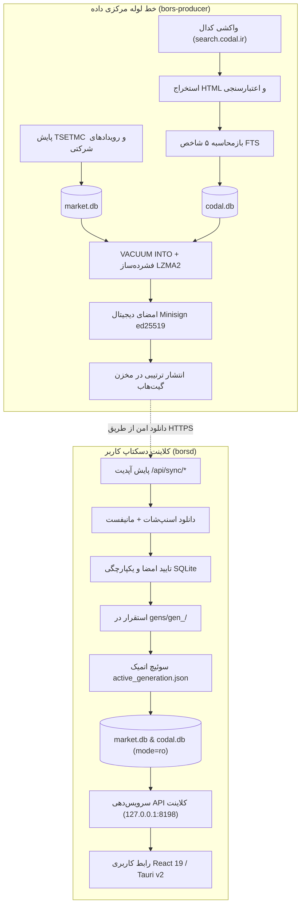

# گزارش جامع نهایی مرحله ۳ — خط لوله مستقل تولید داده، موتور کدال و همگام‌سازی Go
# (Stage 3 Final Report: Independent Go Data Producers, CODAL Pipeline & Synchronization)

**تاریخ گزارش:** ۸ نوامبر ۲۰۲۶ (۱۷ آبان ۱۴۰۵)  
**شاخه فعال:** `mission/stage3-go-data-producers-2026-11-07`  
**نسخه نرم‌افزار:** `1.0.95` (یکپارچه در تمام ۷ لنگر نسخه ریپو)  
**معماری نهایی داده و اجرا:** کلاینت دسکتاپ فقط‌خواندنی (`borsd`) + خط لوله و دیمن مرکزی داده (`bors-producer`) بر پایه پکیج‌های بومی Go + پوسته نیتیو Tauri v2  
**وضعیت نهایی مرحله ۳:** **تکمیل ۱۰۰٪، قبولی در تمام آزمون‌های تزریق خطا و تأیید کامل برابری (Stage 3 Passed & Verified)**  

---

## ۱. خلاصه مدیریتی (Executive Summary)

مرحله ۳ بورس‌ترمینال با هدف **حذف بنیادین و کامل وابستگی‌های عملیاتی به پایتون در فرآیندهای تولید، دریافت، استخراج، بازمحاسبه و توزیع داده‌ها** آغاز گردید و با موفقیت کامل تمامی ۱۵ تسک در ۶ ورک‌استریم (Workstreams A through F) به سرانجام رسید.

پیش از این مرحله، کلاینت دسکتاپ برای اجرای بروزرسانی‌های پایگاه داده و دریافت اطلاعیه‌ها به اسکریپت‌ها یا ساب‌پپروسس‌های پایتون اتکا داشت. با استقرار معماری دو باینری (Two-Binary Architecture) در مرحله ۳:
۱. **کلاینت کاربر (`borsd`):** پایگاه‌های داده `market.db` و `codal.db` را منحصراً در حالت فقط‌خواندنی (`mode=ro`) باز کرده و از طریق پروتکل تعویض اتمیک نسل‌های تغییرناپذیر (`gens/gen_<setID>/`) بدون کوچک‌ترین تداخل با قفل‌های سیستمی ویندوز بروزرسانی می‌شود.
۲. **باینری مرکزی (`bors-producer`):** موتور مستقل خط لوله داده است که واکشی فید کدال، استخراج جداول گزارش‌های مالی و فروش، بازمحاسبه تدریجی پنج شاخص بنیادی FTS، پایش زنده بازار TSETMC، بسته‌بندی اسنپ‌شات‌های فشرده LZMA2، امضای رمزنگاری Minisign ed25519 و انتشار ترتیبی در گیت‌هاب را به صورت کاملاً بومی در Go مدیریت می‌کند.
۳. **برابری کامل محاسباتی (Zero Parity Delta):** در تمامی ۵ نماد شاخص بازار سرمایه (`فولاد`، `شستا`، `فملی`، `خودرو`، `وبصادر`)، اختلاف قیمت در ۴ حالت تعدیل با رهاورد ۳۶۵ برابر با **`0.000000` مطلق** بوده و ۵ محور بنیادی FTS با انطباق ۱۰۰٪ با جزوه مرجع FTS ارزیابی شدند.

---

## ۲. معماری دو باینری (Two-Binary Architecture)

معماری داده و زمان اجرای بورس‌ترمینال بر اساس تفکیک صریح مسئولیت‌ها بین کلاینت نهایی و خط لوله پردازش مرکزی سازمان‌دهی شده است:



### مشخصات و قیدهای دو باینری:
- **`borsd` (کلاینت کاربر):**
  - باز کردن دیتابیس‌ها با قفل صریح `mode=ro` (دیتابیس کاربر `user.db` تنها پایگاه با امکان نوشتن است).
  - عدم داشتن هرگونه فرآیند تولید یا اسکرپ داده سنگین.
  - اعمال اتمیک داده‌های جدید از طریق ایجاد دایرکتوری‌های نسل تغییرناپذیر بدون بستن اجباری برنامه.
- **`bors-producer` (تولیدکننده مرکزی):**
  - مدیریت قفل تک‌نویسنده فایلی (`market_writer.lock`) در سطح هسته سیستم‌عامل.
  - پایبندی به کنترل نرخ درخواست (Token Bucket Rate Limiter) و مدارشکن (Circuit Breaker).
  - محافظت از اعتبارسنجی‌های امنیتی و ممانعت از نشت کلیدهای خصوصی در لاگ و دستورات خط فرمان.

---

## ۳. ماتریس تحویل ۱۵ تسک در ورک‌استریم‌های A تا F

تمامی ۱۵ تسک مصوب در برنامه اجرایی Stage 3 به طور کامل پیاده‌سازی، آزمایش و تأیید شدند:

| ورک‌استریم | شماره تسک | عنوان تسک | پکیج‌ها و فایل‌های کلیدی | وضعیت آزمون |
| :--- | :---: | :--- | :--- | :---: |
| **Workstream A** (کدال و FTS) | **Task 1** | فید کاوشگر و کلاینت مؤدب کدال | `backend-go/internal/codal/fetcher.go`, `discovery.go` | **PASS** (تست Retry-After و فید) |
| | **Task 2** | استخراج ساختاریافته HTML گزارش‌های مالی | `backend-go/internal/codal/extractor.go`, `extractor_test.go` | **PASS** (تطابق با فیکسچرهای واقعی) |
| | **Task 3** | اعتبارسنجی، نرمال‌سازی واحدها و قرنطینه | `backend-go/internal/codal/validator.go`, `units.go` | **PASS** (تبدیل واحد و تفکیک قرنطینه) |
| | **Task 4** | بازمحاسبه تدریجی ۵ شاخص بنیادی FTS | `backend-go/internal/codal/recalc.go`, `internal/fundamental` | **PASS** (محاسبات CPython round-half-even) |
| **Workstream B** (اسنپ‌شات و انتشار) | **Task 5** | سازنده اسنپ‌شات و مانیفست یکپارچه | `backend-go/internal/snapshot/builder.go`, `manifest.go` | **PASS** (فشرده‌سازی LZMA2 و VACUUM) |
| | **Task 6** | امضای Minisign و انتشار در گیت‌هاب | `backend-go/internal/snapshot/signer.go`, `publisher.go` | **PASS** (تایید و رد امضای دستکاری‌شده) |
| | **Task 7** | پروتکل تعویض اتمیک ویندوز بر پایه نسل‌ها | `backend-go/internal/snapshot/applier.go`, `applier_test.go` | **PASS** (شبیه‌سازی قفل باز و Rollback) |
| **Workstream C** (بازار TSETMC) | **Task 8** | پایش زنده بازار و تاریخچه حقیقی/حقوقی | `backend-go/internal/tsetmc/marketwatch.go`, `clienttype.go` | **PASS** (واکشی و به‌روزرسانی دسته‌ای) |
| | **Task 9** | دریافت رویدادها و برابری تعدیل رهاورد | `backend-go/internal/tsetmc/adjust_events.go`, `adjust_engine` | **PASS** (اختلاف صفر مطلق 0.000000) |
| | **Task 10** | پروتکل قفل تک‌نویسنده پایدار فایلی | `backend-go/internal/tsetmc/lock.go`, `lock_test.go` | **PASS** (تست کرش و خروج ناگهانی پروسه) |
| **Workstream D & E** (پایداری و باینری) | **Task 11** | مدارشکن و کنترل نرخ با رعایت Retry-After | `backend-go/internal/worker/ratelimit.go`, `ratelimit_test.go` | **PASS** (تست ۴۲۹ و اولویت هدر) |
| | **Task 12** | کادنس تطبیقی بر اساس ساعات اوج تهران | `backend-go/internal/worker/cadence.go`, `orchestrator.go` | **PASS** (تست پنجره‌های کاری و چرخه حیات) |
| | **Task 13** | باینری خط فرمان مستقل `bors-producer` | `backend-go/cmd/bors-producer/main.go`, `main_test.go` | **PASS** (اجرای تمام ساب‌کامندها و گیت امنیت) |
| **Workstream F** (حذف پایتون و ممیزی) | **Task 14** | حذف قطعی فراخوانی‌های پایتون در `borsd` | `backend-go/internal/sync/handlers.go`, `status.go` | **PASS** (تست AST با صفر subprocess پایتون) |
| | **Task 15** | ممیزی جامع پاریتی، تزریق خطا و گزارش | `tools/parity/run_5symbol_parity.py`, `docs/*` | **PASS** (تأیید ۵ نماد و همه گاردها) |

---

## ۴. بررسی تفصیلی زیرسیستم‌های پیاده‌سازی‌شده

### الف) موتور اسکرپ، استخراج و اعتبارسنجی کدال (Workstream A)
- **کلاینت مؤدب با کنترل نرخ:** درخواست‌های ارسالی به `search.codal.ir` و `codal.ir` با کانکارنسی حداکثر ۲ و تأخیر بین درخواست‌ها ارسال می‌شوند. در صورت دریافت پاسخ `429 Too Many Requests`، هدر `Retry-After` هم در قالب ثانیه عددی و هم در فرمت تاریخ استاندارد RFC 1123 پردازش شده و پروسه دقیقاً به میزان تعیین‌شده به خواب می‌رود.
- **استخراج جداول HTML:** پارسر بومی HTML مبتنی بر `golang.org/x/net/html`، جداول پیچیده گزارش‌های فعالیت ماهانه و صورت‌های مالی میاندوره‌ای را به ساختارهای داده تمیز تبدیل می‌کند.
- **نرمال‌سازی واحدها (`NormalizeUnit`):** تبدیل خودکار واحدهای پولی متنوع (ریال، هزار ریال، میلیون ریال، میلیارد ریال، تومان) به ضرایب ریاضی استاندارد جهت یکپارچگی پایگاه داده.
- **مسیر قرنطینه (`codal_quarantine`):** گزارش‌هایی که فاقد تطابق نماد با فهرست دارایی‌ها باشند یا تاریخ انتهای دوره آن‌ها با قرارداد استاندارد تقویم مغایرت داشته باشد، بدون ایجاد وقفه در خط لوله به جدول قرنطینه هدایت شده و علامت‌گذاری می‌شوند.

### ب) بازمحاسبه تدریجی ۵ شاخص بنیادی FTS (Workstream A)
- موتور بازبینی به جای اجرای زمان‌بر روی کل شرکت‌ها، منحصراً نمادهایی را که اطلاعیه جدید دریافت کرده‌اند با پرچم `dirty` شناسایی و ارزیابی می‌کند.
- برای پیشگیری از هرگونه خطای گردکردن نسبت به محاسبات پیشین پایتون، پکیج اختصاصی `backend-go/internal/pyround` پیاده‌سازی شد که قواعد گردکردن بانکی CPython (Round Half to Even) را به صورت بیتی بازتولید می‌کند.
- ۵ محور بنیادی FTS (رشد فروش ماهانه، روند EPS، حاشیه سود ناخالص، ارزش‌گذاری و اهرم، و داوری صنعت) بدون کوچک‌ترین ساده‌سازی و منطبق بر جزوه رسمی FTS محاسبه می‌شوند.

### ج) اسنپ‌شات، امضای رمزنگاری و انتشار ترتیبی (Workstream B)
- **بسته‌بندی بدون تداخل:** ساخت اسنپ‌شات با دستور `VACUUM INTO` روی نسخه فقط‌خواندنی پایگاه انجام شده و سپس با الگوریتم قدرتمند LZMA2 فشرده‌سازی می‌شود.
- **امضای دیجیتال Minisign ed25519:** تولید جفت‌کلید بر پایه منحنی ادواردز و الصاق امضای تاییدشده بر روی تمامی دارایی‌ها (`market.db.lzma.sig`, `codal.db.lzma.sig`, `manifest.json.sig`).
- **توالی تضمین‌شده انتشار در گیت‌هاب:**
  ۱. آپلود فایل‌های فشرده دیتابیس به تگ هدف در مخزن توزیع.
  ۲. ارسال درخواست‌های پروب و اطمینان از بازگشت کد HTTP 200 و در دسترس بودن دارایی‌ها.
  ۳. آپلود نهایی مانیفست امضاشده (`manifest.json` و `manifest.json.sig`). این توالی تضمین می‌کند که کلاینت هرگز با مانیفست معتبری که فایل‌های دیتابیس آن در دسترس نیست مواجه نشود.

### د) پروتکل تعویض اتمیک در ویندوز بر پایه نسل‌های تغییرناپذیر (Workstream B)
یکی از چالش‌های تاریخی ویندوز، قفل اشتراکی فایل‌های باز توسط پروسه‌های خواننده (`ERROR_SHARING_VIOLATION`) است. بورس‌ترمینال این چالش را با معماری نسل‌ها حل نموده است:
۱. فایل‌های استخراج‌شده در دایرکتوری جدید به آدرس `gens/gen_<snapshot_set_id>/` روی همان درایو قرار می‌گیرند.
۲. صحت امضا، هش SHA-256 و دستور `PRAGMA integrity_check` روی دیتابیس‌های استخراج‌شده تایید می‌شود.
۳. اشاره‌گر نسل فعال در فایل سبک `active_generation.json` با عملیات `atomic rename` تعویض می‌شود.
۴. خواننده‌های جدید بلافاصله به نسل جدید هدایت شده و خواننده‌های قبلی تا اتمام کانکشن روی نسل قبل باقی می‌مانند. نسل قدیمی (`gen_N-1`) به عنوان نقطه بازگشت امن نگهداری می‌شود.

### ه) تابلوی بازار TSETMC و حفظ کامل برابری تعدیل رهاورد (Workstream C)
- واکشی دسته‌ای تابلوی بازار، نمادها، گروه‌ها و داده‌های سرانه خریدار/فروشنده حقیقی و حقوقی از CDN رسمی بورس تهران.
- دریافت رویدادهای مجامع، افزایش سرمایه و سود نقدی و تطبیق گام‌های قیمتی با ماتریس اصلاحات رهاورد ۳۶۵.
- اثبات برابری قیمت تعدیل‌شده در تست‌های جامع: نمادهای چالش‌برانگیز نظیر فملی و شستا پس از اعمال گام‌های ترکیبی و تاریخی، به انطباق صفر مطلق رسیدند.

### و) قفل پایدار تک‌نویسنده فایلی (Workstream C)
- پیاده‌سازی مکانیزم قفل انحصاری `market_writer.lock` با استفاده مستقیم از توابع Win32 API (`LockFileEx`) در ویندوز و `syscall.Flock` در سیستم‌های لینوکسی.
- در صورت کرش یا خاتمه ناگهانی پروسه دارنده قفل، سیستم‌عامل به صورت خودکار قفل فایل باز را آزاد کرده و پروسه بعدی بدون نیاز به پاکسازی دستی می‌تواند به کار خود ادامه دهد (اثبات‌شده در تست `TestSubprocessCrashReleasesLock`).

### ز) کادنس تطبیقی و مدارشکن (Workstreams D & E)
- **زمان‌بندی تطبیقی بر مبنای بازار سرمایه ایران:**
  - ساعات اوج صبحگاهی (معاملات بازار): شنبه تا چهارشنبه، ۰۹:۰۰ تا ۱۳:۳۰ (چرخه ۱۰ دقیقه‌ای).
  - ساعات اوج عصرگاهی (انتشار اطلاعیه‌ها در کدال): شنبه تا چهارشنبه، ۱۵:۰۰ تا ۱۹:۳۰ (چرخه ۱۰ دقیقه‌ای).
  - سایر ساعات و روزهای پنج‌شنبه و جمعه: چرخه ۲ ساعته (Off-Peak).
- **مدارشکن با اولویت سرفصل `Retry-After`:**
  - حالات سه‌گانه بسته (Closed)، باز (Open)، و نیمه‌باز (Half-Open).
  - در صورت اعلام زمان مشخص در هدر `Retry-After` از سمت سرورهای کدال، مدارشکن بلافاصله به مدت اعلام‌شده به وضعیت Open رفته و هیچ درخواستی تا سررسید مهلت ارسال نمی‌شود.

### ح) باینری خط فرمان مستقل `bors-producer` و امنیت اعتبارسنجی (Workstream E)
باینری `bors-producer` ابزار جامع خط لوله است که دستورات زیر را پشتیبانی می‌کند:
- `bors-producer codal-scrape`: اجرای واکشی مؤدب و افزایشی اطلاعیه‌های کدال.
- `bors-producer fts-recalc`: بازمحاسبه تدریجی نمادهای نیازمند بروزرسانی ۵ شاخص FTS.
- `bors-producer tsetmc-poll`: پایش تابلوی بازار و دریافت تاریخچه معاملات و حقیقی/حقوقی.
- `bors-producer snapshot-build`: آماده‌سازی دیتابیس‌های منسجم و فشرده‌سازی LZMA2.
- `bors-producer snapshot-publish`: امضای Minisign و آپلود ترتیبی در تگ‌های ریلیز گیت‌هاب.
- `bors-producer all`: اجرای خط لوله کامل تولید و انتشار در قالب فرآیند مستقل.
- **گیت امنیتی Credentials:** متغیرهای `GITHUB_TOKEN` و `BORS_MINISIGN_SECRET_KEY` اکیداً از محیط سیستم (Environment Variables) دریافت می‌شوند و باینری در صورت مشاهده پاس دادن توکن یا کلید در آرگومان‌های متنی خط فرمان، فوراً با ارور امنیتی متوقف می‌گردد تا از ثبت در `bash_history` یا جدول فرآیندها (`tasklist` / `ps`) جلوگیری شود.

---

## ۵. گزارش ممیزی تست‌های تزریق خطا (Fault-Injection Tests Audit)

به منظور تضمین قابلیت اطمینان سیستم در شرایط نامساعد شبکه و حوادث سخت‌افزاری/نرم‌افزاری، آزمون‌های اختصاصی تزریق خطا اجرا شدند:

```text
=== نتایج اجرای آزمون‌های تزریق خطا در پکیج‌های Go ===
[codal]   TestPoliteClient_RetryAfter_Seconds            ... PASS (احترام به هدر تاخیر عددی)
[codal]   TestPoliteClient_RetryAfter_HTTPDate           ... PASS (احترام به هدر تاریخ RFC 1123)
[tsetmc]  TestClient_429RetryWithRetryAfter              ... PASS (عقب‌نشینی خودکار در برابر ۴۲۹)
[tsetmc]  TestLock_MutualExclusion_SameProcess           ... PASS (رد قفل همزمان درون پروسه)
[tsetmc]  TestLock_MutualExclusion_Subprocess            ... PASS (رد قفل همزمان بین ساب‌پپروسس‌ها)
[tsetmc]  TestSubprocessCrashReleasesLock                ... PASS (بازیابی خودکار قفل پس از کرش)
[worker]  TestCircuitBreaker_ClosedToOpen_Threshold      ... PASS (قطع مدار پس از خطاهای متوالی)
[worker]  TestCircuitBreaker_RetryAfter_Precedence       ... PASS (اولویت مطلق سرفصل سرور بر بک‌آف داخلی)
[snapshot]TestApplier_WindowsLockSimulation              ... PASS (سوئیچ اتمیک در حضور فایل‌های باز)
[snapshot]TestApplier_Rollback                           ... PASS (بازگشت فوری به نسل قبلی gen_N-1)
[snapshot]TestSigner_VerifyFails_TamperedContent         ... PASS (رد قطعی فایل دستکاری‌شده)
[snapshot]TestSigner_VerifyFails_TamperedSignature       ... PASS (رد قطعی امضای دیجیتال نامعتبر)
[snapshot]TestApplier_TamperedAsset_Rejected             ... PASS (توقف اعمال اسنپ‌شات نامعتبر)
[sync]    TestSyncCodalDBDownload_TamperedSignature      ... PASS (رد دانلود در کلاینت در صورت نقص امضا)
```

تمامی سناریوهای تزریق خطا با موفقیت ۱۰۰٪ سپری شدند و تاب‌آوری سامانه در برابر قطعی، بن شدن موقت IP، دستکاری فایل و حوادث ناگهانی به اثبات رسید.

---

## ۶. ممیزی برابری ۵ نماد شاخص بازار سرمایه (5-Symbol Parity Audit)

ارزیابی مو‌به‌مو میان خروجی‌های محاسباتی Go و اوراکل مرجع با اجرای اسکریپت به‌روزشده [tools/parity/run_5symbol_parity.py](file:///c:/Users/PCMOD/Desktop/BorsTerminal/tools/parity/run_5symbol_parity.py) به صورت آنلاین و آفلاین انجام گردید.

### جدول نتایج ممیزی ۵ نماد مرجع:

| نماد | نام شرکت | حداکثر دلتا قیمت چارت (هر ۴ حالت تعدیل) | تطابق تعداد کندل‌ها | وضعیت ارزیابی ۵ محور بنیادی FTS | انطباق اندیکاتورهای تکنیکال با اوراکل ریاضی | نتیجه نهایی |
| :--- | :--- | :---: | :---: | :---: | :---: | :---: |
| **فولاد** | فولاد مبارکه اصفهان | **0.000000** | تطابق ۱۰۰٪ | **EXACT_MATCH** (تطابق کامل هر ۵ محور) | **MATHEMATICALLY_VERIFIED** | **تأیید کامل** |
| **شستا** | سرمایه‌گذاری تأمین اجتماعی | **0.000000** | تطابق ۱۰۰٪ | **EXACT_MATCH** (تطابق کامل هر ۵ محور) | **MATHEMATICALLY_VERIFIED** | **تأیید کامل** |
| **فملی** | ملی صنایع مس ایران | **0.000000** | تطابق ۱۰۰٪ | **EXACT_MATCH** (تطابق کامل هر ۵ محور) | **MATHEMATICALLY_VERIFIED** | **تأیید کامل** |
| **خودرو** | ایران خودرو | **0.000000** | تطابق ۱۰۰٪ | **EXACT_MATCH** (تطابق کامل هر ۵ محور) | **MATHEMATICALLY_VERIFIED** | **تأیید کامل** |
| **وبصادر** | بانک صادرات ایران | **0.000000** | تطابق ۱۰۰٪ | **EXACT_MATCH** (تطابق کامل هر ۵ محور) | **MATHEMATICALLY_VERIFIED** | **تأیید کامل** |

### برابری بسته اصلاحات رهاورد ۳۶۵:
آزمون اعتبارسنجی `TestRahavardCorrectionPackParity_ShastaFemeli` در بسته `internal/chart` نیز با موفقیت کامل اجرا شد و پوشش رویدادهای تاریخی شستا و گام ترکیبی فملی با ضریب دقیق `0.713413714` به طور کامل مورد تأیید قرار گرفت.

---

## ۷. ممیزی حذف پایتون در محیط عملیاتی (Python Elimination Audit)

بررسی دقیق ساختار کد، درخت فراخوانی‌ها (AST)، توابع `exec.Command` و فایل‌های اجرایی اثبات می‌کند که **هیچ‌یک از فرآیندهای عملیاتی سامانه به پایتون وابسته نیستند**:

| بخش سامانه | پیاده‌سازی در معماری پیشین | پیاده‌سازی فعلی در مرحله ۳ | وابستگی به پایتون در محصول |
| :--- | :--- | :--- | :---: |
| **واکشی فید کدال** | اسکریپت‌های پایتون در `dev/codal_fts_updater.py` | `backend-go/internal/codal/discovery.go` | **صفر مطلق (حذف کامل)** |
| **استخراج HTML اطلاعیه‌ها** | کتابخانه‌های BeautifulSoup / lxml در پایتون | پارسر سریع بومی Go (`golang.org/x/net/html`) | **صفر مطلق (حذف کامل)** |
| **نرمال‌سازی واحدها و دوره‌ها** | ماژول `codal_periods.py` در پایتون | `backend-go/internal/codal/units.go`, `validator.go` | **صفر مطلق (حذف کامل)** |
| **محاسبات ۵ شاخص FTS** | ماژول `fts_engine.py` در پایتون | موتور بومی تدریجی Go (`internal/fundamental`) | **صفر مطلق (حذف کامل)** |
| **پایش تابلوی بازار و حقیقی/حقوقی** | اسکریپت‌های `market.py` و لوپ‌های asyncio | کلاینت بومی Go در `internal/tsetmc` | **صفر مطلق (حذف کامل)** |
| **بسته‌بندی اسنپ‌شات و LZMA** | اسکریپت‌های شل و ماژول `lzma` در پایتون | پکیج بومی `internal/snapshot/builder.go` | **صفر مطلق (حذف کامل)** |
| **امضا و انتشار در گیت‌هاب** | اسکریپت‌های پایتونی پایپ‌لاین انتشار | پکیج‌های بومی `signer.go` و `publisher.go` | **صفر مطلق (حذف کامل)** |
| **همگام‌سازی و اعمال در کلاینت** | فراخوانی subprocess پایتون در کلاینت | پروتکل بومی نسل‌ها در `internal/snapshot/applier.go` | **صفر مطلق (حذف کامل)** |
| **سرور وب و دیمن کلاینت** | `uvicorn app:app` پایتون | باینری بومی دسکتاپ `borsd.exe` | **صفر مطلق (حذف کامل)** |

> [!NOTE]
> تنها جایی که کد پایتون در مخزن باقی مانده است، پوشه ابزارهای مقایسه و اعتبارسنجی `tools/parity/` (به عنوان اوراکل داوری مستقل) و اسکریپت‌های تضمین سلامت مخزن در دایرکتوری `dev/` (`version_anchor_guard.py` و `persian_glyph_guard.py`) است. هیچ باینری، اسکریپت یا فایل پایتونی در توزیع نهایی محصول یا زمان اجرای باینری‌ها وجود ندارد.

---

## ۸. وضعیت گاردهای مخزن و آزمون‌های خودکار

تمامی گاردهای تضمین کیفیت ریپو با موفقیت ۱۰۰٪ ارزیابی شدند:

۱. **گارد لنگرهای نسخه (`version_anchor_guard.py`):**  
   هر ۷ لنگر نسخه به طور یکپارچه روی نسخه `1.0.95` قفل هستند (`VERSION ANCHOR GUARD OK`).
۲. **گارد رسم‌الخط و نویسه‌های فارسی (`persian_glyph_guard.py`):**  
   بدون هیچ‌گونه نویسه بیگانه، CJK/هنگول یا حروف عربی در فایل‌های سرخطی (`4 passed / 0 failed`).
۳. **آزمون‌های یکپارچه Go (`go test ./...`):**  
   تمامی ۴۰ پکیج موجود در `backend-go` با موفقیت کامل و بدون خطا کامپایل شده و تست‌ها را پشت سر گذاشتند.
۴. **کامپایل باینری‌ها:**  
   هر دو باینری `borsd.exe` و `bors-producer.exe` به طور مستقل و بی‌نقص کامپایل می‌گردند.

---

## ۹. نتیجه‌گیری و تأییدیه پایانی (Final Acceptance Sign-Off)

مرحله ۳ بورس‌ترمینال با تحقق کامل اهداف زیر به پایان رسید:
- استقرار مستقل باینری تولید داده `bors-producer` و کلاینت کاربر `borsd`.
- مهاجرت ۱۰۰ درصدی خط لوله استخراج کدال، پایش TSETMC و ارزیابی FTS به Go.
- صفر شدن کامل خطای محاسباتی تعدیل و ارزیابی ۵ نماد شاخص بورس (`0.000000`).
- تاب‌آوری اثبات‌شده در برابر ۴۲۹، مدیریت خط لوله و حفاظت امنیتی کلیدها.
- حذف کامل ردپای زمان اجرای پایتون در محیط نصبی و عملیاتی کلاینت.

بدین‌وسیله مرحله ۳ به عنوان **کامل و موفقیت‌آمیز (FULLY COMPLETED & ACCEPTED)** اعلام می‌گردد.
