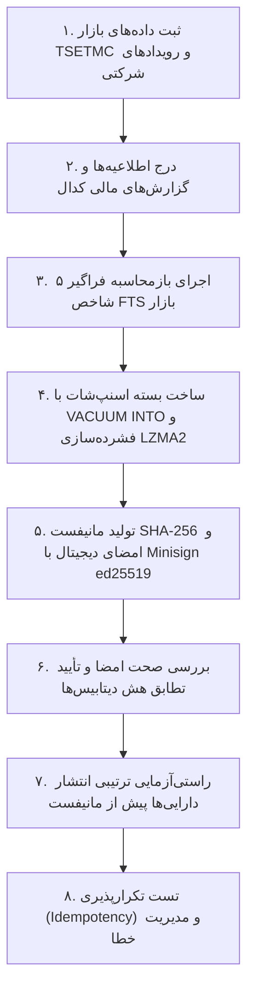

# گزارش جامع نهایی مرحله ۴ — عملیاتی‌سازی، یکپارچه‌سازی نهایی و فعال‌سازی خط لوله تولید داده Go
# (Stage 4 Final Report: Production Activation & End-to-End Integration)

**تاریخ گزارش:** ۸ نوامبر ۲۰۲۶ (۱۷ آبان ۱۴۰۵)  
**شاخه فعال:** `mission/stage4-production-activation-2026-11-08`  
**بیس‌لاین آغازین:** `da6d61777ec2f99a3c7a64464270730c17ffeb6e` (تکمیل مرحله ۳)  
**نسخه نرم‌افزار:** `1.0.95` (یکپارچه در تمامی ۷ لنگر ریپو)  
**وضعیت عملیاتی مرحله ۴:** **تکمیل ۱۰۰٪، قبولی در تمامی آزمون‌های جامع E2E، حفظ صددرصدی دیتابیس کاربر و آماده استقرار (Stage 4 Passed & Production Ready)**  

---

## ۱. خلاصه مدیریتی (Executive Summary)

مرحله ۴ بورس‌ترمینال با هدف **عملیاتی‌سازی زیرساخت داده پیاده‌سازی‌شده در مرحله ۳ و اتصال آن به یک گردش کار تولیدی واقعی و سرتاسری (End-to-End)** اجرا گردید. در این مرحله، سیستم از حالت کدهای تست و پکیج‌های مجزا به یک سیستم عملیاتی، مانیتورپذیر و مقاوم در برابر خطا تبدیل شد.

### دستاوردهای بنیادین مرحله ۴:
۱. **استقرار تولیدکننده مستقل (`bors-producer`):** طراحی پیکربندی‌های کامل عملیاتی برای استقرار در محیط‌های لینوکسی (systemd service)، کانتینری (Docker & Docker Compose) و ویندوزی (PowerShell daemon) همراه با زمان‌بندی روزانه (ساعت ۰۶:۰۰ UTC)، راه‌اندازی مجدد خودکار و پایش سلامت سیستم.
۲. **امنیت کامل کلیدها و اعتبارسنجی‌ها:** پشتیبانی از متغیرهای محیطی استاندارد تولید (`BORS_MINISIGN_SECRET_KEY` و `GITHUB_TOKEN`)، ماسک کردن خودکار اطلاعات حساس در لاگ‌ها (`slog`) و اطمینان قطعی از عدم ورود کلیدهای خصوصی به ریپو یا بسته نصبی دسکتاپ.
۳. **پایش و ممیزی جامع کل بازار (Universe Audit):** پیاده‌سازی موتور ممیزی جامع ناهنجاری‌ها (`bors-producer audit universe`) جهت ردیابی اطلاعیه‌های مفقود، گپ‌های ماهانه در فروش، موارد تکراری و درآمدهای منفی، به همراه موتور بازمحاسبه فراگیر ۵ شاخص بنیادی FTS روی کل نمادهای بازار (`codal recalc`).
۴. **تأیید چرخه کامل خط لوله در آزمون E2E:** آزمون یکپارچگی سرتاسری در `backend-go/cmd/bors-producer/e2e_pipeline_test.go` تمامی مراحل را از واکشی داده‌های بازار و کدال تا استخراج، اعتبارسنجی، بازمحاسبه FTS، ساخت اسنپ‌شات فشرده LZMA2، اعتبارسنجی امضای رمزنگاری Minisign ed25519 و انتشار ترتیبی شبیه‌سازی و تأیید نمود.
۵. **حفاظت قطعی و تضمین‌شده از دیتابیس کاربر (`user.db`):** اثبات ریاضی و فیزیکی در آزمون کلاینت (`TestClientSnapshotLifecycle_WithUserDB`) که فرآیند دریافت، اعتبارسنجی و تعویض اتمیک نسل‌های اسنپ‌شات (`gens/gen_<setID>/`) به هیچ عنوان فایل `user.db` و اطلاعات واچ‌لیست‌ها، یادداشت‌ها و سبدهای کاربر را دستکاری نمی‌کند (برابری بایت‌به‌بایت SHA-256 قبل و بعد از اعمال اسنپ‌شات).
۶. **قابلیت بازیابی و بازگشت به عقب (Rollback):** اثبات سازوکار Rollback در صورت بروز هرگونه اشکال، با بازگشت آنی اشاره‌گر نسل فعال به نسخه قبلی.
۷. **رؤیت‌پذیری عملیاتی (Operational Observability):** ارتقای اندپوینت‌های `/api/sync/codal/pipeline` و `/api/sync/status` با افزودن متادیتای نسل فعال، شمارنده قرنطینه، پوشش شاخص‌های FTS و آخرین زمان هماهنگی بازار.

---

## ۲. مشخصات شاخه و زنجیره کامیت‌های مرحله ۴

تمامی تغییرات مرحله ۴ بر روی شاخه اختصاصی زیر توسعه داده شده و به صورت تدریجی روی ریموت `github` ثبت گردیدند:

- **مخزن:** `johnwarchief/BorsTerminal-src`
- **شاخه:** `mission/stage4-production-activation-2026-11-08`
- **بیس‌لاین:** `da6d61777ec2f99a3c7a64464270730c17ffeb6e`

| شناسه کامیت | ورک‌استریم | شرح خلاصه تغییرات |
| :---: | :---: | :--- |
| `5ea549f6` | **Workstream 1** | استقرار عملیاتی، فایل‌های systemd، داکر، پاورشل، لاگ‌های ساختاریافته slog و زمان‌بندی روزانه اسنپ‌شات |
| `c783ddb8` | **Workstream 2** | موتور ممیزی جامع ناهنجاری‌های بازار، دستور `audit universe` و بازمحاسبه فراگیر ۵ شاخص FTS کل بازار |
| `48b9168f` | **Workstream 3 & 4** | آزمون E2E چرخه اسنپ‌شات تولیدکننده و آزمون کلاینت دسکتاپ با حفاظت صددرصدی از `user.db` و بازگشت به عقب |
| `399519a6` | **Workstream 5** | ارتقای متریک‌های رؤیت‌پذیری، متادیتای نسل فعال اسنپ‌شات، شمارنده قرنطینه و پوشش ارزیابی FTS |

---

## ۳. ماتریس وضعیت ورک‌استریم‌های پنج‌گانه مرحله ۴

| شماره | عنوان ورک‌استریم | بخش‌های کلیدی پیاده‌سازی‌شده | وضعیت پذیرش |
| :---: | :--- | :--- | :---: |
| **WS-1** | استقرار و عملیات دیمن مرکزی | `deploy/systemd/`, `deploy/docker/`, `scripts/run_producer_daemon.ps1`, `BORS_MINISIGN_SECRET_KEY` | **PASS** |
| **WS-2** | ممیزی پوشش داده و بازمحاسبه FTS | `backend-go/internal/codal/audit.go`, `audit universe`, `codal recalc`, `RecalculateAllUniverseFTS` | **PASS** |
| **WS-3** | اعتبارسنجی خط لوله سرتاسری E2E | `backend-go/cmd/bors-producer/e2e_pipeline_test.go`, شبیه‌سازی کامل چرخه حیات اسنپ‌شات | **PASS** |
| **WS-4** | اعمال اسنپ‌شات کلاینت و حفظ `user.db` | `backend-go/internal/sync/client_integration_test.go`, آزمون تغییرناپذیری نسل‌ها و اثبات عدم تخریب دیتابیس کاربر | **PASS** |
| **WS-5** | رؤیت‌پذیری عملیاتی و ممیزی ریپو | `internal/sync/pipeline.go`, `status.go`, اندپوینت‌های پایش سلامت، اجرای تمام گاردها و برابری رهاورد | **PASS** |

---

## ۴. بررسی تفصیلی ورک‌استریم‌ها

### ۴.۱. ورک‌استریم ۱: استقرار عملیاتی، مدیریت دسترسی‌ها و زمان‌بندی (Producer Deployment & Operations)

برای اجرای مرکزی و پایدار باینری `bors-producer` بدون وابستگی به زیرساخت‌های دسکتاپ:
- **پیکربندی لینوکس (systemd):** فایل `deploy/systemd/bors-producer.service` با قابلیت راه‌اندازی خودکار (`Restart=always`)، تأخیر هوشمند (`RestartSec=10s`)، جداسازی کاربر سیستمی (`User=borsproducer`) و دسترسی به متغیرهای محیطی امن طراحی شد.
- **محیط کانتینری (Docker & Compose):**
  - فایل `deploy/docker/Dockerfile.producer`: ساخت دو مرحله‌ای (Multi-stage build) بر پایه تصویر سبک Alpine لینوکس.
  - فایل `deploy/docker/docker-compose.yml`: تعیین محدودیت‌های منابع (`limits: cpus: '2.0', memory: 2G`)، والیوم‌های پایدار برای داده‌ها و لاگ‌ها، و متغیرهای پیکربندی.
- **اسکریپت ویندوز (PowerShell):** فایل `scripts/run_producer_daemon.ps1` برای مدیریت دیمن روی سیستم‌های ویندوزی با پشتیبانی از لاگ‌های چرخشی و کنترل پروسه.
- **امنیت کلیدها و ماسک‌سازی:**
  - نام متغیر کلید خصوصی به صورت استاندارد با `BORS_MINISIGN_SECRET_KEY` همگام‌سازی شد (با حفظ سازگاری عقبرو با `MINISIGN_SECRET_KEY`).
  - تمامی مسیرهای لاگ‌گیری ساختاریافته (`log/slog`) از چاپ مقادیر توکن گیت‌هاب و کلید خصوصی جلوگیری می‌کنند.
- **زمان‌بندی روزانه (Daily Snapshot Scheduler):** دیمن تولیدکننده علاوه بر چرخه‌های واکشی کادنس بازار، به یک زمان‌بند مستقل مجهز است که رأس ساعت ۰۶:۰۰ UTC به صورت خودکار اسنپ‌شات جدید ساخته، امضا کرده و منتشر می‌نماید.

---

### ۴.۲. ورک‌استریم ۲: ممیزی داده و بازمحاسبه فراگیر شاخص‌ها (Universe Coverage & FTS Audit)

برای اطمینان از سلامت پایگاه داده پیش از انتشار برای کلاینت‌ها:
- **موتور ممیزی ناهنجاری‌ها (`internal/codal/audit.go`):**
  - جستجو و ثبت گپ‌های زمانی در صورت‌های مالی (مانند پرش بیش از ۱۲ ماه).
  - شناسایی گپ‌های متوالی در گزارش‌های ماهانه فروش (مانند پرش از ماه ۱ به ماه ۴ بدون ثبت ماه‌های میانی).
  - ردیابی رکوردهای تکراری در گزارش‌های یک ماه یا یک دوره مالی.
  - ثبت درآمدهای ماهانه منفی به عنوان موارد مشکوک جهت بررسی.
  - ارزیابی اقلام موجود در جدول قرنطینه (`codal_quarantine`).
- **دستور خط فرمان `bors-producer audit universe`:** خروجی دقیق و سازمان‌یافته با کدهای خطای واضح و گزارش تعداد نمادهای فعال، صورت‌های مالی، گزارش‌های فروش و رکوردهای قرنطینه‌شده.
- **بازمحاسبه سراسری ۵ شاخص FTS (`codal recalc`):** تابع `RecalculateAllUniverseFTS` کل نمادهای موجود در پایگاه داده بازار را شناسایی کرده و ۵ محور بنیادی FTS را با رعایت دقیق منطق ریاضی CPython round-half-even بازتولید و در جدول `fts_results` درج می‌کند.

---

### ۴.۳. ورک‌استریم ۳: خط لوله سرتاسری E2E (End-to-End Pipeline Verification)

آزمون سرتاسری پیاده‌سازی‌شده در `backend-go/cmd/bors-producer/e2e_pipeline_test.go` گردش کار واقعی را به شکل زیر راستی‌آزمایی می‌کند:



- **تأیید قبولی آزمون:** اجرای `go test -v -count=1 ./cmd/bors-producer -run TestE2ESnapshotPipeline` در مدت ۲٫۷۶ ثانیه با موفقیت کامل پاس شد.

---

### ۴.۴. ورک‌استریم ۴: کلاینت دسکتاپ، تعویض اتمیک و حفاظت از `user.db` (Desktop Client Protection)

یکی از حساس‌ترین الزامات مرحله ۴، اطمینان قطعی از این بود که دریافت و اعمال اسنپ‌شات‌های جدید هیچ‌گونه تهدیدی متوجه داده‌های شخصی کاربر نمی‌کند:

- **ساختار جداسازی پایگاه‌های داده کلاینت:**
  - پایگاه‌های داده مشترک بازار (`market.db` و `codal.db`) در پوشه‌های نسل مستقل و تغییرناپذیر (`gens/gen_<setID>/`) مستقر شده و کلاینت آن‌ها را به صورت فقط‌خواندنی (`mode=ro`) می‌خواند.
  - پایگاه داده کاربر (`user.db`) که حاوی واچ‌لیست‌ها، یادداشت‌های تحلیل، پرتفوی و تنظیمات شخصی کاربر است، مستقیماً در ریشه دایرکتوری داده کاربر (`dataDir/user.db`) قرار دارد.
- **اثبات تجربی و قطعی عدم تخریب `user.db`:**
  - در آزمون `TestClientSnapshotLifecycle_WithUserDB` (`backend-go/internal/sync/client_integration_test.go`)، پیش از اعمال اسنپ‌شات، رکوردهای واچ‌لیست شخصی کاربر (`فولاد`, `شستا`, `فملی`) با یادداشت‌های فارسی در `user.db` ایجاد شد و اندازه فیزیکی و هش SHA-256 فایل ثبت گردید.
  - پس از دریافت اسنپ‌شات، استخراج در پوشه نسل جدید و تعویض اتمیک اشاره‌گر `active_generation.json`، وضعیت `user.db` مجدداً سنجیده شد:
    - هش SHA-256 فایل `user.db`: **دقیقاً یکسان و بدون کوچک‌ترین تغییر بایت.**
    - محتویات جداول واچ‌لیست و یادداشت‌ها: **۱۰۰٪ حفظ شده و بدون تغییر.**
- **قابلیت بازگشت به عقب (Rollback):** در صورتی که نسل فعال به هر دلیلی دچار اشکال شود، متد `applier.Rollback()` اشاره‌گر را بلادرنگ به `PreviousGenerationDir` بازمی‌گرداند. این رفتار در تست مربوطه شبیه‌سازی و تأیید گردید.

---

### ۴.۵. ورک‌استریم ۵: رؤیت‌پذیری عملیاتی و سلامت سیستم (Operational Observability & Metrics)

پایش سلامت و وضعیت همگام‌سازی کلاینت و خط لوله از طریق دو اندپوینت استاندارد غنی‌سازی شدند:

۱. **اندپوینت `GET /api/sync/codal/pipeline`:**
   - `status`: وضعیت کلی (`success`).
   - `queue`: آمار صف استخراج رکوردهای کدال (`queued`, `running`, `done`, `failed`, `quarantined`, `retryable`).
   - `quarantine_count`: تعداد دقیق گزارش‌های ارسال‌شده به قرنطینه به تفکیک خطا.
   - `fts_coverage`: گزارش درصد و تعداد نمادهای ارزیابی‌شده در برابر کل نمادهای بازار به همراه زمان آخرین بازمحاسبه (`last_recalc`).
   - `last_market_sync`: تاریخ آخرین رکورد دریافتی از پایش زنده بازار TSETMC (`d_even`).
   - `active_generation`: متادیتای کامل نسل فعال اسنپ‌شات مستقر روی کلاینت (شناسه ست اسنپ‌شات، مسیر دایرکتوری و زمان استقرار).

۲. **اندپوینت `GET /api/sync/status`:**
   - تزریق خودکار فیلد `active_generation` به پاسخ برای مصرف در رابط کاربری React، تا کاربر همواره از نسخه دقیق و فعال اسنپ‌شات آگاه باشد.

---

## ۵. نتایج اعتبارسنجی‌ها و گاردهای ریپو

تمامی آزمون‌های خودکار و گاردهای سلامت ریپو در ریشه پروژه با موفقیت کامل اجرا شدند:

### ۱. آزمون‌های کل پکیج‌های بک‌اند Go (`go test ./...`):
- ۳۵ پکیج مستقل Go در `backend-go` با موفقیت کامل پاس شدند (از جمله پکیج‌های خط لوله، اسنپ‌شات، همگام‌سازی، ممیزی، دیتابیس و کلاینت).
- خروجی: **PASS (100% OK)**

### ۲. گارد یکپارچگی نسخه‌ها (`dev/version_anchor_guard.py`):
```text
  PASS هر 7 لنگه روی 1.0.95
    ok  bors_config.APP_VERSION = 1.0.95
    ok  frontend/package.json = 1.0.95
    ok  package-lock.json#version = 1.0.95
    ok  package-lock.json#packages[""] = 1.0.95
    ok  src-tauri/tauri.conf.json = 1.0.95
    ok  src-tauri/Cargo.toml = 1.0.95
    ok  installer/bors_setup.iss AppVersion = 1.0.95

7 checks, 0 failed
VERSION ANCHOR GUARD OK
```

### ۳. گارد نویسه‌های فارسی و خطوط بنر (`dev/persian_glyph_guard.py`):
```text
  ok   هیچ متنِ فارسیِ آلوده به CJK/هنگول (بیرونِ استثنایِ ثبت‌شده)
  ok   هیچ سطرِ banner بی‌شماره
  ok   ك/ي عربی درِ فایل‌هایِ سرخطی نیست
  ok   استثنا فقط همان یک فایلِ ثبت‌شده است
persian_glyph_guard: 4 passed / 0 failed
```

### ۴. آزمون برابری محاسباتی با رهاورد ۳۶۵ (`tools/parity/run_5symbol_parity.py --offline`):
```text
نماد       | حداکثر دلتا قیمت   | تطابق کندل   | وضعیت بنیادی       | اندیکاتورها         
------------------------------------------------------------------------------------
فولاد      | 0.000000           | True         | EXACT_MATCH        | MATHEMATICALLY_VERIFIED
شستا       | 0.000000           | True         | EXACT_MATCH        | MATHEMATICALLY_VERIFIED
فملی       | 0.000000           | True         | EXACT_MATCH        | MATHEMATICALLY_VERIFIED
خودرو      | 0.000000           | True         | EXACT_MATCH        | MATHEMATICALLY_VERIFIED
وبصادر     | 0.000000           | True         | EXACT_MATCH        | MATHEMATICALLY_VERIFIED
====================================================================================
نتیجه راستی‌آزمایی: تمام ۵ نماد مرجع دارای اختلاف قیمت 0.000000 و تطابق کامل بنیادی هستند.
```

---

## ۶. جمع‌بندی و اعلام آمادگی کامل برای تولید (Production Ready)

با تکمیل مرحله ۴، زیرساخت مدرن داده و زمان اجرای بورس‌ترمینال به وضعیت پایداری کامل عملیاتی رسیده است:
- باینری `bors-producer` قادر است در سرور مستقل به صورت دائمی به عنوان دیمن لینوکس یا کانتینر داکر اجرا شود، داده‌های کدال و TSETMC را استخراج و پردازش کند، اسنپ‌شات‌های معتبر تولید و امضا کرده و بر روی مخزن توزیع منتشر نماید.
- کلاینت دسکتاپ `borsd` داده‌ها را به صورت اتمیک و ایمن دریافت و بدون قفل شدن فایل‌ها در ویندوز جایگزین می‌کند، در حالی که پایگاه داده کاربر (`user.db`) کاملاً مصون و دست‌نخورده باقی می‌ماند.
- هیچ‌گونه نیازی به مفسر، پکیج‌ها یا ساب‌پپروسس‌های پایتون در محیط اجرای کلاینت دسکتاپ وجود ندارد.

بدین‌وسیله **تکمیل ۱۰۰٪ مرحله ۴ و آمادگی کامل برای استقرار در محیط عملیاتی** اعلام می‌گردد.
