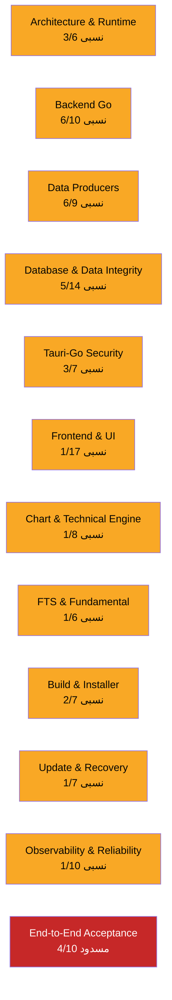
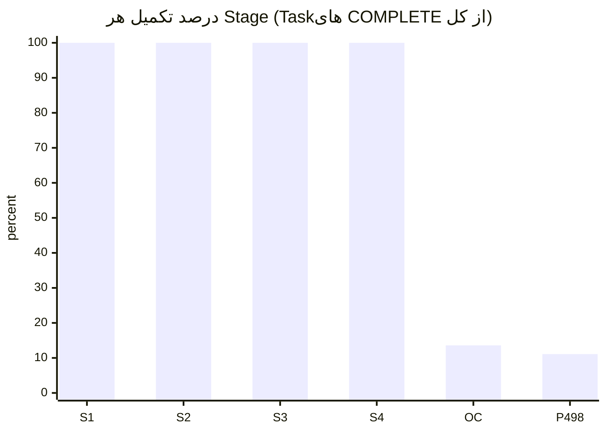
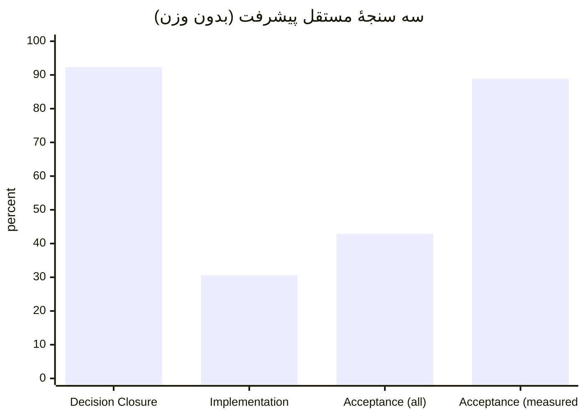
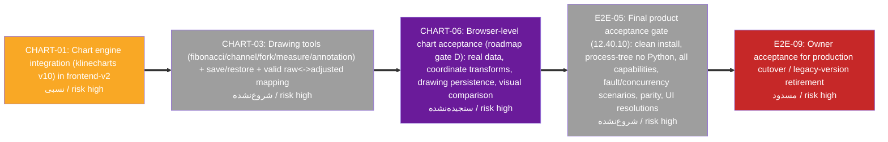

# Migration Progress Dashboard

> **Snapshot:** branch `go-main` @ `ef6a8ba503bd` (2026-11-13) · snapshot date 2026-11-14 · generated 2026-11-13 21:36:39 UTC
> **Audit branch:** `docs/migration-progress-audit-2026-11-14` · live HEAD `ef6a8ba503bd`
> **Source of truth:** `MIGRATION-STATUS.json` · regenerate: `python docs/migration-progress/generate_progress.py`

## ۰. روش، محدوده و تقدم

- **تقدم مأموریت:** این سند، مأموریت تکمیلیِ «ممیزی پیشرفت مهاجرت» است. مأموریت اصلیِ Phase 4.9.8 (دیتابیس کانونیکال + تداوم TSETMC) به‌عنوان کارِ اجراییِ جدید در WBS ثبت شده (Stage `P498`، وضعیت OPEN) و در این سشن پیاده‌سازی نشده است؛ نمودار، وضعیت واقعی commit مبنا را نشان می‌دهد نه تاریخ نگارش اسناد.
- **مبنای وضعیت:** `go-main` @ `ef6a8ba503bd`. هر ادعای COMPLETE به کد/تست/کامیت/گزارش قابل‌تکرار ارجاع دارد؛ گزارش قدیمی به‌تنهایی اثبات وضعیت امروز نیست. `DECIDED` به‌تنهایی `COMPLETE` نیست.
- **شواهد تازهٔ این ممیزی:** `go test ./...` = ۵۵ پکیج ok / ۰ FAIL؛ `tsc -b` = صفر خطا؛ `vitest run` = ۱۰۷ پرونده / ۸۶۷ تست passed (همه روی همین commit).
- **سه شکاف Runtime مندرج در پذیرش Stage 4** علیه کد جاری بازبینی شد: Generation Resolver (بسته شد)، Producer Allowlist (بسته شد)، API Honesty (قرارداد Job بسته شد؛ ممیزی همهٔ مسیرها باز است).
- **آنچه سنجیده نشده:** هر گیت/Task بدون شواهد کافی `NOT_MEASURED` است و هرگز PASS تلقی نمی‌شود؛ فهرست کامل در بخش گیت‌ها و `MIGRATION-REMAINING-WORK.md`.
- **خارج از محدوده:** لین Android، همگام‌سازی ابری، و زیرساخت توزیع تجاری با برچسب `OUT_OF_SCOPE` جدا شده‌اند و در مخرج درصد پیاده‌سازی نمی‌آیند.

## ۱. سه سنجهٔ مستقل پیشرفت

| سنجه | تعداد | درصد | قاعده |
|---|---|---|---|
| Decision Closure (تصمیم‌های معماری) | 24/26 | 92.3% | DECIDED+ACCEPTED+DEFERRED(حکم‌شده) از کل |
| Owner Questions (پرسش‌های مالک) | 8/24 | 33.3% | پرسش‌های تعیین‌تکلیف‌شده از Q1–Q24 |
| Implementation Completion (بدون وزن) | 34/111 | 30.6% | COMPLETE از Taskهای اجرایی (OUT_OF_SCOPE حذف) |
| Implementation Completion (وزن‌دار ریسک) | 92/281 | 32.7% | وزن high=3/medium=2/low=1 |
| Acceptance Completion (همهٔ گیت‌ها) | 24/56 | 42.9% | PASS از کل گیت‌ها |
| Acceptance Completion (گیت‌های سنجیده) | 24/27 | 88.9% | PASS از PASS+FAIL |

> درصد وزنی فقط بر پایهٔ ریسکِ اعلام‌شدهٔ هر Task است (روش در `MIGRATION-STATUS.json` → `metrics_rules`). هیچ درصدی از روی تعداد سطرهای سند ساخته نشده است.

## ۲. وضعیت Taskها به تفکیک

| وضعیت | تعداد |
|---|---|
| COMPLETE (تکمیل) | 34 |
| PARTIAL (نسبی) | 33 |
| IN_PROGRESS (در حال انجام) | 0 |
| OPEN (شروع‌نشده) | 33 |
| BLOCKED (مسدود) | 1 |
| NOT_MEASURED (سنجیده‌نشده) | 8 |
| DEFERRED (موکول) | 2 |
| OUT_OF_SCOPE (خارج از محدوده) | 3 |

> جمع کل Taskها: 114. مخرجِ سنجهٔ Implementation فقط Taskهای اجرایی است (111 = کل منهای 3 مورد OUT_OF_SCOPE).

## ۳. وضعیت Workstreamها

## ۴. درصد تکمیل هر Stage

> برای Stageهای `ACCEPTED`، درصد بر پایهٔ **گیت پذیرش همان Stage** است (۱۰۰٪ = محدودهٔ پذیرش برآورده شده). کارهای تکمیلیِ قابلیت‌ها که فراتر از محدودهٔ پذیرش آن Stage هستند، در بخش Taskها/گیت‌ها جداگانه دیده می‌شوند و Stage پذیرفته‌شده را بازگشایی نمی‌کنند. برای Stageهای فعال، درصد = نسبت Taskهای COMPLETE به کل Taskهای آن Stage.

| Stage | وضعیت | COMPLETE/کل | درصد |
|---|---|---|---|
| S1 — Stage 1 — Python-elimination baseline | ACCEPTED | 3/3 | 100.0% |
| S2 — Stage 2 — Production cutover & Rahavard parity | ACCEPTED | 14/14 | 100.0% |
| S3 — Stage 3 — Go data producers (15 tasks) | ACCEPTED | 13/13 | 100.0% |
| S4 — Stage 4 — Production activation & client verification | ACCEPTED | 6/6 | 100.0% |
| OC — Opportunity Lab P0-P6 | IN_PROGRESS | 9/66 | 13.6% |
| P498 — Phase 4.9.8 — Canonical technical DB & TSETMC continuity | OPEN | 1/9 | 11.1% |

## ۵. مقایسهٔ سه سنجه

## ۶. مسیر بحرانی تا پذیرش تولیدی

مسیر بحرانی (طولانی‌ترین مسیرِ وزن‌دارِ ریسک through Taskهای باقی‌مانده): CHART-01 → CHART-03 → CHART-06 → E2E-05 → E2E-09

## ۷. کارهای مسدود / نیازمند تصمیم مالک

```mermaid
flowchart TD
  Q1["Q1: Approved acceptance thresholds (OOS length, DSR/PBO cuts, min trades, cost stress, regime stability)"]:::BLOCKED
  Q2["Q2: Research/production universe (min history, liquidity, funds/rights/low-history)"]:::BLOCKED
  Q3["Q3: Official execution model (fee decree/date, limit source, queue-lock fill, T+2)"]:::BLOCKED
  Q4["Q4: Strategy return basis (cash account vs Rahavard-equivalent price series)"]:::BLOCKED
  Q6["Q6: v1 generation scope (human template/factor only vs limited search)"]:::BLOCKED
  Q12["Q12: Instrument scope (cash equity/ETF buy-only vs funds/rights/derivatives/short)"]:::BLOCKED
  Q15["Q15: Cloud GPU data egress permission (dataset scope, per-job approver)"]:::BLOCKED
  Q17["Q17: Offline/revocation policy (last-approved validity, revocation application)"]:::BLOCKED
  Q20["Q20: Default severity matrix & Critical passing Quiet Hours"]:::BLOCKED
  Q23["Q23: Notification history retention & archive/delete policy"]:::BLOCKED
  E2E-09["E2E-09: Owner acceptance for production cutover / legacy-version retirement"]:::BLOCKED
  ARCH-03["ARCH-03: Process supervisor / lifecycle: single owner start-stop, readiness beyond /healthz, tray vs exit, no orphan backend"]:::OPEN
  PROD-04["PROD-04: CODAL central Producer/Client deployment: host, scheduling, signed snapshot distribution infra, key custody, SLA"]:::OPEN
  PROD-09["PROD-09: Final production market.db writer selection & full operational validation (Go live feed vs legacy)"]:::OPEN
  DB-08["DB-08: Iranian-market dataset scope manifest: included/excluded/quarantined per asset_class with counts/date ranges; usd_rate disposition"]:::OPEN
  SEC-04["SEC-04: Tauri-Go threat model + executive security tests (CSRF, DNS rebinding, port squat, local process access, secret leakage)"]:::OPEN
  SEC-06["SEC-06: Code-signing chain + key separation (DATA/APP/APPROVAL/REGISTRY), offline approval, key rotation"]:::OPEN
  UI-09["UI-09: Settings page (user prefs, FTS config, notification settings /settings/notifications, start page, tray, autostart)"]:::OPEN
  CHART-07["CHART-07: Chart engine comparison / second-engine decision with vital-tool quality proof"]:::OPEN
  BUILD-02["BUILD-02: Final Tauri production build chain: borsd + frontend-v2 dist + Tauri shell, machine-audited package contents, single updater owner"]:::OPEN
  OBS-07["OBS-07: Notification center + settings full (filters/groups/read, sound/preview/quiet-hours, deep link) (P5.8)"]:::OPEN
  Q20 --> OBS-07
  Q23 --> OBS-07
  E2E-07["E2E-07: OC P1-P6 delivery (contracts/registry, workbench, FTS adapter/Today, runtime/3-users, policy/compare/lab, generation/AI/GPU)"]:::OPEN
  Q1 --> E2E-07
  Q2 --> E2E-07
  Q3 --> E2E-07
  Q4 --> E2E-07
  Q6 --> E2E-07
  Q12 --> E2E-07
  Q15 --> E2E-07
  E2E-09["E2E-09: Owner acceptance for production cutover / legacy-version retirement"]:::OPEN
  E2E-05 --> E2E-09
  E2E-08 --> E2E-09
  classDef BLOCKED fill:#c62828,color:#fff;
  classDef OPEN fill:#9e9e9e,color:#fff;
```

## ۸. گیت‌های پذیرش

| گیت | حکم | منبع | شاهد |
|---|---|---|---|
| G-S1 — Stage 1 Python-elimination exit | PASS | python-elimination/03 | 110/110 suites; AST guard; 70-endpoint matrix; hard gate enforced |
| G-S2 — Stage 2 cutover + Rahavard parity | PASS | STAGE2-FINAL-ACCEPTANCE | READY_FOR_STAGE3_WITH_PARALLEL_WORK; Python removed; 5-symbol adjusted parity |
| G-S3 — Stage 3 producers 15/15 | PASS | STAGE3-FINAL-REPORT | 15 tasks PASS across WS A-F; fault-injection tests |
| G-S4 — Stage 4 production activation + client verify | PASS | STAGE4-FINAL-REPORT | STAGE4_PRODUCTION_ACTIVATED_CLIENT_VERIFIED; v1.0.98; run 42508665247; user.db SHA identical |
| G-RO — Go read-only DB enforcement | PASS | db/arch_test,db_test,market/lifecycle_test | mode=ro symmetry; AST guard vs sql.Open; zero disk writes; go test ok |
| G-SW — Single-writer lock | PASS | tsetmc/lock_test,instance | mutual exclusion same/subprocess; crash releases lock |
| G-GEN — Generation resolver serve+rollback | PASS | generation/resolver.go,app.go | CurrentPointer + atomic swap + Rollback + pending_reload; Stage-4 apply!=serve gap closed |
| G-ALLOW — Producer snapshot allowlist | PASS | bors-producer/pipeline.go#L233 | explicit market.db/codal.db allowlist; research/user/oc_client excluded |
| G-SIGN — Minisign sign/verify tamper rejection | PASS | snapshot signer tests,STAGE4 key audit | tampered content/signature rejected; KeyID 830BF752EF10076 matches embedded pubkey |
| G-APPLY — Atomic apply + user.db preservation | PASS | applier_test,STAGE4 WS-F | Windows lock simulation; rollback; user.db byte-identical; restart reload |
| G-APIJOB — API honesty job contract | PASS | sync/handlers.go,jobs | job_id/status_url; explicit 501 'no job created'; no 200=started |
| G-SEC — Local API guard (token/origin/cors/csrf) | PASS | auth/guard_test,main.go#L92-104 | guard wired into server; per-launch token; strict Host/Origin; closed CORS; CSRF |
| G-LOOP — Loopback-only shell URL | PASS | src-tauri/lib.rs tests | ensure_loopback_shell_url refuses non-loopback; tests |
| G-CAP — Minimal Tauri capabilities | PASS | capabilities/default.json | core/updater/process only; no remote; CSP default-src self |
| G-VER — Version anchors 11/11 | PASS | STAGE4 WS-D,version_anchor_guard.py | 11 anchors synced, 0 failed |
| G-GO-TEST — Go test suite at ef6a8ba5 | PASS | go test ./... (this audit) | 55 packages ok, 0 FAIL, 3 no-test-files |
| G-FE-TYPE — frontend-v2 typecheck at ef6a8ba5 | PASS | tsc -b (this audit) | TSC_EXIT=0, zero errors |
| G-FE-TEST — frontend-v2 unit tests at ef6a8ba5 | PASS | vitest run (this audit) | 107 files / 867 tests passed, 30.96s |
| G-NOTIF-CENTER — In-app notification center + badge | PASS | NotificationsPage,AppShell | page + feed + unread badge present and tested |
| G-CHART-PARITY5 — Rahavard 5-symbol adjusted parity | PASS | STAGE2 parity,tools/parity | zero absolute diff on 5 reference symbols |
| G-498-INTEGRITY — Canonical DB integrity_check | PASS | 4.9.7 separation_validation.json | integrity ok; t=0 rows=0; dup-t groups=0 |
| G-498-RECON — Canonical DB row reconciliation | PASS | 4.9.7 separation_validation.json | technical=69,180,503 == ref_distinct_no_t0=69,180,503 |
| G-498-REFIMM — Reference archive immutable | PASS | 4.9.7 reference_unchanged.json | reference_all.db size 14612127744 + mtime unchanged before/after |
| G-CHART-GLOBAL — Global multi-regime technical parity | NOT_MEASURED | decisions#12.39.4 | only 5-symbol cohort proven; global pending |
| G-CHART-BROWSER — Browser-level chart acceptance (gate D) | NOT_MEASURED | MASTER-EXECUTION-ROADMAP#D | requires live browser proof at this commit |
| G-CHART-TOOLS — Drawing tools + save/restore + raw/adjusted mapping | FAIL | MIGRATION-GAP-MATRIX#technical | no drawing/fibonacci/overlay code in frontend-v2 chart feature |
| G-FTS-PARITY — FTS booklet/Go/Python/Chart conformance (P0.5/Q5) | NOT_MEASURED | OC P0.5,OPEN-QUESTIONS#Q5 | harness exists; zero-unresolved-diff gate open; blocks P3/Today |
| G-FTS-AXIS — FTS 5-axis evidence matrix | NOT_MEASURED | decisions#12.40.8 | recalc tested; full independent axis-evidence matrix open |
| G-UI-COVERAGE — Full legacy capability UI coverage | FAIL | App.tsx routes vs gap matrix | /fts-screen,/portfolio,/settings,/strategy-tree,/engine-lab routes absent; sidebar dead links |
| G-UI-VISUAL — Visual acceptance 1366/1920 real data | NOT_MEASURED | decisions#12.36,#12.40.10 | no browser visual verification at this commit |
| G-NOTIF-TOAST — OS native toast via Tauri plugin | FAIL | src-tauri/Cargo.toml,OC P1.7 | tauri-plugin-notification absent; no notification permission/IPC |
| G-BUILD-PY — Production package no Python (process tree) | PASS | STAGE2 onedir_contract_v11 | Go binary onedir; no .pyd/Python runtime; live process test 13.3 MB |
| G-BUILD-TAURI — Final Tauri installer cutover proof | NOT_MEASURED | decisions#12.40.6 | shell build scripts exist; end-to-end production artifact proof open |
| G-INSTALL — First-launch state machine + WebView2/offline/repair | NOT_MEASURED | ROADMAP#F.1,decisions#12.5,#12.8 | no current-commit evidence |
| G-UPDATE-COMPAT — Update compatibility/legacy fallback/interruption matrix | NOT_MEASURED | ROADMAP#F.2 | applier rollback tested; full updater matrix open |
| G-UPDATE-SCHED — No forced restart during market; scheduled install | NOT_MEASURED | decisions#12.17 | no implementation evidence |
| G-UNINSTALL — Uninstall data preservation / explicit wipe | NOT_MEASURED | decisions#12.16 | no current-commit evidence |
| G-BACKUP — Backup retention + real restore drill | NOT_MEASURED | decisions#12.15,#12.40.7 | no restore-drill evidence |
| G-PERF — Current-commit performance baseline (p95/p99, process tree) | NOT_MEASURED | decisions#12.1,#12.27 | historical 2026-10-27 baseline only |
| G-OBS-DIAG — Structured opt-in diagnostics | NOT_MEASURED | decisions#12.3 | no implementation evidence |
| G-WIN11 — Windows 11 reference acceptance | NOT_MEASURED | decisions#12.13 | no full-scenario Win11 proof at this commit |
| G-OC-P0 — OC P0 gate complete | NOT_MEASURED | OC IMPLEMENTATION-ROADMAP#P0-Gate | P0.5 FTS parity open; P0.3 partial |
| G-498-ALIAS — Global alias verification (all assets) | NOT_MEASURED | 4.9.8 Task 2.2 | only asset 591 sample (2816 bars) verified in 4.9.7 |
| G-498-GEOM — Global candle geometry validation | NOT_MEASURED | 4.9.8 Task 2.3 | not run globally |
| G-498-ADJVAL — Adjustment factor numeric validity (cohort) | NOT_MEASURED | 4.9.8 Task 2.5 | counts verified (8280/6629); values not validated |
| G-498-ADJID — 647 keyless adjustment recovery/quarantine | NOT_MEASURED | 4.9.8 Task 2.5 | 647 keyless events identified; not recovered/quarantined |
| G-498-SCOPE — Iranian-market scope manifest | NOT_MEASURED | 4.9.8 Task 3 | not built |
| G-498-TSETMC-IDEM — TSETMC idempotent incremental ingestion | NOT_MEASURED | 4.9.8 Task 5 | producer not implemented |
| G-498-TSETMC-CONT — TSETMC continuity without breaking history | NOT_MEASURED | 4.9.8 Task 5 | not implemented |
| G-498-PROV — Source provenance per datum | NOT_MEASURED | 4.9.8 Task 4/9 | canonical contract not built |
| G-498-RO-PY — Python research reader read-only | NOT_MEASURED | 4.9.8 Task 9 | research reader not built |
| G-498-ML — ML dataset v1 reproducibility | NOT_MEASURED | 4.9.8 Task 7/9 | dataset v1 not built |
| G-498-PERF — Canonical DB performance benchmark | NOT_MEASURED | 4.9.8 Task 8/9 | not measured |
| G-498-ROLLBACK — Rollback to legacy path without data loss | NOT_MEASURED | 4.9.8 Task 9 | feature-flag cutover not built |
| G-E2E-FINAL — Final product acceptance (12.40.10) | NOT_MEASURED | decisions#12.40.10 | multiple sub-gates open/not measured |
| G-CUTOVER — Owner acceptance for legacy retirement | NOT_MEASURED | decisions#9,#12.3 | blocked on final gates + owner ruling |

