# Migration Remaining Work

> **Snapshot:** branch `go-main` @ `ef6a8ba503bd` (2026-11-13) · snapshot date 2026-11-14 · generated 2026-11-13 21:36:39 UTC
> **Audit branch:** `docs/migration-progress-audit-2026-11-14` · live HEAD `ef6a8ba503bd`
> **Source of truth:** `MIGRATION-STATUS.json` · regenerate: `python docs/migration-progress/generate_progress.py`

**77 Task باقی‌مانده** از 111 Task اجرایی. مسدود: 1 · نیازمند تصمیم مالک: 12 · خارج از محدوده (جدا): 3

## نقشهٔ وابستگی Taskهای باقی‌مانده

```mermaid
flowchart TD
  ARCH-03["ARCH-03: Process supervisor / lifecycle: single owner start-stop, readiness beyond /healthz, tray vs exit, no orphan backend"]:::PARTIAL
  ARCH-05["ARCH-05: Multi-window / multi-instance core ownership (shared core, no parallel producer)"]:::PARTIAL
  ARCH-06["ARCH-06: Research/Runtime separation: Python research-only, Go runtime, research.db outside producer data_dir"]:::PARTIAL
  GO-02["GO-02: API route coverage vs legacy product (70-endpoint matrix; not-ported routes explicit 501)"]:::PARTIAL
  GO-04["GO-04: Full operational-path API honesty audit (Sync/Update/Refresh/Pause/Resume/Stop effect verification)"]:::OPEN
  GO-09["GO-09: Notification backend engine: classify/dedup/rate-limit/quiet-hours/outbox + long-poll feed"]:::PARTIAL
  GO-10["GO-10: Opportunity Center read-models / registry backend (ocdb, ocdata)"]:::PARTIAL
  PROD-04["PROD-04: CODAL central Producer/Client deployment: host, scheduling, signed snapshot distribution infra, key custody, SLA"]:::PARTIAL
  PROD-08["PROD-08: TSETMC incremental continuity into canonical technical.db: idempotent batches, conflict logging, session finalization, corporate-action producer"]:::OPEN
  PROD-09["PROD-09: Final production market.db writer selection & full operational validation (Go live feed vs legacy)"]:::PARTIAL
  DB-01["DB-01: Schema versioning + migration runner + backup/rollback (PRAGMA user_version) for oc_client.db/research.db"]:::PARTIAL
  DB-07["DB-07: Canonical DB comprehensive re-validation: global alias, candle geometry, historical coverage, adjustment numeric validity, representative-cohort Rahavard parity"]:::OPEN
  DB-08["DB-08: Iranian-market dataset scope manifest: included/excluded/quarantined per asset_class with counts/date ranges; usd_rate disposition"]:::OPEN
  DB-09["DB-09: Canonical technical.db schema design + shared_metadata merge + data contract (price basis, provenance, ingestion batches, revisions) + workload indexes"]:::OPEN
  DB-10["DB-10: ML dataset v1: point-in-time, walk-forward, survivorship-safe, reproducible manifest; batch read-only reads"]:::OPEN
  DB-11["DB-11: Database size/schema audit: why 11.9 GB (page/freelist/dbstat, per-table/index sizes, mode semantics, vs legacy TSETMC DB)"]:::OPEN
  DB-12["DB-12: Canonical DB performance & storage benchmark (open/connection, 1/5/10y queries, cohort, training window, RAM, index rebuild, ingestion latency)"]:::OPEN
  DB-13["DB-13: Market.db corruption quarantine + separate-space rebuild + validated swap protocol"]:::NOT_MEASURED
  DB-14["DB-14: User-data backup/retention policy + real restore drill on independent copy"]:::OPEN
  SEC-04["SEC-04: Tauri-Go threat model + executive security tests (CSRF, DNS rebinding, port squat, local process access, secret leakage)"]:::PARTIAL
  SEC-05["SEC-05: Secrets in OS credential store (DPAPI/Credential Manager), fail-closed auth, no secrets in export"]:::OPEN
  SEC-06["SEC-06: Code-signing chain + key separation (DATA/APP/APPROVAL/REGISTRY), offline approval, key rotation"]:::PARTIAL
  SEC-07["SEC-07: Real-order / AutoClicker authorization & safety design"]:::DEFERRED
  UI-01["UI-01: frontend-v2 app shell + collapsible sidebar navigation"]:::PARTIAL
  UI-02["UI-02: Market board page (filters, detail drawer, pulse bar, mini-chart, suspicious panel, export)"]:::PARTIAL
  UI-03["UI-03: Market-status page (15+ metrics: histogram, thermometer, depth, real/legal, phase, industry, treemap, order flow)"]:::PARTIAL
  UI-04["UI-04: Fundamental page (FTS card, drilldown, axis rail, screener table, settings, industry, seasonal, calendar)"]:::PARTIAL
  UI-05["UI-05: Technical page / chart workspace"]:::PARTIAL
  UI-06["UI-06: FTS screener page (/fts-screen): funnel, gate, arbitration, dossier, screening table"]:::OPEN
  UI-07["UI-07: Portfolio page (performance/risk/asset dashboard, link to technical/fundamental/FTS)"]:::OPEN
  UI-08["UI-08: Watchlist management (add/remove + dedicated view)"]:::PARTIAL
  UI-09["UI-09: Settings page (user prefs, FTS config, notification settings /settings/notifications, start page, tray, autostart)"]:::OPEN
  UI-11["UI-11: Strategy-tree (5-page FTS charts) migration"]:::OPEN
  UI-12["UI-12: Engine-lab page (chart engine comparison: mountMs/fps/heap)"]:::OPEN
  UI-13["UI-13: Named workspaces: save/restore layout, per-panel symbol sync groups, adaptive layout, configurable start page"]:::OPEN
  UI-14["UI-14: RTL/Persian-only UI + numeric alignment + dark/light themes + brand/semantic color separation"]:::NOT_MEASURED
  UI-15["UI-15: Command palette + discoverable/customizable keyboard shortcuts"]:::OPEN
  UI-16["UI-16: Opportunity Lab / Today UI (P3.4 read model + P5.4 lab client, inspector, evidence states)"]:::OPEN
  UI-17["UI-17: Visual acceptance at 1366x768 and 1920x1080 with real data (states: loading/error/stale/dense/multi-panel)"]:::NOT_MEASURED
  CHART-01["CHART-01: Chart engine integration (klinecharts v10) in frontend-v2"]:::PARTIAL
  CHART-03["CHART-03: Drawing tools (fibonacci/channel/fork/measure/annotation) + save/restore + valid raw<->adjusted mapping"]:::OPEN
  CHART-04["CHART-04: Buy/sell queue, depth, replay, multi-chart compare, indicator panel, pattern toggles"]:::OPEN
  CHART-05["CHART-05: Rahavard technical parity (OHLC/adjustment/indicators) on representative cohort"]:::PARTIAL
  CHART-06["CHART-06: Browser-level chart acceptance (roadmap gate D): real data, coordinate transforms, drawing persistence, visual comparison"]:::NOT_MEASURED
  CHART-07["CHART-07: Chart engine comparison / second-engine decision with vital-tool quality proof"]:::OPEN
  CHART-08["CHART-08: Kronos / candle-sequence forecast integration gate (official inference path, real OHLCV+amount, session timestamps, benchmarks)"]:::DEFERRED
  FTS-01["FTS-01: FTS source-of-truth reconciliation + parity harness (booklet/OWNER_RULINGS rule inventory; Python/Go/Chart conformance; golden vectors)"]:::PARTIAL
  FTS-02["FTS-02: FTS 5-axis evidence matrix (input/axis values/missing-data/reason/verdict independently verified)"]:::PARTIAL
  FTS-03["FTS-03: FTS Adapter/Envelope (fts.envelope/1, tri-state, NA kind, ruleset/config hash) consumed by Today/OC"]:::OPEN
  FTS-05["FTS-05: FTS local-data execution + result freshness/data-version labeling + recompute on new valid data"]:::PARTIAL
  FTS-06["FTS-06: FTS golden vectors + Go/Python/Chart ruleset/config alignment; remove dual config from Approved path"]:::OPEN
  BUILD-02["BUILD-02: Final Tauri production build chain: borsd + frontend-v2 dist + Tauri shell, machine-audited package contents, single updater owner"]:::PARTIAL
  BUILD-03["BUILD-03: Installer hardening: per-user least privilege, silent upgrade, data boundary, Inno protections preserved/revalidated"]:::PARTIAL
  BUILD-04["BUILD-04: WebView2 runtime check + offline package + repair scenario + clear prerequisite failure"]:::NOT_MEASURED
  BUILD-05["BUILD-05: First-install/first-launch state machine + low-resource profile + first-launch acceptance"]:::OPEN
  BUILD-06["BUILD-06: Dependency license audit + notices + redistribution obligations before distributable package"]:::OPEN
  UPD-01["UPD-01: Tauri updater signed artifacts + embedded pubkey + endpoint configuration"]:::PARTIAL
  UPD-02["UPD-02: Update compatibility: legacy-version fallback, delta rules, full-package fallback, supported-version policy"]:::OPEN
  UPD-03["UPD-03: Interrupted update / power-loss / locked-file / partial-download recovery matrix"]:::PARTIAL
  UPD-05["UPD-05: Update scheduling per user preference; no forced close/restart during market/sensitive ops"]:::OPEN
  UPD-06["UPD-06: Uninstall keeps user/market data by default; explicit full-wipe with summary"]:::OPEN
  UPD-07["UPD-07: App-version rollback (not only DB generation) preserving data/settings; incompatible downgrade detected"]:::PARTIAL
  OBS-02["OBS-02: Component health / limited restart with backoff / degraded mode / no stale-as-live"]:::PARTIAL
  OBS-03["OBS-03: Structured local diagnostics (opt-in export, redaction, no default external send)"]:::OPEN
  OBS-04["OBS-04: Error UX: human-readable cause + suggested action + details drawer + severity separation + no false success"]:::NOT_MEASURED
  OBS-05["OBS-05: Per-domain data freshness indicators + stale labeling (board/candle/technical/FTS independent)"]:::PARTIAL
  OBS-06["OBS-06: OS native toast via tauri-plugin-notification + AUMID/shortcut + long-poll bridge + ack/click (P1.7/P4.8)"]:::OPEN
  OBS-07["OBS-07: Notification center + settings full (filters/groups/read, sound/preview/quiet-hours, deep link) (P5.8)"]:::PARTIAL
  OBS-08["OBS-08: OC observability: /api/oc/status, audit, health (no PII), job/status (P5.6)"]:::PARTIAL
  OBS-09["OBS-09: Performance baseline at this commit: cold/warm start, time-to-ready, RAM/CPU process tree, p95/p99 latency, dropped updates"]:::NOT_MEASURED
  OBS-10["OBS-10: Crash recovery / half-done operations policy (checkpoint, dedup ids, atomic txn resolution, no blind retry of external effects)"]:::PARTIAL
  E2E-05["E2E-05: Final product acceptance gate (12.40.10): clean install, process-tree no Python, all capabilities, fault/concurrency scenarios, parity, UI resolutions"]:::OPEN
  E2E-06["E2E-06: OC P0 gate: all P0 tests + NOT_MEASURED report (P0.1-P0.8)"]:::PARTIAL
  E2E-07["E2E-07: OC P1-P6 delivery (contracts/registry, workbench, FTS adapter/Today, runtime/3-users, policy/compare/lab, generation/AI/GPU)"]:::OPEN
  E2E-08["E2E-08: Phase 4.9.8 validation & cutover gates (19 gates: reference_immutable ... rollback)"]:::OPEN
  E2E-09["E2E-09: Owner acceptance for production cutover / legacy-version retirement"]:::BLOCKED
  E2E-10["E2E-10: Windows 11 reference acceptance + Windows 10 conditional compatibility proof"]:::NOT_MEASURED
  DB-01 --> GO-10
  DB-09 --> PROD-08
  DB-07 --> PROD-08
  DB-07 --> DB-09
  DB-08 --> DB-09
  DB-09 --> DB-10
  DB-09 --> DB-12
  DB-01 --> DB-14
  UI-01 --> UI-02
  UI-01 --> UI-03
  UI-01 --> UI-04
  UI-01 --> UI-05
  CHART-01 --> UI-05
  UI-01 --> UI-06
  FTS-01 --> UI-06
  UI-01 --> UI-07
  UI-02 --> UI-08
  UI-01 --> UI-09
  UI-06 --> UI-11
  CHART-07 --> UI-12
  UI-01 --> UI-13
  UI-01 --> UI-14
  UI-01 --> UI-15
  GO-10 --> UI-16
  FTS-03 --> UI-16
  UI-02 --> UI-17
  UI-05 --> UI-17
  CHART-01 --> CHART-03
  CHART-01 --> CHART-04
  CHART-01 --> CHART-06
  CHART-03 --> CHART-06
  UI-12 --> CHART-07
  DB-10 --> CHART-08
  FTS-01 --> FTS-03
  FTS-01 --> FTS-06
  FTS-03 --> FTS-06
  BUILD-02 --> BUILD-03
  BUILD-02 --> BUILD-04
  BUILD-02 --> BUILD-05
  BUILD-02 --> BUILD-06
  BUILD-02 --> UPD-01
  UPD-01 --> UPD-02
  UPD-01 --> UPD-03
  UPD-01 --> UPD-05
  BUILD-03 --> UPD-06
  UPD-01 --> UPD-07
  DB-01 --> UPD-07
  ARCH-03 --> OBS-02
  UI-01 --> OBS-04
  GO-09 --> OBS-06
  UI-09 --> OBS-07
  GO-10 --> OBS-08
  BUILD-02 --> E2E-05
  UI-06 --> E2E-05
  UI-07 --> E2E-05
  UI-09 --> E2E-05
  CHART-06 --> E2E-05
  FTS-01 --> E2E-05
  OBS-09 --> E2E-05
  UPD-02 --> E2E-05
  DB-01 --> E2E-06
  FTS-01 --> E2E-06
  GO-09 --> E2E-06
  E2E-06 --> E2E-07
  DB-07 --> E2E-08
  DB-08 --> E2E-08
  DB-09 --> E2E-08
  PROD-08 --> E2E-08
  DB-10 --> E2E-08
  DB-12 --> E2E-08
  E2E-05 --> E2E-09
  E2E-08 --> E2E-09
  E2E-05 --> E2E-10
  classDef COMPLETE fill:#2e7d32,color:#fff;
  classDef PARTIAL fill:#f9a825,color:#fff;
  classDef IN_PROGRESS fill:#1565c0,color:#fff;
  classDef OPEN fill:#9e9e9e,color:#fff;
  classDef BLOCKED fill:#c62828,color:#fff;
  classDef NOT_MEASURED fill:#6a1b9a,color:#fff;
  classDef DEFERRED fill:#00838f,color:#fff;
  classDef OUT_OF_SCOPE fill:#455a64,color:#fff;
```

## فهرست کارهای باقی‌مانده به تفکیک Workstream

### WS1 — Architecture & Runtime

| ID | Task | وضعیت | ریسک | پیش‌نیاز | تصمیم مالک | پرسش‌های باز |
|---|---|---|---|---|---|---|
| ARCH-03 | Process supervisor / lifecycle: single owner start-stop, readiness beyond /healthz, tray vs exit, no orphan backend | PARTIAL | high | ARCH-01 | بله | — |
| ARCH-05 | Multi-window / multi-instance core ownership (shared core, no parallel producer) | PARTIAL | medium | ARCH-02 | — | — |
| ARCH-06 | Research/Runtime separation: Python research-only, Go runtime, research.db outside producer data_dir | PARTIAL | medium | ARCH-01 | — | — |

### WS2 — Backend Go

| ID | Task | وضعیت | ریسک | پیش‌نیاز | تصمیم مالک | پرسش‌های باز |
|---|---|---|---|---|---|---|
| GO-02 | API route coverage vs legacy product (70-endpoint matrix; not-ported routes explicit 501) | PARTIAL | high | GO-01 | — | — |
| GO-04 | Full operational-path API honesty audit (Sync/Update/Refresh/Pause/Resume/Stop effect verification) | OPEN | medium | GO-03 | — | — |
| GO-09 | Notification backend engine: classify/dedup/rate-limit/quiet-hours/outbox + long-poll feed | PARTIAL | medium | GO-01 | — | — |
| GO-10 | Opportunity Center read-models / registry backend (ocdb, ocdata) | PARTIAL | medium | GO-01, DB-01 | — | — |

### WS3 — Data Producers

| ID | Task | وضعیت | ریسک | پیش‌نیاز | تصمیم مالک | پرسش‌های باز |
|---|---|---|---|---|---|---|
| PROD-04 | CODAL central Producer/Client deployment: host, scheduling, signed snapshot distribution infra, key custody, SLA | PARTIAL | high | PROD-01, DB-03 | بله | — |
| PROD-08 | TSETMC incremental continuity into canonical technical.db: idempotent batches, conflict logging, session finalization, corporate-action producer | OPEN | high | DB-09, DB-07 | — | — |
| PROD-09 | Final production market.db writer selection & full operational validation (Go live feed vs legacy) | PARTIAL | high | PROD-05, PROD-06 | بله | — |

### WS4 — Database & Data Integrity

| ID | Task | وضعیت | ریسک | پیش‌نیاز | تصمیم مالک | پرسش‌های باز |
|---|---|---|---|---|---|---|
| DB-01 | Schema versioning + migration runner + backup/rollback (PRAGMA user_version) for oc_client.db/research.db | PARTIAL | high | — | — | — |
| DB-07 | Canonical DB comprehensive re-validation: global alias, candle geometry, historical coverage, adjustment numeric validity, representative-cohort Rahavard parity | OPEN | high | DB-06 | — | — |
| DB-08 | Iranian-market dataset scope manifest: included/excluded/quarantined per asset_class with counts/date ranges; usd_rate disposition | OPEN | high | DB-06 | بله | — |
| DB-09 | Canonical technical.db schema design + shared_metadata merge + data contract (price basis, provenance, ingestion batches, revisions) + workload indexes | OPEN | high | DB-07, DB-08 | — | — |
| DB-10 | ML dataset v1: point-in-time, walk-forward, survivorship-safe, reproducible manifest; batch read-only reads | OPEN | high | DB-09 | — | — |
| DB-11 | Database size/schema audit: why 11.9 GB (page/freelist/dbstat, per-table/index sizes, mode semantics, vs legacy TSETMC DB) | OPEN | medium | DB-06 | — | — |
| DB-12 | Canonical DB performance & storage benchmark (open/connection, 1/5/10y queries, cohort, training window, RAM, index rebuild, ingestion latency) | OPEN | medium | DB-09 | — | — |
| DB-13 | Market.db corruption quarantine + separate-space rebuild + validated swap protocol | NOT_MEASURED | high | DB-04 | — | — |
| DB-14 | User-data backup/retention policy + real restore drill on independent copy | OPEN | high | DB-01 | — | — |

### WS5 — Tauri-Go Security

| ID | Task | وضعیت | ریسک | پیش‌نیاز | تصمیم مالک | پرسش‌های باز |
|---|---|---|---|---|---|---|
| SEC-04 | Tauri-Go threat model + executive security tests (CSRF, DNS rebinding, port squat, local process access, secret leakage) | PARTIAL | high | SEC-01, SEC-02 | بله | — |
| SEC-05 | Secrets in OS credential store (DPAPI/Credential Manager), fail-closed auth, no secrets in export | OPEN | high | — | — | — |
| SEC-06 | Code-signing chain + key separation (DATA/APP/APPROVAL/REGISTRY), offline approval, key rotation | PARTIAL | high | DB-03 | بله | — |
| SEC-07 | Real-order / AutoClicker authorization & safety design | DEFERRED | high | — | — | — |

### WS6 — Frontend & UI

| ID | Task | وضعیت | ریسک | پیش‌نیاز | تصمیم مالک | پرسش‌های باز |
|---|---|---|---|---|---|---|
| UI-01 | frontend-v2 app shell + collapsible sidebar navigation | PARTIAL | medium | ARCH-01 | — | — |
| UI-02 | Market board page (filters, detail drawer, pulse bar, mini-chart, suspicious panel, export) | PARTIAL | medium | UI-01 | — | — |
| UI-03 | Market-status page (15+ metrics: histogram, thermometer, depth, real/legal, phase, industry, treemap, order flow) | PARTIAL | medium | UI-01 | — | — |
| UI-04 | Fundamental page (FTS card, drilldown, axis rail, screener table, settings, industry, seasonal, calendar) | PARTIAL | medium | UI-01, GO-08 | — | — |
| UI-05 | Technical page / chart workspace | PARTIAL | medium | UI-01, CHART-01 | — | — |
| UI-06 | FTS screener page (/fts-screen): funnel, gate, arbitration, dossier, screening table | OPEN | high | UI-01, FTS-01 | — | — |
| UI-07 | Portfolio page (performance/risk/asset dashboard, link to technical/fundamental/FTS) | OPEN | medium | UI-01 | — | — |
| UI-08 | Watchlist management (add/remove + dedicated view) | PARTIAL | low | UI-02 | — | — |
| UI-09 | Settings page (user prefs, FTS config, notification settings /settings/notifications, start page, tray, autostart) | OPEN | medium | UI-01 | بله | — |
| UI-11 | Strategy-tree (5-page FTS charts) migration | OPEN | medium | UI-06 | — | — |
| UI-12 | Engine-lab page (chart engine comparison: mountMs/fps/heap) | OPEN | low | CHART-07 | — | — |
| UI-13 | Named workspaces: save/restore layout, per-panel symbol sync groups, adaptive layout, configurable start page | OPEN | medium | UI-01 | — | — |
| UI-14 | RTL/Persian-only UI + numeric alignment + dark/light themes + brand/semantic color separation | NOT_MEASURED | medium | UI-01 | — | — |
| UI-15 | Command palette + discoverable/customizable keyboard shortcuts | OPEN | low | UI-01 | — | — |
| UI-16 | Opportunity Lab / Today UI (P3.4 read model + P5.4 lab client, inspector, evidence states) | OPEN | medium | GO-10, FTS-03 | — | — |
| UI-17 | Visual acceptance at 1366x768 and 1920x1080 with real data (states: loading/error/stale/dense/multi-panel) | NOT_MEASURED | medium | UI-02, UI-05 | — | — |

### WS7 — Chart & Technical Engine

| ID | Task | وضعیت | ریسک | پیش‌نیاز | تصمیم مالک | پرسش‌های باز |
|---|---|---|---|---|---|---|
| CHART-01 | Chart engine integration (klinecharts v10) in frontend-v2 | PARTIAL | high | ARCH-01 | — | — |
| CHART-03 | Drawing tools (fibonacci/channel/fork/measure/annotation) + save/restore + valid raw<->adjusted mapping | OPEN | high | CHART-01 | — | — |
| CHART-04 | Buy/sell queue, depth, replay, multi-chart compare, indicator panel, pattern toggles | OPEN | medium | CHART-01 | — | — |
| CHART-05 | Rahavard technical parity (OHLC/adjustment/indicators) on representative cohort | PARTIAL | high | CHART-02 | — | — |
| CHART-06 | Browser-level chart acceptance (roadmap gate D): real data, coordinate transforms, drawing persistence, visual comparison | NOT_MEASURED | high | CHART-01, CHART-03 | — | — |
| CHART-07 | Chart engine comparison / second-engine decision with vital-tool quality proof | OPEN | medium | UI-12 | بله | — |
| CHART-08 | Kronos / candle-sequence forecast integration gate (official inference path, real OHLCV+amount, session timestamps, benchmarks) | DEFERRED | medium | DB-10 | — | — |

### WS8 — FTS & Fundamental

| ID | Task | وضعیت | ریسک | پیش‌نیاز | تصمیم مالک | پرسش‌های باز |
|---|---|---|---|---|---|---|
| FTS-01 | FTS source-of-truth reconciliation + parity harness (booklet/OWNER_RULINGS rule inventory; Python/Go/Chart conformance; golden vectors) | PARTIAL | high | GO-08 | — | — |
| FTS-02 | FTS 5-axis evidence matrix (input/axis values/missing-data/reason/verdict independently verified) | PARTIAL | high | GO-08 | — | — |
| FTS-03 | FTS Adapter/Envelope (fts.envelope/1, tri-state, NA kind, ruleset/config hash) consumed by Today/OC | OPEN | high | FTS-01 | — | — |
| FTS-05 | FTS local-data execution + result freshness/data-version labeling + recompute on new valid data | PARTIAL | medium | GO-08 | — | — |
| FTS-06 | FTS golden vectors + Go/Python/Chart ruleset/config alignment; remove dual config from Approved path | OPEN | high | FTS-01, FTS-03 | — | — |

### WS9 — Build & Installer

| ID | Task | وضعیت | ریسک | پیش‌نیاز | تصمیم مالک | پرسش‌های باز |
|---|---|---|---|---|---|---|
| BUILD-02 | Final Tauri production build chain: borsd + frontend-v2 dist + Tauri shell, machine-audited package contents, single updater owner | PARTIAL | high | BUILD-01, SEC-03 | بله | — |
| BUILD-03 | Installer hardening: per-user least privilege, silent upgrade, data boundary, Inno protections preserved/revalidated | PARTIAL | high | BUILD-02 | — | — |
| BUILD-04 | WebView2 runtime check + offline package + repair scenario + clear prerequisite failure | NOT_MEASURED | medium | BUILD-02 | — | — |
| BUILD-05 | First-install/first-launch state machine + low-resource profile + first-launch acceptance | OPEN | high | BUILD-02 | — | — |
| BUILD-06 | Dependency license audit + notices + redistribution obligations before distributable package | OPEN | medium | BUILD-02 | — | — |

### WS10 — Update & Recovery

| ID | Task | وضعیت | ریسک | پیش‌نیاز | تصمیم مالک | پرسش‌های باز |
|---|---|---|---|---|---|---|
| UPD-01 | Tauri updater signed artifacts + embedded pubkey + endpoint configuration | PARTIAL | high | BUILD-02, DB-03 | — | — |
| UPD-02 | Update compatibility: legacy-version fallback, delta rules, full-package fallback, supported-version policy | OPEN | high | UPD-01 | — | — |
| UPD-03 | Interrupted update / power-loss / locked-file / partial-download recovery matrix | PARTIAL | high | DB-04, UPD-01 | — | — |
| UPD-05 | Update scheduling per user preference; no forced close/restart during market/sensitive ops | OPEN | medium | UPD-01 | — | — |
| UPD-06 | Uninstall keeps user/market data by default; explicit full-wipe with summary | OPEN | medium | BUILD-03 | — | — |
| UPD-07 | App-version rollback (not only DB generation) preserving data/settings; incompatible downgrade detected | PARTIAL | high | UPD-01, DB-01 | — | — |

### WS11 — Observability & Reliability

| ID | Task | وضعیت | ریسک | پیش‌نیاز | تصمیم مالک | پرسش‌های باز |
|---|---|---|---|---|---|---|
| OBS-02 | Component health / limited restart with backoff / degraded mode / no stale-as-live | PARTIAL | high | ARCH-03, GO-07 | — | — |
| OBS-03 | Structured local diagnostics (opt-in export, redaction, no default external send) | OPEN | medium | — | — | — |
| OBS-04 | Error UX: human-readable cause + suggested action + details drawer + severity separation + no false success | NOT_MEASURED | medium | UI-01 | — | — |
| OBS-05 | Per-domain data freshness indicators + stale labeling (board/candle/technical/FTS independent) | PARTIAL | medium | OBS-01 | — | — |
| OBS-06 | OS native toast via tauri-plugin-notification + AUMID/shortcut + long-poll bridge + ack/click (P1.7/P4.8) | OPEN | medium | GO-09, SEC-03 | — | — |
| OBS-07 | Notification center + settings full (filters/groups/read, sound/preview/quiet-hours, deep link) (P5.8) | PARTIAL | medium | UI-10, UI-09 | بله | Q20, Q21, Q23 |
| OBS-08 | OC observability: /api/oc/status, audit, health (no PII), job/status (P5.6) | PARTIAL | low | GO-10 | — | — |
| OBS-09 | Performance baseline at this commit: cold/warm start, time-to-ready, RAM/CPU process tree, p95/p99 latency, dropped updates | NOT_MEASURED | high | ARCH-01 | — | — |
| OBS-10 | Crash recovery / half-done operations policy (checkpoint, dedup ids, atomic txn resolution, no blind retry of external effects) | PARTIAL | high | DB-04, ARCH-02 | — | — |

### WS12 — End-to-End Acceptance

| ID | Task | وضعیت | ریسک | پیش‌نیاز | تصمیم مالک | پرسش‌های باز |
|---|---|---|---|---|---|---|
| E2E-05 | Final product acceptance gate (12.40.10): clean install, process-tree no Python, all capabilities, fault/concurrency scenarios, parity, UI resolutions | OPEN | high | BUILD-02, UI-06, UI-07, UI-09, CHART-06, FTS-01, OBS-09, UPD-02 | — | — |
| E2E-06 | OC P0 gate: all P0 tests + NOT_MEASURED report (P0.1-P0.8) | PARTIAL | high | ARCH-04, PROD-07, SEC-01, GO-03, DB-01, FTS-01, GO-09 | — | — |
| E2E-07 | OC P1-P6 delivery (contracts/registry, workbench, FTS adapter/Today, runtime/3-users, policy/compare/lab, generation/AI/GPU) | OPEN | medium | E2E-06 | بله | Q1, Q2, Q3, Q4, Q6, Q11, Q12, Q15 |
| E2E-08 | Phase 4.9.8 validation & cutover gates (19 gates: reference_immutable ... rollback) | OPEN | high | DB-07, DB-08, DB-09, PROD-08, DB-10, DB-12 | — | — |
| E2E-09 | Owner acceptance for production cutover / legacy-version retirement | BLOCKED | high | E2E-05, E2E-08 | بله | — |
| E2E-10 | Windows 11 reference acceptance + Windows 10 conditional compatibility proof | NOT_MEASURED | medium | E2E-05 | — | — |

## پرسش‌های باز مالک (Blocking)

| ID | پرسش | وضعیت | مسدودکننده | پیش‌فرض تا رأی |
|---|---|---|---|---|
| Q1 | Approved acceptance thresholds (OOS length, DSR/PBO cuts, min trades, cost stress, regime stability) | DEFERRED | بله | approval_enabled=false; no new Approved/Stable until explicit activation |
| Q2 | Research/production universe (min history, liquidity, funds/rights/low-history) | OPEN | بله | research >=252 sessions; production declared universe; low-liquidity flagged not silently dropped |
| Q3 | Official execution model (fee decree/date, limit source, queue-lock fill, T+2) | OPEN | بله | per-session limits; asymmetric dated fees; queue-lock=no-fill; T+2 cash lock |
| Q4 | Strategy return basis (cash account vs Rahavard-equivalent price series) | OPEN | بله | each validation declares basis; dual report until vote |
| Q5 | FTS place & trust condition in Opportunity Lab | DECIDED | بله | /fts-screen independent; Today consumes fts.envelope/1 only after conformance gate |
| Q6 | v1 generation scope (human template/factor only vs limited search) | OPEN | بله | template+factor; search/ML research-only behind flag |
| Q7 | AI/ML role in Approved path (hypothesis only vs scoring/ranking) | ACCEPTED | — | hypothesis suggestions only; no AI weight in approval/ranking |
| Q8 | Experiment resource caps (max time, concurrency, cancel, during-trading behavior) | OPEN | — | interactive <=2min; batch <=30min; cancellable; separate research queue |
| Q9 | Historical data investment (backfill limits/stops/BestLimits/order depth) | ACCEPTED | — | forward recording; backfill separate optional mission; no historical queue backtest claim until then |
| Q10 | Approval authority (single owner+log vs dual control) | ACCEPTED | — | single owner + immutable log; revocation always allowed |
| Q11 | Opportunity ranking dimensions & priority order | DECIDED | بله | Lexicographic without composite/weight approved; v1 order is candidate only |
| Q12 | Instrument scope (cash equity/ETF buy-only vs funds/rights/derivatives/short) | OPEN | بله | cash equity+ETF buy-only; funds/rights next phase; derivatives/short out |
| Q13 | Retention/archive policy for experiments/opportunity snapshots | ACCEPTED | — | append-only; no auto-delete; compressed archive with manifest after volume threshold |
| Q14 | Opportunity notification channel (in-app vs system/Telegram) | ACCEPTED | — | in-app + local Windows toast; no external channel/telemetry in v1 |
| Q15 | Cloud GPU data egress permission (dataset scope, per-job approver) | OPEN | بله | explicit opt-in per job; no personal data; scope hash + audit |
| Q16 | Three-user private registry access (read PAT vs device flow) | OPEN | — | v1 fine-grained read PAT in OS keychain; owner revocable |
| Q17 | Offline/revocation policy (last-approved validity, revocation application) | OPEN | بله | offline_verified until next sync; revocation on first connect; no auto-extension claim |
| Q18 | Registry/Approval key custody & rotation (encrypted software vs hardware token) | OPEN | — | separate keys, encrypted/offline approval; rotation via key transition + app update |
| Q19 | Entitlement (all three users see all Stables vs per-user entitlement) | OPEN | — | v1 all Stables for all three users; no separate entitlement |
| Q20 | Default severity matrix & Critical passing Quiet Hours | OPEN | بله | section 19.2 table; Critical passes quiet hours, Important does not |
| Q21 | Default sound/preview for Critical/Important & sensitive categories | OPEN | — | Critical sound on; Important off; sensitive preview off |
| Q22 | Notification center full page only vs quick drawer | OPEN | — | /notifications page + optional bell drawer; one data source |
| Q23 | Notification history retention & archive/delete policy | OPEN | بله | Informational short-lived; Important/Critical until manual archive with manifest |
| Q24 | Toast when app fully closed | OPEN | — | no; history re-read from sources at next startup |

## موارد خارج از محدودهٔ مهاجرت (OUT_OF_SCOPE)

- **E2E-11** — Android canonical synchronization lane: Independent strictly-gated lane; no real Android app exists; out of current desktop migration scope.
- **E2E-12** — Automatic cloud sync between computers: 
- **E2E-13** — Commercial/public distribution & multi-language support infrastructure: 

