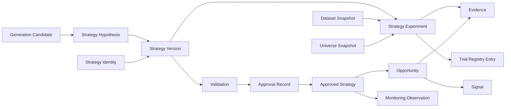

# فاز ۱ — کشف محصول و چشم‌انداز: Opportunity Center

> **وضعیت:** تکمیل‌شده در 2026-11-08 · **مبنا:** `da6d6177` (نوک Stage 3) · **شاخه:** `mission/opportunity-center-design-2026-11-08`
> **دروازهٔ فاز:** ماهیت محصول، قابلیت تولید استراتژی، مرز مسئولیت با صفحات فعلی و ارزش متمایز آن کاملاً روشن باشد.
> **برچسب شواهد:** **تأییدشده** = در کد/دادهٔ همین مبنا دیده شد؛ **سنجیده** = عدد با روش و تاریخ؛ **سند** = در سند موجود آمده و دوباره سنجیده نشد؛ **فرضیه** = پیشنهاد/فرض کاری؛ **نامعلوم** = راستی‌آزمایی‌نشده یا متناقض.

---

## ۰) خلاصهٔ اجرایی

- Opportunity Center یک اسکنر، فید سیگنال یا داشبورد عمومی نیست. یک **لایهٔ تصمیم و پژوهش** است که دو مسئولیت را عمداً جدا نگه می‌دارد: کشف و توضیح فرصت‌های جاری از استراتژی‌های تأییدشده، و تولید/آزمایش/اعتبارسنجی/نسخه‌بندی/تأیید استراتژی‌های تازه.
- **FTS یک استراتژی کانونیکال مستقل است**؛ Opportunity Center خروجی معتبر آن را مصرف و مقایسه می‌کند، اما منطق، آستانه یا قاعدهٔ آن را بازپیاده نمی‌کند. مرجع قواعد، جزوهٔ FTS و رأی‌های مالک است.
- امروز سیگنال‌ها و داوری‌ها پراکنده‌اند و موجودیت‌های Strategy، Strategy Version، Experiment، Evidence، Validation و Opportunity در کد و داده وجود ندارند. این شکاف، مسئلهٔ اصلی محصول است.
- Backtest موجود (Python) از API و UI جدا و خوابیده است؛ فرض‌هایش خوش‌بینانه‌اند (کارمزد ۳۰bp هر طرف، پر شدن در بازگشایی، بدون قید صف و بدون تسویهٔ T+2). این موتور **مرجع پژوهش و Oracle تست** است، نه Runtime آینده.
- پیشنهاد محصول: مدل **دوسطحی** — «میز فرصت» برای استفادهٔ روزانه و «میز پژوهش» برای تولید و اعتبارسنجی — با یک رجیستری استراتژی و یک مدل شواهد مشترک. این مدل دو مسئولیتی را که مأموریت گفته نباید اشتباه گرفته شوند، جدا می‌کند.
- تولید استراتژی مرحله‌ای است: قاعده و عامل با IR تایپ‌شده اول؛ جست‌وجوی محدود و ML بعداً و فقط پژوهشی؛ AI فقط پیشنهاد فرضیه، هرگز اثبات.
- تأیید استراتژی فقط پس از اعتبارسنجی خارج از نمونه، تعدیل آزمون‌های مکرر، استرس هزینه/صف/نقدشوندگی و تأیید انسانی معنا دارد. **آستانه‌ها رأی مالک است** و در `OPEN-QUESTIONS.md` ثبت شده‌اند.
- فاز ۴ تا پذیرش نهایی Stage 4 نهایی نمی‌شود. اسناد فازهای ۱ تا ۳ به «معماری تأییدنشدهٔ Stage 4» وابسته نیستند.

---

## ۱) روش، مبنا و دامنهٔ شواهد

- بررسی کد و اسناد در Worktree مستقل با مبنا `da6d6177` انجام شد. `main` اجداد این کامیت است؛ بنابراین همهٔ کامیت‌های `main` در مبنا حاضرند. Stage 3 روی `main` ادغام نشده است.
- Stage 4 در این مبنا نیست. کارهای uncommitted آن در Worktree دیگر خوانده یا تغییر داده نشدند. وضعیت Stage 4 در این مجموعه «در جریان / تأییدنشده» است.
- منابع وب با تاریخ دسترسی 2026-11-08 در `RESEARCH-REFERENCES.md` ثبت شده‌اند. ادعای فروشنده از رفتار مستندشده جدا شده است.
- هیچ آستانه یا فرمول تازه‌ای برای FTS ساخته نشد. هر جا شواهد کافی نبود، «نامعلوم» ثبت شد.
- این فاز فقط طراحی است: هیچ کد Runtime، API، جدول، مدل یا تغییر محصول ساخته نشد.

---

## ۲) وضعیت واقعی محصول (Current-State Evidence)

### ۲.۱ سطح محصول و ناوبری

| یافته | شاهد | وضعیت |
|---|---|---|
| `frontend-v2` چهار صفحهٔ زنده دارد: بازار، تکنیکال، وضعیت بازار، بنیادی؛ به‌همراه اعلان‌ها | `frontend-v2/src/app/App.tsx:11-24` | تأییدشده |
| گروه «کشف فرصت» در ناوبری وجود دارد، اما «فرصت‌ها» و «غربالگری FTS» غیرفعال‌اند | `frontend-v2/src/app/shell/Sidebar.tsx:11-27` | تأییدشده |
| «دیده‌بان»، «پرتفوی» و «سرخطی» نیز غیرفعال‌اند | همان | تأییدشده |
| هیچ صفحه یا مسیر Opportunity Center وجود ندارد | جست‌وجوی کد | تأییدشده |

**نتیجه:** جای ناوبری Opportunity Center از قبل رزرو شده است؛ نیازی به پوستهٔ تازه یا بازطراحی ناوبری سراسری نیست. تصمیم نهایی IA در فاز ۳ است.

### ۲.۲ بک‌اند، داده و مالکیت نوشتن

| یافته | شاهد | وضعیت |
|---|---|---|
| `routes.json` فهرست ۱۴۲ مسیر Python را دارد؛ Go فقط زیرمجموعه‌ای را پیاده کرده و بقیه 501 می‌گیرند | `backend-go/internal/httpapi/routes.json`، `server.go` | تأییدشده |
| `borsd` سرور Go و `bors-producer` نویسندهٔ مستقل داده است | `backend-go/cmd/borsd`، `cmd/bors-producer` | تأییدشده |
| `market.db` و `codal.db` برای سرور فقط‌خواندنی‌اند؛ `user.db` تنها دیتابیس نوشتنی است | `backend-go/internal/db/db.go:67-130` | تأییدشده |
| نوشتن `market.db` فقط از مسیر قفل تک‌نویسندهٔ producer مجاز است | `backend-go/internal/tsetmc/lock.go` | تأییدشده |
| FTS بنیادی در Python زنده است؛ FTS تکنیکال در چارت Go و Python وجود دارد | `fts_engine.py`، `api/chart.py`، `backend-go/internal/chart` | تأییدشده |
| مسیر `/api/fts` فهرست بنیادی در Go هنوز 501 است | `routes.json` و `server.go` | تأییدشده |

**نتیجه:** Runtime آینده Go است. طراحی نباید به Python وابسته شود؛ اما منطق موجود Python برای پژوهش، مقایسه و Oracle تست ارزش دارد و باید مستند شود.

### ۲.۳ قابلیت‌های استراتژی، آزمایش و اعتبارسنجی

| یافته | شاهد | وضعیت |
|---|---|---|
| موجودیت Strategy/Strategy Version/Experiment/Opportunity در کد و schema وجود ندارد | بازبینی کد و دیتابیس؛ `docs/research/STRATEGY-FTS-READ-ONLY-AUDIT-2026-10-17.md:284-310` | تأییدشده |
| استراتژی سفارشی ماندگار نمی‌شود؛ `custom` فقط زنجیرهٔ ارسالی مرورگر است | همان سند؛ `api/funnel.py` | تأییدشده |
| سه موتورِ داوری موازی و چهار استور مجزا وجود دارد | `docs/plans/strategy-unification-plan.md:9-36` | سند |
| Backtest نقطه‌در‌زمان وجود دارد اما API/UI ندارد و از محصول جدا است | `backtest_engine.py:67-99`؛ `tools/bot_backtest_run.py` | تأییدشده |
| مدل هزینهٔ پیش‌فرض ۳۰bp هر طرف + ۱۰bp لغزش + سقف ۲٪ حجم روز است | `trade_sim.py:53-58` | تأییدشده |
| پر شدن در بازگشایی روز بعد و فقط داخل دامنهٔ مجاز | `backtest_engine.py:287-338`؛ `trade_sim.py:198-213` | تأییدشده |
| صف قفل، تسویهٔ T+2 و اثر بازار مدل نمی‌شوند | `trade_sim.py:190-297`؛ `docs/TSETMC-DATA-GAP-MATRIX.md:659-692` | تأییدشده |
| Paper Trading وجود دارد اما دستی و همیشه کاغذی است | `paper_trading.py`، `/api/bot/*` | تأییدشده |
| ثبت تعداد آزمایش‌ها، DSR/PBO، Holdout قفل‌شده و رجیستری نسخه وجود ندارد | بازبینی کد؛ اسناد پژوهشی | تأییدشده |

**نتیجه:** قطعات خام (BarView، Trade Sim، Paper) ارزشمندند، اما «سیستم اعتبارسنجی» و «رجیستری استراتژی» وجود ندارد. بدون این دو، تولید استراتژی فقط تولید کاندید است، نه تولید اعتبار.

### ۲.۴ کفایت داده و ریسک‌های بنیادی

| محدودیت | شاهد | اثر بر محصول |
|---|---|---|
| نبود تاریخچهٔ عمق سفارش و صف | `docs/TSETMC-DATA-GAP-MATRIX.md:109,659-692` | بک‌تست صف و سرخطی تاریخی ممکن نیست؛ مدل محافظه‌کارانه لازم است |
| نبود کندل دقیقه‌ای/تیک | `docs/research/LOCAL-ALGORITHMIC-LEARNING-ARCHITECTURE.md:159-170` | استراتژی درون‌روزی از دامنهٔ اولیه خارج است |
| نبود تاریخچهٔ توقف/بازگشایی و تغییر نماد | `docs/TSETMC-DATA-GAP-MATRIX.md:144,461` | تداوم یونیورس و رویدادکاوی مختل می‌شود |
| نبود قید نقطه‌در‌زمان برای صورت‌های مالی | `fts_engine.py` بدون فیلتر `publish_date <= as_of`؛ `api/fundamental.py` زمان منبع را گزارش می‌کند نه برش بازپخش | نشت اطلاعات آینده در بک‌تست بنیادی |
| سوگیری بقا در فهرست نمادها | `docs/research/LOCAL-ALGORITHMIC-LEARNING-ARCHITECTURE.md:159-170` | نتایج گذشته خوش‌بینانه می‌شوند |
| ناهمگونی دامنهٔ نوسان در دوره‌های مختلف | منابع متناقض؛ `docs/TAPE_FILTERS_VS_SOURCES_1405-07-18.md:51` | درصد ثابت ممنوع؛ باید از فیلد هر نشست استفاده شود |
| کارمزد و مالیات با منابع متناقض | `trade_sim.py:53-58` (proxy)؛ `docs/research/ALGORITHMIC-RESEARCH-ENGINE-SPEC.md:153-159` | نتایج رفت‌وبرگشتِ کم‌هزینه خوش‌بینانه‌اند |

**نتیجه:** اعتبارسنجی معتبر بدون «لایهٔ دادهٔ نقطه‌در‌زمان» و «مدل اجرای واقع‌گرایانه» ممکن نیست. این دو، پیش‌نیاز فاز ۲ و ۴ هستند، نه جزئیات پیاده‌سازی.

---

## ۳) مسئله (Problem Definition)

### ۳.۱ گزارهٔ مسئله

BorsTerminal امروز **داده و تحلیل** تولید می‌کند، اما **فرصت قابل‌توضیح** و **استراتژی قابل‌اعتماد** تولید نمی‌کند. کاربر باید ذهناً چند موتور و چند صفحه را ترکیب کند تا به یک تصمیم برسد؛ و اگر ایدهٔ تازه‌ای داشته باشد، ابزار استانداردی برای تعریف، آزمایش، اعتبارسنجی، نسخه‌بندی و مقایسهٔ آن ندارد.

### ۳.۲ هزینهٔ وضعیت فعلی

| هزینه | توضیح |
|---|---|
| سیگنال‌های ناهم‌سنج | پرچم‌های تابلو، ستاپ‌های تکنیکال، پنج محور FTS و ماتریس اعتماد، هر کدام زبان و تازگی خودشان را دارند. |
| نبود پروندهٔ شواهد | کاربر نمی‌تواند ببیند یک فرصت از چه شرایطی، با چه مقادیری، با چه تازگی و با چه شرایط ابطالی ساخته شده است. |
| نبود حافظهٔ تصمیم | تاریخچهٔ سیگنال و عملکرد همان استراتژی در شرایط مشابه وجود ندارد. |
| آزمایش موردی | ایده‌های تازه با اسکریپت یا تغییر موقت آزمایش می‌شوند؛ نه پیش‌ثبت، نه Holdout، نه ثبت تعداد آزمایش. |
| اعتماد بی‌پشتوانه | Backtest خوش‌بینانه می‌تواند به «اثبات» تبدیل شود؛ در حالی که فقط یک مشاهدهٔ درون‌نمونه است. |
| ناتوانی در بهبود | بدون رجیستری نسخه و شکست‌ها، تیم دوباره همان ایده‌ها را آزمایش می‌کند و یاد نمی‌گیرد. |

### ۳.۳ چرا اکنون

- زیرساخت Go، قرارداد کندل، تعدیل، FTS، قیف و Backtest خام آماده‌اند؛ قطعات لازم برای ساخت این لایه وجود دارند.
- Stage 3 داده‌های تولیدی Go را تثبیت کرده است؛ اما Stage 4 هنوز پذیرفته نشده و فاز ۴ باید صبر کند.
- تصمیم مالک در 2026-11-08 صریح است: تولید استراتژی هدف بنیادی محصول است، نه یک قابلیت جانبی.

---

## ۴) کاربران، Jobها و سناریوها

### ۴.۱ کاربر

محصول محلی و تک‌کاربره است. دو حالتِ همان کاربر تعریف می‌شود:

| حالت | توضیح | نیاز غالب |
|---|---|---|
| **معامله‌گر روزانه** | صبح بازار را مرور می‌کند، FTS و تابلو را می‌خواند، فرصت را بررسی و تصمیم می‌گیرد. | سرعت، تراکم، تازگی، دلیل، شرایط ابطال |
| **پژوهشگر** | فرضیه می‌سازد، استراتژی تعریف می‌کند، آزمایش و اعتبارسنجی می‌خواهد. | عمق، مقایسه، شواهد، بازتولیدپذیری |

این دو persona جدا نیستند؛ دو **حالت** از یک کاربرند. طراحی نباید محصول را به دو اپلیکیشن یا دو حساب تبدیل کند.

### ۴.۲ Jobها

| کد | Job | خروجی مطلوب |
|---|---|---|
| J1 | «الان چه چیزی ارزش توجه دارد و چرا؟» | فید فرصت‌های تازه با دلیل، استراتژی مولد و تازگی |
| J2 | «این فرصت از چه شرایطی ساخته شده و چه چیزی آن را باطل می‌کند؟» | پروندهٔ شواهد با مقادیر واقعی، منبع، زمان و شرایط ابطال |
| J3 | «این دو فرصت/استراتژی را در چه ابعادی مقایسه کنم؟» | مقایسهٔ چندبعدی، بدون امتیاز منفرد مبهم |
| J4 | «فرضیه‌ام را چطور به یک استراتژی قابل‌آزمون تبدیل کنم؟» | تعریف نسخه‌دار با IR تایپ‌شده |
| J5 | «این استراتژی واقعاً edge دارد یا نتیجهٔ شانس/بیش‌برازش است؟» | گزارش اعتبارسنجی با OOS، WF، DSR/PBO، هزینه و نمونه |
| J6 | «چه کسی/با چه شواهدی این استراتژی را تأیید کرد؟» | رکورد تأیید، نسخه، دامنهٔ اعتبار و تاریخ ابطال |
| J7 | «استراتژی تأییدشده‌ام افت کرده؟» | پایش drift، نقض شرایط، هشدار و تعلیق |
| J8 | «سیستم چه فرضیه‌های تازه‌ای پیشنهاد می‌دهد؟» | کاندیدهای قابل‌بررسی، نه استراتژی تأییدشده |
| J9 | «چه ایده‌هایی قبلاً رد شدند و چرا؟» | آرشیو شکست‌ها و جلوگیری از تکرار |

### ۴.۳ سناریوهای اصلی

**سناریوی ۱ — صبحِ معامله‌گر.** کاربر وارد «میز فرصت» می‌شود؛ ۱۲ فرصت از ۳ استراتژی تأییدشده می‌بیند. فیلتر «فقط FTS» و «تازگی کمتر از ۵ دقیقه» را می‌زند. یک فرصت را باز می‌کند: سیگنال‌های محرک، مقادیر، منبع هر داده، زمان محاسبه، شرایط ابطال و پایهٔ تاریخی همان استراتژی. با یک کلیک به چارت و بنیادی می‌رود. هیچ عددی بدون برچسب تازگی و منبع نیست.

**سناریوی ۲ — پژوهش.** کاربر فرضیهٔ «شکست مقاومت جت با تأیید قدرت خرید حقیقی در رژیم صعودی» را ثبت می‌کند. فرضیه پیش‌ثبت می‌شود: یونیورس، افق، اثر انتظاری، شرایط ابطال، آزمون‌های برنامه‌ریزی‌شده. سپس نسخهٔ ۱ استراتژی را با اسلات‌های استاندارد می‌سازد، آزمایش درون‌نمونه و خارج‌نمونه اجرا می‌کند، WF و DSR/PBO می‌گیرد، استرس هزینه و صف می‌زند. نتیجه یا رد می‌شود یا برای Paper و سپس تأیید انسانی می‌رود.

**سناریوی ۳ — تولید.** کاربر درخواست کاندید می‌دهد. موتور تولیدِ مرحلهٔ اول، فقط از قالب‌ها و ترکیب‌های مجاز، ۲۰ کاندید می‌سازد. هر کاندید در Trial Registry ثبت می‌شود. کاربر ۳ کاندید را به فرضیه ارتقا می‌دهد؛ بقیه با دلیل رد می‌شوند. هیچ کاندیدی به‌صورت خودکار وارد فید فرصت نمی‌شود.

**سناریوی ۴ — پایش.** یک استراتژی تأییدشده افت عملکرد نشان می‌دهد. پایش، نقض شرط یا drift را ثبت می‌کند؛ فرصت‌های آن استراتژی «معلق» علامت می‌خورند و از رتبه‌بندی خارج می‌شوند تا بازبینی یا تعلیق رسمی.

---

## ۵) مدل مفهومی و موجودیت‌ها

### ۵.۱ تعریف موجودیت‌های اصلی

| موجودیت | تعریف | تغییرناپذیری | چرخهٔ عمر |
|---|---|---|---|
| **Signal** | مشاهدهٔ تاریخ‌دار و قابل‌بازتولید از یک موتور که شرطی را برای یک نماد در یک زمان برقرار می‌داند؛ شاهد است، نه توصیه. | پس از صدور، Append-Only | emitted → fresh → stale → expired/invalidated |
| **Strategy Hypothesis** | گزارهٔ ابطال‌پذیر دربارهٔ رفتار بازار با دلیل، یونیورس، افق، اثر انتظاری و شرایط ابطال؛ قبل از آزمون ثبت می‌شود. | پس از ثبت، تغییر نمی‌کند | draft → registered → testing → supported/rejected/inconclusive → archived |
| **Strategy** | هویت پایدار یک خط پژوهشی؛ نسخه‌ها زیر آن قرار می‌گیرند. | هویت پایدار | active → suspended → deprecated → retired |
| **Strategy Version** | مشخصات اجرایی و تغییرناپذیر یک استراتژی: یونیورس، داده، ورود/خروج/فیلتر/پارامتر/ریسک/فرض اجرا، با نسخهٔ سمانتیک و هش محتوا. | کاملاً تغییرناپذیر؛ تغییر = نسخهٔ جدید | draft → backtested → out_of_sample → paper → approved → suspended/deprecated/retired؛ rejected در هر دروازه |
| **Strategy Experiment** | اجرای بازتولیدپذیر یک نسخه روی یک برش داده با پروتکل و مدل هزینه؛ مانیفست + نتیجه. | کاملاً تغییرناپذیر | queued → running → completed/failed/cancelled → archived |
| **Evidence** | آرتیفکت عددی/تصویری/متنی که یک ادعا را پشتیبانی یا رد می‌کند: متریک، نمونهٔ معاملات، تفکیک رژیم، اندازهٔ نمونه، منبع، تعداد آزمایش. | تغییرناپذیر | created → attached → superseded |
| **Validation** | فرایند و حکم انطباق یک نسخه با معیارهای پیش‌ثبت‌شده؛ شامل OOS، WF، DSR/PBO، استرس هزینه/صف، کفایت نمونه و پایداری رژیم. | حکم تغییرناپذیر؛ حکم تازه = Validation تازه | pending → running → passed/failed/inconclusive → expired |
| **Opportunity** | کاندید تاریخ‌دار و رتبه‌بندی‌شده از اعمال یک نسخهٔ تأییدشده روی دادهٔ جاری؛ با سیگنال‌های محرک، شواهد، تازگی، شرایط ابطال و پیوند به نسخه. | Snapshot تشخیص تغییرناپذیر؛ وضعیت Append-Only | detected → ranked → surfaced → reviewed → acted/ignored/expired/invalidated |
| **Approved Strategy** | نسخهٔ استراتژی + Validation معتبر + رکورد تأیید انسانی. مجوز استفاده در کشف فرصت است، نه مجوز معاملهٔ واقعی. | نسخه و حکم تغییرناپذیر؛ ابطال Append-Only | requested → approved → suspended → revoked/expired |

### ۵.۲ موجودیت‌های پشتیبان

| موجودیت | نقش |
|---|---|
| **Generation Candidate** | خروجی موتور تولید پیش از ارتقا به فرضیه؛ با منشأ، قالب، پارامترها و دلیل رد/پذیرش. |
| **Dataset Snapshot** | هش داده، بازه، یونیورس، مبنای قیمت و نسخهٔ قراردادهای کندل/تعدیل. |
| **Trial Registry Entry** | هر آزمایش/کاندید با شناسه، خانواده، پارامترها و وضعیت؛ ورودی محاسبهٔ DSR/PBO. |
| **Universe Snapshot** | فهرست نمادهای مجاز در یک تاریخ، با دلیل شمول/حذف و وضعیت داده. |
| **Approval Record** | تأییدکننده، زمان، دامنه، شرایط و ابطال. |
| **Monitoring Observation** | مشاهدهٔ پس از تأیید: عملکرد، drift، نقض شرط و هشدار. |

### ۵.۳ رابطه‌ها

### ۵.۴ قواعد تغییرناپذیر مدل

1. یک استراتژی = یک هویت پایدار + نسخه‌های تغییرناپذیر. ویرایش درجا ممنوع است.
2. هر ادعا باید به Experiment و Evidence وصل باشد؛ شواهد شناور ممنوع است.
3. تعداد آزمایش‌ها باید در Trial Registry ثبت شود؛ بدون N، DSR/PBO بی‌معنا است.
4. Approved = Validation معتبر + تأیید انسانی. Backtest تنها کافی نیست.
5. Opportunity فقط از Approved Strategy تولید می‌شود؛ استراتژی تأییدنشده فرصت تولید نمی‌کند.
6. FTS یک استراتژی کانونیکال است؛ خروجی‌اش شاهد است و منطقش بازپیاده نمی‌شود. قواعد FTS به سایر استراتژی‌ها تحمیل نمی‌شوند.
7. بی‌پاسخ ≠ عبور؛ stale ≠ fresh؛ unavailable یک وضعیت رسمی است.
8. هر نتیجه باید با Dataset Snapshot + Engine Version + Params + Seed + Trial Count بازتولید شود.
9. رتبه‌بندی چندبعدی و قابل‌توضیح است؛ امتیاز منفرد مبهم ممنوع است.
10. داده از ماشین خارج نمی‌شود؛ مدل یا ابر اختیاری است، نه پیش‌نیاز.
11. تأیید انسانی تنها دروازهٔ Approved است؛ AI هرگز تأیید نمی‌کند.
12. شکست‌ها نیز ثبت می‌شوند؛ رد شدن یک ایده یک نتیجهٔ معتبر است.

---

## ۶) جایگاه محصول و مرز مسئولیت‌ها

| سطح | مسئولیت | مسئول نیست برای |
|---|---|---|
| **بازار / تابلو** | تابلوی زنده، فیلترهای تابلو، وضعیت صف و نبض بازار | تأیید استراتژی یا رتبه‌بندی فرصت |
| **تکنیکال** | چارت، اندیکاتور، ستاپ، لایه‌های FTS تکنیکال | اعتبارسنجی آماری استراتژی |
| **بنیادی** | پنج محور FTS، صورت‌های مالی، تقویم رویدادها | موتور آزمایش یا تأیید |
| **غربالگری FTS** | خروجی کانونیکال استراتژی FTS | آزمایشگاه استراتژی عمومی |
| **Opportunity Center — میز فرصت** | فید، رتبه‌بندی، توضیح، تازگی، ابطال، پایش فرصت‌ها | تعریف یا نسخه‌بندی استراتژی |
| **Opportunity Center — میز پژوهش** | کتابخانه، فرضیه، نسخه، آزمایش، اعتبارسنجی، تأیید، پایش استراتژی | جایگزینی صفحات داده یا چارت |
| **درخت استراتژی پنج‌صفحه‌ای** | نقشهٔ تاریخی/آموزشی موجود | توسعه، بازطراحی یا حذف در این مأموریت |
| **پرتفوی / دیده‌بان** | نگهداری دارایی و تصمیم‌های سبد | کشف فرصت یا اثبات استراتژی |
| **سرخطی / اجرا** | اجرای سفارش و اتصال کارگزاری | مجوز خودکار برای معامله |

### ۶.۱ موضع نسبت به FTS

- FTS یک استراتژی مستقل و مهم است؛ پیشنهاد این طراحی این است که **اولین استراتژی تأییدشدهٔ کانونیکال** باشد تا میز فرصت از روز اول ارزش داشته باشد. این پیشنهاد نیازمند رأی مالک است (`OPEN-QUESTIONS.md`، Q6).
- Opportunity Center خروجی FTS را از مسیرهای موجود (خروجی بنیادی، خروجی تکنیکال، قیف) مصرف می‌کند و آن را در کنار استراتژی‌های دیگر نمایش و مقایسه می‌دهد.
- منطق، آستانه، استثنا و ترتیب گیت‌های FTS بازنویسی نمی‌شود. هر تغییری در FTS مأموریت جداگانه و مجوز جداگانه می‌خواهد.
- قواعد FTS به سایر استراتژی‌ها تحمیل نمی‌شوند؛ هر استراتژی فرضیه، ورودی و گیت‌های خودش را دارد.

---

## ۷) دامنه و غیراهداف

### ۷.۱ در دامنه (طراحی)

| حوزه | محتوا |
|---|---|
| میز فرصت | فید، فیلتر، رتبه‌بندی قابل‌توضیح، جزئیات، شواهد، تازگی، ابطال، تاریخچه، مقایسه، پیوند به چارت/بنیادی |
| میز پژوهش | کتابخانه، رجیستری فرضیه، تعریف نسخه‌دار، آزمایشگاه، اعتبارسنجی، مقایسه، تأیید، پایش، تاریخچهٔ شکست |
| تولید | قاعده‌محور، عامل‌محور، جست‌وجوی محدود، ML پژوهشی، AI پیشنهادی — با لایه‌بندی مشخص |
| شواهد و داده | منشأ، Snapshot، نقطه‌در‌زمان، Trial Registry، کفایت نمونه |
| قراردادها | قرارداد موتور استراتژی، قرارداد FTS، قرارداد API — تفصیل در فازهای ۲ و ۴ |

### ۷.۲ خارج از دامنه

- معاملهٔ واقعی، ارسال سفارش یا اتصال کارگزاری. Approved مجوز معامله نیست.
- بازپیاده‌سازی منطق FTS یا تغییر آستانه‌های آن.
- جایگزینی صفحات بازار/تکنیکال/بنیادی. آن‌ها مرجع جزئیات و شواهد می‌مانند.
- توسعه یا بازطراحی درخت استراتژی پنج‌صفحه‌ای؛ حذف آن نیز ممنوع است.
- ابر، چندکاربره، اشتراک‌گذاری داده یا خروج داده از ماشین.
- Python به‌عنوان وابستگی Runtime. Python فقط پژوهش/آزمون/Oracle.
- بک‌تست دقیقه‌ای/تیک/عمق سفارش تا زمانی که دادهٔ تاریخی وجود ندارد.
- داشبورد عمومی، بازارچهٔ سیگنال یا فید بی‌پایان.
- بهینه‌سازی سبد و تخصیص سرمایه در نسخهٔ اول؛ اتصال فرصت به پرتفوی یک یکپارچه‌سازی آینده است.

---

## ۸) روش‌های تولید استراتژی

### ۸.۱ مقایسهٔ روش‌ها

| روش | خروجی | قابلیت حسابرسی | شواهد کلیدی | ریسک بیش‌برازش | داده/محاسبه | تناسب با ایران | پیشنهاد |
|---|---|---|---|---|---|---|---|
| **Rule-based** | قاعده و پارامتر در AST | بالا | Brock 1992 [R35]؛ Sullivan 1999 [R23] | متوسط | ۵–۱۰ سال روزانه؛ سبک | بالا، اگر صف و دامنه مدل شود | **اول** |
| **Statistical Pattern** | قالب الگو + آمار برخورد | متوسط | Lo 2000 [R29] | بالا | ۱۰ سال+ دادهٔ تمیز؛ متوسط | پایین–متوسط | **پژوهشی، بعداً** |
| **Quant Factor** | تعریف عامل، رتبه، وزن | بالا | Harvey 2016 [R22]؛ Gu 2020 [R28] | متوسط–بالا | ۱۰ سال+، ≥۳۰۰ نماد، PIT | متوسط | **اول برای پژوهش** |
| **GP / Evolutionary** | درخت عبارت/قاعده | متوسط | Allen 1999 [R14] (بدون edge پس از هزینه در OOS) | بسیار بالا | ۱۰⁴–۱۰⁵ ارزیابی/ساعت/هسته | پایین–متوسط | **بعداً، محدود** |
| **Symbolic Regression** | معادلهٔ فشرده | بالا | Schmidt 2009 [R16]؛ Cranmer 2020 [R17]؛ La Malfa 2021 [R30] | بالا | ۵–۱۰ سال؛ متوسط–سنگین | پایین–متوسط | **فقط پژوهش** |
| **ML** | وزن/درخت | پایین | Gu 2020 [R28]؛ Israel 2020 [R27] | بالا | ۱۵ سال+؛ دقیقه تا روز | پایین در حال حاضر | **فقط پژوهش، آفلاین** |
| **AI-assisted** | فرضیه/فرمول/کد | متوسط | Alpha-GPT [R31]، AlphaAgent [R32] — شواهد نوپا | بسیار بالا | LLM + PIT؛ متغیر | پایین به‌عنوان اثبات | **فقط پیشنهاد فرضیه** |
| **Hybrid** | پیشین → قالب → جست‌وجو → اعتبارسنجی | بالا | AlphaForge [R34]؛ ترکیبی | کنترل‌شده با بودجه | مانند بالا | بالا | **معماری تولید** |

### ۸.۲ توصیهٔ لایه‌ای

1. **جریان تولید معتبر (Production):** قاعده‌محور و عامل‌محور روی یک IR تایپ‌شده، قطعی، قابل‌حسابرسی و Go-native. تولید فقط در چارچوب قالب‌ها و اسلات‌های مجاز؛ هر کاندید در Trial Registry.
2. **جریان پژوهشی (Research):** GP محدود، Symbolic Regression و ML منظم، فقط برای اصلاح فرضیهٔ انسانی. اجرای آفلاین/طراحی‌زمانی؛ خروجی AST/JSON؛ ورود به همان اعتبارسنجی؛ هرگز تأیید خودکار.
3. **جریان AI:** فقط پیشنهاد فرضیه یا ساختار. بازبینی انسانی، Sandbox، ثبت در Trial Registry. هیچ ادعای سودآوری از خروجی AI پذیرفته نمی‌شود.
4. **هرگز در مسیر اثبات:** جست‌وجوی باز، انتشار خودکار خروجی LLM، شبکهٔ عمیق به‌عنوان اثبات، استراتژی درون‌روزی بدون داده، هر کاندید بدون OOS و تعداد آزمایش.

### ۸.۳ چیزی که موتور تولید نباید بکند

- تولید استراتژی را به «تولید سود» یا «اثبات اعتبار» تبدیل کند.
- دادهٔ مصنوعی یا نتیجهٔ دلبخواه به‌عنوان شاهد تولید کند.
- آستانه یا قاعدهٔ FTS را تغییر دهد یا از آن الگو بگیرد و آن را به همه تعمیم دهد.
- کاندیدی را بدون ثبت و بدون دلیل رد/پذیرش دور بریزد.
- تعداد آزمایش را پنهان کند یا آزمایش‌های تکراری را به‌عنوان شواهد مستقل بشمارد.

---

## ۹) پژوهش رقابتی

### ۹.۱ مقایسهٔ فشرده

| پلتفرم | تولید/نویسندگی | اعتبارسنجی | شفافیت/توضیح | نسخه‌بندی و بازتولید | برای ما |
|---|---|---|---|---|---|
| **QuantConnect / LEAN** [R1][R2][R3] | کد C#/Python؛ بهینه‌سازی جدولی | Walk-forward مستند؛ Holdout و محدودیت آزمایش | تعریف Overfitting و راهنمای پژوهش | Data/Project محلی؛ رجیستری تغییرناپذیر مستند نشده | انضباط پژوهشی را بگیر، Runtime را نه |
| **Composer** [R4] | درخت بصری «Symphony»؛ کتابخانهٔ بزرگ | OOS/WF مستند نشده؛ فقط Disclaimer | قابل‌فهم برای کاربر عادی | ابری و اختصاصی | ترکیب بصری و Clone/Compare را بگیر، اجرای خودکار را نه |
| **Portfolio Visualizer** [R5] | فرم؛ بدون تولید استراتژی | بهینه‌سازی وزن، نه اعتبارسنجی استراتژی | منبع داده و Disclaimer شفاف | نسخه‌بندی آزمایش مستند نشده | برچسب منبع و «فرضی» را بگیر |
| **TradingView** [R6][R7] | Pine؛ اکوسیستم اسکریپت | Emulator میل‌به‌میل؛ بدون WF/تعدیل آزمون مکرر | هشدار Repaint/Lookahead؛ کمیسیون/اسلیپیج قابل‌تنظیم | نسخهٔ اسکریپت، نه آزمایش | هشدارهای واقع‌گرایی را بگیر |
| **MetaTrader 5** [R8][R9] | MQL5؛ بهینه‌سازی ژنتیکی | Forward period مستند | جدول بهینه‌سازی؛ بدون متریک تعدیل‌شده | فایل‌های محلی؛ بدون رجیستری نسخه | تقسیم Forward را بگیر |
| **vectorbt** [R10] | پایتون؛ جاروب پارامتر | Train/Test در نسخهٔ PRO | Heatmap پارامتر | فقط کد/داده | Heatmap و Split را بگیر |
| **QuantRocket** [R11][R12] | Python/Docker محلی | WF برای ML مستند | داده و Credential محلی | دادهٔ محلی؛ نه رجیستری تغییرناپذیر | ایدهٔ Local-first را بگیر، Stack را نه |
| **ایران (رهاورد ۳۶۵ و مشابه)** [R13] | Replay دستی؛ بدون مستند تولید خودکار | اعتبارسنجی عمومی مستند نشده | نامعلوم | نامعلوم | هیچ ادعای اعتبارسنجی را بدون بازتولید قبول نکن |

### ۹.۲ درس‌های کلیدی

1. **Walk-forward مستند کمیاب است.** LEAN و MT5 آن را مستند کرده‌اند؛ بسیاری دیگر فقط Disclaimer دارند.
2. **کنترل‌های واقع‌گرایی کفِ محصول‌اند، نه مزیت:** کمیسیون، اسلیپیج، مدل پرشدن، هشدار Repaint و دادهٔ مصنوعی.
3. **تعدیل آزمون‌های مکرر تقریباً هیچ‌جا مستند نیست.** Trial Registry + DSR/PBO + Holdout قفل‌شده یک تمایز واقعی و کم‌هزینه است.
4. **«کشف» امروز اغلب بازارچهٔ مرتب‌شده بر اساس بازده درون‌نمونه است.** ما باید بر اساس بقای خارج‌نمونه، پایداری پارامتر و پوشش رژیم رتبه بدهیم.
5. **نسخه‌بندی، شکاف جهانی است.** هیچ پلتفرم بررسی‌شده، آرتیفکت تغییرناپذیرِ متصل‌کنندهٔ Code Hash + Params + Data Snapshot + Seed + Trial Count را مستند نکرده است.
6. **ایران بنچمارک عمومی تأییدشده ندارد.** این فرصت واقعی است، اما نباید ادعای اعتبارسنجی را از فروشندهٔ ایرانی بدون بازتولید بپذیریم.
7. **بهینه‌ساز، ماشین Data Snooping است.** اگر عرضه شود، باید Trial Counter، Holdout قفل‌شده و WF پیش‌فرض داشته باشد.

### ۹.۳ چه چیزی را کپی نکنیم

- اجرای ابری، بازارچهٔ استراتژی یا شبکهٔ بهینه‌سازی.
- وابستگی Runtime به Python/Docker.
- بهینه‌سازی ژنتیکی به‌عنوان پیش‌فرض.
- «Backtest سپس اجرای خودکار» بدون Holdout و تأیید صریح.
- تاریخچهٔ پولی/پنهان؛ دادهٔ محلی دلیل خوبی برای شفافیت است.

---

## ۱۰) مدل‌های محصول و پیشنهاد

| مدل | Landing | قدرت | ریسک | تناسب با مأموریت |
|---|---|---|---|---|
| **A — Opportunity-first** | فید فرصت‌ها | ارزش روزانهٔ فوری؛ نزدیک به کار معامله‌گر | تبدیل شدن به فید سیگنال؛ پنهان‌شدن عمق پژوهش و تولید | متوسط |
| **B — Research-first** | کتابخانه + آزمایشگاه | عمق علمی و تمایز واقعی | ارزش روزانه دیر می‌آید؛ فاصله از کار روزانهٔ مالک | متوسط–پایین |
| **C — Two-surface** | میز فرصت (پیش‌فرض) + میز پژوهش | دو مسئولیت جدا، یک رجیستری و یک مدل شواهد؛ قابل‌عرضهٔ مرحله‌ای | نیاز به پیوند قوی و مرز روشن؛ خطر احساس «دو محصول» | **بالا — پیشنهاد** |

### ۱۰.۱ پیشنهاد: مدل C

- **میز فرصت** پاسخ «الان چه چیزی مهم است و چرا؟» را می‌دهد. از استراتژی‌های تأییدشده تغذیه می‌شود، نه از کاندیدهای تأییدنشده.
- **میز پژوهش** پاسخ «چطور یک استراتژی بسازم و اعتبارش را ثابت کنم؟» را می‌دهد. کتابخانه، فرضیه، نسخه، آزمایش، اعتبارسنجی، مقایسه، تأیید و پایش.
- هر دو یک رجیستری استراتژی، یک مدل شواهد و یک واژگان رتبه‌بندی دارند. پیوند دوطرفه: فرصت → نسخه → Validation → Experiment؛ و کتابخانه → فرصت‌های همان استراتژی.
- عرضهٔ مرحله‌ای توصیه‌شده:
  1. **نسخهٔ ۱:** میز فرصت با FTS به‌عنوان اولین استراتژی تأییدشده؛ شواهد، تازگی، ابطال و تاریخچه. بدون موتور تولید.
  2. **نسخهٔ ۲:** میز پژوهش با رجیستری، فرضیه، IR، آزمایش و اعتبارسنجی برای استراتژی‌های قاعده‌محورِ انسانی.
  3. **نسخهٔ ۳:** تولید محدود، مقایسهٔ عمیق، پایش drift و پیشنهادهای AI.

این مرحله‌بندی **پیشنهاد محصول** است، نه تصمیم مالک؛ در فاز ۴ به مأموریت‌های اجرایی تبدیل می‌شود.

---

## ۱۱) اصول محصول

1. **شواهد بر خروجی مقدم است.** یک استراتژی تولیدشده تا وقتی اعتبارسنجی نشده، کاندید است.
2. **یک حقیقت برای هر مفهوم.** یک رجیستری استراتژی، یک مدل حکم، یک مدل منشأ داده؛ موتور موازی ممنوع.
3. **FTS کانونیکال است، نه قالب.** مصرف می‌شود؛ بازپیاده نمی‌شود؛ قواعدش تحمیل نمی‌شوند.
4. **توضیح‌پذیری یک فیلد است، نه یک تزئین.** هر فرصت باید Trace داشته باشد.
5. **امتیاز منفرد مبهم ممنوع.** مقایسه چندبعدی با ابعاد نام‌دار.
6. **بازتولیدپذیری ساختاری.** Snapshot + Engine + Params + Seed + N.
7. **محلی، CPU-first، بدون خروج داده.** ابر و GPU اختیاری‌اند، نه لازم.
8. **غیاب داده یک وضعیت رسمی است.** بی‌داده ≠ عبور؛ کهنه ≠ تازه.
9. **سطح روزانه سریع می‌ماند.** پژوهش سنگین جدا، قابل‌لغو و اولویت‌دار است.
10. **تأیید انسانی تنها دروازهٔ Approved است.** AI پیشنهاد می‌دهد، تأیید نمی‌کند.
11. **نسخه‌پذیر و قابل‌بازگشت.** هر تغییر نسخهٔ جدید؛ هر تأیید قابل‌ابطال.
12. **شکست هم نتیجه است.** رد شدن با دلیل، از تکرار همان ایده جلوگیری می‌کند.

---

## ۱۲) پیش‌نیازهای معماری (فقط پیش‌نویس؛ فاز ۴ پس از Stage 4)

این بخش **تصمیم نهایی معماری نیست** و تا پذیرش Stage 4 نهایی نمی‌شود. فقط وابستگی‌های شناخته‌شده را ثبت می‌کند:

1. **رجیستری استراتژی و آزمایش** با مالکیت نوشتن مشخص و نسخه‌بندی تغییرناپذیر.
2. **لایهٔ دادهٔ نقطه‌در‌زمان** برای بنیادی (`publish_date` cutoff، تجدید ارائه، یونیورس تاریخی) و تابلو/دامنه.
3. **هارنس اعتبارسنجی** شامل Walk-Forward، DSR/PBO، Trial Registry و Holdout قفل‌شده.
4. **مدل اجرای ایران** شامل دامنهٔ هر نشست، صف قفل، توقف/بازگشایی، کارمزد نامتقارن و T+2.
5. **قرارداد استراتژی** تایپ‌شده، نسخه‌دار و قابل‌Sandbox؛ بدون کد دلخواه در مسیر تولید.
6. **Read Modelهای فید فرصت و میز پژوهش** با تازگی و منشأ.
7. **جداسازی پژوهش سنگین** از Market/Technical با صف، لغو و سقف منابع.

---

## ۱۳) معیار تکمیل فاز ۱ و تحویل به فاز ۲

| معیار | وضعیت |
|---|---|
| وضعیت واقعی محصول در مبنا راستی‌آزمایی شد | انجام شد |
| مسئله، کاربر، Job و سناریوها تعریف شدند | انجام شد |
| ۹ موجودیت اصلی + موجودیت‌های پشتیبان + رابطه‌ها + چرخهٔ عمر + قواعد تغییرناپذیر | انجام شد |
| جایگاه و مرز با صفحات فعلی و FTS روشن شد | انجام شد |
| روش‌های تولید و توصیهٔ لایه‌ای ثبت شد | انجام شد |
| پژوهش رقابتی با منبع و تاریخ دسترسی ثبت شد | انجام شد |
| سه مدل محصول مقایسه و یک مدل پیشنهاد شد | انجام شد |
| اصول، دامنه و غیراهداف ثبت شدند | انجام شد |
| پرسش‌های باز و Decision Log ثبت شدند | انجام شد |
| بازبینی مالک بر فاز ۱ | در انتظار؛ طبق دستور، مانع شروع فاز ۲ نیست |

**وابستگی‌های فاز ۲:** مدل رسمی استراتژی و نسخه، چارچوب ارزیابی و واژه‌نامهٔ متریک‌ها، چارچوب اعتبارسنجی و Anti-overfitting، قیدهای بازار ایران، قرارداد یکپارچه‌سازی FTS، و مفهوم Research Engine.

---

## ۱۴) ارجاع‌ها

- منابع بیرونی و داخلی: `RESEARCH-REFERENCES.md`
- تصمیم‌ها و گزینه‌های ردشده: `DECISION-LOG.md`
- پرسش‌های مالکانه و پیش‌فرض‌ها: `OPEN-QUESTIONS.md`
- سند مرجع تصمیم‌های مهاجرت: `BorsTerminal-Desktop-Migration-Decisions.md` (بند ۱۰ افزوده شد)
