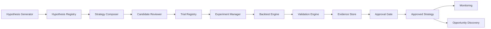
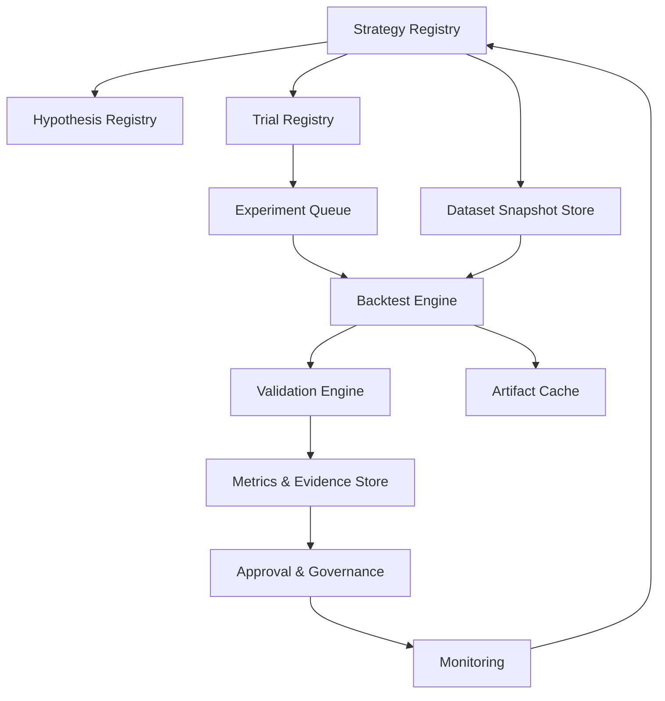

# فاز ۲ — Strategy Intelligence & Research Engine

> **وضعیت:** تکمیل‌شده در 2026-11-08 · **مبنا:** `da6d6177` · **شاخه:** `mission/opportunity-center-design-2026-11-08`
> **دروازهٔ فاز:** بتوان توضیح داد سیستم دقیقاً چگونه یک استراتژی جدید تولید می‌کند، چگونه آن را می‌آزماید و تحت چه شرایطی به آن اعتبار می‌دهد.
> **برچسب شواهد:** **تأییدشده** = در کد/دادهٔ همین مبنا؛ **سنجیده** = عدد با روش/تاریخ؛ **سند** = در سند موجود؛ **فرضیه** = پیشنهاد/فرض؛ **نامعلوم** = راستی‌آزمایی‌نشده.

---

## ۰) خلاصهٔ اجرایی

- **تولید ارزان است؛ اعتبارسنجی محصول است.** موتور تولید فقط کاندید می‌سازد. هیچ کاندیدی بدون ثبت آزمایش، خارج‌نمونه، تعدیل آزمون مکرر و تأیید انسانی به استراتژی تأییدشده تبدیل نمی‌شود.
- **مدل استراتژی، یک IR تایپ‌شده و نسخه‌دار است**، نه متن آزاد و نه کد دلخواه. اسلات‌های استاندارد (رژیم، ستاپ، تأیید، خروج، اندازه) فضای جست‌وجو را کنترل می‌کنند. تغییر هر جزء = نسخهٔ جدید.
- **اعتبارسنجی چندلایه است:** split زمانی و Holdout قفل‌شده، Walk-Forward با Embargo، Purged/CPCV، PBO/CSCV، DSR، RC/SPA، تعدیل آزمون مکرر، پایداری پارامتر، حساسیت رژیم، استرس هزینه/صف و آزمون‌های نشت.
- **یک امتیاز منفرد ممنوع است.** مقایسه با دروازه‌های سخت، Dominance، پروفایل چندبعدی، ترتیب لغوی و مقایسهٔ احتمالاتی انجام می‌شود. «تمایزناپذیر» یک نتیجهٔ معتبر است.
- **واقعیت داده، یک قید طراحی است:** در این checkout چند نشست پیوسته، تاریخچهٔ دامنه، عمق صف و نرخ رسمی کارمزد قابل اتکا موجود نیست. بنابراین «شواهد ناکافی» یک حکم رسمی است، نه شکست فنی.
- **قرارداد FTS مصرف‌محور است:** `fts.envelope/1` با حفظ سه‌حالتی، دلایل NA، نسخهٔ قواعد و Config Hash. FTS بازپیاده نمی‌شود؛ مقایسهٔ تاریخی فقط با Replay معتبر ممکن است.
- **شکاف Go جدی است:** `/api/fts` فهرست بنیادی و `/api/fundamental/screen` هنوز 501؛ `/api/screener` در Go فقط کش می‌خواند؛ قیف Go فعلاً stub است؛ نسخهٔ قواعد تکنیکال Go («3») با Python («6») یکی نیست؛ Config در دو store جدا است. این‌ها پیش‌نیاز فاز ۴ هستند، نه جزئیات.
- **آستانه‌های پذیرش رأی مالک است.** سند یک پروتکل حداقلی و چند آستانهٔ پیشنهادی می‌دهد؛ هیچ‌کدام تصمیم مالک نیست (Q1).

---

## ۱) مدل استراتژی (Strategy Model)

### ۱.۱ اصول

1. **عمومی و مستقل از FTS:** مدل نباید فقط برای FTS یا یک خانوادهٔ خاص طراحی شود.
2. **تایپ‌شده:** همهٔ شرایط و پارامترها نوع، واحد و دامنهٔ مجاز دارند؛ متن آزاد فقط برای توضیح انسانی است.
3. **نسخه‌دار و تغییرناپذیر:** هر تغییر در هر فیلد اجرایی، نسخهٔ جدید می‌سازد.
4. **قابل‌حسابرسی:** هر شرط باید به یک Primitive ثبت‌شده با نسخه و پارامتر ارجاع دهد.
5. **قابل‌بازتولید:** داده، مبنای قیمت، تقویم، هزینه، Seed و Trial Count بخشی از قراردادند.
6. **توضیح‌پذیر:** خروجی سیگنال باید Trace داشته باشد: کدام شرط، با چه مقدار، در چه زمان و از چه منبعی.
7. **بدون کد دلخواه در مسیر تولید:** اجرای کد کاربر یا LLM در جریان Approved ممنوع است. مدل‌های ML به‌صورت آرتیفکت نسخه‌دار ارجاع می‌شوند، نه کد اجرایی.
8. **FTS یک ورودی است، نه یک قالب:** استراتژی می‌تواند خروجی FTS را به‌عنوان فیلتر/شاهد مصرف کند؛ نباید قواعد آن را کپی کند.

### ۱.۲ فیلدهای مدل

| گروه | فیلدها | الزام |
|---|---|---|
| هویت | `strategy_id`, `version` (semver), `name`, `category`, `owner`, `created_at`, `changelog`, `content_hash` | اجباری |
| فرضیه | `hypothesis_id`, `statement`, `rationale`, `expected_effect`, `invalidation`, `economic_prior` | اجباری |
| یونیورس | `universe_rule` (PIT)، `include/exclude`, `min_history`, `liquidity_rule`, `instrument_types` | اجباری |
| افق | `timeframe` (daily/weekly)، `decision_time`, `holding_horizon`, `rebalance` | اجباری |
| داده | `inputs[]` (OHLCV/adjusted, fundamentals, tape, market state, corporate actions)، `price_basis`, `missing_data_policy`, `pit_requirements` | اجباری |
| ویژگی/Primitive | `features[]` با `primitive_id`, `version`, `params`, `output_schema` | اجباری |
| ورود | `entry_condition` (expression تایپ‌شده)، `confirmation[]`, `min_conditions` | اجباری |
| خروج | `stop`, `target`, `time_exit`, `signal_exit`, `trailing`, `priority` | اجباری |
| فیلترها | `filters[]` با حالت `pass/fail/pending/unavailable` و دلیل NA | اختیاری/بسته به استراتژی |
| پارامترها | `name`, `type`, `default`, `min`, `max`, `step`, `owner_approved`, `sensitivity_note` | اجباری |
| ریسک | `position_sizing`, `max_positions`, `max_symbol_exposure`, `max_total_exposure`, `daily_loss_limit`, `kill_switch` | اجباری |
| ابطال | `price_invalidation`, `data_invalidation`, `regime_invalidation`, `time_invalidation` | اجباری |
| سیگنال | `signal_schema` (action, confidence/score, reason, as_of, ttl, evidence_refs) | اجباری |
| توضیح | `explanation_template`, `trace_fields[]` | اجباری |
| اجرا | `fill_model`, `cost_model`, `slippage_model`, `settlement`, `queue_rule`, `calendar`, `universe_snapshot` | اجباری |
| منشأ داده | `dataset_snapshot_id`, `source_versions`, `config_hash`, `calendar_hash` | اجباری |
| اعتبارسنجی | `required_protocol`, `trial_index`, `holdout_policy`, `complexity_budget` | اجباری |
| وضعیت | `lifecycle_state`, `approved_scope`, `monitoring_policy` | اجباری |

### ۱.۳ گرامر اسلات

```text
Strategy = Regime_Filter × Setup_Trigger × Confirmation_Filter × Exit_Rule × Sizing_Model
```

- هر استراتژی باید دقیقاً یک مقدار از هر اسلات اصلی داشته باشد؛ اسلات‌های اختیاری می‌توانند خالی باشند اما باید صریحاً `null` باشند، نه حذف‌شده.
- اسلات‌ها از یک رجیستری Primitive نسخه‌دار انتخاب می‌شوند؛ ترکیب آزاد و بی‌قاعده ممنوع است.
- پیوندهای بین اسلات‌ها باید سازگاری نوع/واحد داشته باشند (مثلاً درصد با درصد، قیمت با قیمت).
- یک استراتژی می‌تواند چند نسخهٔ مختلف از یک اسلات داشته باشد، اما هر نسخه یک هش مستقل دارد.

### ۱.۴ نمونهٔ شماتیک IR (فقط قرارداد، نه پیاده‌سازی)

```json
{
  "schema": "oc.strategy/1",
  "strategy_id": "strat_jet_breakout",
  "version": "1.2.0",
  "hypothesis_id": "hyp_jet_sector_strength",
  "category": "rule_based",
  "universe": {"rule": "tsetmc_equity", "min_history": 252, "liquidity": "adv20_floor"},
  "timeframe": {"bar": "1d", "decision": "close", "exit": "next_open"},
  "inputs": [
    {"id": "ohlcv", "basis": "adjusted_total_return"},
    {"id": "tape", "fields": ["buy_power", "jet"], "pit": true},
    {"id": "market_state", "fields": ["regime", "breadth"], "pit": true}
  ],
  "slots": {
    "regime": {"primitive": "regime_trend_up", "version": "1", "params": {}},
    "setup": {"primitive": "jet_resistance_break", "version": "2", "params": {"lookback": 21}},
    "confirmation": {"primitive": "buy_power_ratio", "version": "1", "params": {"min": 1.8}},
    "exit": {"primitive": "atr_structural_stop", "version": "1", "params": {"atr": 14, "mult": 2}},
    "sizing": {"primitive": "fixed_fraction", "version": "1", "params": {"fraction": 0.1}}
  },
  "risk": {"max_positions": 10, "max_total_exposure": 0.7, "daily_loss_limit": 0.03},
  "execution": {"fill": "next_open_band_queue", "cost_model": "iran_effective_dated", "settlement": "T+2"},
  "validation": {"protocol": "oc.min.v1", "holdout": "locked", "complexity_budget": 12}
}
```

> این نمونه فقط قرارداد را نشان می‌دهد؛ هیچ مقدار یا آستانهٔ آن تأییدشده یا پیش‌فرض محصول نیست.

### ۱.۵ دسته‌بندی استراتژی‌ها

| دسته | توضیح | مسیر تولید | وضعیت پیشنهادی |
|---|---|---|---|
| `rule_based` | قواعد قطعی روی Primitiveها | انسانی/قالب | جریان اصلی |
| `factor` | تعریف عامل، رتبه‌بندی مقطعی | انسانی/پژوهشی | جریان پژوهشی |
| `pattern` | الگوهای هندسی/آماری | انسانی/قالب | پژوهشی |
| `hybrid` | ترکیب قاعده + عامل + مدل | انسانی/محدود | معماری تولید |
| `ml_assisted` | مدل نسخه‌دار به‌عنوان فیلتر/رتبه‌بند | آفلاین | فقط پژوهشی |
| `fts_canonical` | FTS به‌عنوان استراتژی کانونیکال | مصرف قرارداد | تأییدشدهٔ کانونیکال |

### ۱.۶ بودجهٔ پیچیدگی

- تعداد پارامترهای آزاد، تعداد اسلات‌های غیرخالی و تعداد شرایط ورود باید سقف داشته باشند.
- سقف عددی، **آستانهٔ مالک** است (Q1). تا رأی، سقف فقط به‌عنوان هشدار گزارش می‌شود، نه رد خودکار.
- هر پارامتر باید دامنه، واحد و دلیل وجودی داشته باشد؛ پارامتر بدون دلیل حذف می‌شود.
- پارامترهای حساس باید در گزارش با منحنی حساسیت و پایداری نشان داده شوند.

### ۱.۷ چیزی که مدل نیست

- یک زبان برنامه‌نویسی عمومی یا اجرای کد دلخواه.
- یک کپی از قواعد FTS.
- یک مدل پیش‌بینی قیمت یا شبکهٔ عمیق.
- یک مجوز معامله. Approved فقط مجوز استفاده در کشف فرصت است.

---

## ۲) چرخهٔ عمر استراتژی

### ۲.۱ وضعیت‌ها

| وضعیت | معنا | خروجی الزامی |
|---|---|---|
| `Draft` | فرضیه/نسخه در حال تعریف | فرضیه، IR، داده‌های لازم |
| `Backtested` | آزمایش درون‌نمونه اجرا شده | Manifest، متریک‌ها، ردها |
| `OutOfSample` | آزمون خارج‌نمونه/WF انجام شده | گزارش OOS، پایداری، PBO/DSR |
| `Paper` | اجرای کاغذی/سایه | ثبت سیگنال و نتیجهٔ واقعی‌نما |
| `Approved` | معتبر برای کشف فرصت | Validation معتبر + تأیید انسانی |
| `Suspended` | موقتاً خارج از فید | دلیل تعلیق، تاریخ بازبینی |
| `Rejected` | در یکی از دروازه‌ها رد شده | دلیل عددی + Evidence |
| `Deprecated` | جایگزین شده | نسخهٔ جایگزین |
| `Retired` | بازنشسته | دلیل، آرشیو کامل |

### ۲.۲ دروازه‌های گذار

| گذار | شرط |
|---|---|
| Draft → Backtested | IR معتبر، دادهٔ کافی، اجرای موفق، ثبت Trial |
| Backtested → OutOfSample | Pre-registration، split قفل‌شده، اجرای WF/CPCV |
| OutOfSample → Paper | عبور از پروتکل حداقلی (بخش ۵) یا رأی صریح مالک |
| Paper → Approved | شواهد کاغذی + Validation معتبر + تأیید انسانی |
| هر وضعیت → Rejected | شکست در دروازه با دلیل عددی |
| Approved → Suspended/Retired | Drift، نقض شرط، دادهٔ ناکافی، رأی مالک |

### ۲.۳ نقش‌ها

| نقش | مسئولیت |
|---|---|
| پژوهشگر (مالک) | فرضیه، تعریف، درخواست آزمایش، تصمیم تأیید |
| موتور پژوهش | اجرا، ثبت، محاسبهٔ متریک‌ها، گزارش |
| اعتبارسنج | اجرای پروتکل و صدور حکم فنی |
| تأییدکننده (مالک) | تأیید/رد/تعلیق/ابطال |
| پایشگر | مشاهدهٔ پس از تأیید، Drift و نقض شرط |

### ۲.۴ قاعدهٔ تأیید

- Approved = نسخهٔ تغییرناپذیر + Validation معتبر + رکورد تأیید انسانی.
- دامنهٔ تأیید باید صریح باشد: یونیورس، بازهٔ داده، هزینه، رژیم‌ها و شرایط ابطال.
- تأیید قابل ابطال است؛ ابطال یک رکورد جدید است، نه حذف تاریخچه.
- Approved مجوز معاملهٔ واقعی نیست.

---

## ۳) معماری تولید استراتژی

### ۳.۱ تفکیک مسئولیت‌ها

| لایه | تولید می‌کند | تولید نمی‌کند |
|---|---|---|
| Hypothesis Generation | گزارهٔ ابطال‌پذیر، دلیل، آزمون پیش‌ثبت | استراتژی قابل‌اجرا یا حکم اعتبار |
| Strategy Construction | IR نسخه‌دار از فرضیه | حکم اعتبار یا تأیید |
| Experiment Management | اجرای بازتولیدپذیر | تغییر استراتژی یا نتیجه |
| Validation | حکم فنی مبتنی بر شواهد | تأیید انسانی |
| Approval | رکورد تأیید/رد | تغییر شواهد یا محاسبهٔ دوباره |
| Monitoring | مشاهدهٔ پس از تأیید | تأیید خودکار یا معامله |

### ۳.۲ مؤلفه‌ها



### ۳.۳ روش‌های تولید و بودجهٔ جست‌وجو

| مرحله | روش | بودجه/محدودیت | خروجی |
|---|---|---|---|
| G0 | فرضیهٔ انسانی + قالب | بدون جست‌وجوی خودکار | فرضیه/IR |
| G1 | ترکیب اسلات‌های مجاز | گرید محدود و از پیش ثبت‌شده | کاندید |
| G2 | GP/Symbolic/ML پژوهشی | آفلاین، بودجهٔ ثبت‌شده، خروجی AST | کاندید پژوهشی |
| G3 | AI-assisted | فقط پیشنهاد، بازبینی انسانی، Sandbox | فرضیه/ساختار |

- **هر کاندید، حتی ردشده، در Trial Registry ثبت می‌شود.** N باید قابل‌حسابرسی باشد.
- بودجهٔ جست‌وجو باید قبل از اجرا اعلام و در Manifest ثبت شود؛ بودجهٔ نامحدود ممنوع.
- کاندیدهای تکراری/همبسته باید خوشه‌بندی شوند و `N_eff` گزارش شود.
- تولید نمی‌تواند به‌صورت خودکار به Approved برسد.

### ۳.۴ قواعد AI-assisted

- AI فقط فرضیه، ساختار یا کد پیشنهادی تولید می‌کند؛ خروجی آن شاهد نیست.
- هر پیشنهاد AI باید منشأ، مدل، نسخه، Prompt/ورودی و محدودیت‌ها را ثبت کند.
- بازبینی انسانی قبل از ورود به Trial Registry الزامی است.
- هیچ مدل AI در مسیر تأیید، رتبه‌بندی نهایی یا محاسبهٔ متریک‌های رسمی وزن ندارد.
- مدل باید مدل‌نوابسته باشد؛ تعویض مدل نباید قرارداد یا شواهد را بشکند.

### ۳.۵ چیزی که تولید نباید بکند

- تولید استراتژی را با اثبات سودآوری یکی بگیرد.
- N را پنهان کند یا آزمایش‌های همبسته را مستقل بشمارد.
- دادهٔ ساختگی یا نتیجهٔ دلبخواه تولید کند.
- قواعد FTS را کپی یا بازتعریف کند.
- کاندید را بدون دلیل رد/پذیرش دور بریزد.
- کد دلخواه را در مسیر Approved اجرا کند.

---

## ۴) چارچوب ارزیابی

### ۴.۱ قراردادهای عددی

| موضوع | قرارداد |
|---|---|
| تعداد نشست سالانه | از دادهٔ مشاهده‌شده (`A`)، نه فرض ۲۵۲. بازار ایران معمولاً ۲۴۰–۲۴۸ نشست دارد. |
| بازده | هندسی برای CAGR؛ میانگین‌های حسابی فقط با √A سالانه می‌شوند. |
| خالص/ناخالص | همهٔ متریک‌های اصلی خالص؛ ناخالص فقط در کنار آن و با برچسب «پیش از هزینه». |
| ریسک‌فری | سری اعلام‌شده؛ نبود آن ⇒ متریک با برچسب «بدون rf» یا «—». |
| اسمی/واقعی | CAGR اسمی پیش‌فرض؛ برای بازهٔ >۱ سال، CAGR واقعی با CPI اعلام‌شده در صورت وجود. |
| مبنای قیمت | هر متریک باید `price_basis` را حمل کند؛ مخلوط‌کردن مبنا ممنوع. |
| دقت نمایش | ۲ رقم معنادار برای پول/نسبت؛ ۱ رقم برای درصد؛ همراه با بازهٔ اطمینان یا `N_eff`. |
| غیبت | «—» با دلیل؛ هرگز صفر جعلی. |

### ۴.۲ واژه‌نامهٔ متریک‌ها

| متریک | تعریف | تفسیر/دام | نمایش |
|---|---|---|---|
| Gross Return | `Π(1+r_g)−1` بدون هزینه | فقط کیفیت سیگنال؛ تیتر نباشد | کنار Net، با برچسب |
| Net Return | `Π(1+r)−1` با کارمزد/مالیات/لغزش | نتیجهٔ واقعی حساب | ۲ رقم + CI |
| CAGR | `(V_N/V_0)^(A/N)−1` | هندسی؛ بازهٔ کوتاه را تعمیم نده | «≈۳۱٪/سال (بازه، N)» |
| MDD | `max_t (peak_t−V_t)/peak_t` | فقط Close؛ مسیر واحد | «−۱۸٪ (تاریخ)» |
| DD Duration | نشست‌های قله→بازگشت؛ Censored اگر بازنگشته | Censored ≠ صفر | «≥۴۱۲ (باز)» |
| Recovery | دره→قلهٔ قبلی؛ Recovery Factor = سود/|MDD| | بازنگشتن = نامعلوم | «۹۶ نشست» |
| Sharpe | `mean(e)/sd(e,ddof=1) × √A` | iid؛ خودهمبستگی آن را متورم می‌کند | `1.4 ± 0.5` |
| Sortino | `mean(e)/DD × √A`، DD از `min(e−MAR,0)` | قرارداد all-N vs negative-only را اعلام کن | با CI |
| Calmar | `CAGR/|MDD|`، بازهٔ ≥۳ سال | مشاهدهٔ مؤثر کم؛ ناپایدار | ۲ رقم + بازه |
| Profit Factor | `Σ wins/|Σ losses|` | یک معاملهٔ بزرگ غالب می‌شود | «1.8 (1.2 بدون بزرگ‌ترین)» |
| Win Rate / Payoff | `wins/T`؛ `avgW/|avgL|`؛ سربه‌سر `1/(1+payoff)` | Win Rate تنها بی‌معنا | «۴۶٪ / ۱٫۹» |
| Expectancy | `p·avgW−(1−p)·avgL` | واحد R یا تومان؛ خالص | `+0.21R ± 0.14` |
| Frequency | `T / years` | T زیاد با Edge کوچک = هزینه | عدد + بازه |
| Holding Period | میانهٔ نشست‌ها از پرشدن تا خروج | میانگین چوله؛ T+2 کف است | «میانه ۶، p90 ۲۳» |
| Turnover | `Σ|notional| / avg equity` سالانه، یک‌طرفه و اعلام‌شده | دوطرفه آن را دو برابر می‌کند | «۳٫۱×/سال (یک‌طرفه)» |
| Exposure | `mean_t(invested/V)`؛ Cash Drag | تفکیک Alpha از «همیشه در بازار» | «۶۲٪ / Drag ۴٫۱pp» |
| VaR | `−q_0.05(r)` تاریخی، ≥۲۵۰ نشست | دم سنگین؛ پنجرهٔ هم‌پوشان | «−۳٫۸٪/روز (۹۵٪)» |
| CVaR/ES | `−E[r | r≤−VaR]` | ≥۵ برابر مشاهدهٔ دم لازم | «—» اگر نمونه کم |
| Skew/Kurtosis | `m3/m2^1.5`، `m4/m2²−3` | اگر Skew<0 یا Kurt>3، Sharpe ریسک را کم‌نمایی می‌کند | ۲ رقم با علامت |
| Worst N | بدترین ۵ معاملهٔ خالص + میانگین بدترین ۵٪ | شکنندگی/تمرکز | جدول تاریخ/نماد |
| Participation | `notional/ADV20`؛ میانه و p90 | نماد کم‌عمق در بک‌تست خوب، در اجرا بد | «p90 ۱٫۸٪؛ ADV میانه ۴٫۲B» |
| Capacity | `AUM_cap ≈ p_max·ADV_median/w_avg` | تقریب خطی؛ با تست اندازه تأیید | «≈۱۸B تومان در ۳٪» |
| Size Sensitivity | اجرای ۰٫۲۵×/۱×/۴× | اثبات صادقانهٔ ظرفیت | «۴× → CAGR −۷٫۳pp» |
| Cost Drag | `CAGR_g−CAGR_net`؛ هزینه/سود ناخالص | استراتژی = پروفایل هزینه | «۲٫۹pp/سال» |
| Break-even Cost | ضریب `m*` که CAGR خالص = ۰ | اگر Edge نزدیک Drag باشد شکننده | «هزینه تا ۲٫۳× قابل تحمل» |
| Degradation | `net/gross`؛ `ΔSharpe per +10bp` | محدب، نه خطی | «−۰٫۱۸ SR / ۱۰bp» |
| Sample Adequacy | `N_eff = N/(1+2Σρ_k)` یا AR(1)؛ `SE(SR)=√((1+SR²/2)/N_eff)`؛ `MDE≈2.8σ_e/√N_eff` | اگر MDE > Edge ⇒ «تمایزناپذیر» | «T=37, N_eff=12, CI ±0.6 SR» |

### ۴.۳ چارچوب مقایسه

1. **دروازه‌های سخت (قبل از رتبه‌بندی):** پنجره، یونیورس، مدل هزینه و قواعد تسویه یکسان؛ حداقل تعداد معامله/`N_eff`؛ پوشش داده. رد در دروازه ⇒ «صلاحیت ندارد»، نه رتبهٔ پایین.
2. **Dominance:** فقط روی `(Net CAGR, −MDD, −Cost Drag)`. A بر B غالب است اگر در همه ≥ و در یکی > باشد و بازه‌های اطمینان جدا باشند.
3. **پروفایل:** Radar با حداکثر ۶ محور مطلق و بازهٔ اطمینان. **مساحت Radar ممنوع**؛ یک امتیاز پنهان است.
4. **ترتیب لغوی:** ترتیب اعلام‌شدهٔ مالک، با نمایش معیار تعیین‌کننده و فاصله.
5. **مقایسهٔ احتمالاتی:** Bootstrap جفتی سری بازده؛ `P(SR_A>SR_B)`، میانهٔ تفاوت و بازهٔ ۹۰٪. برچسب «پیشرو» فقط با `P≥0.9` و تفاوت > MDE؛ در غیر این صورت «متمایز نشده» نمایش داده می‌شود.
6. **ضد امتیاز مرکب:** هیچ رتبه‌جمع، ستاره یا عدد تجمیعی. هر استراتژی ۴ حکم ستونی + نوار شواهد دارد.

### ۴.۴ دو مجموعهٔ پیش‌فرض نمایش

| مجموعه | محتوا |
|---|---|
| **میز فرصت (فشرده، ۸ کاشی)** | Net CAGR (CI) · MDD + Recovery · Sharpe/Sortino (CI) · Expectancy (R) · Win Rate/Payoff · T + N_eff · Holding + Turnover · Capacity + p90 Participation |
| **میز پژوهش (کامل)** | همهٔ موارد + Gross/Net، CAGR واقعی، DD Duration، Calmar، Profit Factor با/بدون بزرگ‌ترین، Exposure + Cash Drag، VaR/CVaR/Skew/Kurtosis، بدترین ۵، Break-even، Size Ladder، Cost Curve، MDE، Bootstrap Rank Range |

### ۴.۵ شمای گزارش ارزیابی

`run_id, code_hash, data_hash, universe_hash, date_span, bar_rows, halted_rows, cost_model_version, seed, trial_count_total, trial_count_effective, split_spec, embargo, per_fold{...}, oos_metrics + CI, WFE, min_fold, PBO, DSR, SPA_p, regime_table, cost_curve, break_even, leakage_tests, holdout{flag, access_log, result}, verdict, pre_registered_threshold`

---

## ۵) چارچوب اعتبارسنجی و Anti-overfitting

### ۵.۱ پیش‌ثبت و Trial Registry

- فرضیه، پارامترها، داده، آستانهٔ پذیرش و بودجهٔ جست‌وجو **قبل از اجرا** ثبت می‌شوند.
- هر کاندید (موفق یا ناموفق) یک رکورد Append-Only با هش زنجیره‌ای دارد.
- `N_total` = تعداد کل کاندیدهای ثبت‌شده در همان خانواده/دوره.
- `N_eff` = خوشه‌بندی کاندیدهای همبسته (مثلاً بر اساس همبستگی بازده) و شمارش خوشه‌ها.
- بدون `N`، DSR و PBO قابل تفسیر نیستند.

### ۵.۲ تقسیم زمانی و Holdout

- Split زمانی ۶۰/۲۰/۲۰ (پیشنهاد فنی؛ نسبت نهایی رأی مالک).
- Holdout با هش، دسترسی‌لاگ و پرچم «یک‌بار مصرف»؛ کالیبراسیون روی آن ممنوع.
- نتیجهٔ Holdout باید حتی در صورت شکست منتشر شود.
- نرمال‌سازی/انتخاب ویژگی نباید روی کل داده انجام شود؛ فقط Train.

### ۵.۳ Walk-Forward و Purged/Embargoed CV

- Foldها: Train `[0,e_k)` (anchored) یا پنجرهٔ لغزان؛ Test `[e_k+E, e_k+E+step)`.
- `E = h + 2` نشست (h = افق برچسب) به‌عنوان Embargo پیشنهادی.
- Re-fit فقط روی Train؛ منحنی OOS از اتصال Testها.
- Purged K-Fold: حذف مشاهده‌هایی که بازهٔ برچسبشان با Test تلاقی دارد.
- CPCV: ترکیب همهٔ تقسیم‌های Train/Test برای تولید **توزیع** OOS، نه یک مسیر.

### ۵.۴ PBO / CSCV

- ماتریس `M` با ابعاد `T×N` (ستون = کاندید، سطر = دورهٔ هم‌تراز).
- تقسیم سطرها به `S=16` بلوک پیوسته؛ برای هر ترکیب `C(16,8)=12,870`:
  - Train = ۸ بلوک، Test = مکمل.
  - `n* = argmax` شارپ Train.
  - رتبهٔ `n*` در Test = `ω`؛ `ω̄=ω/(N+1)`؛ `λ=ln(ω̄/(1−ω̄))`.
- `PBO = تعداد λ≤0 / تعداد ترکیب‌ها`.
- هزینهٔ تقریبی: ۲–۴ ثانیه برای `T≈2400, N≈400` در Go تک‌هسته؛ با ۴ کارگر <۱ ثانیه.
- تفسیر: احتمال اینکه بهترین درون‌نمونه، در خارج‌نمونه زیر میانه باشد. اگر N ثبت نشده باشد، PBO بی‌معناست.

### ۵.۵ DSR

- شارپ **دوره‌ای** (نه سالانه) و `skew`, `kurtosis` (نرمال=3).
- `SR0 = √Var(SR_n) · [(1−γ)Φ⁻¹(1−1/N) + γΦ⁻¹(1−1/(Ne))]`، `γ=0.5772156649`.
- `DSR = Φ( (SR−SR0)·√(T−1) / √(1 − γ3·SR + ((γ4−1)/4)·SR²) )`.
- ورودی‌ها: SR، N، Var(SR_n)، Skew، Kurtosis، طول نمونه.
- اگر Var از <۱۰ آزمایش محاسبه شود، DSR قابل اتکا نیست.
- سالانه‌سازی فقط برای نمایش.

### ۵.۶ Reality Check / SPA

- `d_k = r_bench − r_k`؛ آمارهٔ `max_k √n·d̄_k/ω̂_k`.
- Bootstrap ایستا (Politis–Romano)، طول بلوک خودکار، `B=1000` نمایش و `B=5000` نهایی.
- SPA برای مجموعهٔ بزرگ و همبسته بهتر از RC است.
- هزینهٔ تقریبی ۵–۱۵ ثانیه برای `K≤200`.

### ۵.۷ تعدیل آزمون مکرر

- Bonferroni/Holm برای FWER؛ BH/BHY برای FDR.
- این‌ها **به‌تنهایی کافی نیستند**: N ثبت‌نشده، انتخاب روی همان داده و آزمون‌های همبسته را حل نمی‌کنند.
- ترکیب توصیه‌شده: Trial Registry + DSR + PBO + SPA.

### ۵.۸ پایداری پارامتر و پیچیدگی

- همبستگی رتبه‌ای پارامترها بین Foldها (Spearman).
- سهم فلات: درصد گریدِ نزدیک به قله؛ تفکیک «قلهٔ تیز» از «فلات».
- حساسیت یک‌به‌یک ±۱ گام.
- حداقل تعداد معامله: پیشنهاد فنی ۱۰۰ کل و ۳۰ در هر Fold (منتظر Q1).
- پارامتر بدون دلیل حذف می‌شود؛ تعداد پارامتر آزاد سقف دارد.

### ۵.۹ حساسیت رژیم

- رژیم‌ها فقط با قواعد **قابل‌محاسبه در t−1**: نوسان تحقق‌یافتهٔ پنجرهٔ گسترشی، قیمت نسبت به SMA200 در t−1، Breadth بازار.
- Quantileهای کل‌نمونه ممنوع؛ نشت آینده.
- گزارش: تعداد نشست، SR، Hit Rate، سهم PnL هر رژیم، بیشترین سهم یک رژیم.
- پرچم تمرکز: اگر ≥۷۰٪ PnL از یک رژیم باشد (آستانهٔ پیشنهادی، Q1).

### ۵.۱۰ استرس هزینه/صف/لغزش

- `Net(m)` برای `m ∈ {0.5, 1, 2, 4, 8}` برابر هزینهٔ پایه.
- Break-even bps/طرف.
- مدل صف: خرید فقط اگر `low ≤ limit − tick`؛ صف قفل = عدم پرشدن پیش‌فرض.
- گزارش: هزینه، پرشدن، ردها و حساسیت؛ نه یک عدد خوش‌بینانه.

### ۵.۱۱ آزمون‌های نشت و بقا

1. **Shift Test:** جابه‌جایی +۱ نشست همهٔ ورودی‌ها؛ افت >۳۰٪ OOS ⇒ احتمال استفادهٔ Same-Bar.
2. **Placebo:** درهم‌ریختن سیگنال در بلوک‌های ۲۰ نشستی؛ DSR باید به ~۰ برسد.
3. **PIT Universe:** نماد قبل از Listing یا بعد از Delisting ظاهر نشود؛ تعداد نماد در هر تاریخ با مرجع.
4. **Corporate Action:** |بازده| > دامنه فقط در تاریخ تعدیل؛ نسبت Adjusted/Raw در غیر آن ثابت.
5. **PIT Fundamentals:** ویژگی‌های کدال با `publish_date`، نه `period_end`.
6. **Survivorship Delta:** `SR(یونیورس کامل PIT) − SR(یونیورس فعلی)`.

### ۵.۱۲ پروتکل حداقلی اعتبارسنجی (ترتیب دروازه‌ها)

| # | دروازه | آستانهٔ پیشنهادی (منتظر Q1) |
|---|---|---|
| ۱ | ثبت Trial قبل از اجرا | اجباری |
| ۲ | Split زمانی + Holdout قفل‌شده | اجباری |
| ۳ | Walk-Forward ≥۴ Fold با Embargo | اجباری |
| ۴ | پایداری پارامتر + حداقل معامله | ۱۰۰ کل / ۳۰ در Fold |
| ۵ | CPCV → PBO | `PBO ≤ 0.25` |
| ۶ | DSR | `DSR ≥ 0.95` |
| ۷ | SPA در برابر Benchmark | `p ≤ 0.05` |
| ۸ | استرس هزینه ۲× | Net مثبت؛ Break-even ≥۲× هزینهٔ واقعی |
| ۹ | آزمون‌های نشت | همه سبز |
| ۱۰ | تمرکز رژیم | <۷۰٪ PnL از یک رژیم |
| ۱۱ | Holdout یک‌باره | آستانهٔ پیش‌ثبت‌شده |
| ۱۲ | تأیید انسانی | اجباری |

> **هشدار:** این اعداد پیشنهاد فنی‌اند، نه رأی مالک. هیچ استراتژی‌ای تا رأی Q1 «Approved» نمی‌شود؛ می‌تواند «Qualified for review» باشد.

### ۵.۱۳ واقعیت اندازهٔ نمونه

- برای تشخیص سالانهٔ `SR*` با ۹۵٪ اطمینان، تقریباً `T ≈ (1.96/SR*)²` سال لازم است.
- با ۵ سال داده، فقط `SR ≳ 0.9` قابل تفکیک است.
- با `N≈100` آزمایش، کف نویز `SR0` معمولاً ۱٫۰–۱٫۵ است؛ بنابراین ۵ سال داده برای تأیید یک استراتژی با Sharpe ۱ کافی نیست.
- نتیجهٔ طراحی: برای ادعاهای `SR<1.5`، بازهٔ ۱۰ ساله یا حکم «شواهد ناکافی» لازم است. این یک **واقعیت آماری** است، نه آستانهٔ مالک.

### ۵.۱۴ تاکسونومی حکم

| حکم | معنا |
|---|---|
| `pass` | همهٔ دروازه‌های پیش‌ثبت‌شده سبز؛ آمادهٔ تأیید انسانی |
| `fail` | یک دروازه با دلیل عددی رد شده |
| `inconclusive` | شواهد کافی نیست یا نتیجه در مرز است |
| `insufficient_evidence` | داده/نمونه/تاریخچه برای حکم کافی نیست |
| `expired` | داده یا رژیم تغییر کرده؛ حکم قبلی معتبر نیست |

---

## ۶) سیاست Anti-overfitting

1. **Pre-registration** قبل از هر اجرا؛ تغییر فرضیه بعد از دیدن نتیجه = Trial جدید.
2. **Trial Budget** اعلام‌شده؛ بودجهٔ نامحدود ممنوع.
3. **Complexity Budget** برای تعداد پارامتر/شرط/اسلات.
4. **Locked Holdout** یک‌بار مصرف؛ هر دسترسی لاگ می‌شود.
5. **Trial Registry** Append-Only؛ N_total و N_eff هر دو گزارش.
6. **Redundancy Pruning** برای استراتژی‌های همبسته؛ آستانهٔ پیشنهادی ۰٫۸۵ (Q1).
7. **Regime Stress** و **Cost Stress** بخشی از حکم، نه گزارش اختیاری.
8. **Stopping Rule** از قبل تعریف شود؛ توقف بعد از دیدن نتیجه، خودش یک انتخاب است.
9. **Human Sign-off** تنها دروازهٔ Approved.
10. **Post-approval Monitoring** و ابطال خودکار در صورت نقض شرط یا Drift.
11. **Negative Results Archive** برای جلوگیری از تکرار.
12. **ممنوعیت‌ها:** انتشار خودکار، شمارش آزمایش‌های همبسته به‌عنوان مستقل، کالیبراسیون روی Holdout، انتخاب ویژگی روی کل داده، گزارش فقط بهترین نتیجه.

---

## ۷) قیدهای بازار ایران

### ۷.۱ دامنهٔ نوسان

- دامنه **هر نشست** از فیلدهای همان نشست (`allowed_min/max`) خوانده می‌شود؛ درصد ثابت ممنوع.
- اگر دامنه نامعلوم است: `band_missing` و عدم پرشدن؛ ساختن دامنه از `prev_close` ممنوع.
- اگر Open بیرون دامنه است: `band_inconsistent` و رد؛ Clamp کردن، قیمت ساختگی می‌سازد.
- تاریخچهٔ دامنه در این checkout موجود نیست؛ برای بک‌تست تاریخی باید بک‌فیل یا حکم «شواهد ناکافی» باشد.

### ۷.۲ صف قفل

- صف قفل = سمتی که در آستانهٔ دامنه بدون معاملهٔ متقابل است.
- پیش‌فرض: **عدم پرشدن** در سمت قفل.
- پرشدن جزئی فقط با حجم معاملهٔ واقعی و پارامتر اعلام‌شدهٔ `q_deplete` (پیش‌فرض ۰) و گزارش حساسیت.
- عمق ۵ سطحی و Order ID در داده نیست؛ بنابراین مدل تهاجمی ممنوع.
- ردهای `locked_no_trade`, `locked_queue`, `locked_queue_unknown` باید جدا از `no_bar` ثبت شوند.

### ۷.۳ توقف، بازگشایی و نماد

- نماد متوقف: پرشدن ممنوع؛ موقعیت با آخرین قیمت معتبر Mark می‌شود؛ `mark_stale_sessions` ثبت.
- بازگشایی: پرشدن در Open همان نشست؛ Backfill نشست‌های ازدست‌رفته ممنوع.
- تداوم یونیورس با `ins_code`/ISIN؛ نام نمایشی فقط Alias است.
- تغییر نماد/ادغام بدون ISIN معتبر ممنوع؛ نمادهای دارای پسوند (مثل `خودرو2`) مستقل‌اند.
- تاریخچهٔ Listing/Delisting در داده نیست؛ سوگیری بقا باید صریح گزارش شود.

### ۷.۴ تسویهٔ T+2

- فروش: `cash_locked` تا دو نشست؛ `cash_available` جدا.
- خرید از `cash_available`؛ استفادهٔ فوری از وجه فروش ممنوع.
- بدون این قید، استراتژی‌های پرگردش، نقدینگی خیالی مصرف می‌کنند و CAGR را متورم می‌کنند.

### ۷.۵ کارمزد و مالیات

- مدل باید **نامتقارن و تاریخ‌دار** باشد: کارمزد خرید، کارمزد فروش، مالیات فروش ۰٫۵٪.
- نرخ‌ها در منابع متناقض‌اند؛ مدل فعلی ۳۰bp هر طرف یک Proxy است و باید جایگزین شود.
- گزارش همیشه Gross و Net؛ حساسیت به نرخ‌ها.
- نرخ رسمی/مصوبهٔ جاری باید در فاز ۴ با سند معتبر تثبیت شود (Q3).

### ۷.۶ رویدادهای شرکتی و تعدیل

- سری عملکردی: Back-adjustment ضربی با لنگر Close؛ برای مقایسه/عملکرد.
- حساب بک‌تست: قیمت خام + دفتر نقدی سود نقدی/حق تقدم؛ مخلوط‌کردن بدون اعلام ممنوع.
- رویداد ناقص: `incomplete`، نه `ratio=1`؛ نباید بی‌صدا حذف شود.
- حق تقدم بدون قیمت عرضه ⇒ ناقص و پرچم‌دار.
- هر متریک باید `price_basis` را حمل کند.

### ۷.۷ نقطه‌در‌زمان بنیادی

- `publish_date` مبنای قطع است، نه `period_end`.
- تجدید ارائه/تغییر Tracing باید به‌صورت As-Of خوانده شود.
- `market_cap` تاریخی و Snapshot یونیورس لازم است.
- بدون PIT، هیچ بک‌تست بنیادی معتبر نیست.

### ۷.۸ تقویم، نشست و حراج

- روز معاملاتی از داده/تقویم معتبر، نه فرض.
- ساعت رسمی و گیت کد با هم اختلاف دارند؛ قرارداد باید منبع رسمی و گیت را جدا نگه دارد.
- حراج بازگشایی/پایانی و کندل دقیقه‌ای در دامنهٔ اولیه نیستند؛ استراتژی درون‌روزی خارج است.

### ۷.۹ کفایت داده: واقعیت این Checkout

در `market.db` این checkout فقط **یک نشست** (2026-11-04) دیده شد: `price_history` ۲٬۲۰۹ ردیف/۱ تاریخ، `order_book` ۳٬۵۱۱ ردیف/۱ تاریخ و تنها یک سطح عمق. تاریخچهٔ دامنه در `price_history` نیست؛ `market_watch` فقط نشست جاری را دارد. بنابراین:

- بک‌تست چندنشستی، تاریخچهٔ دامنه، صف و ظرفیت در این checkout قابل اثبات نیست.
- حکم رسمی برای هر Validation که به این داده‌ها نیاز دارد: `insufficient_evidence`.
- این وضعیت ممکن است در نصب کامل متفاوت باشد؛ **UNVERIFIED** تا سنجش مجدد (Q9).

### ۷.۱۰ قاعدهٔ پرشدن (شبه‌کد)

```text
on session s, pending(side, qty, decided_on=T, limit):
  if no bar(s): reject no_bar
  if halted(s): reject halted
  if s <= T: reject timing_violation
  ref = open if open>0 else close
  if band_known and not (min<=ref<=max): reject band_inconsistent
  px = ref * (1 ± slip); px = clamp(px, low, high)
  if band_known and not (min<=px<=max): reject band_inconsistent
  if limit and violated: reject limit_price
  qty = plan(side, equity, cash_available, held)
  if qty<=0: reject size_zero
  if locked(s):
      if volume in (None,0): reject locked_no_trade
      if blocked_side(side): reject locked_queue
  if at_limit_edge(s) and blocked_side(side):
      reach = floor(volume * q_deplete)   # default 0
      if reach < qty: reject locked_queue
  cap = floor(volume * max_share) if volume else None
  if cap and qty>cap: qty=cap; outcome=partial_capacity
  fees = commission(side, board, date) + (0.005*gross if sell)
  if buy: cash_available -= gross+fees
  if sell: cash_locked += gross-fees; maturity = s + 2 sessions
  if cash_available < gross+fees: reject insufficient_cash
```

### ۷.۱۱ تاکسونومی رد

`no_bar`, `stale`, `halted`, `suspended`, `timing_violation`, `band_missing`, `band_inconsistent`, `limit_price`, `locked_no_trade`, `locked_queue`, `locked_queue_unknown`, `partial_capacity_zero`, `size_zero`, `insufficient_cash`, `rejected_risk`, `kill_switch`, `strategy_error`, `mark_stale`.

هر رد باید `(signal_date, fill_date, side, code, detail)` داشته باشد و با `filled` ادغام نشود.

---

## ۸) قرارداد یکپارچه‌سازی FTS

### ۸.۱ اصول

1. FTS یک استراتژی کانونیکال است؛ مصرف می‌شود، بازپیاده نمی‌شود.
2. وضعیت سه‌حالتی (`pass/fail/unknown`) و `not_applicable` باید حفظ شود؛ `unknown ≠ fail`.
3. دلایل NA (`class` vs `data`) و `remediation` باید حفظ شوند.
4. نسخهٔ موتور، نسخهٔ قواعد، Config Hash و Registry Version باید در پاسخ باشد.
5. `as_of` باید نوعش صریح باشد: `source_date` / `scan_time` / `replay_cutoff`.
6. مقایسهٔ تاریخی فقط با Replay معتبر و همان مبنا/یونیورس/هزینه مجاز است.

### ۸.۲ پاکت مشترک `fts.envelope/1`

```json
{
  "schema": "fts.envelope/1",
  "subject": {"kind":"equity","symbol":"فولاد","symbol_key":"فولاد","sector":"فلزات اساسی","identity":"company"},
  "engine": {"id":"fts.fundamental|fts.technical|fts.funnel","version":"…","ruleset_version":"…","config_hash":"sha256:…","registry_version":"…"},
  "as_of": {"value":"…","kind":"source_date|scan_time|replay_cutoff","timezone":"Asia/Tehran"},
  "produced_at": "…",
  "verdict": {"code":"…","machine":"…","severity":"ok|warn|reject|none"},
  "states": [{"id":"…","state":"pass|fail|unknown|not_applicable","value":null,"reason_code":"…","reason":"…","remediation":"…","rule_ref":"…"}],
  "score": {"raw":0,"max":0,"primary":0,"primary_axes":[]},
  "coverage": {"measured":0,"required":0,"unavailable_axes":[]},
  "evidence": [{"kind":"codal_fs","tracing_no":0,"period_end":"…","published_at":"…","source_sha256":null}],
  "freshness": {"state":"fresh|stale|missing|quarantined","as_of":"…","per_source":{}},
  "provenance": {"price_basis":"closing|last","analysis_basis":"…","sources":[]},
  "invalidation": {"ttl_s":0,"invalidated_by":[],"cache":"none|screener_disk|fts_results"},
  "payload": {}
}
```

### ۸.۳ Payload بنیادی

- محورهای F-01..F-05 با مقدار خام، واحد، وضعیت سه‌حالتی، دلیل NA، منبع و Threshold مؤثر.
- `applicable`, `identity_kind`, `exclusions`, `profile`, `annualization`.
- `primary_score` و ترتیب Blocker.
- **حفظ:** `applicable=false` («FTS ندارد») از `REJECT` جدا است؛ Exclusion سیاستی از Data Gap جدا است.

### ۸.۴ Payload تکنیکال

- `trend` در D/W/M + `matrix` + `major_swings` + `provisional` در برابر Confirmed.
- `fib`, `jet`, `choch`, `point_hunt`, `pullback`, `double_bottom`, `range_box`, `hourglass` (با تنظیمات), `exit_engine` (L1..L4), `setups`, `status`, `structure_points`, `ref_close`, `bars`.
- `weekly UNKNOWN` وتو نیست؛ با `REJECT` یکی نشود.
- `ruleset_version` باید در پاسخ باشد، نه فقط در Cache Key.

### ۸.۵ Payload قیف

- `preset`, `chain`, `status_matrix` با `{status, reason_code, human_reason, stage_ref}`.
- `coverage`, `universe`, `registry` refs.
- `timeline` در پاسخ List حذف می‌شود؛ در Trace کامل است.

### ۸.۶ نگاشت منبع و شکاف Python/Go

| سطح | Python | Go | شکاف |
|---|---|---|---|
| `/api/fts` فهرست بنیادی | `api/market.py:1745` | 501 | پورت نشده |
| `/api/screener/row` | `api/screener.py:399` | 501 | پورت نشده |
| `/api/fundamental/screen` | `api/fundamental.py:2167` | 501 | پورت نشده |
| `/api/screener` | محاسبهٔ زندهٔ `evaluate_v10` | فقط کش/`fts_results` | در نبود کش، خالی/محدود؛ فیلدهای states/NA/tech ندارد |
| `/api/fts/{symbol}` | Ruleset `"6"` | Ruleset `"3"` | **واگرایی نسخهٔ قواعد**؛ `ref_close` غایب |
| `/api/fts/config` | فایل `fts_thresholds.json` | جدول SQLite `fts_config` | **دو Store متفاوت** |
| `/api/fundamental/{symbol}` | کارت کامل | پورت شده | `reason` محور ۱ غایب؛ Config Hash ندارد |
| `/api/funnel` | موتور مرحله‌ای واقعی | Stub با ۲۰۰ | **معنایی پورت نشده**؛ Matrix/Timeline خالی |
| Registry Fingerprint | `de294e318475` | `555648ebff52` | **Stale** |
| `as_of` | Funnel/Screener: Epoch؛ Tech: Date | Funnel: ISO | قرارداد باید نرمال کند |

> **نتیجه:** Opportunity Center نمی‌تواند فرض کند Go امروز همان FTS را می‌دهد. هر ادعای مقایسه/کشف بر پایهٔ FTS باید یا از Python معتبر مصرف کند (در دورهٔ گذار) یا تا بستن شکاف Go صبر کند. این یک پیش‌نیاز فاز ۴ است.

### ۸.۷ Replay و مقایسهٔ تاریخی

| موتور | Replay | لازم برای مقایسه |
|---|---|---|
| تکنیکال | بله (`as_of` برش کندل) | `ruleset_version` در پاسخ؛ عمق کندل کافی |
| بنیادی | **نه** | `as_of` در موتور، فیلتر `publish_date`، Market Cap تاریخی، تاریخ Config |
| قیف | **نه** (فقط برچسب زمان) | Snapshot هر نشست از Board/Screener/Tech؛ تاریخ رجیستری |

- FTS به‌عنوان یک استراتژی کانونیکال در جدول مقایسه قرار می‌گیرد، اما فقط با متریک‌های هم‌مبنا.
- مقایسهٔ FTS با استراتژی دیگر باید همان پنجره، یونیورس، هزینه و مبنا را داشته باشد؛ در غیر این صورت «مقایسهٔ نامعتبر» علامت می‌خورد.
- قواعد FTS به استراتژی‌های دیگر تحمیل نمی‌شود؛ FTS یک ستون مقایسه است، نه گیت جهانی.

### ۸.۸ چیزهایی که نباید نرمال شوند

- `unknown` در برابر `false`.
- `na_kind=class|data`.
- `applicable=false` («FTS ندارد») در برابر `REJECT`.
- Exclusion سیاستی در برابر Data Gap.
- `weekly UNKNOWN` در برابر `REJECT`.
- `provisional/live_forming`.
- `bars_available/bars_required`.
- تنظیمات Hourglass.
- `price_basis` و `analysis_basis`/`adjustCapability`.
- شناسهٔ Ruleset هر موتور.

---

## ۹) مفهوم Research Engine

### ۹.۱ مؤلفه‌ها



### ۹.۲ مدل ذخیره‌سازی (پیشنهادی، فاز ۴ نهایی می‌کند)

- **رجیستری استراتژی/نسخه/فرضیه/آزمایش/تأیید:** Append-Only و تغییرناپذیر.
- **Trial Registry:** هش زنجیره‌ای؛ N و N_eff قابل بازسازی.
- **Evidence Store:** آرتیفکت‌های عددی/تصویری با هش و ارجاع به Experiment.
- **Dataset Snapshot:** هش داده، تقویم، یونیورس، مبنا و نسخهٔ قراردادها.
- **دیتابیس جدا برای پژوهش:** پیشنهاد اولیه `research.db` با نویسندهٔ واحد؛ `market.db`/`codal.db` فقط‌خواندنی. تصمیم نهایی فاز ۴.
- **حذف:** ممنوع؛ آرشیو فشرده با حفظ Manifest.

### ۹.۳ مدیریت آزمایش

- صف اولویت‌دار؛ تعاملی/دسته‌ای/پس‌زمینه.
- لغو واقعی (نه فقط UI)؛ سقف CPU/حافظه/زمان.
- پژوهش سنگین جدا از Market/Technical؛ در ساعات بازار، اولویت با سطح روزانه.
- هر اجرا `run_id`, `digest`, `manifest` دارد.
- شکست اجرا نیز ثبت می‌شود.

### ۹.۴ قرارداد Backtest Engine

- `BarView` فقط پیشوند تا روز تصمیم؛ بدون فیلد آینده.
- سیگنال T، اجرا T+1؛ عدم اجرای Same-Bar.
- مدل پرشدن ایران (بخش ۷).
- هزینهٔ نامتقارن و تاریخ‌دار.
- T+2.
- Rejection Taxonomy.
- Digest شامل Manifest + Trades + Equity + Rejections.
- بازتولید: اجرای دوباره همان Digest را بدهد.

### ۹.۵ قرارداد Validation Engine

- ورودی: Experiment(ها) + Trial Registry + Protocol + Config.
- خروجی: Validation Report با حکم، دلایل، دامنه، `valid_until`.
- محاسبات: WF/CPCV، PBO، DSR، SPA، پایداری، رژیم، هزینه، نشت.
- هیچ Validation بدون Manifest کامل صادر نمی‌شود.
- حکم قابل تمدید نیست؛ با داده/رژیم جدید، Validation تازه لازم است.

### ۹.۶ Sandbox و امنیت

- IR تایپ‌شده؛ بدون اجرای کد دلخواه.
- Primitiveها ثبت‌شده و نسخه‌دار؛ دسترسی فایل/شبکه ندارند.
- مدل‌های ML به‌صورت آرتیفکت نسخه‌دار (مثلاً ONNX) با هش؛ بدون آموزش در Runtime.
- AI Adapter اختیاری و مدل‌نوابسته؛ خروجی آن هرگز مستقیم اجرا نمی‌شود.
- هیچ داده‌ای از ماشین خارج نمی‌شود.
- لاگ دسترسی/تغییر برای Governance.

### ۹.۷ رابطه با Python موجود

- Python مرجع پژوهش، منطق تاریخی و Oracle تست است.
- خروجی Python می‌تواند برای Parity و Regression استفاده شود.
- Runtime آینده Go است؛ وابستگی Runtime به Python ممنوع.
- جایگزینی تدریجی با اثبات هم‌ارزی؛ مسیر قدیمی پس از تثبیت بازنشسته می‌شود.

---

## ۱۰) تصمیم‌ها، پرسش‌های باز و تحویل به فاز ۳

### ۱۰.۱ تصمیم‌های افزوده (تفصیل در `DECISION-LOG.md`)

- مدل استراتژی = IR تایپ‌شده + گرامر اسلات؛ بدون کد دلخواه در مسیر Approved.
- Trial Registry و N/N_eff اجباری.
- پروتکل حداقلی اعتبارسنجی با آستانه‌های پیشنهادی، منتظر Q1.
- قرارداد `fts.envelope/1` با حفظ سه‌حالتی و نسخه‌ها.
- قاعدهٔ پرشدن ایران: دامنهٔ هر نشست، صف قفل = عدم پرشدن، T+2، هزینهٔ نامتقارن، تاکسونومی رد.
- «شواهد ناکافی» یک حکم رسمی است.
- شکاف Go در FTS پیش‌نیاز فاز ۴ است.
- پژوهش جدا از Market/Technical و قابل‌لغو.

### ۱۰.۲ پرسش‌های باز مرتبط

- **Q1** آستانهٔ Approved (PBO/DSR/SPA/تعداد معامله/تمرکز رژیم).
- **Q2** یونیورس و حداقل سابقه/نقدشوندگی.
- **Q3** نرخ رسمی کارمزد/مالیات و مدل صف.
- **Q4** مبنای بازده (حساب نقدی vs سری تعدیل‌شده).
- **Q9** سرمایه‌گذاری در دادهٔ تاریخی (دامنه/توقف/عمق).
- **Q12** دامنهٔ ابزارها.

### ۱۰.۳ وابستگی‌های فاز ۳

- IA میز فرصت و میز پژوهش با تکیه بر مدل موجودیت‌ها و احکام.
- نمایش تازگی، شواهد، نامعلومی و «شواهد ناکافی» بدون جعل قطعیت.
- نمایش مقایسهٔ چندبعدی و N_eff/CI.
- Prototype مستقل با دادهٔ دمو و برچسب دائمی.
- جریان کشف → جزئیات → مقایسه → آزمایش → اعتبارسنجی → تأیید.

---

## ۱۱) منابع

- فهرست کامل: `RESEARCH-REFERENCES.md` (R1–R75 و S1–S50).

| ادعای کلیدی | منابع |
|---|---|
| PBO/CSCV و تفسیر آن | R53، R21 |
| DSR و ورودی‌های آن | R54، R20 |
| کف نمونه و تعداد آزمایش (MinBTL) | R19 |
| RC/SPA | R24، R56 |
| Purged CV/CPCV | R55 |
| Walk-Forward | R25 |
| تعدیل آزمون مکرر | R59، R60، R22 |
| خطای Sharpe و خودهمبستگی | R63، R64 |
| MDD و CVaR/ES | R66، R67، R68 |
| مقایسهٔ Sharpe | R69 |
| نقدشوندگی/ظرفیت/اثر بازار | R70، R71، R72، R73 |
| Bootstrap سری زمانی | R61، R62 |
| پروتکل بک‌تست | R57، R26 |
| خوشه‌بندی Trialها و N_eff | R58 |
| T+2 | R74، R41، R47 |
| کارمزد نامتقارن | R75، R37، R40، R43 |
| دامنهٔ نوسان رژیمی | R36، R39، R44، R48، R50 |
| صف و اولویت قیمت/زمان | R37، R38 |
| قرارداد FTS و نسخه‌ها | S18، S19، S36، S37، S38، S43، S44 |
| شکاف Go در FTS | S3، S4، S39، S40، S41، S42 |
| مدل پرشدن و ریسک‌های فعلی | S8–S11، S22، S31، S32، S45، S46، S47 |
| هویت نماد و رویداد شرکتی | S33، S34، S35، S49، S50 |
| شکاف استراتژی/DSL/ذخیره‌سازی | S13، S14 |
| اسناد پیشین معماری | S15، S16، S17 |
| ML و محدودیت‌های آن | R27، R28، R31–R34 |

- اسناد پیشین: `docs/research/MULTI-ALGORITHM-PLATFORM-ARCHITECTURE.md`، `docs/research/LOCAL-ALGORITHMIC-LEARNING-ARCHITECTURE.md`، `docs/research/ALGORITHMIC-RESEARCH-ENGINE-SPEC.md`.
- شکاف استراتژی: `docs/research/STRATEGY-FTS-READ-ONLY-AUDIT-2026-10-17.md`.
- قواعد FTS: `docs/fts-notes/OWNER_RULINGS.md`، `docs/FTS-RULE-ALGORITHM-MAP.md`.
- قرارداد داده: `docs/CANDLE-CONTRACT.md`، `docs/RAHAVARD-CANDLE-ADJUSTMENT-PARITY-1405-07-20.md`، `docs/TSETMC-DATA-GAP-MATRIX.md`.
