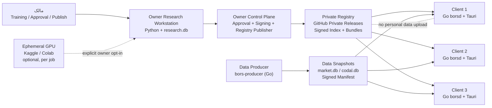
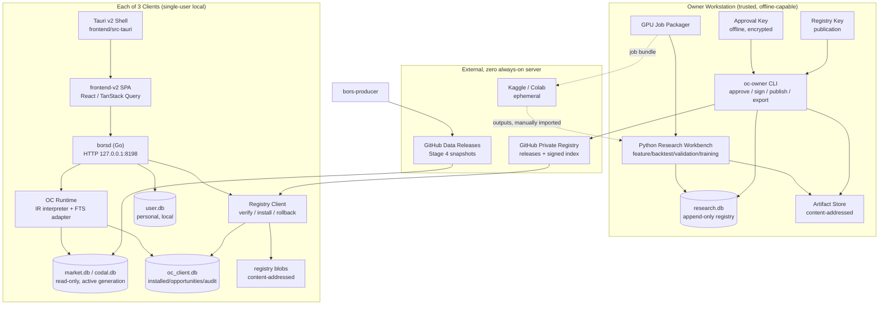
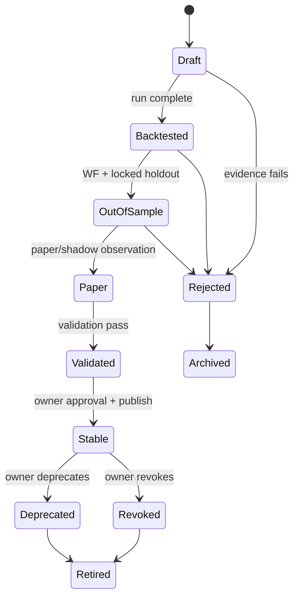
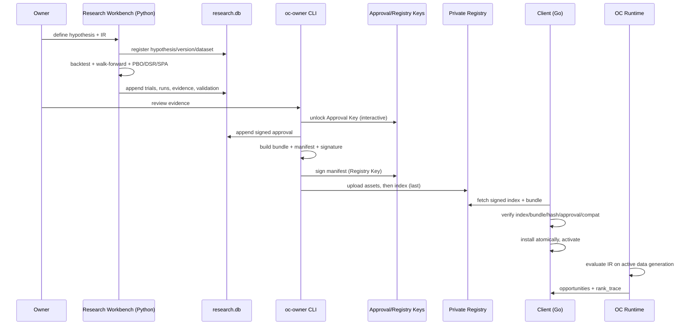
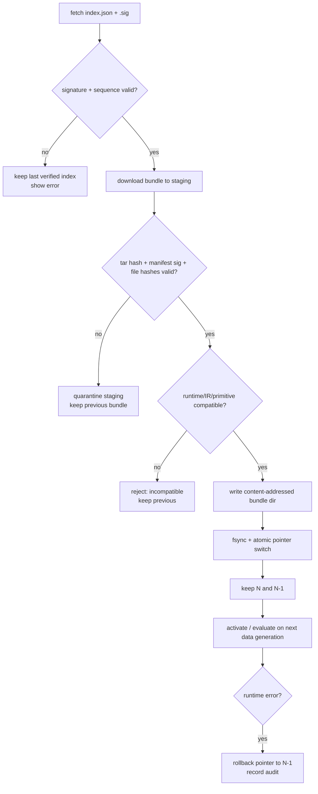
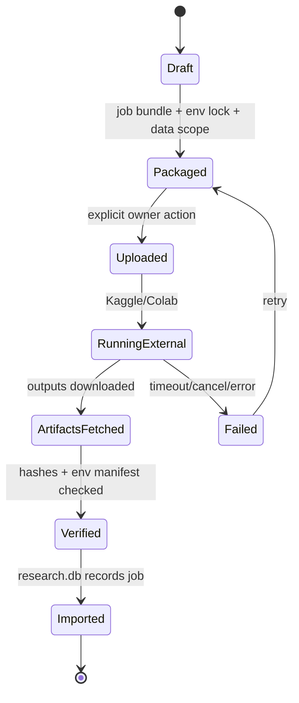

# ۰۴ — معماری فنی Opportunity Lab

> **فاز ۴ مأموریت Opportunity Center / Opportunity Lab · ۲۰۲۶-۱۱-۰۸ · شاخهٔ `mission/opportunity-center-design-2026-11-08`**
> **مبنای معماری:** Stage 4 پذیرفته‌شده در `11f4b128` (پس از ادغام با شاخهٔ طراحی؛ merge `9c3676d4`).
> **وضعیت:** معماری پیشنهادی و آمادهٔ پیاده‌سازی؛ هیچ کد Runtime در این فاز نوشته نشده است.
> **قاعده:** تصمیم‌های فنی این سند با ADRهای `adr/` ثبت شده‌اند. تصمیم‌هایی که محتوایشان در اختیار مالک است با وضعیت «نیازمند امضای مالک» جدا شده‌اند.

## ۰) خلاصهٔ اجرایی

Opportunity Lab از دو صفحهٔ مستقل تشکیل می‌شود که با یک قرارداد مشترک به هم وصل‌اند:

1. **Owner Research & Approval Plane (سیستم مالک، Python):** تولید فرضیه، آزمایش، آموزش اختیاری روی GPU موقت، اعتبارسنجی، تولید شواهد، تأیید انسانی و انتشار. این صفحه فقط روی سیستم مالک اجرا می‌شود و کلید امضا ندارد مگر در همان سیستم.
2. **Client Runtime Plane (سه کاربر، Go + Tauri):** دریافت دادهٔ بازار/کدال و بسته‌های استراتژی تأییدشده، اعتبارسنجی امضا و سازگاری، نصب اتمیک، اجرای تفسیری IR در Go، تولید فرصت و نمایش Today/Library/Lab/Compare/Monitor. دادهٔ شخصی هر کاربر محلی می‌ماند.

**رجیستری خصوصی** یک مخزن GitHub خصوصی با Releaseهای تغییرناپذیر و ایندکس امضاشده است؛ سرور دائمی ندارد. مالک از سیستم خود امضا و منتشر می‌کند؛ سه کاربر با اعتبارنامهٔ خواندنی محدود دریافت می‌کنند. اگر GitHub در دسترس نباشد، آخرین نسخهٔ تأییدشدهٔ محلی معتبر استفاده می‌شود.

**قرارداد اصلی:** `oc.strategy/1` (IR)، `oc.bundle/1` (بستهٔ قابل‌نصب)، `oc.registry/1` (ایندکس امضاشده)، `oc.validation_policy/1` و `oc.ranking_policy/1` (سیاست‌های امضاشدهٔ مالک)، `oc.approval/1` (رکورد تأیید). Runtime هیچ کد دلخواه، Python، ONNX یا مدل پیش‌بینی را در مسیر Stable اجرا نمی‌کند. FTS یک آداپتور کانونیکال مصرف‌شده است، نه بازپیاده‌سازی.

**سه شکاف پذیرفته‌شدهٔ Stage 4 که پیش از فعال‌سازی OC باید بسته شوند:**

1. `borsd` دیتابیس‌ها را از `dataDir/market.db` باز می‌کند، نه از نسل فعال `gens/gen_*`؛ `ActiveDBPath` امروز فقط در تست‌ها مصرف می‌شود (`backend-go/internal/db/db.go:75-133`؛ `backend-go/internal/snapshot/applier.go:95-118`). بنابراین «اعمال نسل» و «سرو شدن نسل» دو چیز متفاوت‌اند.
2. Producer هر `.db` موجود در `data_dir` را snapshot می‌کند (`backend-go/cmd/bors-producer/pipeline.go:240-265`). اگر `research.db` یا `oc_client.db` در آن پوشه باشد، می‌تواند منتشر شود؛ allowlist اجباری است.
3. FTS دو نسخهٔ قواعد دارد: Python `"6"` (`api/chart.py:3896`) و Go `"3"` (`backend-go/internal/chart/fts_swings.go:20`)؛ قیف Go نیز pass-through است (`backend-go/internal/funnel/funnel.go`). تا پاریتی، خروجی FTS نباید به‌عنوان Stable منتشر شود.

این سه مورد در نقشهٔ اجرایی، دروازهٔ P0 هستند و در این سند به‌عنوان پیش‌نیاز معماری ثبت شده‌اند، نه فرض موفقیت.

## ۱) مبنا، روش و لایه‌بندی شواهد

### ۱.۱ مبنای پذیرفته‌شده

| ادعا | شاهد |
|---|---|
| Stage 4 پذیرفته شد و نوک شاخه `11f4b128` است | `docs/STAGE4-PRODUCTION-ACTIVATION-FINAL-REPORT.md:10-11, 221-235` |
| شاخهٔ طراحی روی Stage 3 بود و اکنون Stage 4 در آن ادغام شده است | merge `9c3676d4`؛ `git log --oneline -4` |
| Runtime هدف Go + Tauri + SQLite با نویسندهٔ صریح | `docs/BorsTerminal-Desktop-Migration-Decisions.md:519-533` |
| Python خارج از Runtime کلاینت؛ فقط پژوهش/ابزار | همان `:529-533`؛ `AGENTS.md` بند Python |
| دادهٔ کاربر در جریان Snapshot تغییر نمی‌کند | `docs/STAGE4-PRODUCTION-ACTIVATION-FINAL-REPORT.md:46-50, 208-217, 262-289` |
| امنیت کانال محلی Tauri↔Go هنوز OPEN است | `docs/BorsTerminal-Desktop-Migration-Decisions.md:559-568` |
| نسخه‌بندی Schema و Migration هنوز OPEN است | همان `:596-606` |
| فاز ۴ فقط پس از پذیرش Stage 4 | دستور مالک در همین مأموریت؛ `README.md:16` |

### ۱.۲ لایه‌بندی شواهد

| برچسب | معنا |
|---|---|
| **تأییدشده** | در کد/دادهٔ همان commit دیده شد؛ مسیر و خط ذکر شده است. |
| **سنجیده** | عدد با روش و تاریخ اندازه‌گیری شده است. |
| **سند/تصمیم** | در سند یا رأی مالک آمده است. |
| **پیشنهاد** | انتخاب معماری این سند است و پیاده‌سازی/آزمون آن انجام نشده. |
| **نامعلوم/باز** | راستی‌آزمایی نشده یا منتظر رأی مالک است. |

### ۱.۳ نسبت به اسناد قبلی

- `docs/research/MULTI-ALGORITHM-PLATFORM-ARCHITECTURE.md`، `LOCAL-ALGORITHMIC-LEARNING-ARCHITECTURE.md` و `ALGORITHMIC-RESEARCH-ENGINE-SPEC.md` پیشینهٔ پژوهشی‌اند. مفاهیم قابل‌استفاده (BarView، Holdout، PBO/DSR، slot grammar، ثبت آزمایش) حفظ می‌شوند؛ اجزای متعارض با Runtime Go و تصمیم مالک (Python plugin registry، مدل‌های ONNX در کلاینت، ML در رتبه‌بندی/تأیید) حذف یا به Research Plane منتقل می‌شوند.
- `docs/plans/strategy-unification-plan.md` به‌عنوان نقشهٔ شکاف «چند موتور/چند استور» حفظ می‌شود؛ این معماری یک استور جدید موازی برای استراتژی نمی‌سازد، بلکه مرز Research/Registry/Runtime را روشن می‌کند.
- `03-UX-AND-PRODUCT-EXPERIENCE.md` و `PRODUCT-REQUIREMENTS.md` مرجع UX و الزامات‌اند. یک اصلاح مرزی در این فاز ثبت شده است: **آزمایشگاه کلاینت read-only است؛ اجرای آزمایش فقط در سیستم مالک.** جزئیات در §۱۱.۴ و §۱۸ و ADR-OC-014.

## ۲) اصول معماری

| # | اصل | پیامد فنی |
|---|---|---|
| A1 | Runtime محصول Go است؛ Python فقط Research/Training | هیچ فرآیند/وابستگی Python در بستهٔ کلاینت؛ تست ساختاری Process Tree |
| A2 | کنترل، آموزش، تأیید و انتشار فقط روی سیستم مالک | هیچ endpoint تأیید/انتشار در کلاینت؛ کلید امضا روی کلاینت نیست |
| A3 | فقط نسخهٔ Stable به سه کاربر می‌رسد | Registry Index فقط `stable` را تبلیغ می‌کند؛ Draft/Paper/Validated در Registry عمومی نیست |
| A4 | دادهٔ شخصی محلی می‌ماند | Watchlist/Portfolio/Workspace در `user.db`/WebView؛ هرگز در Registry/Research upload نمی‌شود |
| A5 | هر فایل داده یک نویسنده دارد | `market.db`/`codal.db` فقط Producer؛ `research.db` فقط Research؛ `oc_client.db` فقط `borsd`؛ `user.db` فقط `borsd` |
| A6 | مصنوعات امضاشده و تغییرناپذیرند | Manifest + SHA-256 + Minisign؛ ایندکس آخر منتشر می‌شود |
| A7 | نصب اتمیک، Rollback و Offline آخرین نسخهٔ معتبر | Staging → Verify → Pointer؛ نگهداشتن N/N-1؛ حالت `offline_verified` |
| A8 | هیچ کد دلخواه در مسیر Stable | IR تایپ‌شده + primitiveهای کامپایل‌شده در Go؛ بدون Plugin/Reflection/Exec |
| A9 | FTS کانونیکال مصرف می‌شود | آداپتور Go + `fts.envelope/1` + دروازهٔ پاریتی؛ بدون بازنویسی قواعد |
| A10 | رتبه‌بندی قابل‌توضیح و بدون امتیاز مرکب | `ranking_policy` امضاشده + `rank_trace`؛ هیچ Score تجمیعی |
| A11 | AI پیشنهاد می‌دهد، تأیید/انتشار نمی‌کند | جداسازی `ai_suggestions`؛ کلید تأیید در دسترس Research/CI نیست |
| A12 | بدون سرور دائمی و هزینهٔ میزبانی مفروض | GitHub خصوصی + Release؛ GPU موقت اختیاری؛ حالت آفلاین/فایل |
| A13 | خطا باید fail-closed و صادقانه باشد | حالت‌های `stale/degraded/unavailable/insufficient_evidence`؛ بدون pass جعلی |
| A14 | Kronos/پیش‌بینی متعلق به Technical Intelligence است | `internal/oc` به `internal/prediction` وابسته نمی‌شود؛ مدل پیش‌بینی شاهد تأیید نیست |

## ۳) نمای زمینه (System Context)



**مرزها:**

- Registry و DataRepo فقط توزیع‌اند؛ هیچ دادهٔ شخصی یا Telemetry از کلاینت دریافت نمی‌کنند.
- GPU موقت بخشی از Research است، نه Runtime؛ خروجی آن تا اعتبارسنجی محلی و امضای مالک، کاندید است.
- سه کلاینت از نظر داده کاملاً مستقل‌اند؛ «سه کاربر» یک مدل چندمستأجری روی سرور نیست.

## ۴) نمای Container



## ۵) مسئولیت اجزا و مرزها

| جزء | مسئولیت | صریحاً مسئول نیست | فناوری |
|---|---|---|---|
| Research Workbench | فرضیه، IR، Backtest، WF/PBO/DSR/SPA، Trial Registry، آموزش، شواهد | اجرای فرصت روزانه، تأیید، انتشار، دسترسی به `user.db` | Python، read-only SQLite، pandas/numpy |
| Owner Control Plane (`oc-owner`) | بررسی شواهد، تأیید، امضا، ساخت بسته، انتشار Registry، Export آفلاین | محاسبهٔ استراتژی، اجرای Backtest، سرو به کلاینت | Python CLI + Minisign |
| Private Registry | نگهداری تغییرناپذیر ایندکس/بسته، دسترسی ۳ کاربر | تأیید، محاسبه، ذخیرهٔ دادهٔ شخصی | GitHub Private Releases |
| `bors-producer` | تولید دادهٔ بازار/کدال، Snapshot امضاشده، FTS دادهٔ خام | تولید/تأیید/انتشار استراتژی | Go |
| `borsd` | سرو محلی، DB read-only، read model، API، چرخهٔ عمر کلاینت | نوشتن market/codal، آموزش، تأیید، انتشار | Go |
| OC Runtime | تفسیر IR، اعمال `ranking_policy`، فرصت، پایش محلی | دانلود کد، اجرای Python، آموزش | Go |
| Registry Client | دانلود/اعتبارسنجی/نصب/فعال‌سازی/Rollback/Offline | تصمیم دربارهٔ تأیید استراتژی | Go |
| Tauri Shell | پنجره، tray، عمر فرآیند، updater میزبان | منطق استراتژی، دسترسی به DB | Rust/Tauri v2 |
| `frontend-v2` | Today، Library، Lab read-only، Compare، Monitor | محاسبهٔ اعداد، تأیید، اجرای آزمایش | React/TS |
| `user.db` | Watchlist/Portfolio/تنظیمات شخصی | دادهٔ Registry/Research | SQLite rwc |
| `oc_client.db` | بسته‌های نصب‌شده، فرصت‌ها، audit محلی | دادهٔ شخصی/Research کامل | SQLite rwc |
| `research.db` | رجیستری پژوهش، Trials، Evidence، Approvalها | هیچ ارتباطی با Runtime کلاینت | SQLite WAL |

## ۶) مدل دامنه و چرخهٔ عمر

### ۶.۱ موجودیت‌ها

| موجودیت | مالک | تغییرناپذیری | کلید |
|---|---|---|---|
| Hypothesis | Research | پس از ثبت | `hypothesis_id` |
| Strategy Identity | Research/Registry | پایدار | `strategy_id` |
| Strategy Version | Research | کاملاً تغییرناپذیر | `strategy_id + semver + ir_hash` |
| Dataset Snapshot | Research | تغییرناپذیر | `dataset_hash` |
| Experiment / Run | Research | Append-Only | `run_id` |
| Trial Entry | Research | Append-Only، hash-chained | `trial_id` |
| Validation | Research | حکم تغییرناپذیر | `validation_id` |
| Approval Record | Owner | Append-Only، امضاشده | `approval_id` |
| Bundle | Registry | تغییرناپذیر | `bundle_hash` |
| Registry Index | Registry | هر نسخه تغییرناپذیر | `registry_seq + index_hash` |
| Installed Version | Client | رکورد نصب | `client_id + strategy_id + version` |
| Opportunity Snapshot | Client | Snapshot تشخیص | `opportunity_id` |
| Monitoring Observation | Client | Append-Only | `observation_id` |
| Revocation | Registry | Append-Only | `revocation_id` |

### ۶.۲ چرخهٔ عمر استراتژی



**قواعد:**

- `Validated` ≠ `Stable`؛ فقط تأیید انسانی + امضا + انتشار، Stable می‌سازد.
- نسخهٔ Stable تغییرناپذیر است؛ اصلاح = نسخهٔ جدید.
- `Deprecated` برای نسخه‌های قدیمی است که هنوز برای کاربران فعال‌اند؛ `Revoked` باید در اولین Sync به کلاینت اعلام شود.
- `Paper/Shadow` در سیستم مالک اجرا می‌شود؛ کلاینت Paper اجرا نمی‌کند.
- FTS کانونیکال یک `Strategy Identity` با `engine=fts.canonical` است و نسخه/قواعد/Config آن در Approval و Registry ثبت می‌شود.

### ۶.۳ قواعد تغییرناپذیر

1. هر فرصت به `strategy_version + approval_id + bundle_hash` وصل است.
2. هر حکم Validation به `run_id + policy_hash + dataset_hash + universe_hash` وصل است.
3. هیچ نسخه‌ای بدون `N_total` و `N_eff` وارد مرحلهٔ اعتبارسنجی نمی‌شود.
4. `unknown`/`NA` هرگز به `pass` تبدیل نمی‌شود.
5. هیچ امتیاز مرکبی در Domain Model وجود ندارد؛ رتبه یک Policy امضاشده است.
6. هیچ AI/Research Job نمی‌تواند Approval امضا کند.
7. دادهٔ شخصی در هیچ‌یک از موجودیت‌های Registry/Research وجود ندارد.

## ۷) مدل ذخیره‌سازی

### ۷.۱ توپولوژی

| دیتابیس/فایل | محل | نویسنده | خواننده | در Snapshot داده؟ | در Registry؟ |
|---|---|---|---|---|---|
| `market.db` | نسل فعال `gens/gen_*/` | Producer (خارج از بستهٔ کلاینت) | `borsd`, Research (copy) | بله | خیر |
| `codal.db` | نسل فعال `gens/gen_*/` | Producer | `borsd`, Research | بله | خیر |
| `user.db` | `dataDir/` | `borsd` | `borsd` | **خیر** | **خیر** |
| `oc_client.db` | `dataDir/oc/` | `borsd` | `borsd` | **خیر** | **خیر** |
| `research.db` | `BORS_RESEARCH_DIR` (خارج از dataDir Producer) | Research | Research/Owner CLI | **خیر** | **خیر** |
| `research artifacts` | `BORS_RESEARCH_DIR/artifacts/` | Research | Research/Owner CLI | **خیر** | فقط Evidence Summary |
| `registry blobs` | `dataDir/oc/registry/blobs/` | Registry Client | OC Runtime | **خیر** | — |
| `active_generation.json` | `dataDir/` | Snapshot Applier | `borsd` (پس از رفع شکاف) | خیر | خیر |

**قاعدهٔ اجباری:** Producer باید فقط allowlist صریح `market.db` و `codal.db` را Snapshot کند؛ هر `.db` دیگر باید رد شود. این تغییر در P0 نقشهٔ اجرایی است. تا آن زمان، اجرای OC روی ماشین Producer ممنوع است.

### ۷.۲ `research.db` (Owner)

SQLite WAL، یک نویسنده (Research Workbench)، ابزارهای گزارش فقط‌خواندنی. جداول اصلی:

```text
schema_migrations
hypotheses(id, statement, universe_spec, horizon, expected_effect, invalidation,
           planned_tests_json, search_budget, created_at, hash, prev_hash)
strategy_identities(id, name, family, created_at, status)
strategy_versions(id, strategy_id, semver, ir_json, ir_hash, ir_schema,
                  runtime_min, runtime_max, created_at, author, status)
datasets(hash, span_start, span_end, universe_hash, price_basis, lineage_json, created_at)
experiments(id, version_id, dataset_hash, protocol_json, cost_model_version,
            seed, code_hash, env_lock_hash, status, created_at)
runs(id, experiment_id, started_at, finished_at, status, manifest_json, error)
trials(id, family, candidate_hash, params_hash, status, n_group, prev_hash, hash, created_at)
validations(id, version_id, run_id, policy_hash, verdict, metrics_json, gates_json,
            holdout_access_json, created_at, prev_hash, hash)
evidence(id, kind, artifact_hash, summary_json, created_at)
approvals(id, version_id, validation_id, owner_id, approval_basis, policy_hash,
          scope_json, signed_record, signed_at, revoked_at, reason, prev_hash, hash)
bundles(id, version_id, bundle_hash, manifest_hash, built_at, published_at)
gpu_jobs(id, job_hash, environment_hash, data_scope_hash, status, outputs_json, created_at)
audit_events(id, actor, action, subject, detail_json, prev_hash, hash, created_at)
keys(key_id, purpose, public_key, valid_from, valid_to, status)
```

**Hash chain:** هر رکورد حساس (`trials`, `validations`, `approvals`, `audit_events`) `prev_hash` دارد؛ `hash = SHA256(canonical_json(record_without_hash) + prev_hash)`. دوره‌ای یک `signed_root` توسط کلید Approval امضا و در `research.db` ثبت می‌شود. این ساختار Tamper-Evident است، نه یک Timestamp معتبر بیرونی.

### ۷.۳ `oc_client.db` (Client)

SQLite با `PRAGMA user_version`، یک نویسنده (`borsd`). جداول:

```text
schema_migrations
registry_state(sequence, index_hash, source, fetched_at, verified_at, last_error)
installed_bundles(strategy_id, version, bundle_hash, manifest_hash, installed_at,
                  activated_at, deactivated_at, status, runtime_compat)
strategy_runtime_state(strategy_id, version, last_eval_at, data_generation,
                       config_hash, state, last_error)
opportunity_snapshots(opportunity_id, strategy_id, version, symbol, ins_code,
                      signal_time, data_generation, evidence_json, invalidation_json,
                      freshness, status, rank_trace_json, created_at)
revocations(strategy_id, version, effective_at, reason, index_sequence, applied_at)
monitoring_observations(id, strategy_id, version, observed_at, kind, detail_json, prev_hash, hash)
audit_events(id, actor, action, subject, detail_json, prev_hash, hash, created_at)
```

**قواعد:** حداکثر یک نسخهٔ فعال برای هر `strategy_id`؛ نصب چند نسخه مجاز است؛ فرصت‌ها با تغییر `data_generation` یا Revocation باطل می‌شوند؛ هیچ دادهٔ شخصی در این DB نیست (Watchlist/Portfolio فقط در `user.db`).

### ۷.۴ `user.db`

دست‌نخورده می‌ماند. جداول موجود (Watchlist، FTS config، selection) از طریق APIهای موجود خوانده/نوشته می‌شوند. OC نباید جدول شخصی جدیدی به `user.db` اضافه کند؛ در صورت نیاز به ترجیح نمایشی، از Workspace/UI store یا `oc_client.db` استفاده می‌کند.

### ۷.۵ Schema versioning

- `market.db`/`codal.db`: Producer `PRAGMA user_version` را تنظیم می‌کند؛ Manifest آن را اعلام می‌کند؛ Client قبل از Apply سازگاری را بررسی می‌کند.
- `oc_client.db` و `research.db`: Migration runner با فایل‌های شماره‌دار، تراکنش، Backup قبل از Migration و Rollback در خطا.
- `research.db` نسخهٔ Researcher را جدا از Runtime نگه می‌دارد؛ مهاجرت آن هرگز به کلاینت منتقل نمی‌شود.
- Manifest schema (`oc.bundle/1`) و IR schema (`oc.strategy/1`) از DB schema جدا هستند.

## ۸) قرارداد استراتژی و مصنوعات

### ۸.۱ `oc.strategy/1`

```json
{
  "schema": "oc.strategy/1",
  "strategy_id": "jet-breakout",
  "semver": "1.2.0",
  "family": "rule_based",
  "universe": {
    "rule": "tsetmc_cash_equity",
    "min_history_sessions": 252,
    "liquidity": {"adv_sessions": 20, "min_participation": 0.02}
  },
  "horizon": {"unit": "session", "min": 3, "max": 20},
  "slots": {
    "regime": {"primitive": "market_regime", "params": {"allowed": ["up"]}},
    "setup": {"primitive": "breakout_resistance", "params": {"lookback": 21}},
    "confirmation": {"primitive": "real_buy_power", "params": {"min": 1.8}},
    "exit": {"primitive": "atr_time_exit", "params": {"atr": 14, "multiple": 2, "max_sessions": 20}},
    "sizing": {"primitive": "fixed_fraction", "params": {"fraction": "0.10", "max_positions": 10}}
  },
  "execution": {"model": "tse_session/1", "queue": "locked_no_fill", "settlement": "T+2"},
  "invalidation": {"primitive": "close_below", "params": {"level_ref": "setup.low"}},
  "provenance": {"hypothesis_id": "hyp_001", "created_by": "owner", "origin": "human"}
}
```

**قواعد:**

- یک مقدار برای هر اسلات اصلی؛ اسلات اختیاری صریحاً `null`.
- پارامترهای پول/درصد به‌صورت رشتهٔ اعشاری (نه Float) برای هش پایدار.
- `primitive` باید در Primitive Registry کامپایل‌شده در Go وجود داشته باشد؛ نسخهٔ Primitive در Compatibility ثبت می‌شود.
- `origin` می‌تواند `human` یا `ai_suggested` باشد؛ `ai_suggested` تا ارتقای انسانی به Hypothesis/Version، قابل انتشار نیست.

### ۸.۲ Primitive Registry

- Primitiveها توابع Go خالص با امضای تایپ‌شده‌اند: ورودی `BarView/Features`، خروجی `Signal/Decision`؛ بدون I/O، شبکه، فایل، تصادف غیرقابل‌بازتولید.
- Registry در زمان Build کامپایل می‌شود؛ Plugin داینامیک/Reflection/Exec ممنوع.
- هر Primitive: `id`, `version`, `params_schema`, `lookback`, `output_schema`, `tests`, `deterministic=true`.
- افزودن Primitive جدید = نسخهٔ Runtime جدید؛ بسته‌های نیازمند Primitive ناشناخته رد می‌شوند.
- Expression DSL آزاد در v1 مجاز نیست. اگر بعداً لازم شد، AST محدود با whitelist توابع و سقف عمق/زمان، در ADR جدا.

### ۸.۳ `oc.bundle/1`

```
bundle.tar.gz
├── manifest.json
├── manifest.json.sig          (Minisign، Registry Key)
├── strategy.json              (oc.strategy/1)
├── approval.json              (oc.approval/1، Approval Key)
├── evidence/
│   ├── summary.json           (متریک‌ها، دروازه‌ها، verdict، dataset/universe hash)
│   └── protocol.json          (split، WF، PBO/DSR/SPA، cost model، N_total/N_eff)
└── README.md                  (متن کوتاه برای کاربر، اختیاری)
```

Manifest شامل `schema`, `bundle_id`, `strategy_id`, `semver`, `ir_hash`, `files[{path,sha256,size}]`, `runtime_min/max`, `approval_id`, `validation_id`, `policy_hash`, `created_at`, `publisher_key_id`, `registry_sequence` است. امضای Manifest همهٔ فایل‌ها را پوشش می‌دهد؛ SHA-256 هر فایل جدا بررسی می‌شود.

**Canonicalization:** Builder از JSON Canonical (`sort_keys`, `separators`, UTF-8, decimal strings) استفاده می‌کند؛ Hash روی بایت‌های همان فایل است. تست Cross-Language (Python Builder ↔ Go Verifier) الزامی است.

### ۸.۴ `oc.approval/1`

```json
{
  "schema": "oc.approval/1",
  "approval_id": "apr_...",
  "strategy_id": "jet-breakout",
  "semver": "1.2.0",
  "ir_hash": "sha256:...",
  "validation_id": "val_...",
  "validation_run_hash": "sha256:...",
  "policy_hash": "sha256:...",
  "approval_basis": "validation_policy",
  "owner_id": "owner",
  "scope": {"instruments": ["cash_equity"], "max_runtime": "..."},
  "signed_at": "2026-11-08T...",
  "key_id": "APPROVAL_KEY_ID",
  "signature": "base64..."
}
```

`approval_basis` می‌تواند `validation_policy`، `canonical_baseline` (برای FTS) یا `emergency` باشد؛ Emergency فقط با دلیل و سپس بازبینی. هیچ مسیر خودکار این رکورد را نمی‌سازد.

## ۹) جریان Research تا Runtime



### ۹.۱ دسترسی Research به داده

- Research فقط از یک `Dataset Snapshot` تغییرناپذیر می‌خواند (کپی/نسل فعال، `mode=ro`).
- قبل از هر Experiment، `dataset_hash`، `universe_hash`، `price_basis` و `config_hash` ثبت می‌شود.
- اگر دادهٔ لازم نیست یا ناقص است، اجرا با `insufficient_evidence` متوقف می‌شود؛ پر کردن با دادهٔ ساختگی ممنوع.
- Research هرگز `market.db`/`codal.db` را نمی‌نویسد و به `user.db` کلاینت دسترسی ندارد.

### ۹.۲ Backtest و اعتبارسنجی

- Backtest/validation در Python Research است؛ Go Runtime فقط شواهد تأییدشده را نمایش می‌دهد.
- پروتکل Phase 2 (Split، Holdout قفل، WF/Embargo، Purged CV/CPCV، PBO، DSR، SPA، هزینه/صف/رژیم/نشت) در Research Engine پیاده می‌شود.
- `trial_registry` قبل از اجرا ثبت می‌شود؛ `N_total` و `N_eff` در Evidence Summary و Approval می‌آیند.
- Validation Verdict: `pass`, `fail`, `inconclusive`, `insufficient_evidence`, `expired`.
- هیچ Validation بدون `policy_hash` و `dataset_hash` معتبر نیست.

### ۹.۳ کامپایل و بسته‌بندی

1. IR Validator: Schema + Slot Grammar + Primitive Registry + Runtime Compatibility.
2. Canonicalize + `ir_hash`.
3. Bundle Builder: Manifest + Evidence Summary + Approval.
4. Sign Manifest با Registry Key؛ Approval با Approval Key.
5. Registry Publisher: آپلود دارایی‌ها، تأیید HTTP 200، سپس آپلود ایندکس.

**قاعدهٔ انتشار:** ایندکس آخر منتشر می‌شود؛ کلاینت هرگز مجموعهٔ نیمه‌کاره نمی‌بیند. دارایی‌ها تغییرناپذیرند؛ اصلاح = Sequence جدید.

## ۱۰) Registry خصوصی و توزیع

### ۱۰.۱ توپولوژی پیشنهادی

| گزینه | سرور دائمی | هزینهٔ فرض‌شده | دسترسی ۳ کاربر | ارزیابی |
|---|---|---|---|---|
| **GitHub Private Releases + Signed Index** | ندارد | صفر در محدودهٔ GitHub | Collaborator + PAT خواندنی | **انتخاب v1** |
| Owner PC به‌عنوان سرور | دارد (PC مالک) | برق/دسترس‌پذیری | LAN/Tailscale | رد؛ وابسته به روشن‌بودن |
| Static HTTPS + Signed Index | دارد (میزبانی) | هزینهٔ میزبانی | Signed URL/mTLS | جایگزین آینده |
| File Export/Import (USB/LAN) | ندارد | صفر | دستی | **حالت آفلاین/پشتیبان** |

`RegistryTransport` یک Interface است تا GitHub به static/فایل تغییر کند بدون تغییر قرارداد کلاینت. **هیچ سرور دائمی در v1 مفروض نیست.**

### ۱۰.۲ `oc.registry/1`

```json
{
  "schema": "oc.registry/1",
  "registry_id": "bors-opportunity-lab",
  "sequence": 42,
  "generated_at": "2026-11-08T...",
  "publisher_key_id": "REGISTRY_KEY_ID",
  "min_runtime": "1.1.0",
  "strategies": [
    {
      "strategy_id": "jet-breakout",
      "latest_stable": "1.2.0",
      "status": "stable",
      "bundle_url": "https://github.com/.../releases/download/.../jet-1.2.0.tar.gz",
      "bundle_sha256": "...",
      "bundle_size": 123456,
      "approval_id": "apr_...",
      "validation_id": "val_...",
      "policy_hash": "...",
      "metrics_summary": {...},
      "published_at": "..."
    }
  ],
  "revocations": [
    {"strategy_id": "old", "semver": "0.9.0", "effective_at": "...", "reason": "..."}
  ],
  "ranking_policy": {"url": "...", "sha256": "...", "policy_id": "..."},
  "validation_policy": {"url": "...", "sha256": "...", "policy_id": "..."}
}
```

+ `registry.json.sig` (Minisign). ایندکس شامل هیچ دادهٔ شخصی نیست.

### ۱۰.۳ دسترسی سه کاربر

- مالک یک مخزن خصوصی `BorsTerminal-registry` می‌سازد و سه حساب را به‌عنوان خواننده اضافه می‌کند.
- v1: هر کاربر یک Fine-grained PAT با `Contents: Read` روی همان مخزن می‌گیرد؛ در OS Keychain ذخیره می‌شود. مالک می‌تواند هر توکن را جدا Revoke کند.
- گزینهٔ آینده: GitHub Device Flow با OAuth App؛ نیاز به سرور ندارد، UX بهتر، ولی Scope و Client ID اضافه می‌کند.
- توکن فقط برای دانلود استفاده می‌شود؛ هیچ دادهٔ شخصی همراه درخواست نمی‌رود.
- محرمانگی: کنترل دسترسی GitHub + امضا؛ اگر محرمانگی قوی‌تر لازم شد، رمزنگاری per-user در ADR آینده. امضا فقط یکپارچگی/اصالت می‌دهد، نه محرمانگی.

### ۱۰.۴ نصب و Rollback



- Staging در همان Volume؛ fsync؛ Rename؛ Pointer JSON با temp+rename.
- کپی قبلی تا تأیید موفق نسل جدید نگه داشته می‌شود.
- حداکثر یک نسخهٔ فعال؛ Rollback فقط به نسخهٔ نصب‌شده/معتبر.
- Offline: آخرین بسته/ایندکس تأییدشده؛ برچسب `offline_verified` و زمان آخرین تأیید.

### ۱۰.۵ Revocation و Anti-Rollback

- ایندکس `sequence` یکنواست؛ کلاینت Sequence کمتر از آخرین را رد می‌کند (مگر `recovery=true` امضاشده).
- Revocation در ایندکس امضاشده می‌آید؛ اولین Sync آن را اعمال می‌کند و فرصت‌های آن نسخه را باطل می‌کند.
- در حالت آفلاین، کلاینت نمی‌تواند Revocation جدید را بداند؛ تا اتصال بعدی با برچسب `offline_verified` ادامه می‌دهد. مدت/سیاست این وضعیت در Q17 است و در ADR-OC-005 ثبت شده است.
- `latest.json` و Version.txt غیرامضاشدهٔ Stage 4 برای Registry استفاده نمی‌شوند؛ فقط ایندکس/بستهٔ امضاشده.

### ۱۰.۶ Export/Import آفلاین

`oc-owner registry export --out registry-pack.tar.gz` یک ایندکس + بسته‌های Stable + امضاها می‌سازد. کلاینت `registry import` همان مسیر Verify/Install را طی می‌کند. این حالت برای نصب اولیه، شبکهٔ محدود یا پشتیبان است.

## ۱۱) Runtime و Read Model

### ۱۱.۱ چرخهٔ ارزیابی

1. `borsd` نسل فعال داده را می‌شناسد (پس از رفع شکاف Generation Resolver).
2. برای هر نسخهٔ Stable فعال، `Strategy Runtime` روی `DataView` نقطه‌در‌زمان اجرا می‌شود.
3. FTS Adapter در صورت نیاز `fts.envelope/1` می‌دهد.
4. `Signal`ها به `Opportunity` تجمیع می‌شوند؛ `ranking_policy` اعمال می‌شود؛ `rank_trace` ذخیره می‌شود.
5. `oc_client.db` Snapshot می‌شود؛ API read model را می‌دهد.
6. تغییر داده/فعال‌سازی/Revocation، cache را باطل می‌کند؛ فرصت کهنه می‌شود.

### ۱۱.۲ قرارداد API

| متد/مسیر | کار | نوشتن؟ |
|---|---|---|
| `GET /api/oc/status` | وضعیت داده، Registry، نسخه‌ها، آخرین ارزیابی، خطا | خیر |
| `GET /api/oc/opportunities` | Today با فیلتر/صفحه‌بندی و `rank_trace` | خیر |
| `GET /api/oc/opportunities/{id}` | شواهد Inspector | خیر |
| `GET /api/oc/strategies` | Stable/نصب‌شده/فعال | خیر |
| `GET /api/oc/strategies/{id}/versions` | نسخه‌ها و وضعیت | خیر |
| `POST /api/oc/strategies/{id}/activate` | فعال‌سازی محلی | `oc_client.db` |
| `POST /api/oc/strategies/{id}/deactivate` | غیرفعال‌سازی محلی | `oc_client.db` |
| `GET /api/oc/lab/{id}/{version}` | Evidence read-only | خیر |
| `GET /api/oc/compare?ids=...` | مقایسهٔ شواهد Stable | خیر |
| `GET /api/oc/monitor` | مشاهدات محلی | خیر |
| `POST /api/oc/registry/check` | شروع Sync با Job ID | cache/DB |
| `GET /api/oc/registry/status` | وضعیت Sync/آخرین ایندکس | خیر |

- پاسخ‌ها `schema`, `as_of`, `data_state`, `freshness`, `generated_at` دارند.
- خطا: `{code, message, detail, retryable}`؛ «۲۰۰ = شروع شد» بدون Job واقعی ممنوع (رفع نقص `internal/sync/handlers.go:93-133`).
- صفحه‌بندی اجباری برای فهرست فرصت‌ها؛ payload کامل جدول در یک پاسخ ممنوع.
- `no-store` فعلی سرور (`internal/httpapi/server.go:309-343`) با ETag/read model محلی جایگزین یا مدیریت می‌شود؛ UI از TanStack Query و invalidation استفاده می‌کند.

### ۱۱.۳ رتبه‌بندی

`ranking_policy` یک شیء امضاشده است؛ Runtime فقط comparator را اجرا می‌کند:

```json
{
  "schema": "oc.ranking_policy/1",
  "policy_id": "rank/2026-11-08",
  "dimensions": [
    {"key": "freshness", "direction": "desc"},
    {"key": "strategy_trust", "direction": "desc"},
    {"key": "evidence_coverage", "direction": "desc"},
    {"key": "liquidity_participation", "direction": "desc"}
  ],
  "tie_breakers": ["signal_time_desc", "symbol_asc"],
  "exclusions": ["stale", "invalidated", "revoked", "suspended"]
}
```

- هیچ وزن/جمع/Score وجود ندارد.
- `rank_trace` برای هر ردیف: مقدار ابعاد، بعد تعیین‌کننده، tie-breaker.
- اگر Policy نباشد/نامعتبر باشد، fallback امن `freshness desc, symbol asc` با برچسب `policy=fallback`؛ ادعای سیاست مالک نمی‌شود.

### ۱۱.۴ Lab کلاینت

- Lab کلاینت فقط `evidence/summary.json` و `protocol.json` بستهٔ نصب‌شده را نمایش می‌دهد.
- دکمهٔ «اجرای آزمایش» در UI کلاینت وجود ندارد؛ این اقدام فقط در Research Workbench سیستم مالک است.
- «تاریخچهٔ اجرا» در Lab کلاینت، اجراهای ثبت‌شده در Evidence Bundle است، نه اجرای جدید.
- این تصمیم، Phase 3 را اصلاح می‌کند (ADR-OC-014).

## ۱۲) FTS کانونیکال

### ۱۲.۱ مرز

- `internal/oc/fts` یک **Adapter** است: ورودی نماد/تاریخ، خروجی `fts.envelope/1`.
- پیاده‌سازی از موتورهای Go موجود (`internal/fundamental.EvaluateV10`، `internal/chart.FTS`) استفاده می‌کند؛ قواعد FTS در OC تکرار نمی‌شوند.
- FTS Strategy در Registry یک `engine: fts.canonical` است؛ Bundle آن فرمول ندارد، فقط `ruleset_version`, `config_hash`, `approval` و `evidence` دارد.
- `fts.envelope/1` سه‌حالتی (`pass/fail/unknown` + `NA`) را حفظ می‌کند؛ `unknown` هرگز fail نمی‌شود.
- `as_of.kind` (`source_date|scan_time|replay_cutoff`) و `config_hash` در Envelope اجباری است.
- `/fts-screen` سطح کانونیکال مستقل می‌ماند؛ Today همان Envelope را مصرف می‌کند؛ هیچ غربالگری موازی ساخته نمی‌شود (Q5).

### ۱۲.۲ دروازهٔ پاریتی

| مورد | Python | Go امروز | اقدام |
|---|---|---|---|
| Ruleset تکنیکال | `"6"` (`api/chart.py:3896`) | `"3"` (`internal/chart/fts_swings.go:20`) | پورت/هم‌ترازسازی + Golden Vectors |
| `/api/fts` ریشه | موجود | 501 | یا Adapter جدید/FTS handler |
| `/api/fundamental/screen` | موجود | 501 | Go Screener یا per-symbol adapter |
| Funnel | موجود | stub/pass-through | پورت یا Envelope با `coverage < 1` |
| Config FTS | فایل/env | `user.db` | Config کانونیکال در Snapshot/Registry؛ Override کاربر جدا |

**قاعده:** تا پاریتی کامل، FTS Stable منتشر نمی‌شود؛ Today می‌تواند FTS را با `unavailable` نشان دهد اما فرصت FTS نمی‌سازد. هیچ Stub به‌عنوان pass مصرف نمی‌شود.

### ۱۲.۳ Replay

- Research می‌تواند Replay تاریخی FTS را با Python Oracle بسازد؛ خروجی آن شاهد Research است.
- Runtime کلاینت Replay تاریخی FTS را سرو نمی‌کند مگر داده/Envelope تاریخی امضاشده در Registry باشد.
- مقایسهٔ تاریخی FTS بدون Replay ممنوع است (OC-D-032).

## ۱۳) GPU موقت و آموزش

### ۱۳.۱ اصل

- پیش‌فرض: آموزش/پژوهش روی CPU سیستم مالک.
- GPU ابری فقط با درخواست صریح مالک برای یک Job مشخص؛ هیچ Background Sync، هیچ سرور دائمی، هیچ هزینهٔ میزبانی مفروض.
- دادهٔ شخصی هرگز به GPU نمی‌رود. فقط Dataset Slice لازم، با `data_scope_hash`، و در صورت لزوم فشرده/رمزنگاری‌شده.
- Job موقت است؛ خروجی با Hash برمی‌گردد و در Research Import می‌شود؛ تا Validation محلی و تأیید مالک، Stable نیست.

### ۱۳.۲ چرخهٔ Job



- Job Bundle: code commit + env lock + data scope + params + seed + expected outputs + limits.
- خروجی: مدل/متریک/گزارش با Hash؛ `gpu_jobs` ثبت می‌شود.
- محیط GPU (نسخهٔ کتابخانه/درایور/CUDA) در Manifest ذخیره می‌شود؛ تکرارپذیری کامل تضمین نمی‌شود مگر محیط قفل شود.
- مدل آموزش‌دیده در v1 وارد Runtime نمی‌شود؛ فقط شاهد Research است (ADR-OC-011). Kronos/پیش‌بینی خارج از OC.

### ۱۳.۳ محدودیت‌ها

- Kaggle/Colab قابل‌اعتماد برای Job طولانی/حساس نیستند؛ Timeout، قطع اتصال و محدودیت GPU پذیرفته می‌شود.
- Confidentiality از Cloud قابل‌تضمین نیست؛ مالک باید آگاهانه اجازه دهد. گزینهٔ Encryption at rest فقط انتقال را امن می‌کند، نه پردازش در Cloud.
- هیچ Credential دائمی در Notebook قرار نمی‌گیرد؛ Token یک‌بارمصرف/محیطی.

## ۱۴) امنیت و مدل تهدید

### ۱۴.۱ مرزهای اعتماد

| مرز | تهدید | کنترل |
|---|---|---|
| Registry → Client | Tamper، Replay، Malicious Bundle | امضا، SHA-256، Sequence، Schema، Primitive whitelist |
| Owner Key | Compromise/Leak | Approval Key آفلاین/رمزدار، Registry Key جدا، عدم ورود به CI/Client |
| Research → Registry | انتشار ناخواسته/دادهٔ شخصی | Owner-only CLI، Review، Bundle Builder، Data Boundary Test |
| Client Local API | CSRF/DNS Rebinding/Other Process | Loopback، SameSite Cookie/Token، Origin/Host check، no CORS |
| GPU Job | Data Exfiltration | Opt-in per job، Data minimization، Encryption، Audit |
| Strategy Runtime | Arbitrary Code/DoS | IR تایپ‌شده، Primitive Registry، Timeout/Step Limit، no I/O |
| Supply Chain | Dependency/Build Tamper | Pin، Hash، SBOM، Reproducible Build (هدف)، Signature |
| Three Users | Token Sharing/Cache Leak | Per-user read token، revoke، no personal data in registry |

### ۱۴.۲ کلیدها

| Key | کاربرد | محل | در CI؟ | چرخش |
|---|---|---|---|---|
| DATA_KEY (Stage 4 موجود) | امضای Snapshot داده | GitHub Secret / Producer | بله (فعلی) | با ترتیب Stage 4 |
| APP_KEY (Tauri موجود) | امضای Update اپ | GitHub Secret | در مخزن موجود است اما Workflow فعلی مصرفش نمی‌کند (شکاف Stage 4) | جدا، خارج از OC |
| APPROVAL_KEY (جدید) | امضای Approval Record | فقط سیستم مالک، رمزدار/آفلاین | **خیر** | با Key Transition امضاشده |
| REGISTRY_KEY (جدید) | امضای Bundle/Index | سیستم مالک | **خیر** | با Key Transition + App Update |

- Public Keyها در Client Trust Store (کد/Config) با `key_id` نگهداری می‌شوند.
- هیچ کلید خصوصی در Registry، Research Artifact، Log یا Chat نیست.
- Rotation: ابتدا Client جدید با Public Key جدید منتشر می‌شود (یا هر دو کلید)، سپس Registry با کلید جدید امضا می‌شود، سپس کلید قدیم بازنشسته. اگر کلید قدیم compromised باشد، Transition قابل‌اعتماد نیست؛ Recovery فقط با نصب دستی Client جدید.

### ۱۴.۳ کانال محلی

- `borsd` فقط `127.0.0.1` (یا IPC بومی)؛ هیچ Interface عمومی.
- Token تصادفی per-launch در فایل محدود/کوکی `HttpOnly; SameSite=Strict`؛ درخواست‌های نوشتاری نیازمند Header CSRF.
- Origin/Host Strict؛ CORS بسته؛ `Origin: null` رد.
- Tauri Shell نباید URL دلخواه را بدون Token باز کند؛ `--url` فعلی باید محدود/امضاشده شود. این بخش از تصمیم‌های OPEN مهاجرت (`docs/...:559-568`) است و در P0 امنیت بسته می‌شود.
- هیچ Secret در URL یا Log.

### ۱۴.۴ Research Sandbox

- Research Workbench در venv/Container جدا؛ Network پیش‌فرض بسته (مگر GPU Job صریح)؛ فقط Dataset Snapshot read-only.
- کد Research می‌تواند کتابخانه نصب کند (خارج از Client)؛ Lockfile ثبت می‌شود.
- خروجی Research قابل‌اعتماد برای Runtime نیست تا Approval/امضا.
- `research.db` و Artifact Store از Producer dataDir جدا؛ Test ساختاری.

## ۱۵) شکست، بازیابی و حالت آفلاین

| سناریو | رفتار | شاهد/آزمون |
|---|---|---|
| Registry در دسترس نیست | آخرین ایندکس/بستهٔ تأییدشده؛ `offline_verified`؛ نصب جدید نه | Test transport offline |
| ایندکس بد امضا/قدیمی | رد کامل؛ حفظ ایندکس قبلی؛ Audit | Signature/sequence tests |
| بستهٔ خراب/ناقص | Quarantine؛ فعال نسخهٔ قبلی | Hash/tar tests |
| Runtime ناسازگار | رد نصب؛ دلیل؛ نسخهٔ قبلی فعال | Compatibility tests |
| Crash وسط نصب | Staging پاک؛ Pointer دست‌نخورده | Kill-point tests |
| Disk full | Preflight + خطا؛ نسخهٔ قبلی | Fault injection |
| Data Snapshot خراب | Stage 4 Applier integrity check؛ نسل قبلی | Stage 4 tests + Generation Resolver |
| Revocation در آفلاین | تا Sync بعدی اعمال نمی‌شود؛ برچسب آفلاین | Offline/revocation tests |
| Registry Publish نیمه‌کاره | ایندکس منتشر نمی‌شود؛ کلاینت ایندکس قبلی | Publisher failure tests |
| Key rotation نادرست | Client قدیمی امضا را رد می‌کند؛ نسخهٔ قبلی حفظ | Rotation drill |
| Clock skew | Timestamp آینده/گذشتهٔ غیرمجاز رد؛ ساعت سیستم تنها مرجع نیست | Time tests |
| User data corruption | Backup/Migration جدا؛ Registry نصب را تکرار نمی‌کند | user.db integrity test |

**Rollback سطوح:**

1. Strategy Bundle: Pointer به نسخهٔ N-1.
2. Data Generation: Stage 4 Applier Rollback (پس از افزودن API/مصرف‌کننده).
3. App Update: باید مستقل و با Backup باشد؛ در این فاز طراحی نمی‌شود (ADR-OC-013).
4. Research DB: Backup قبل از Migration؛ Artifacts تغییرناپذیر.

## ۱۶) کارایی و منابع

| مسیر | بار | هدف/وضعیت |
|---|---|---|
| Client Today read model | ارزیابی سبک چند استراتژی × یونیورس | باید بدون Blocking؛ عدد پس از اندازه‌گیری |
| FTS Adapter | محاسبه/کش FTS | Stage 4: بازمحاسبهٔ ۱٬۱۸۸ نماد در ۵۳ ثانیه (گزارش Stage 4:271)؛ Runtime باید cache/prefix داشته باشد |
| Registry Sync | دانلود ایندکس + بستهٔ کوچک | بسته‌ها به‌طور معمول کوچک‌اند؛ سقف اندازه/Timeout مشخص |
| Data Sync | Stage 4 Snapshot ~۹۱MB بازار | Stage 4 live: ~۱۲ دقیقه (گزارش Stage 4:289)؛ UI باید پیشرفت واقعی بدهد |
| Research | Python CPU/GPU | جدا از Client؛ صف/لغو/سقف (Q8) |
| GPU | موقت | Timeout/Retry؛ خارج از SLA کلاینت |

**قواعد:** هیچ Research Job در `borsd` اجرا نمی‌شود؛ ارزیابی فرصت باید قابل‌لغو و Time-bounded باشد؛ Read Model صفحه‌بندی شود؛ حافظه با Stream/فیلتر محدود بماند. اعداد نهایی بودجه پس از Baseline Stage 4 و اندازه‌گیری Phase 5 تعیین می‌شوند؛ عدد اختراعی ثبت نمی‌شود.

## ۱۷) مشاهده‌پذیری و حسابرسی

- **Client:** `/api/oc/status` شامل `data_generation`, `registry_sequence`, `bundle_verified`, `last_eval_at`, `data_state`, `last_error`؛ Log ساختاریافتهٔ محلی بدون PII.
- **Registry Client:** هر Verify/Install/Rollback/Revocation در `audit_events` با Hash chain.
- **Owner:** `research.db` Audit/Approval Hash chain؛ `bundle`/`index` Hash؛ Publication Log.
- **GPU:** Job Bundle/Environment/Output Hash؛ وضعیت صادقانه (بدون ادعای تکرارپذیری کامل).
- **بدون Telemetry:** هیچ ارسال خودکار به Owner/Cloud؛ فقط Download Registry/Data و GPU Opt-in.
- **Health:** `/healthz` فعلی فقط Liveness است؛ `oc/status` آمادگی کارکردی OC را جدا گزارش می‌کند.

## ۱۸) تعیین تکلیف Q1 تا Q14

### ۱۸.۱ Q1 — آستانهٔ Approved

**تحلیل:** آستانه‌ها محتوای روش‌شناسی‌اند و اختراع‌شان ممنوع است. Hardcode کردن آن‌ها در Go، تغییر سیاست را به Release گره می‌زند و Audit را ضعیف می‌کند. با ۵ سال داده و `N≈100`، تأیید `SR<1.5` ممکن نیست؛ Validation باید `insufficient_evidence` را رسمی نگه دارد (Phase 2 §۵.۱۳).

**پیشنهاد مهندسی (Accepted):** `oc.validation_policy/1` یک سند امضاشدهٔ مالک است؛ Validation و Approval فقط `policy_hash` را حمل می‌کنند. تا امضای مالک، `approval_enabled=false`؛ هیچ استراتژی تولیدشده/جدید Stable نمی‌شود. مقادیر پیشنهادی Phase 2 به‌عنوان «Candidate Profile» در `adr/ADR-OC-009` ثبت می‌شوند، نه Threshold نهایی. FTS کانونیکال می‌تواند با `approval_basis=canonical_baseline` و امضای جداگانهٔ مالک، مسیر v1 را باز کند؛ این هم نیازمند امضای مالک است.

**وضعیت:** ساختار فنی قطعی؛ **اعداد و امضا: مالک**.

### ۱۸.۲ Q5 — جایگاه FTS

**تحلیل:** سه گزینه: (A) `/fts-screen` مستقل + Today مصرف‌کننده؛ (B) ادغام کامل در Today؛ (C) FTS فقط یک استراتژی معمولی. B غربالگری/Replay/Trace کانونیکال را حذف می‌کند؛ C هویت FTS را به یک Bundle معمولی تقلیل می‌دهد و ریسک بازپیاده‌سازی دارد.

**پیشنهاد (Accepted for engineering):** A. FTS یک سطح کانونیکال مستقل با Envelope مشترک است؛ Today همان خروجی را مصرف می‌کند؛ Library آن را به‌عنوان `canonical` نشان می‌دهد؛ هیچ غربالگری موازی ساخته نمی‌شود. `/fts-screen` می‌تواند در frontend-v2 به‌عنوان View همان Envelope پورت شود، ولی موتور جدا ندارد.

**وضعیت:** معماری قطعی؛ **تأیید نهایی جایگاه محصول: مالک** (Q5).

### ۱۸.۳ Q11 — رتبه‌بندی

**تحلیل:** رتبه‌بندی باید قابل‌توضیح باشد؛ Composite Score تصمیم مالک را پنهان می‌کند. وزن‌ها/ترتیب به سلیقه و ریسک مالک وابسته‌اند.

**پیشنهاد (Accepted for engineering):** `oc.ranking_policy/1` امضاشده، Lexicographic، بدون وزن/جمع. ترتیب پیشنهادی v1: `freshness desc → strategy_trust desc → evidence_coverage desc → liquidity_participation desc → signal_time desc → symbol asc`. «نزدیکی به ابطال» به‌عنوان هشدار نمایش داده می‌شود، نه معیار رتبه (تا فرصت‌های پرریسک را بالا نکشد). هر ردیف `rank_trace` دارد؛ Policy غایب ⇒ fallback شفاف.

**وضعیت:** موتور قطعی؛ **ترتیب/ابعاد نهایی: مالک** (Q11).

### ۱۸.۴ بقیهٔ پرسش‌ها

| پرسش | تصمیم/پیش‌فرض معماری | وضعیت |
|---|---|---|
| Q2 یونیورس | `UniverseSnapshot` تغییرناپذیر + قانون صریح هر استراتژی؛ حداقل سابقه/نقدشوندگی در Policy؛ حذف بی‌صدا ممنوع | پیش‌فرض مهندسی؛ مالک تأیید کند |
| Q3 اجرا | `execution_model/1`: دامنهٔ هر نشست، صف قفل=no-fill، T+2، هزینهٔ نامتقارن تاریخ‌دار؛ `cost_model_version` در Evidence | ساختار Accepted؛ نرخ/منبع رسمی مالک |
| Q4 مبنای بازده | دو مبنای مجاز با `price_basis` اجباری؛ مخلوط‌کردن ممنوع؛ گزارش دوتایی تا رأی | Accepted؛ پیش‌فرض نمایش مالک |
| Q6 دامنهٔ تولید | v3؛ قالب/انسان پیش‌فرض، جست‌وجو/ML پشت Flag؛ بدون تغییر Runtime v1 | پیش‌فرض؛ مالک |
| Q7 AI | فقط پیشنهاد فرضیه/کاندید؛ `ai_suggested` در DB؛ بدون وزن در Approval/Ranking؛ کلید در دسترس AI نیست | Accepted (اجباری) |
| Q8 منابع | Research Queue جدا، Cancel واقعی، سقف تعاملی/دسته‌ای پیشنهادی Phase 1؛ عدد نهایی پس از اندازه‌گیری | پیش‌فرض |
| Q9 دادهٔ تاریخی | ثبت رو‌به‌جلو؛ Backfill مأموریت جدا؛ بدون داده ⇒ `insufficient_evidence`؛ ادعای صف/دامنه بدون تاریخ ممنوع | Accepted |
| Q10 اختیار تأیید | تک‌مالک + Audit امضاشده؛ سه کاربر مصرف‌کننده‌اند، نه Approver | Accepted |
| Q12 ابزارها | سهام/ETF نقدی، فقط خرید؛ مشتقه/فروش استقراضی خارج؛ در Universe/Execution enforce | پیش‌فرض؛ مالک |
| Q13 نگهداشت | Append-Only؛ حذف خودکار ممنوع؛ Archive فشرده با Manifest؛ Client cache قابل پاک‌سازی، Registry/Research نه | Accepted |
| Q14 اعلان | فقط In-App؛ هیچ کانال بیرونی/Telemetry در v1 | Accepted |

### ۱۸.۵ پرسش‌های تازهٔ فاز ۴

| ID | پرسش | پیش‌فرض تا رأی | اثر |
|---|---|---|---|
| Q15 | مجوز خروج داده برای GPU ابری: کدام Dataset Scope و چه کسی هر Job را تأیید می‌کند؟ | فقط با اقدام صریح مالک برای هر Job؛ بدون دادهٔ شخصی؛ Scope Hash ثبت | Research/GPU |
| Q16 | روش دسترسی سه کاربر: PAT خواندنی یا Device Flow؟ | v1: Fine-grained PAT خواندنی در OS Keychain؛ Owner قابل Revoke | Registry/Onboarding |
| Q17 | سیاست Revocation در آفلاین: تا کی آخرین نسخهٔ تأییدشده معتبر بماند؟ | تا Sync بعدی با برچسب `offline_verified`؛ هیچ تمدید خودکار ادعا نمی‌شود | Runtime/Registry |
| Q18 | نگهداری/چرخش کلید Registry و Approval: نرم‌افزاری رمزدار یا Hardware Token؟ | کلیدهای جدا، رمزدار، آفلاین برای Approval؛ چرخش با Key Transition + App Update | Security |
| Q19 | آیا هر سه کاربر همهٔ Stableها را می‌بینند یا Entitlement به‌ازای کاربر لازم است؟ | v1: همهٔ Stableها برای هر سه کاربر؛ بدون Entitlement جداگانه | Registry/Product |

## ۱۹) وابستگی‌ها

| وابستگی | نوع | وضعیت | یادداشت |
|---|---|---|---|
| Go 1.26 + `modernc.org/sqlite` | Runtime | موجود | بدون CGO؛ حفظ |
| `aead.dev/minisign` + `ulikunitz/xz` | امضا/فشرده‌سازی | موجود | Registry از همان Minisign استفاده می‌کند |
| `archive/tar`, `compress/gzip`, `crypto/sha256` | Bundle | Stdlib | وابستگی جدید لازم نیست |
| Python + pandas/numpy | Research | موجود (`requirements.txt`) | فقط Owner؛ Pin حفظ شود (`numpy==2.0.2`) |
| scipy/scikit-learn/lightgbm | Research اختیاری | خارج از Runtime | Env جدا/GPU Job |
| GitHub Private Releases | Registry | موجود/قابل ایجاد | بدون سرور دائمی |
| Stage 4 Snapshot + Minisign | Data | Accepted | Generation Resolver و Producer Allowlist پیش‌نیاز |
| Tauri v2 | Shell | موجود | Updater فعلی برای OC استفاده نمی‌شود |
| `frontend-v2` + TanStack Query | UI | موجود | مسیرهای OC افزوده می‌شوند |
| Map/چارت | UI | موجود | OC چارت جدید نمی‌سازد؛ پیوند به سطوح موجود |

## ۲۰) معیارهای پذیرش معماری

### ۲۰.۱ پذیرش طراحی (این فاز)

| معیار | وضعیت |
|---|---|
| مرز Research/Runtime/Registry صریح | انجام شد |
| مدل دادهٔ Owner/Client/Personal جدا | انجام شد |
| قرارداد IR/Bundle/Registry/Policy/Approval | انجام شد |
| جریان انتشار/نصب/Rollback/Offline | انجام شد |
| مدل تهدید و کلیدها | انجام شد |
| Q1/Q5/Q11 تحلیل و تصمیم پیشنهادی | انجام شد |
| ADRها و نقشهٔ اجرایی | `adr/` + `IMPLEMENTATION-ROADMAP.md` |
| شواهد Stage 4 و شکاف‌ها | ثبت شد |

### ۲۰.۲ پذیرش پیاده‌سازی (فاز ۵، آینده)

1. **P0:** Producer Allowlist؛ Generation Resolver در `borsd`؛ Schema Migration؛ Local API Token؛ FTS Parity Vectors. بدون این‌ها OC فعال نمی‌شود.
2. Registry: صدور/نصب/Verify/Revoke/Rollback/Offline با تست Tamper و Sequence.
3. سه کاربر: Onboarding/Revoke PAT؛ هیچ دادهٔ شخصی در Registry/Log.
4. Runtime: IR Interpreter با Primitive Registry؛ عدم اجرای کد؛ Timeout؛ Determinism.
5. Data: `user.db` Byte-identical در Sync/Registry/Install؛ `oc_client.db` سالم.
6. Approval: بدون کلید/امضای مالک، Bundle/Index ساخته نمی‌شود؛ AI/Client نمی‌تواند تأیید کند.
7. FTS: Parity با Python روی Golden Vectors؛ Stub/501 به‌عنوان pass مصرف نشود.
8. No Python در Client Process Tree؛ No Telemetry؛ No Arbitrary Egress.
9. API: Job ID/Status واقعی؛ `data_state`/`as_of`؛ خطاها صادقانه.
10. UX: Today/Library/Lab read-only/Compare/Monitor با دادهٔ واقعی؛ ۱۳۶۶/۱۹۲۰؛ بدون سرریز.

## ۲۱) ریسک‌ها

| ریسک | شدت | احتمال | کاهش |
|---|---|---|---|
| Generation Resolver انجام نشود؛ Client دادهٔ قدیمی سرو کند | بالا | متوسط | P0 Gate + تست end-to-end |
| Producer همهٔ DBها را Snapshot کند؛ نشت Research | بالا | متوسط | Allowlist + Test + ممنوعیت Research در dataDir |
| FTS Parity ناقص؛ Stable جعلی | بالا | بالا | دروازهٔ Golden/Replay؛ `unavailable` |
| کلید Approval/Registry افشا شود | بالا | کم | آفلاین، رمزدار، جدا، چرخش، Audit |
| Revocation آفلاین دیر برسد | متوسط | متوسط | برچسب Offline + Q17 + Sync اجباری |
| Bundle سازگار نباشد | متوسط | متوسط | Runtime Range + Primitive Version |
| Registry وابسته به GitHub باشد | متوسط | متوسط | Transport Interface + Export/Import + Cache |
| دادهٔ شخصی به Registry/GPU برود | بالا | کم | Data Boundary Test + Opt-in + Review |
| Research و Runtime واگرا شوند | بالا | متوسط | قرارداد Canonical + Cross-Language Test |
| App Updater معیوب، توزیع Runtime را پیچیده کند | متوسط | بالا | جداسازی ADR-OC-013؛ Rework مستقل |
| سکوت/خطای API قدیمی (200=started) | متوسط | بالا | Job Contract + تست |
| حجم/زمان Data Sync (۹۱MB/~۱۲دقیقه) | متوسط | متوسط | پیشرفت واقعی، Resume، Offline Cache |
| نمونهٔ ۵ ساله برای SR پایین | بالا | بالا | `insufficient_evidence`؛ ۱۰ سال یا عدم Stable |

## ۲۲) نقشهٔ اجرایی و ADRها

- نقشهٔ گام‌به‌گام، وابستگی‌ها و Gateها: `IMPLEMENTATION-ROADMAP.md`.
- تصمیم‌های فنی: `adr/README.md` و فایل‌های `adr/ADR-OC-001..014`.
- گزارش نهایی و شواهد: `FINAL-REPORT.md`.
- پرسش‌های باز: `OPEN-QUESTIONS.md` (Q1/Q5/Q11 و Q15-Q19).

## ۲۳) شواهد و شکاف‌های راستی‌آزمایی‌نشده

### ۲۳.۱ شواهد کد

- `backend-go/cmd/borsd/main.go:44-53` — باز کردن DB پیش از Serve.
- `backend-go/internal/db/db.go:75-133` — market/codal `ro`، user `rwc`.
- `backend-go/internal/snapshot/applier.go:95-118,124-290` — ActiveDBPath/Apply/Rollback.
- `backend-go/internal/sync/handlers.go:93-133` — Sync no-op.
- `backend-go/cmd/bors-producer/pipeline.go:240-265` — Snapshot همهٔ `.db`.
- `backend-go/internal/httpapi/server.go:225-291` — routes/FTS/funnel.
- `backend-go/internal/sync/handlers.go:135-166` — `url` override (SSRF surface).
- `api/chart.py:3896` و `backend-go/internal/chart/fts_swings.go:20` — ruleset drift.
- `frontend/src-tauri/src/lib.rs:123-131` — External URL؛ `tauri.conf.json:31-35` — updater.
- `frontend-v2/src/shared/api/http.ts:3,19-29` — relative fetch.
- `docs/STAGE4-PRODUCTION-ACTIVATION-FINAL-REPORT.md:10-11, 221-289` — Stage 4 acceptance/evidence.
- `docs/BorsTerminal-Desktop-Migration-Decisions.md:519-645` — migration architecture/OPENs.

### ۲۳.۲ راستی‌آزمایی‌نشده

- رفتار واقعی Generation Resolver پس از Apply (کد فعلی ندارد؛ فقط Test/ابزار).
- پاریتی کامل FTS Go/Python روی همهٔ نمادها و رژیم‌ها.
- امنیت واقعی Tauri/HTTP loopback و Token.
- عملکرد Today/Runtime روی یونورس کامل و بار واقعی.
- دسترسی سه کاربر به GitHub Private Release در محیط واقعی.
- GPU Job روی Kaggle/Colab با دادهٔ واقعی (هیچ Job اجرا نشده).
- چرخش کلید و Recovery کامل.
- Migration واقعی `oc_client.db`/`research.db` (هنوز DBای ساخته نشده).
