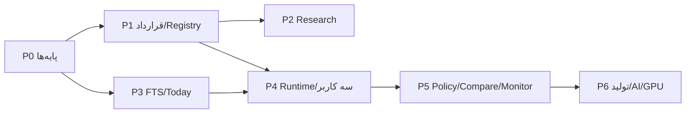

# نقشهٔ اجرایی Opportunity Lab (Phase 5+)

> **تاریخ:** ۲۰۲۶-۱۱-۰۸ · **مبنا:** معماری `04-TECHNICAL-ARCHITECTURE.md` روی Stage 4 `11f4b128`
> **وضعیت:** برنامهٔ پیشنهادی؛ هیچ کد Runtime در فاز ۴ نوشته نشده است. شروع هر مرحله نیازمند Gate قبلی است.
> **قاعدهٔ عرضه:** یک Release فقط وقتی؛ Gateهای همان مرحله با شاهد قابل‌تکرار سبز شوند. «تست سبز» بدون شاهد Build/نصب واقعی کافی نیست.

## ۰) خلاصهٔ مسیر

| مرحله | نام | خروجی | Gate ورود | Gate خروج |
|---|---|---|---|---|
| P0 | پایه‌های امن و قابل‌اعتماد | Generation Resolver، Producer Allowlist، Schema Migration، Local API Token، FTS Source-of-Truth Reconciliation/Parity Harness، Notification Base | پذیرش Stage 4 | تست‌های P0 سبز |
| P1 | قراردادها و Registry | Schemaها، Canonicalization، Bundle Builder/Signer، Verifier/Installer، Transport فایل، Notification Contract | P0 | Verify/Install/Rollback/Offline سبز |
| P2 | Research Workbench | Dataset/IR/Trial/Experiment/Validation در Python، research.db | P1 | بازتولید Experiment روی Snapshot |
| P3 | FTS Adapter و Today v1 | Envelope، FTS Parity، Read Model، API Today/Inspector | P0 + P2 | FTS Stable + Today بدون Stub |
| P4 | Runtime و سه کاربر | IR Interpreter، Primitive Registry، Library/Activation، Registry GitHub، Onboarding ۳ کاربر، Notification Engine/Bridge | P1 + P3 | نصب/فعال‌سازی/Revoke روی ۳ کلاینت + Toast |
| P5 | Policy/Compare/Monitor | Validation/Ranking Policy، Compare، Lab read-only، Monitoring/Revocation، Notification Center/Settings | P4 + Q1/Q11 | شواهد کامل + Revocation + اعلان قابل‌تنظیم |
| P6 | تولید/AI/GPU | Candidate Generation، AI Suggestions، GPU Job Adapter | Q6/Q7/Q15 | Research-only؛ بدون Auto-Approve |

## ۱) P0 — پایه‌های امن و قابل‌اعتماد

**هدف:** بستن شکاف‌هایی که بدون آن‌ها OC روی Stage 4 ناامن/غیرقابل‌اتکاست.

| کار | جزئیات | معیار پذیرش |
|---|---|---|
| P0.1 Generation Resolver | `borsd` باید `active_generation.json` را بخواند، DBهای market/codal را از `gens/gen_*` باز کند و پس از Apply/Reload، Handleها را اتمیک تعویض کند؛ Rollback API/Command | تست: Apply نسل جدید ⇒ API همان داده را می‌دهد؛ Restart/Rollback ⇒ نسل قبلی؛ بدون بستن ناگهانی |
| P0.2 Producer Allowlist | Snapshot فقط `market.db` و `codal.db`؛ `research.db`/`oc_client.db`/`user.db` رد شوند | تست: گذاشتن DB اضافی در dataDir ⇒ منتشر نشود؛ Manifest فقط دو دارایی |
| P0.3 Schema Versioning | `PRAGMA user_version` + Migration Runner + Backup/Rollback برای `oc_client.db` و `research.db`؛ Manifest Schema سازگاری | Migration idempotent؛ Backup/Restore تست |
| P0.4 Local API Security | Token per-launch، Cookie/Header، Origin/Host strict، CORS بسته، محدودکردن `--url` Tauri | تست CSRF/Origin null/پورت اشغال؛ UI فقط با Token |
| P0.5 FTS Source-of-Truth Reconciliation + Parity Harness | استخراج Rule Inventory از `docs/جزوه FTS.pdf` و OWNER_RULINGS؛ ممیزی رفتار/نمایش FTS روی چارت؛ ممیزی Python و Go؛ تعیین یک قرارداد/خروجی مرجع برای موتور Go و مصرف همان خروجی در نمودار و OC؛ Golden Vectors برای Ruleset/Config/سه‌حالتی. هیچ پیاده‌سازی موجودی از پیش درست فرض نشود و ابهام جزوه به تصمیم‌سازی مالک ارجاع شود. | پوشش قابل‌ردیابی تمام قواعد داخل دامنه؛ مقایسهٔ نماد/سناریو/رژیم؛ خروجی‌های Python/Go/Chart منطبق با مرجع؛ صفر اختلاف حل‌نشده در قواعد حیاتی؛ هر مورد نامعلوم `INSUFFICIENT` و مانع Today/Stable؛ حداقل ۵ نماد واقعی و چند برش رژیم |
| P0.6 API Honesty | Job ID/Status برای Sync/Registry؛ حذف 200=started | تست: Job واقعی + Status + خطا |
| P0.7 Build Contract | اسکن بسته/Process Tree برای نبود Python | تست ساخت: هیچ Python/Uvicorn/FastAPI در بستهٔ کلاینت |
| P0.8 Notification Base | Schema `oc_client.db` برای Event/Delivery/Prefs؛ Publisher Interface؛ Token فایل ACL‌دار برای پل؛ Single-instance guard | Migration+Rollback؛ تست Token؛ دو نمونهٔ هم‌زمان |

**P0 Gate:** همهٔ تست‌ها + گزارش `NOT_MEASURED`ها. اگر تطابق جزوه/چارت/Python/Go در P0.5 اثبات نشود، FTS و P3 مسدود می‌مانند و هیچ خروجی نامنطبق `pass` نمی‌گیرد؛ اگر Notification Base نیست، P4.8 مسدود می‌شود. Q1 Deferred است و مانع زیرساخت P0 نیست، اما Approved/Stable جدید فعال نمی‌شود.

## ۲) P1 — قراردادها و Registry

**هدف:** ساخت قراردادهای قابل‌اعتبارسنجی و مسیر نصب امن بدون GitHub.

| کار | جزئیات | معیار پذیرش |
|---|---|---|
| P1.1 Schemaها | `oc.strategy/1`، `oc.bundle/1`، `oc.registry/1`، `oc.approval/1`، `oc.validation_policy/1`، `oc.ranking_policy/1` + JSON Schema | Validatorهای Python/Go هم‌رفتار |
| P1.2 Canonicalization | JSON Canonical + Decimal String + Hash | Cross-language test vector؛ Hash یکسان |
| P1.3 Bundle Builder (Python) | ساخت Manifest/File Hash/Signature/Approval | Tamper tests؛ عدم ساخت بدون Approval |
| P1.4 Verifier/Installer (Go) | Staging/Verify/Content-Address/Pointer/N-1 | Tamper/Hash/Schema/Compat/Crash tests |
| P1.5 Rollback/Offline | Pointer N-1؛ Cache؛ `offline_verified`؛ Export/Import فایل | Offline install؛ Rollback؛ Sequence test |
| P1.6 Registry Transport Interface | `file` + `github_private` (Mock) | تست بدون شبکه؛ سپس GitHub واقعی در P4 |
| P1.7 Notification Contract & Tauri Spike | `oc.notification_event/1` + Preferences Schema؛ افزودن `tauri-plugin-notification`؛ AUMID/Shortcut؛ Mock Bridge + کلیک واقعی | Toast نصب‌شده؛ Deep Link؛ OS-off؛ Restart؛ بدون `remote` Capability |

**P1 Gate:** یک Bundle ساختگی (بدون استراتژی واقعی) با موفقیت Sign/Verify/Install/Rollback/Offline می‌شود؛ هیچ کلید در CI نیست؛ Toast آزمایشی در نصب واقعی با کلیک/OS-off/Restart پاس می‌شود.

## ۳) P2 — Research Workbench

**هدف:** تبدیل Research فعلی به یک Workbench بازتولیدپذیر، بدون ورود به Runtime.

| کار | جزئیات | معیار پذیرش |
|---|---|---|
| P2.1 Dataset Snapshot | خواندن read-only نسل فعال/کپی + Hash | یک Snapshot ثابت، دو اجرا، Hash یکسان |
| P2.2 Hypothesis/IR | ثبت تغییرناپذیر + Slot Grammar + Validator | IR نامعتبر رد؛ نسخهٔ ثبت‌شده تغییر نمی‌کند |
| P2.3 Backtest/Fill | BarView، costs/queue/T+2، rejection taxonomy | تست‌های Look-ahead/Fill/Queue |
| P2.4 Validation | Split/Holdout/WF/CPCV/PBO/DSR/SPA/Leakage/Sample | Verdict taxonomy؛ N_total/N_eff؛ `insufficient_evidence` |
| P2.5 Trial Registry | Hash chain، Before-run | هیچ Run بدون Trial؛ شمارش موفق/ناموفق |
| P2.6 research.db/Artifacts | Schema/Migration/Backup؛ Content-addressed | Restart/Recovery؛ Tamper-evident chain |
| P2.7 Owner CLI (read-only) | گزارش شواهد؛ بدون Approval | Command Log؛ هیچ نوشتن Client |

**P2 Gate:** یک فرضیهٔ نمونه از Dataset تا Verdict بازتولید می‌شود؛ Approval عمداً غیرفعال است (Q1).

## ۴) P3 — FTS Adapter و Today v1

**هدف:** اولین ارزش کاربری: Today با FTS کانونیکال، بدون Stub.

| کار | جزئیات | معیار پذیرش |
|---|---|---|
| P3.1 FTS Adapter | Envelope، Config canonical، tri-state | Golden Vectors؛ `unknown≠fail` |
| P3.2 Ruleset/Config alignment | هم‌ترازی نهایی Go/Python/Chart با Rule Inventory مرجع؛ حذف Config دوگانه از مسیر Approved | Config Hash در Envelope؛ Override جدا؛ تطابق سه‌جانبهٔ تأییدشده |
| P3.3 FTS Strategy Bundle | Descriptor + Evidence + Approval Basis | Bundle بدون فرمول؛ Verify |
| P3.4 Read Model Today | فرصت FTS + Inspector + استناد | API/UI ۱۳۶۶/۱۹۲۰؛ دادهٔ واقعی |
| P3.5 Data State | stale/degraded/unavailable/insufficient | No fake pass؛ بنر/جزئیات |
| P3.6 Owner FTS Bootstrap | Approval امضاشده برای FTS کانونیکال (پس از Parity) | فقط با امضای مالک؛ Registry/Install |

**P3 Gate:** تطابق جزوه/چارت/Python/Go سبز + Bundle مجاز و امضاشده طبق Policy مالک + Today واقعی + هیچ Stub در مسیر. اگر Parity ناقص یا ابهام قاعده باز است، FTS `unavailable` و P3 متوقف می‌شود؛ `approval_enabled=false` نباید دور زده شود.

## ۵) P4 — Runtime و سه کاربر

**هدف:** اجرای IR و توزیع Stable برای سه کاربر.

| کار | جزئیات | معیار پذیرش |
|---|---|---|
| P4.1 IR Interpreter | Primitive Registry، Determinism، Timeout/Step Limit | Unit/Fuzz؛ عدم I/O؛ نسخهٔ ناسازگار رد |
| P4.2 Strategy Runtime | Evaluation، Signal/Opportunity، Cache/Invalidation | همان Data + IR ⇒ همان نتیجه |
| P4.3 Library/Activation | نصب/فعال/غیرفعال/حذف Cache؛ Lab فقط‌خواندنی پایه | یک نسخهٔ فعال؛ Audit |
| P4.4 GitHub Private Registry | Release/Index/Signature؛ سه PAT خواندنی | نصب روی سه کلاینت؛ Revoke؛ بدون دادهٔ شخصی |
| P4.5 Owner Publish Flow | Sign/Publish/Sequence/Rollback انتشار | انتشار نیمه‌کاره/خطا؛ ایندکس آخر |
| P4.6 Monitoring | مشاهدات محلی/Drift/Revocation | هشدار بدون رتبه‌بندی خودکار |
| P4.7 Offline Drill | قطع شبکه/Registry/Data | آخرین نسخهٔ معتبر + برچسب |
| P4.8 Notification Engine/Bridge | Publisherهای دامنه، Classifier/Dedup/Rate Limit/Quiet Hours، Outbox، Long-poll، Rust Toast، Ack/Click | Toast در Minimized/Tray؛ صفر Toast برای سیگنال/قیمت؛ Restart بدون تکرار |

**P4 Gate:** یک استراتژی غیر-FTS (نمونهٔ قاعده‌محور) از Approval تا سه کلاینت می‌رود؛ Revocation سبز؛ `user.db` بایت‌به‌بایت سالم؛ اعلان فقط برای رویداد واجد شرایط و کلیک به مسیر درست.

## ۶) P5 — Policy، Compare، Lab و پایداری

| کار | جزئیات | معیار پذیرش |
|---|---|---|
| P5.1 Validation Policy | پس از رفع Deferred و تصویب/امضای مالک (Q1)؛ تا آن زمان `approval_enabled=false` | `policy_hash`؛ عدم ایجاد Approved/Stable جدید پیش از فعال‌سازی صریح |
| P5.2 Ranking Policy | روش Lexicographic تأیید شده؛ ترتیب معیارها باید جداگانه به تصویب مالک برسد؛ `rank_trace` | هیچ Composite/Weight؛ ترتیب فقط پس از تصویب و امضای Policy فعال شود |
| P5.3 Compare | ۲–۴ Stable؛ CI/N_eff؛ incomparable | FTS reference؛ no composite |
| P5.4 Lab Client | Evidence/Gates/Runs کامل read-only | بدون دکمهٔ اجرا |
| P5.5 Revocation/Deprecation | ایندکس/Sequence/آفلاین | اعمال در Sync؛ برچسب |
| P5.6 Observability | `/api/oc/status`، Audit، Health | بدون PII؛ Job/Status |
| P5.7 Performance Baseline | Today/Lab/Registry روی دادهٔ واقعی | اعداد ثبت‌شده؛ بدون ادعای پیش از اندازه‌گیری |
| P5.8 Notification Center/Settings | `/notifications`، `/settings/notifications`، فیلتر/گروه/Read، صدا/Preview/Quiet Hours، Deep Link | E2E اعلان؛ صفر رویداد گم‌شده؛ حساسیت Preview |

**P5 Gate:** سیاست‌های امضاشده، Compare/Lab/Revocation کامل؛ ۳ کاربر پایدار؛ مرکز/تنظیمات اعلان با معیارهای §۱۹.۱۱.

## ۷) P6 — تولید، AI و GPU (اختیاری/Research)

| کار | جزئیات | معیار پذیرش |
|---|---|---|
| P6.1 Candidate Generation | قالب/ترکیب محدود، Trial قبل از اجرا | هیچ Candidate بدون Trial؛ Human Promotion |
| P6.2 AI Suggestions | `ai_suggested`، جداسازی، بدون Approval/Ranking | No auto-publish؛ Audit |
| P6.3 GPU Job Adapter | Package/State/Import؛ Opt-in | Job آزمایشی؛ Data Scope؛ Output Hash |
| P6.4 Model Research Artifacts | مدل به‌عنوان شاهد، نه Runtime v1 | ADR جدا برای ورود به Runtime |

**P6 Gate:** هیچ خروجی AI/GPU بدون Validation و امضای مالک Stable نمی‌شود؛ Kronos خارج از OC می‌ماند.

## ۸) وابستگی‌ها و ترتیب بحرانی

- P3 به P0.5 (FTS Parity) و P2 (Evidence) وابسته است؛ اگر FTS ناقص باشد، P3 فقط `unavailable` را نشان می‌دهد.
- P4 به P1 (نصب امن) و P3 (FTS) وابسته است.
- P4.8 به P0.8 (Storage/Token) و P1.7 (Toast/AUMID) وابسته است؛ اگر Toast واقعی پاس نشود، P4.8 فقط مرکز اعلان بدون OS Toast عرضه می‌کند و این محدودیت صریح ثبت می‌شود.
- P5 به Q1/Q11 امضاشده وابسته است؛ بدون آن، Policyها در وضعیت `owner-pending`.
- P5.8 به Q20/Q21/Q23 برای پیش‌فرض‌های نهایی وابسته است؛ ساخت مرکز/تنظیمات بدون آن‌ها ممکن است.
- P6 اختیاری است و هیچ Gate محصولی v1 را مسدود نمی‌کند.

## ۹) مالکیت و تصمیم‌ها

| موضوع | مالک تصمیم | وضعیت |
|---|---|---|
| Q1 آستانه‌های Approved | مالک | مسدودکنندهٔ P5 |
| Q5 جایگاه `/fts-screen` | مالک | معماری A انتخاب؛ تأیید محصول |
| Q11 ابعاد/ترتیب رتبه | مالک | موتور آماده؛ Policy امضا شود |
| Q15 GPU Data Scope | مالک | P6 |
| Q16 روش دسترسی ۳ کاربر | مالک/معماری | PAT پیش‌فرض |
| Q17 Offline/Revocation | مالک | پیش‌فرض `offline_verified` |
| Q18 Key Custody | مالک/امنیت | کلید جدا/آفلاین |
| Q20 ماتریس Severity/Quiet Hours | مالک | پیش‌فرض §۱۹.۲ |
| Q21 صدا/Preview | مالک | پیش‌فرض امن |
| Q23 نگهداشت اعلان | مالک | پیش‌فرض Archive |
| P0/P1 فنی | مهندسی | مطابق ADRها |

## ۱۰) معیار پذیرش نهایی محصول

1. سه کاربر می‌توانند بدون Python و بدون سرور دائمی، Stableهای امضاشده را نصب/فعال/آفلاین استفاده کنند.
2. هیچ دادهٔ شخصی در Registry/Cloud/Log نیست.
3. هیچ استراتژی بدون Validation + Approval مالک Stable نمی‌شود.
4. FTS کانونیکال با Parity مصرف می‌شود؛ Stub/501 pass نیست.
5. هر نصب/ارتقا/Rollback/Revocation قابل‌بازتولید و Audit است.
6. Today/Library/Compare/Monitor/Lab read-only با دادهٔ واقعی و حالت‌های صادقانه کار می‌کنند.
7. Any Failure: last-good + Offline + clear status.
8. اعداد Performance/دسترس‌پذیری اندازه‌گیری و ثبت شده‌اند؛ هیچ عدد اختراعی نیست.
9. اعلان فقط برای Critical/Important؛ تاریخچهٔ کامل در مرکز؛ Toast در Minimized/Tray؛ کلیک به Deep Link معتبر؛ OS-off تاریخچه را از بین نمی‌برد؛ `user.db` سالم.

## ۱۱) آنچه در این فاز انجام نمی‌شود

- نوشتن کد Runtime/Go/Python جدید.
- ساخت Registry واقعی/GitHub Private Repo.
- اجرای GPU Job.
- تغییر Stage 4 Worktree، FTS، دیتابیس یا Release.
- Merge به `main` یا انتشار نسخه.
