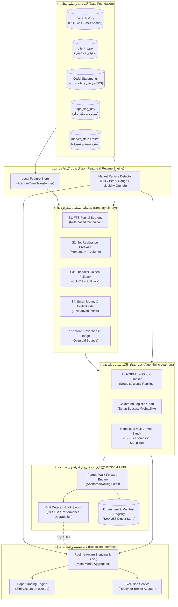
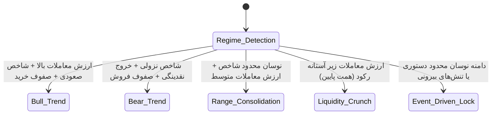

# BorsTerminal — Local Algorithmic Learning System Architecture
## معماری سیستم الگوریتمی یادگیرندهٔ محلی برای بورس‌ترمینال

**تاریخ نگارش:** ۲۴ مهر ۱۴۰۵ (2026-10-15)  
**نسخه:** 1.0.0 (Research Architecture Blueprint)  
**محیط اجرا:** BorsTerminal Desktop (Local Python + SQLite + Rust/Tauri/FastAPI)  
**شاخه جاری:** `mission/4-axes-2026-10-10` | **کامیت لنگر:** `e9db359e`  
**وضعیت:** سند پژوهشی و طراحی معماری (بدون اعمال تغییر اجرایی در کد محصول)  

---

## فهرست مطالب

1. [وضعیت واقعی زیرساخت موجود و شواهد کد](#1-وضعیت-واقعی-زیرساخت-موجود-و-شواهد-کد)
   - [۱.۱ محیط گیت، شاخه و فضاهای کاری](#۱۱-محیط-گیت-شاخه-و-فضاهای-کاری)
   - [۱.۲ محل ذخیره و قرارداد داده‌های تاریخی و کندل‌ها](#۱۲-محل-ذخیره-و-قرارداد-دادههای-تاریخی-و-کندلها)
   - [۱.۳ موتورهای تابلوخوانی و خروجی فیلترها](#۱۳-موتورهای-تابلوخوانی-و-خروجی-فیلترها)
   - [۱.۴ موتور سیگنال‌های FTS و داوری‌های تکنیکال](#۱۴-موتور-سیگنالهای-fts-و-داوریهای-تکنیکال)
   - [۱.۵ زیرساخت فعلی بکتست، شبیه‌سازی و ثبت تاریخی](#۱۵-زیرساخت-فعلی-بکتست-شبیهسازی-و-ثبت-تاریخی)
   - [۱.۶ کفایت داده و تحلیل شکاف اطلاعاتی](#۱۶-کفایت-داده-و-تحلیل-شکاف-اطلاعاتی)
2. [معماری پیشنهادی سیستم الگوریتمی یادگیرنده](#2-معماری-پیشنهادی-سیستم-الگوریتمی-یادگیرنده)
   - [۲.۱ اصول راهبردی و فلسفه طراحی](#۲۱-اصول-راهبردی-و-فلسفه-طراحی)
   - [۲.۲ نمودار جریان معماری کلان (System Architecture Diagram)](#۲۲-نمودار-جریان-معماری-کلان-system-architecture-diagram)
   - [۲.۳ لایه‌های هفت‌گانه سیستم](#۲۳-لایه‌های-هفت‌گانه-سیستم)
3. [ماتریس مقایسه‌ای: اجزای موجود در برابر اجزای مفقود](#3-ماتریس-مقایسه‌ای-اجزای-موجود-در-برابر-اجزای-مفقود)
4. [طرح دیتاست، مهندسی ویژگی‌ها و تعریف اهداف یادگیری](#4-طرح-دیتاست-مهندسی-ویژگیها-و-تعریف-اهداف-یادگیری)
   - [۴.۱ ساختار انباره ویژگی‌های محلی (Local Point-in-Time Feature Store)](#۴۱-ساختار-انباره-ویژگیهای-محلی-local-point-in-time-feature-store)
   - [۴.۲ دسته‌بندی ویژگی‌ها (Feature Pillars)](#۴۲-دستهبندی-ویژگیها-feature-pillars)
   - [۴.۳ برچسب‌ها و اهداف یادگیری (Outcome Labels & Horizons)](#۴۳-برچسبها-و-اهداف-یادگیری-outcome-labels--horizons)
5. [روش بکتست، شبیه‌سازی بازار و اعتبارسنجی زمانی](#5-روش-بکتست-شبیهسازی-بازار-و-اعتبارسنجی-زمانی)
   - [۵.۱ مهار کامل نشت اطلاعات آینده (Anti-Lookahead Protocol)](#۵۱-مهار-کامل-نشت-اطلاعات-آینده-anti-lookahead-protocol)
   - [۵.۲ کنترل سوگیری بقا (Survivorship Bias)](#۵۲-کنترل-سوگیری-بقا-survivorship-bias)
   - [۵.۳ مهار Repainting و اعوجاج‌های قیمتی](#۵۳-مهار-repainting-و-اعوجاج‌های-قیمتی)
   - [۵.۴ مدل‌سازی واقع‌بینانه هزینه‌ها و صف‌های قفل نقدشوندگی](#۵۴-مدلسازی-واقعبینانه-هزینهها-و-صفهای-قفل-نقدشوندگی)
   - [۵.۵ اعتبارسنجی زنجیره‌ای بریده‌شده (Purged Walk-Forward Cross-Validation)](#۵۵-اعتبارسنجی-زنجیرهای-بریدهشده-purged-walk-forward-cross-validation)
6. [طرح مقایسه استراتژی‌ها، کتابخانه مستقل و ثبت آزمایش‌ها](#6-طرح-مقایسه-استراتژیها-کتابخانه-مستقل-و-ثبت-آزمایشها)
   - [۶.۱ کتابخانه استراتژی‌های پایه و پژوهشی (Strategy Library)](#۶۱-کتابخانه-استراتژیهای-پایه-و-پژوهشی-strategy-library)
   - [۶.۲ ارزیابی تفکیک‌شده بر اساس رژیم‌های بازار](#۶۲-ارزیابی-تفکیکشده-بر-اساس-رژیمهای-بازار)
   - [۶.۳ مقایسه خانواده‌های الگوریتمی](#۶۳-مقایسه-خانوادههای-الگوریتمی)
   - [۶.۴ ترکیب خروجی‌ها و تخصیص پویای سرمایه (Ensemble & Bandits)](#۶۴-ترکیب-خروجیها-و-تخصیص-پویای-سرمایه-ensemble--bandits)
   - [۶.۵ ثبت نسخه‌ها و متادیتا (Experiment Tracking & Manifest Digest)](#۶۵-ثبت-نسخهها-و-متادیتا-experiment-tracking--manifest-digest)
   - [۶.۶ پایش افت عملکرد و کنترل بیش‌برازش (Concept Drift & Overfitting Guards)](#۶۶-پایش-افت-عملکرد-و-کنترل-بیشبرازش-concept-drift--overfitting-guards)
7. [فازبندی اجرا و معیارهای پذیرش](#7-فازبندی-اجرا-و-معیارهای-پذیرش)
8. [ریسک‌ها، محدودیت‌های داده و پرسش‌های حل‌نشده](#8-ریسکها-محدودیتهای-داده-و-پرسشهای-حلنشده)

---

## ۱. وضعیت واقعی زیرساخت موجود و شواهد کد

### ۱.۱ محیط گیت، شاخه و فضاهای کاری

در بررسی میدانی مخزن BorsTerminal، وضعیت گیت و فضاهای کاری به شرح زیر تثبیت گردید:

- **مسیر ریشه مخزن:** `c:\Users\PCMOD\Desktop\BorsTerminal`
- **شاخه کاری جاری:** `mission/4-axes-2026-10-10`
- **هش کامیت لنگر جاری:** `e9db359e`
- **وضعیت فضاهای کاری (Worktrees):** روی ماشین کاربر چندین worktree موازی شناسایی شد:
  - `C:/Users/PCMOD/Desktop/BorsTerminal` [شاخه `mission/4-axes-2026-10-10`] (شاخه فعال این گزارش)
  - `C:/Users/PCMOD/Desktop/_bors-easytrader` [شاخه `mission/easytrader-adapter-2026-10-15`]
  - `C:/Users/PCMOD/Desktop/_bors-ui-audit-s1` [شاخه `mission/ui-audit-system-1-2026-10-15`]
  - `C:/Users/PCMOD/Desktop/BorsTerminal-android` [شاخه `arena/fts-mobile-uiux-20261007`]
  - `C:/Users/PCMOD/Desktop/BorsTerminal-desktop` [شاخه `main`]
  - `C:/Users/PCMOD/Desktop/BorsTerminal-roadmap` [شاخه `funnel-api-wip`]
- **قید گیت و انضباط اجرایی:** هیچ تغییری در فایل‌های محصول اعمال نشده، هیچ کامیت یا پوشی صورت نگرفته و وارد worktree عامل‌های دیگر نشده‌ایم. این گزارش صرفاً مستندسازی و طراحی معماری است.

---

### ۱.۲ محل ذخیره و قرارداد داده‌های تاریخی و کندل‌ها

داده‌های بازار در دو پایگاه داده SQLite و قراردادهای پایتونی منجمد ذخیره و مدیریت می‌شوند:

1. **پایگاه داده اصلی `market.db`:**
   - جدول `price_history` ([candle_contract.py#L43-L56](file:///c:/Users/PCMOD/Desktop/BorsTerminal/candle_contract.py#L43-L56)): ستون‌های `(symbol, date, open, high, low, close, volume, last, value, src)`. این جدول انبار اصلی کندل‌های روزانه است.
   - پوشش تاریخی: طبق سند [confidence_engine.py#L17-L29](file:///c:/Users/PCMOD/Desktop/BorsTerminal/confidence_engine.py#L17-L29)، جدول `price_history` برای ۲۵۱۵ نماد ردیف دارد اما تنها ۸۶۸ نماد دارای سابقه بیش از ۶۰ کندل معتبر هستند.
   - جدول `daily_prices`: اسنپ‌شات موقت نشست‌های اخیر (تنها شامل حدود ۹ نشست معاملاتی در نسخه فعلی دیتابیس است و برای تاریخچه دوربرد قابل استفاده نیست).
   - جدول `client_type` و `client_type_value`: آمار معاملات حقیقی و حقوقی شامل حجم و ارزش خرید/فروش و تعداد خریدار/فروشنده به ازای هر نماد و تاریخ `d_even`.
   - جدول `adjust_events`, `price_adjust_events`, `share_change_events`: رویدادهای افزایش سرمایه و سود نقدی برای تعدیل قیمت‌ها.
   - جدول `financial_statements` و `monthly_sales`: صورت‌های مالی ۱۲ ماهه، ۳ ماهه و گزارش‌های درآمد فعالیت ماهانه کدال.

2. **قرارداد هندسه کندل (`candle_contract.py`):**
   - قاعده گسترش سایه ([candle_contract.py#L69-L88](file:///c:/Users/PCMOD/Desktop/BorsTerminal/candle_contract.py#L69-L88)): تابع `widen(open_, high, low, *prices)`. سایه کندل بر اساس داده‌های خام گسترش می‌یابد ولی قیمت پایانی و بدنه دستکاری نمی‌شوند تا اعوجاج داده‌های ناقص TSETMC مهار شود.
   - حق تقدم مالکیت سطر ([candle_contract.py#L32-L41](file:///c:/Users/PCMOD/Desktop/BorsTerminal/candle_contract.py#L32-L41)): ردیف‌های با منبع `published` بالاترین اولویت را دارند (`rank=2`) و اسنپ‌شات‌های زنده تابلو (`board`, `rank=1`) حق بازنویسی کندل‌های منتشرشده نهایی را ندارند.

3. **قرارداد لنگر و مبنای قیمت (`price_basis.py`):**
   - تفکیک `last` و `closing` ([price_basis.py#L1-L28](file:///c:/Users/PCMOD/Desktop/BorsTerminal/price_basis.py#L1-L28)): انتخاب مبنای قیمت برای محاسبات تکنیکال سمت سرور انجام می‌شود. قیمت پایانی (`closing`) همواره لنگر اصلی تعدیل است و انتخاب کاربر (`last` یا `closing`) روی لنگر زنجیره اثر نمی‌گذارد تا مقیاس تاریخی نشکند.

---

### ۱.۳ موتورهای تابلوخوانی و خروجی فیلترها

1. **فیلترهای هفت‌گانه کانونیکال (`tape_flags.py`):**
   - کدها مستقیماً از فایل‌های مرجع مالک استخراج شده و با [tools/tape_formula_parity.py](file:///c:/Users/PCMOD/Desktop/BorsTerminal/tools/tape_formula_parity.py) راستی‌آزمایی می‌شوند ([tape_flags.py#L1-L91](file:///c:/Users/PCMOD/Desktop/BorsTerminal/tape_flags.py#L1-L91)):
     - `f_jet`: شکست نردبان مقاومت ۸ گانه (`[ih][2..59]`) + حجم ۳ برابر میانگین ۳۰ نشست + قدرت خریدار به فروشنده $\ge 1.5$.
     - `f_susp`: حجم مشکوک ۳ برابر میانگین ۳۰ روزه با تعداد معاملات $\ge 50$.
     - `f_clock`: الگوی ساعت ($pl \ge pc \times 1.02$) با تعداد معاملات $\ge 30$.
     - `f_noqteh`: نقطه‌زنی؛ فاصله تا کف ۲۹ نشست اخیر کمتر از ۳٪ با معاملات $\ge 5$.
     - `f_roobi`: کف‌روبی صف فروش؛ آخرین معامله روی آستانه پایین ($pl = tmin$) و درصد آخرین منفی با تشکیل صف خرید در سطر اول ($zd1 > 1, qd1 > 100$).
     - `f_smart`: ورود پول هوشمند؛ حجم بیش از ۱.۵ برابر میانگین ۳۰ روزه، سرانه خریدار حقیقی بیش از فروشنده حقیقی، آخرین بزرگتر از پایانی و بازدهی مثبت.
     - `f_legal`: کد به کد حقوقی به حقیقی؛ شرایط پول هوشمند به همراه خرید حقیقی بیش از ۵۰٪ حجم و فروش حقوقی بیش از ۵۰٪ حجم.

2. **سوابق تاریخی فیلترهای تابلو (`tape_flag_history.py` روی `user.db`):**
   - ایجاد جدول `tape_flag_day` و `tape_flag_day_meta` ([tape_flag_history.py#L38-L61](file:///c:/Users/PCMOD/Desktop/BorsTerminal/tape_flag_history.py#L38-L61)): ثبت روزانه پرچم‌های فعال به ازای هر نماد و تاریخ.
   - **قانون عدم بازسازی گذشته‌نگر:** در خطوط [tape_flag_history.py#L9-L16](file:///c:/Users/PCMOD/Desktop/BorsTerminal/tape_flag_history.py#L9-L16) صریحاً تصریح شده که اطلاعات صف و مقادیر لحظه‌ای در دیتابیس گذشته نگه داشته نشده‌اند، بنابراین گذشته پیش از آغاز ثبت لاگ قابل بازسازی نیست و به عنوان «ثبت‌نشده» تلقی می‌شود نه «غیرفعال».

3. **وضعیت‌های معاملاتی نماد و فاز بازار:**
   - رده‌بندی بازار (`market_universe.py`): دسته‌بندی نماد به `TRADING_ACTIVE`، `QUOTE_ACTIVE_NO_TRADE`، `NO_RECENT_TRADE`، `SUSPENDED`، `STALE_DATA`، `MARKET_CLOSED` ([market_universe.py#L28-L41](file:///c:/Users/PCMOD/Desktop/BorsTerminal/market_universe.py#L28-L41)).
   - فاز نشست (`market_phase.py`): تفکیک رسمی `pre_open`، `continuous`، `closed`، `holiday` بر اساس داده‌های رسمی TSETMC و تعیین اینکه چه شاخص‌هایی در هر فاز قابل محاسبه‌اند ([market_phase.py#L57-L75](file:///c:/Users/PCMOD/Desktop/BorsTerminal/market_phase.py#L57-L75)).

---

### ۱.۴ موتور سیگنال‌های FTS و داوری‌های تکنیکال

1. **موتور بنیادی ۵ شاخص FTS (`fts_engine.py`):**
   - پیاده‌سازی طبق جزوه FTS ([fts_engine.py#L1-L29](file:///c:/Users/PCMOD/Desktop/BorsTerminal/fts_engine.py#L1-L29)):
     1. رشد فروش YTD نسبت به دوره مشابه سال قبل از `monthly_sales`.
     2. روند سودآوری ۳ ساله متوالی EPS فقط از صورت‌های مالی ۱۲ ماهه حسابرسی‌شده شرکت اصلی از `financial_statements`.
     3. حاشیه سود ناخالص: سود ناخالص تقسیم بر درآمد عملیاتی.
     4. نسبت درآمد سالانه شده به ارزش بازار روز و پتانسیل سود ناخالص.
     5. فیلتر صنعت: قیمت‌گذاری آزاد/بورس کالا در برابر قیمت‌گذاری دستوری.

2. **داوری چندعاملی روند (`trend_classify.py`):**
   - طبقه‌بندی روند بر اساس ترکیب ۴ محور ([trend_classify.py#L13-L100](file:///c:/Users/PCMOD/Desktop/BorsTerminal/trend_classify.py#L13-L100)):
     - ساختار پیوت‌های سقف و کف (HH+HL، LL+LH، و غیره).
     - شیب‌های نرمال‌شده با ATR در پنجره‌های ۲۰، ۵۰ و ۱۲۰ کندله.
     - آرایش میانگین‌های متحرک ۲۰، ۵۰ و ۲۰۰.
     - نسبت کارایی کافمن (Kaufman Efficiency Ratio - ER).

3. **موتور قیف کانونیکال (`funnel_engine.py` و `funnel_tech_scan.py`):**
   - قیف اشتراک متوالی (Sequential Intersection) در ۵ گام ([funnel_engine.py#L11-L35](file:///c:/Users/PCMOD/Desktop/BorsTerminal/funnel_engine.py#L11-L35)): واجدیت نماد $\to$ وتوی روند هفتگی $\to$ ساختار و ستاپ‌های روزانه (جت، فیبوناچی، CHoCH، کف دوقلو) $\to$ فیلترهای بنیادی FTS $\to$ تابلوخوانی.
   - خروجی منسجم در جدول مادی‌شده `funnel_tech_scan` ذخیره می‌شود ([funnel_tech_scan.py#L56-L82](file:///c:/Users/PCMOD/Desktop/BorsTerminal/funnel_tech_scan.py#L56-L82)).

4. **موتور تایید سه‌گانه (`confidence_engine.py`):**
   - ترکیب امتیازهای مستقل سه ستون تکنیکال (`conf_tech`)، تابلوخوانی (`conf_tape`) و بنیادی (`conf_fund`) با تفکیک شفاف وضعیت «بی‌داده» (`nodata`) از «مردود» (`fail`) ([confidence_engine.py#L5-L30](file:///c:/Users/PCMOD/Desktop/BorsTerminal/confidence_engine.py#L5-L30)).

---

### ۱.۵ زیرساخت فعلی بکتست، شبیه‌سازی و ثبت تاریخی

برخلاف نسخه‌های اولیه، زیرساخت بکتست و شبیه‌سازی در مأموریت‌های اخیر ریپو شکل گرفته است:

1. **موتور بکتست نقطه در زمان (`backtest_engine.py`):**
   - ساختار `BarView` ([backtest_engine.py#L66-L83](file:///c:/Users/PCMOD/Desktop/BorsTerminal/backtest_engine.py#L66-L83)): به استراتژی تنها پیشوندی از کندل‌ها تا روز تصمیم داده می‌شود (`bars = seq[:i+1]`). امکان نشت آینده کداً مسدود است.
   - مدل پر شدن در گشایش فردا: سیگنال صادر شده در پایان روز $T$، در بازگشایی روز $T+1$ با قیمت Open پر می‌شود ([backtest_engine.py#L290-L338](file:///c:/Users/PCMOD/Desktop/BorsTerminal/backtest_engine.py#L290-L338)).
   - نگهبانان ریسک (`RiskLimits`): سقف ارزش سفارش، سقف درگیری نماد و پورتفوی، و سقف ضرر روزانه با کلید قطع اضطراری (`kill_switch`).
   - اثر انگشت تکرارپذیری (`digest`): هش SHA-256 از مانیفست پارامترها، معاملات، منحنی حقوق صاحبان سهام و ریجکشن‌ها ([backtest_engine.py#L155-L166](file:///c:/Users/PCMOD/Desktop/BorsTerminal/backtest_engine.py#L155-L166)).
   - ابزارهای تقسیم زمانی: توابع `split_chronic` و `walk_forward` در خطوط [backtest_engine.py#L463-L489](file:///c:/Users/PCMOD/Desktop/BorsTerminal/backtest_engine.py#L463-L489).

2. **مدل هزینه و حساب شبیه‌سازی (`trade_sim.py`):**
   - کلاس منسجم `SimAccount` و `Position` که بین بکتست و Paper Trading مشترک است ([trade_sim.py#L86-L120](file:///c:/Users/PCMOD/Desktop/BorsTerminal/trade_sim.py#L86-L120)).
   - کلاس `CostModel`: تعریف کارمزد و لغزش (پیش‌فرض ۳۰ پیپ کارمزد و ۱۰ پیپ اسلیپیج) به همراه سقف مشارکت حجمی (`max_volume_share = 0.02` یعنی حداکثر ۲٪ حجم واقعی روز) ([trade_sim.py#L52-L72](file:///c:/Users/PCMOD/Desktop/BorsTerminal/trade_sim.py#L52-L72)).

3. **حساب کاغذی و دفتر کل ثبت رخدادها (`paper_trading.py` و `execution_ledger.py`):**
   - آداپتور `PaperBroker` سازگار با رابط کارگزاری در [paper_trading.py#L50-L100](file:///c:/Users/PCMOD/Desktop/BorsTerminal/paper_trading.py#L50-L100).
   - جدول ماندگار `execution_event` و `execution_flag` در `user.db` ([execution_ledger.py#L43-L76](file:///c:/Users/PCMOD/Desktop/BorsTerminal/execution_ledger.py#L43-L76)): ثبت لاگ تغییرات سفارش به صورت Append-Only بدون بازنویسی تاریخچه و ثبت کلید قطع `ARMED/HALTED/TRIPPED`.
   - ابزار خط فرمان اجرای بکتست: [tools/bot_backtest_run.py](file:///c:/Users/PCMOD/Desktop/BorsTerminal/tools/bot_backtest_run.py) روی داده‌های واقعی `price_history`.

---

### ۱.۶ کفایت داده و تحلیل شکاف اطلاعاتی

| مؤلفه داده | وضعیت در ریپو | شواهد و فایل منبع | آیا برای بازسازی گذشته کافی است؟ | کمبودها و شکاف‌های دقیق |
| :--- | :---: | :--- | :---: | :--- |
| **کندل‌های روزانه (OHLCV)** | موجود | `market.db:price_history`, `candle_contract.py` | بله (برای نمادهای باسابقه) | تنها ۸۶۸ نماد سابقه $\ge 60$ کندل دارند؛ نمادهای حذف‌شده یا کم‌سابقه غایبند. |
| **تعدیلات افزایش سرمایه و سود** | موجود | `market.db:adjust_events`, `api/chart.py` | بله | تاریخ اعمال دقیق است اما رویدادهای تغییر سرمایه قدیمی‌تر گاهی ناقص ثبت شده‌اند. |
| **اطلاعات کدال (صورت‌های مالی/فروش)** | موجود | `market.db:financial_statements`, `monthly_sales` | نسبی (با چالش Lookahead) | تاریخ انتشار سند در کدال (`publish_date`) باید با تاریخ دوره تفکیک شود. |
| **اطلاعات حقیقی/حقوقی روزانه** | موجود | `market.db:client_type`, `client_type_value` | بله | در مقیاس روزانه موجود است ولی زمان‌بندی ورود پول در طول ساعات بازار را ندارد. |
| **پرچم‌های تابلوخوانی گذشته** | مفقود در گذشته / موجود از ۱۴۰۵ | `user.db:tape_flag_day`, `tape_flag_history.py:11` | خیر (پیش از ۱۴۰۵-۰۷) | صف‌ها، مظنه‌ها و فیلدهای مقطعی ذخیره نشده‌اند؛ گذشته‌نگاری پیش از مهر ۱۴۰۵ ناممکن است. |
| **دفتر سفارش و عمق مظنه‌ها (L2/L3)** | مفقود در تاریخچه | `market.db:order_book` (اسنپ‌شات لحظه‌ای) | خیر | عمق صف در طول تاریخ ذخیره نشده و شبیه‌سازی پر شدن صف‌های سنگین ناممکن است. |
| **ریزمعاملات درون‌روزی (Tick/Minute)** | کاملاً مفقود | دیتابیس فاقد جدول تیک یا کندل ۱دقیقه‌ای است | خیر | تحلیل‌های Microstructure درون روز، شکست‌های ثانیه‌ای و پر شدن آنی قابل بک‌تست نیست. |
| **اطلاعات نمادهای اخراجی/باطل‌شده** | مفقود (سوگیری بقا) | `market.db:instruments` فقط شامل نمادهای فعلی است | خیر | سوگیری بقا (Survivorship Bias) وجود دارد؛ نمادهای ورشکسته یا حذف‌شده غایبند. |

---

## ۲. معماری پیشنهادی سیستم الگوریتمی یادگیرنده

### ۲.۱ اصول راهبردی و فلسفه طراحی

1. **سیستم چندالگوریتمی، نه مدل پیش‌بینی قیمت منفرد:**
   بازار سرمایه یک سامانه پیچیده با رژیم‌های متغیر غیرخطی است. پیش‌بینی نقطه قیمت فردا ($P_{t+1} = \hat{y}$) دچار نویز شدید و فروپاشی مقطعی می‌شود. هدف سیستم یادگیرنده در بورس‌ترمینال عبارت است از:
   - برآورد احتمال موفقیت ستاپ (Setup Quality Score & Probability Estimation).
   - رتبه‌بندی فرصت‌های معاملاتی واجد شرایط (Cross-Sectional Candidate Ranking).
   - تخصیص پویای سرمایه به استراتژی‌های سازگار با رژیم جاری بازار (Regime-Aware Dynamic Allocation).

2. **قانون تفکیک‌ناپذیری FTS (حفظ حاکمیت قوانین کانونیکال):**
   قوانین جزوه FTS موتور قطعی و حاکم بر انطباق سیگنال باقی می‌مانند. سیستم یادگیرنده هرگز حق ندارد رد قطعی FTS را وتو کند یا نقض کند:
   $$\text{Decision} = \text{FTS\_Gate}(\text{Symbol}) \land \text{Risk\_Gate}(\text{Portfolio}) \land \text{Learner\_Score}(\text{Strategy}, \text{Regime})$$
   سیستم یادگیرنده به این پرسش پاسخ می‌دهد: «از میان نمادهایی که فیلترهای رسمی FTS و تابلو را پاس کرده‌اند، کدام‌یک از نظر آماری و در رژیم فعلی بازار بالاترین احتمال بازدهی تعدیل‌شده به ریسک را دارند؟»

3. **اجرای محلی و بدون وابستگی به ابر (100% Local Inference):**
   تمامی فرآیندهای استخراج ویژگی، اجرای مدل‌ها و تصمیم‌گیری به صورت محلی در موتور پایتون دسکتاپ اجرا شده و با فرمت‌های استاندارد و سبک (نظیر LightGBM Booster، Treelite یا ONNX Runtime) مدیریت می‌شوند.

---

### ۲.۲ نمودار جریان معماری کلان (System Architecture Diagram)



---

### ۲.۳ لایه‌های هفت‌گانه سیستم

1. **لایه ۱: خط لوله ویژگی‌های نقطه در زمان (Point-in-Time Feature Pipeline):**
   تولید بردارهای ویژگی با برچسب زمانی قطعی و ممانعت از وارد شدن داده‌های منتشرنشده.
2. **لایه ۲: موتور تشخیص رژیم بازار (Market Regime Detection Engine):**
   دسته‌بندی کلان وضعیت حاکم بر بازار بورس تهران در ۵ وضعیت متمایز.
3. **لایه ۳: کتابخانه مستقل استراتژی‌ها (Strategy Library):**
   واحدهای مجزای تصمیم‌گیری با ورودی `BarView` و تولید سیگنال‌های کاندیدا.
4. **لایه ۴: آزمایشگاه یادگیری و ارزیابی مدل‌ها (Model Learning & Ranking):**
   مدل‌های آماری و گرادیان بوستینگ برای نمره‌دهی به کاندیداها و رتبه‌بندی.
5. **لایه ۵: مانیفست آزمایش‌ها و ثبت نسخه (Experiment & Metadata Registry):**
   ردیابی و نسخه‌بندی دیتاست، پارامترها و نتایج با هش قطعی `digest`.
6. **لایه ۶: پایش افت عملکرد و مهار بیش‌برازش (Concept Drift & Overfitting Watchdog):**
   تشخیص کاهش بهره‌وری استراتژی در تغییر شرایط ساختاری بازار.
7. **لایه ۷: پل اتصال به Paper Trading و موتور اجرای سفارش (Execution & Paper Bridge):**
   تغذیه تصمیمات نهایی به موتور شبیه‌سازی `trade_sim.py` و دفتر کل `execution_ledger.py`.

---

## ۳. ماتریس مقایسه‌ای: اجزای موجود در برابر اجزای مفقود

| بخش معماری | اجزای موجود در کد BorsTerminal | اجزای مفقود / مورد نیاز برای پیاده‌سازی | وضعیت آمادگی | اولویت توسعه |
| :--- | :--- | :--- | :---: | :---: |
| **قرارداد کندل و مبنا** | `candle_contract.py`, `price_basis.py` | — (کامل و منجمد است) | `READY` | — |
| **فیلترهای تابلوخوانی** | `tape_flags.py`, `tape_flag_history.py` | ساخت فیچرهای تجمعی (تعداد روزهای متوالی پرچم، شدت فیلتر) | `PARTIAL` | متوسط |
| **موتور بنیادی FTS** | `fts_engine.py`, `codal_periods.py` | محاسبه شاخص‌های تاریخی بر مبنای `publish_date` واقعی کدال | `PARTIAL` | بالا |
| **تشخیص رژیم بازار** | `mstat_engine.py`, `market_phase.py` | مدل رسمی رژیم ۵ حالته بازار (HMM یا Rule-based Regime Classifier) | `MISSING` | بسیار بالا |
| **موتور بکتست تک‌نماد/سبد** | `backtest_engine.py`, `trade_sim.py` | بکتست متقاطع چند استراتژی (Multi-Strategy Portfolio Backtest) | `PARTIAL` | بالا |
| **انباره ویژگی‌ها (Feature Store)** | لاگ‌های پراکنده و متغیرهای درون حافظه | ساختار منسجم `FeatureStore` نقطه در زمان روی SQLite | `MISSING` | بسیار بالا |
| **ثبت متادیتا و آزمایش‌ها** | متد `digest()` در `BacktestResult` | پایگاه داده ثبت جامع آزمایش‌ها (`ExperimentTracker` محلی) | `PARTIAL` | متوسط |
| **مدل‌های یادگیری ماشین** | وجود سند چشم‌انداز `docs/ML-ENGINE-ROADMAP.md` | پیاده‌سازی خط لوله آموزش و استنتاج محلی LightGBM/Tree | `MISSING` | فاز ۳ |
| **کتابخانه استراتژی‌ها** | فقط `MaCross` و `BuyAndHold` در موتور بکتست | استخراج استراتژی‌های FTS، جت، فیبوناچی و پول هوشمند به شکل ماژولار | `MISSING` | بالا |
| **پایش افت عملکرد (Drift)** | قفل سقف ضرر در `RiskLimits` | الگوریتم‌های CUSUM و رصد تخریب شارپ (Deflated Sharpe Test) | `MISSING` | فاز ۴ |
| **موتور شبیه‌سازی و اجرا** | `paper_trading.py`, `execution_ledger.py` | اتصال مستقیم خروجی‌های یادگیرنده به `PaperBroker` در زمان واقعی | `PARTIAL` | فاز ۵ |

---

## ۴. طرح دیتاست، مهندسی ویژگی‌ها و تعریف اهداف یادگیری

### ۴.۱ ساختار انباره ویژگی‌های محلی (Local Point-in-Time Feature Store)

برای جلوگیری از هرگونه نشت اطلاعات آینده و بازتولیدناپذیری، یک پایگاه داده مجزا با نام پیشنهادی `features.db` (یا جداول مشخص در `user.db` جهت ایزوله ماندن از بازنویسی `market.db`) طراحی می‌شود:

```sql
CREATE TABLE IF NOT EXISTS feature_snapshot (
    symbol TEXT NOT NULL,
    date TEXT NOT NULL,                -- تاریخ تصمیم T (شمسی یا میلادی استاندارد YYYY-MM-DD)
    as_of_epoch REAL NOT NULL,          -- زمان دقیق در دسترس بودن آخرین داده
    regime_id TEXT NOT NULL,           -- رژیم حاکم در زمان تصمیم
    fts_status TEXT NOT NULL,          -- pass / reject / pending / unavailable
    feature_payload JSON NOT NULL,     -- بردار عددی تمام ویژگی‌ها
    schema_version TEXT NOT NULL,      -- نسخه ساختار ویژگی‌ها
    PRIMARY KEY (symbol, date, schema_version)
);
CREATE INDEX IF NOT EXISTS idx_feat_sym_date ON feature_snapshot(symbol, date);
CREATE INDEX IF NOT EXISTS idx_feat_regime ON feature_snapshot(regime_id, date);
```

---

### ۴.۲ دسته‌بندی ویژگی‌ها (Feature Pillars)

ویژگی‌ها در ۵ ستون مستقل مهندسی می‌شوند:

#### ستون ۱: ویژگی‌های هندسه کندل و ساختار قیمت (Price & Candle Geometry)
- **`ret_1d`, `ret_3d`, `ret_5d`, `ret_20d`:** بازدهی‌های گذشته‌نگر منتهی به روز تصمیم بر مبنای `price_basis.current()` (آخرین یا پایانی).
- **`volatility_20d`:** انحراف معیار بازده‌های روزانه در پنجره ۲۰ نشست گذشته.
- **`atr_pct_14`:** نسبت دامنه واقعی میانگین (ATR) به قیمت پایانی ([trend_classify.py#L23-L33](file:///c:/Users/PCMOD/Desktop/BorsTerminal/trend_classify.py#L23-L33)).
- **`body_to_range_ratio`:** اندازه بدنه کندل به دامنه کل (سقف منهای کف) بر مبنای هندسه اصلاح‌شده [candle_contract.py:widen](file:///c:/Users/PCMOD/Desktop/BorsTerminal/candle_contract.py#L69-L88).
- **`gap_pct`:** شکاف قیمتی بازگشایی امروز نسبت به پایانی دیروز: $(Open_t - Close_{t-1}) / Close_{t-1}$.
- **`dist_to_52w_high` / `dist_to_52w_low`:** فاصله درصدی آخرین قیمت تا سقف و کف یک‌ساله.

#### ستون ۲: ویژگی‌های ساختار تکنیکال و روند (Technical Structure & Swings)
- **`trend_weekly` / `trend_daily`:** برچسب روند کانونیکال برآمده از [trend_classify.py](file:///c:/Users/PCMOD/Desktop/BorsTerminal/trend_classify.py) (`bull`, `bear`, `range`).
- **`slope_score`:** شیب نرمال‌شده در پنجره‌های ۲۰، ۵۰ و ۱۲۰ روزه ([trend_classify.py#L35-L48](file:///c:/Users/PCMOD/Desktop/BorsTerminal/trend_classify.py#L35-L48)).
- **`kaufman_er`:** نسبت کارایی کافمن برای سنجش میزان تمیزی روند در برابر نویز ([trend_classify.py#L68-L75](file:///c:/Users/PCMOD/Desktop/BorsTerminal/trend_classify.py#L68-L75)).
- **`dist_to_fib_zone`:** فاصله قیمت تا محدوده طلایی فیبوناچی (ترازهای ۰.۵ تا ۰.۶۸) شناسایی‌شده در [confidence_engine.py#L80](file:///c:/Users/PCMOD/Desktop/BorsTerminal/confidence_engine.py#L80).
- **`choch_bull_flag` / `range_break_flag`:** رخداد تغییر ماهیت ساختار یا شکست مستطیل رِنج در ۲۰ کندل اخیر ([funnel_tech_scan.py#L70-L73](file:///c:/Users/PCMOD/Desktop/BorsTerminal/funnel_tech_scan.py#L70-L73)).

#### ستون ۳: ویژگی‌های تابلوخوانی و ریزساختار (Tape & Microstructure)
- **`buyer_power_ratio`:** نسبت سرانه خرید حقیقی به سرانه فروش حقیقی:
  $$\text{BuyerPower} = \frac{\text{Buy\_I\_Volume} / \text{Buy\_CountI}}{\text{Sell\_I\_Volume} / \text{Sell\_CountI}}$$
- **`inst_ownership_delta_5d`:** تغییرات خالص سهم حقوقی در ۵ روز گذشته بر اساس `client_type`.
- **`vol_to_vol30_ratio`:** حجم امروز تقسیم بر میانگین ۳۰ نشست گذشته ([tape_flags.py#L47](file:///c:/Users/PCMOD/Desktop/BorsTerminal/tape_flags.py#L47)).
- **`active_tape_flags_count`:** تعداد کل پرچم‌های فعال همزمان از میان ۷ پرچم کانونیکال `f_jet`, `f_susp`, `f_clock`, `f_noqteh`, `f_roobi`, `f_smart`, `f_legal`.
- **`tape_flag_persistence_5d`:** تعداد روزهایی در ۵ روز اخیر که حداقل یکی از فیلترهای پول هوشمند یا جت فعال بوده است (خوانده‌شده از `user.db:tape_flag_day`).

#### ستون ۴: ویژگی‌های رژیم و شرایط کلان بازار (Market Breadth & Regime)
- **`market_turnover_hemat`:** ارزش معاملات خرد سهام به همت (خوانده‌شده از `mstat_engine.py`).
- **`market_advance_decline_ratio`:** نسبت تعداد نمادهای مثبت به منفی در کل بازار.
- **`market_queue_pressure`:** نسبت ارزش صف‌های خرید به ارزش صف‌های فروش کل بازار.
- **`market_net_retail_cash`:** خالص جریان ورود/خروج پول نقد حقیقی به کل بازار.
- **`regime_label`:** شناسه رژیم استخراج‌شده (توضیح در بخش ۶.۲).

#### ستون ۵: ویژگی‌های کانتکست بنیادی FTS (Fundamental FTS Context)
- **`fts_score`:** امتیاز خام FTS (از ۰ تا ۵) برآمده از [fts_engine.py](file:///c:/Users/PCMOD/Desktop/BorsTerminal/fts_engine.py).
- **`sales_growth_yoy`:** نرخ رشد فروش سال به سال تجمیعی از `monthly_sales`.
- **`gross_margin_pct`:** حاشیه سود ناخالص شرکت از صورت‌های مالی.
- **`eps_trend_status`:** وضعیت رشد ۳ ساله سودآوری (صعودی متوالی = ۱، غیرمتوالی = ۰).
- **`industry_pricing_type`:** قیمت‌گذاری آزاد (بورس کالا) = ۱، دستوری = ۰ ([fts_engine.py#L22](file:///c:/Users/PCMOD/Desktop/BorsTerminal/fts_engine.py#L22)).

---

### ۴.۳ برچسب‌ها و اهداف یادگیری (Outcome Labels & Horizons)

تعریف تارگت‌ها باید کاملاً شفاف، دارای افق زمانی مشخص و بدون ابهام باشد:

1. **بازده افق ثابت (Forward Session Return):**
   $$R_{t, H} = \frac{Open_{t+1+H} - Open_{t+1}}{Open_{t+1}} - \text{RoundTripFee}$$
   که در آن $H \in \{3, 5, 10\}$ نشست معاملاتی است. ورود در بازگشایی روز $T+1$ فرض می‌شود نه روز تصمیم $T$.

2. **روش سه‌مانع (Triple Barrier Method - مقتبس از Marcos López de Prado):**
   برای هر سیگنال در زمان $T+1$ سه مانع تعریف می‌شود:
   - **مانع بالا (Take Profit):** رسیدن به $+2 \times ATR_{14}$ پیش از انقضای زمان و پیش از حد ضرر.
   - **مانع پایین (Stop Loss):** رسیدن به $-1 \times ATR_{14}$ (یا حد ضرر ساختاری پیوت قبلی).
   - **مانع زمانی (Time Barrier):** انقضای ۱۰ نشست معاملاتی.
   - **برچسب هدف ($Y$):**
     $$Y = \begin{cases} 
     +1 & \text{اگر مانع بالا اول لمس شود (Success)} \\
     -1 & \text{اگر مانع پایین اول لمس شود (Failure)} \\
     0 & \text{اگر به مانع زمانی برسد (Neutral / Inactive)}
     \end{cases}$$

3. **سفر مطلوب و نامطلوب بیشینه (MFE / MAE):**
   - **MFE (Maximum Favorable Excursion):** بالاترین قیمت لمس‌شده در طول $H$ نشست پس از ورود منهای قیمت ورود.
   - **MAE (Maximum Adverse Excursion):** عمیق‌ترین افت قیمت لمس‌شده در طول $H$ نشست پس از ورود.
   این مقادیر پیوسته به مدل‌ها اجازه می‌دهند به جای یک برچسب باینری ساده، کشش سود در برابر ریسک ریزش معامله را تخمین بزنند.

---

## ۵. روش بکتست، شبیه‌سازی بازار و اعتبارسنجی زمانی

### ۵.۱ مهار کامل نشت اطلاعات آینده (Anti-Lookahead Protocol)

برای حفظ کمال داده‌ها و تضمین قطعیت نتایج:
1. **عایق‌بندی کامل پیشوند داده (`BarView`):**
   همان‌گونه که در خطوط [backtest_engine.py#L66-L83](file:///c:/Users/PCMOD/Desktop/BorsTerminal/backtest_engine.py#L66-L83) تثبیت شده، استراتژی در گام $t$ فقط شیء `BarView` شامل ردیف‌های تا تاریخ $t$ را مشاهده می‌کند. دسترسی به داده‌های روز $t+1$ از لحاظ معماری غیرممکن است.
2. **تاخیر فاز سفارش به بازگشایی فردا (Next-Open Execution):**
   سفارشی که در پایان نشست روز $T$ (بر اساس قیمت‌های بسته) تصمیم‌گیری می‌شود، در بازگشایی نشست $T+1$ اجرا می‌گردد. اجرای همزمان با قیمت بسته همان روز به عنوان خطای قطعی رد صلاحیت می‌شود.
3. **لنگر زمانی صورت‌های مالی کدال (Codal Point-in-Time Lag):**
   گزارش‌های کدال به هیچ وجه بر اساس «تاریخ پایان دوره مالی» در ویژگی‌ها اعمال نمی‌شوند، بلکه بر اساس **«تاریخ و ساعت انتشار در سایت کدال» (`publish_date`)** به دیتاست تزریق می‌گردند. برای نمونه، صورت مالی منتهی به ۱۲/۲۹ که در تاریخ ۰۴/۲۵ منتشر شده است، تا پیش از تاریخ ۰۴/۲۵ در ویژگی‌های بنیادی اعمال نمی‌شود.

---

### ۵.۲ کنترل سوگیری بقا (Survivorship Bias)

در بورس تهران نمادهای متعددی طی سال‌های گذشته تعلیق طولانی، لغو پذیرش یا ورشکست شده‌اند (نظیر کنتورسازی یا برخی نمادهای پایه).
- **وضعیت کنونی ریپو:** جدول `price_history` به شکل عمده شامل نمادهایی است که در حال حاضر فعال هستند و برای نمادهای باطل‌شده تاریخچه کاملی نگهداری نکرده است.
- **راهبرد مهار سوگیری:**
  1. در گزارش‌های پژوهشی صراحتاً ثبت شود که فضای نمونه روی «نمادهای دارای تاریخچه فعال» اجرا شده و نباید تعمیم کاذب به کل تاریخ ۳۰ ساله بورس داده شود.
  2. موتور انتخاب سبد (`Universe Selection`) در هر تاریخ $T$، جهان واجد شرایط را فقط از روی نمادهایی تشکیل می‌دهد که در همان تاریخ $T$ وضعیت معاملاتی فعال (`c_etaval = 'مجاز'`) داشته‌اند ([funnel_engine.py#L88-L91](file:///c:/Users/PCMOD/Desktop/BorsTerminal/funnel_engine.py#L88-L91)) و از تعریف یک Universe ایستا که امروز می‌دانیم زنده مانده‌اند خودداری می‌کند.

---

### ۵.۳ مهار Repainting و اعوجاج‌های قیمتی

- **عدم اتکا به پیوت‌های تاییدنشده:** در استخراج قله‌ها و دره‌های زیگ‌زاگ، پیوت تنها زمانی معتبر است که شکست ساختار بعد از آن تثبیت شده باشد. استفاده از کف و سقف‌های شناور روز جاری در متغیرهای پیش‌بینی‌کننده ممنوع است.
- **استفاده انحصاری از ردیف‌های نهایی منتشرشده (`src = published`):** اسنپ‌شات‌های موقت میانه بازار که در جدول موقت قرار دارند نباید در دیتاست تاریخی بنشینند ([candle_contract.py#L22-L24](file:///c:/Users/PCMOD/Desktop/BorsTerminal/candle_contract.py#L22-L24)).

---

### ۵.۴ مدل‌سازی واقع‌بینانه هزینه‌ها و صف‌های قفل نقدشوندگی

یکی از فاحش‌ترین خطاهای بکتست در بازار ایران، فرض نقدشوندگی کامل و کارمزد ناچیز است. در این معماری قواعد زیر الزام می‌شوند:

1. **اصلاح نرخ کارمزد واقعی بورس تهران:**
   در `trade_sim.py:55` کارمزد فعلی ۳۰ پیپ (۰.۳٪) ثبت شده که به عنوان راهبد آزمایشی است. در محیط شبیه‌سازی واقعی بورس تهران:
   - کارمزد خرید سهام: حدود ۰.۳۷۱٪
   - کارمزد و مالیات فروش سهام: حدود ۰.۸۸٪ (شامل ۰.۵٪ مالیات مقطوع فروش)
   - **مجموع کارمزد دوطرفه واقعی (Round-trip Cost):** حدود ۱.۲۵٪ (۱۲۵ پیپ).
   هر مدل یا استراتژی که سود آن در محدوده کارمزد ۱.۲۵٪ باشد، فاقد توجیه عملیاتی شناخته شده و مردود می‌گردد.

2. **محدودیت صف‌های قفل خرید و فروش (Limit-Lock Queue Dynamics):**
   - اگر در روز $T+1$ قیمت بازگشایی روی آستانه مجاز بالا قفل باشد ($Open = High = Low = t_{max}$) و حجم معاملات بسیار ناچیز باشد، خرید انجام نمی‌شود (`Rejection: locked_buy_queue`).
   - اگر نماد در صف فروش قفل باشد ($Open = High = Low = t_{min}$)، خروج اضطراری و فروش در همان روز ناممکن است و با زیان تا روز باز شدن صف امتداد می‌یابد.
   - سقف مشارکت حجمی: سفارش‌های فرضی نمی‌توانند بیش از ۲٪ حجم کل معامله‌شده آن روز بازار را ببلعند (`max_volume_share = 0.02` در [trade_sim.py#L58](file:///c:/Users/PCMOD/Desktop/BorsTerminal/trade_sim.py#L58)).

---

### ۵.۵ اعتبارسنجی زنجیره‌ای بریده‌شده (Purged Walk-Forward Cross-Validation)

تقسیم‌بندی تصادفی سنتی (K-Fold CV) در داده‌های سری زمانی مالی خطای فاحش نشت آینده ایجاد می‌کند. اعتبارسنجی سیستم یادگیرنده بورس‌ترمینال بر اساس روش زیر اجرا می‌شود:

```
تاریخچه زمانی (Sessions) ───────────────►
Fold 1: [─── Train ───] [Purge] [── Test ──]
Fold 2:        [─── Train ───] [Purge] [── Test ──]
Fold 3:               [─── Train ───] [Purge] [── Test ──]
```

- **توالی زمانی:** پنجره آموزش همواره بر پنجره آزمون مقدم است.
- **بازه پاکسازی (Purge Window):** به اندازه افق برچسب (مثلاً ۱۰ نشست) بین انتهای داده‌های آموزش و ابتدای داده‌های تست فاصله انداخته می‌شود تا برچسب‌های مرزی همپوشانی پیدا نکنند.
- **تعداد فولدها:** حداقل ۳ تا ۵ فولد متوالی بر اساس تابع `walk_forward` در [backtest_engine.py#L474-L489](file:///c:/Users/PCMOD/Desktop/BorsTerminal/backtest_engine.py#L474-L489).

---

## ۶. طرح مقایسه استراتژی‌ها، کتابخانه مستقل و ثبت آزمایش‌ها

### ۶.۱ کتابخانه استراتژی‌های پایه و پژوهشی (Strategy Library)

استراتژی‌ها کلاس‌های مستقلی هستند که پروتکل `Strategy` را پیاده‌سازی کرده و فقط متد `on_bar(view: BarView) -> Signal | None` دارند ([backtest_engine.py#L84-L90](file:///c:/Users/PCMOD/Desktop/BorsTerminal/backtest_engine.py#L84-L90)):

1. **`Strategy_FTS_Canonical` (پایه حاکم):**
   انطباق کامل با خروجی نهایی قیف FTS ([funnel_engine.py](file:///c:/Users/PCMOD/Desktop/BorsTerminal/funnel_engine.py)). خرید فقط در صورت تایید همزمان هفتگی، روزانه و ۵ شاخص FTS.
2. **`Strategy_Jet_Breakout` (تکانه و شکست مقاومت):**
   ورود در شکست نردبان مقاومتی ۵۹ روزه با تایید حجم ۳ برابری و سرانه خریدار برتر.
3. **`Strategy_Fibonacci_Pullback` (پولبک و تغییر ساختار):**
   ورود در پولبک به محدوده طلایی فیبوناچی (۰.۵ تا ۰.۶۸ موج پیشین) پس از تایید الگوی CHoCH صعودی.
4. **`Strategy_SmartMoney_Accumulation` (جریان سفارش و کد به کد):**
   ورود پس از ۲ روز متوالی پرچم ورود پول هوشمند و کد به کد با حمایت حقیقی.
5. **`Strategy_Range_MeanReversion` (بازگشت به میانگین در رِنج):**
   خرید در کف‌های باکس معاملاتی با واگرایی مثبت RSI و فروش در سقف باند در رژیم‌های خنثی.

---

### ۶.۲ ارزیابی تفکیک‌شده بر اساس رژیم‌های بازار

یک استراتژی روندپذیر ممکن است در بازار صعودی بازدهی درخشانی داشته باشد اما در بازار رکودی تمام سود خود را از دست بدهد. به همین جهت عملکرد هر استراتژی به تفکیک ۵ رژیم بازار محاسبه می‌شود:



- **رژیم ۱ (صعودی پرشتاب - Bull Trend):** ارزش معاملات خرد بالای ۸ همت، بیش از ۷۰٪ نمادها بالای MA50، غلبه صفوف خرید.
- **رژیم ۲ (نزولی فرسایشی - Bear Trend):** شاخص کل زیر MA50، سرانه فروش برتر، ارزش صف‌های فروش چند برابر صف‌های خرید.
- **رژیم ۳ (تعادلی / رِنج - Range Consolidation):** شاخص کل در محدوده نوسانی $\pm 3\%$، ارزش معاملات متوسط، بدون روند پایدار در شاخص‌های لیدر.
- **رژیم ۴ (تله نقدینگی / رکود - Liquidity Crunch):** ارزش معاملات خرد زیر آستانه کفایت نقدشوندگی (مثلاً زیر ۴ همت)، حجم مبنا در اکثر نمادها پر نمی‌شود.
- **رژیم ۵ (قفل معاملاتی ناشی از شوک - Shock & Lock):** محدودیت دامنه نوسان به $\pm 1\%$ یا $\pm 2\%$ توسط سازمان بورس، صفوف خرید یا فروش غیرقابل معامله.

---

### ۶.۳ مقایسه خانواده‌های الگوریتمی

سیستم یادگیرنده عملکرد خانواده‌های الگوریتمی زیر را روی دیتاست ارزیابی مقایسه می‌کند:

| خانواده الگوریتم | الگوریتم‌های کاندید | نقاط قوت در بازار ایران | ریسک‌ها و چالش‌ها | نقش در سیستم |
| :--- | :--- | :--- | :--- | :--- |
| **قاعده‌محور (Rule-Based)** | FTS Funnel, Hard Filters | شفافیت ۱۰۰٪، تطابق کامل با منطق تحلیلی مالک | عدم انعطاف در تغییر رژیم بازار | دروازه‌بان واجدیت کاندیداها (Gatekeeper) |
| **درختان تصمیم و بوستینگ (Tree Boosting)** | LightGBM, XGBoost, CatBoost | مدیریت عالی داده‌های جدولی ناهمگن و روابط غیرخطی | حساسیت به نویز و بیش‌برازش روی پارامترها | رتبه‌بندی کیفی کاندیداها (Ranking) |
| **مدل‌های آماری خطی و کالیبره‌شده** | ElasticNet, Calibrated Logistic | کمترین ریسک بیش‌برازش، کالیبراسیون دقیق احتمال | ناتوانی در کشف الگوهای ترکیبی پیچیده | مدل پایه اعتبارسنجی (Benchmark Baseline) |
| **یادگیری آنلاین و راهزنان (Bandits)** | Contextual Thompson Sampling, EXP3 | تخصیص سرمایه منعطف بدون بازآموزی سنگین مدل | افت مقطعی در چرخش‌های ناگهانی بازار | وزن‌دهی به استراتژی‌ها در رژیم‌های متغیر |

---

### ۶.۴ ترکیب خروجی‌ها و تخصیص پویای سرمایه (Ensemble & Bandits)

به جای ادغام ساده خروجی‌ها با میانگین حسابی، سیستم از سازوکار **متا-مدل وابسته به رژیم (Regime-Conditioned Ensemble)** استفاده می‌کند:
$$Score(s, t) = \sum_{k=1}^{M} w_k(\text{Regime}_t) \cdot P_k(s, t)$$
که در آن:
- $P_k(s, t)$: احتمال برآورد شده موفقیت برای نماد $s$ توسط استراتژی/مدل $k$.
- $w_k(\text{Regime}_t)$: وزن تخصیص داده شده به استراتژی $k$ در رژیم جاری بازار.

برای مثال، در رژیم **رِنج و رکود نقدینگی**، وزن استراتژی شکست مقاومت (`Jet_Breakout`) به صفر میل می‌کند و وزن استراتژی بازگشت به میانگین (`MeanReversion`) یا نقد ماندن پورتفوی افزایش می‌یابد.

---

### ۶.۵ ثبت نسخه‌ها و متادیتا (Experiment Tracking & Manifest Digest)

مشابه سیستم‌های مدرن MLOps اما به صورت محلی و سبک، هر آزمایش بکتست و آموزش در جدولی با نام `experiment_log` در `user.db` یا فایلی ساختاریافته در `_audit/experiments/` ثبت می‌شود:

```json
{
  "experiment_id": "exp_20261015_lgbm_ranker_v1",
  "engine_version": "bot-backtest-2",
  "timestamp": "2026-10-15T21:10:00Z",
  "dataset_manifest": {
    "date_span": ["1401-01-05", "1404-07-20"],
    "universe_hash": "a4f891b2c3d4",
    "features_version": "v1.2",
    "rows_count": 452100
  },
  "strategy_family": "LightGBM_Ranker",
  "hyperparameters": {
    "num_leaves": 31,
    "learning_rate": 0.03,
    "max_depth": 5,
    "min_child_samples": 50
  },
  "cost_model": {
    "commission_bps": 125.0,
    "slippage_bps": 10.0,
    "max_volume_share": 0.02
  },
  "validation_metrics": {
    "walk_forward_sharpe": 1.42,
    "max_drawdown": -0.165,
    "win_rate": 0.582,
    "profit_factor": 1.68,
    "brier_score": 0.21
  },
  "digest": "7f8b9c2a1e4d3f5a"
}
```
هر نتیجه با هش SHA-256 (`digest`) قفل می‌شود تا هرگونه تغییر در کد، داده یا فرضیات باعث تغییر هش شده و نتایج غیرتکرارپذیر را مشخص سازد ([backtest_engine.py#L155-L166](file:///c:/Users/PCMOD/Desktop/BorsTerminal/backtest_engine.py#L155-L166)).

---

### ۶.۶ پایش افت عملکرد و کنترل بیش‌برازش (Concept Drift & Overfitting Guards)

1. **آزمون شارپ تنزیل‌شده (Deflated Sharpe Ratio - Bailey & López de Prado):**
   اگر کاربری ۱۰۰۰ بار هایپرپارامترها را تغییر دهد تا به یک شارپ بالا برسد، این بازده تصادفی است. سیستم یادگیرنده با شمارش دفعات اجرای آزمایش بر روی یک دیتاست، نسبت شارپ را نسبت به تعداد تلاش‌ها جریمه می‌کند.
2. **نگهبان انحراف سود و زیان (CUSUM PnL Drift Detector):**
   در مرحله Paper Trading یا اجرای واقعی، تفاوت تجمعی میان بازده مورد انتظار مدل و بازده محقق‌شده پایش می‌شود. در صورت وقوع افت شدید متوالی (Cumulative Underperformance)، استراتژی مورد نظر به صورت خودکار به حالت غیرفعال یا قرنطینه درمی‌آید.
3. **کلید قطع سراسری ریسک (`RiskLimits.kill_switch`):**
   تعبیه در موتور بکتست و لایو ([backtest_engine.py#L259-L260](file:///c:/Users/PCMOD/Desktop/BorsTerminal/backtest_engine.py#L259-L260) و [execution_ledger.py#L78-L85](file:///c:/Users/PCMOD/Desktop/BorsTerminal/execution_ledger.py#L78-L85)). در صورت رسیدن ضرر محقق‌شده روز به سقف تعیین‌شده، متد `_trip()` کل سفارشات بعدی را مسدود می‌کند.

---

## ۷. فازبندی اجرا و معیارهای پذیرش

```mermaid
timeline
    title برنامه فازبندی پیاده‌سازی سیستم الگوریتمی یادگیرنده
    section فاز ۰ : انضباط داده و عایق‌سازی
        ایجاد جداول تاریخچه بدون نشت : تثبیت publish_date کدال
    section فاز ۱ : انباره ویژگی‌ها و رژیم
        خط لوله Local Feature Store : موتور تشخیص رژیم ۵ حالته
    section فاز ۲ : کتابخانه استراتژی‌ها
        پیاده‌سازی ۵ استراتژی ماژولار : بکتست چند استراتژی با کارمزد بورس
    section فاز ۳ : یادگیری و رتبه‌بندی
        مدل‌های رتبه‌بندی LightGBM : اعتبارسنجی Purged Walk-Forward
    section فاز ۴ : متا-مدل و افت عملکرد
        تخصیص سرمایه با Contextual Bandit : پیاده‌سازی CUSUM و DSR
    section فاز ۵ : اتصال Paper Trading
        اتصال بلادرنگ به PaperBroker : داشبورد ارزیابی زنده عملکرد
```

### شرح تفصیلی فازها و معیارهای پذیرش (Exit Criteria):

#### فاز ۰: انضباط داده و زیرساخت Point-in-Time (پیش‌نیاز اجباری)
- **اقدامات:**
  - تطبیق جدول `price_history` با قواعد `candle_contract.py` و `price_basis.py`.
  - ایجاد جدول انبار تاریخ انتشار دقیق کدال (`codal_publish_timeline`) برای ممانعت از پیش‌بینی با صورت‌های مالی منتشرنشده.
- **معیار پذیرش (Exit Criterion):**
  تولید مجدد ویژگی‌های تاریخی برای یک تاریخ مشخص در گذشته دقیقاً با داده‌های همان لحظه مطابقت داشته باشد و تست گارد نشت آینده با موفقیت پاس شود.

#### فاز ۱: انباره ویژگی‌ها و موتور تشخیص رژیم بازار
- **اقدامات:**
  - ساخت ماژول `feature_extractor.py` جهت استخراج ۲۵ ویژگی استاندارد در ۵ ستون.
  - پیاده‌سازی ماژول `regime_detector.py` بر مبنای متغیرهای نبض بازار و جریان پول.
- **معیار پذیرش:**
  تکمیل جداول ویژگی‌ها برای ۸۶۸ نماد دارای تاریخچه معتبر بدون خطای `NaN` ناموجه و دسته‌بندی موفق تمام روزهای گذشته به یکی از ۵ رژیم بازار.

#### فاز ۲: کتابخانه مستقل استراتژی‌ها و ارتقای شبیه‌ساز
- **اقدامات:**
  - تبدیل فیلترهای جت، فیبوناچی و FTS به کلاس‌های سازگار با پروتکل `Strategy`.
  - اصلاح کلاس `CostModel` در `trade_sim.py` برای لحاظ کارمزد واقعی ۱.۲۵٪ بورس تهران و محدودیت‌های صفوف قفل نوسان.
- **معیار پذیرش:**
  اجرای بکتست مستقل برای هر ۵ استراتژی در دوره ۳ ساله و تولید گزارش مجزا برای عملکرد در هر یک از رژیم‌های بازار به همراه هش تکرارپذیر `digest`.

#### فاز ۳: آموزش مدل‌های یادگیرنده رتبه‌بندی و دسته‌بندی
- **اقدامات:**
  - پیاده‌سازی خط لوله آموزش آفلاین با LightGBM و Scikit-Learn.
  - اعمال متد اعتبارسنجی زمانی `Purged Walk-Forward` با ۵ فولد بدون همپوشانی.
- **معیار پذیرش:**
  مدل رتبه‌بندی در دوره آزمون خارج از نمونه (Out-of-Sample) بتواند نمادهای پنجک برتر (Top Quintile) را با نرخ برد و بازدهی معنادار بالاتر از میانگین بازار و خط مبنای تصادفی تفکیک کند.

#### فاز ۴: متا-مدل، تخصیص پویای سرمایه و رصد انحراف
- **اقدامات:**
  - پیاده‌سازی تخصیص‌دهنده سرمایه متناسب با رژیم (Contextual Bandit Allocation).
  - پیاده‌سازی مانیتور انحراف فرآیند (CUSUM Drift Detection) برای تشخیص مرگ استراتژی‌ها.
- **معیار پذیرش:**
  در بکتست کلی، منحنی افت سرمایه (Drawdown) سیستم ترکیبی حداقل ۲۰٪ نسبت به تک‌تک استراتژی‌های منفرد بهبود یابد.

#### فاز ۵: اتصال به Paper Trading و استقرار محلی
- **اقدامات:**
  - اتصال سیگنال‌های ترکیبی مدل به آداپتور `PaperBroker` در فایل [paper_trading.py](file:///c:/Users/PCMOD/Desktop/BorsTerminal/paper_trading.py).
  - ثبت خودکار لاگ تصمیمات و معاملات در جدول `execution_event` روی `user.db`.
- **معیار پذیرش:**
  اجرای بدون خطای سیستم در ساعات زنده بازار برای حداقل ۱۰ نشست معاملاتی پیاپی در محیط شبیه‌سازی، بدون ایجاد تداخل با فرآیندهای روزمره دسکتاپ بورس‌ترمینال.

---

## ۸. ریسک‌ها، محدودیت‌های داده و پرسش‌های حل‌نشده

### ۸.۱ محدودیت‌های ساختاری داده

1. **فقدان داده‌های تیک و عمق تاریخی (Lack of Historical Order Book Depth):**
   به دلیل عدم ذخیره‌سازی داده‌های عمق صفوف خرید و فروش در سال‌های گذشته، ارزیابی رفتارهای سرخطی و رقابت صف‌ها در گذشته ناممکن است. مدل‌ها باید بر داده‌های پایان نشست تمرکز کنند و از ادعای برتری در معاملات ثانیه‌ای پرهیز نمایند.
2. **کوتاه بودن سابقه نمادهای بازار (Data Scarcity):**
   بسیاری از شرکت‌های بازار سرمایه ایران سابقه معاملاتی ناپیوسته دارند (توقف‌های چندماهه به دلیل افزایش سرمایه یا کنفرانس افشای الف). این امر طول نمونه مؤثر را کوتاه کرده و خطر بیش‌برازش (Overfitting) را افزایش می‌دهد.
3. **تغییرات مکرر قوانین معاملاتی بورس تهران (Structural Regime Breaks):**
   دستکاری‌های مکرر در دامنه نوسان (از $\pm 5\%$ به $\pm 7\%$، $\pm 2\%$، $\pm 1\%$ و بالعکس)، تغییرات در حجم مبنا و بسته‌شدن‌های ناگهانی به دلیل شوک‌های سیاسی، داده‌های آماری گذشته را ناپایا (Non-Stationary) می‌کند. مدل‌ها باید تغییرات ساختاری را به عنوان ویژگی صریح دریافت کنند.

---

### ۸.۲ پرسش‌های حل‌نشده نیازمند تصمیم مالک محصول

| ردیف | پرسش اساسی | گزینه‌های موجود | پیامد فنی و تحلیلی | وضعیت |
| :---: | :--- | :--- | :--- | :---: |
| **۱** | **موقعیت ذخیره‌سازی ویژگی‌ها و مدل‌ها** | ۱. پایگاه داده مجزا (`features.db`)<br/>۲. جدول درون `user.db` | پایگاه داده مجزا مانع سنگین شدن دیتابیس کاربر و جلوگیری از تعارض در بک‌آپ‌ها می‌شود. | نیازمند تصمیم |
| **۲** | **سطح اتوماسیون مداخله در Paper Trading** | ۱. صدور سیگنال صرفاً توصیه‌ای در UI<br/>۲. ارسال خودکار به حساب کاغذی | ارسال خودکار امکان بکتست زنده بلادرنگ را فراهم می‌سازد اما نیازمند تایید ریسک از سمت کاربر است. | نیازمند تصمیم |
| **۳** | **موتور یادگیری ترجیحی در بیلد منجمد** | ۱. LightGBM C-API با کتابخانه کامپایل‌شده<br/>۲. خروجی مدل به فرمت درخت باینری Pure-Python/JSON | فرمت Pure-Python در PyInstaller سبک‌ترین و امن‌ترین حالت است؛ C-API سرعت بالاتری در آموزش دارد. | نیازمند بررسی |
| **۴** | **رویکرد در برابر نمادهای با نقدشوندگی بسیار پایین** | ۱. فیلتر کردن و حذف نماد پیش از ورود به مدل<br/>۲. جریمه سنگین در تابع هدف مدل | حذف پیشینی مانع از آلودگی مدل با رکوردهای ساختگی صف‌های قفل بدون معامله می‌شود. | توصیه: گزینه ۱ |

---

## جمع‌بندی نهایی

این سند معماری، یک مسیر مهندسی دقیق، قابل راستی‌آزمایی و منطبق با کدهای واقعی مخزن BorsTerminal را تبیین می‌کند. سیستم پیشنهادی:
- به قوانین کانونیکال و قطعی FTS دست نمی‌زند و آن را به عنوان گیت واجدیت معتبر می‌شناسد.
- از فرضیات غیرواقعی سودآوری و نشت اطلاعات آینده مبراست.
- بر پایه‌های منجمد موجود (`candle_contract`, `price_basis`, `trade_sim`, `backtest_engine`, `paper_trading`) بنا شده است.
- یک سیستم هوشمند چندالگوریتمی، آگاه از رژیم بازار و مجهز به مکانیزم‌های دفاعی ریسک برای رتبه‌بندی فرصت‌های معاملاتی محلی فراهم می‌سازد.
