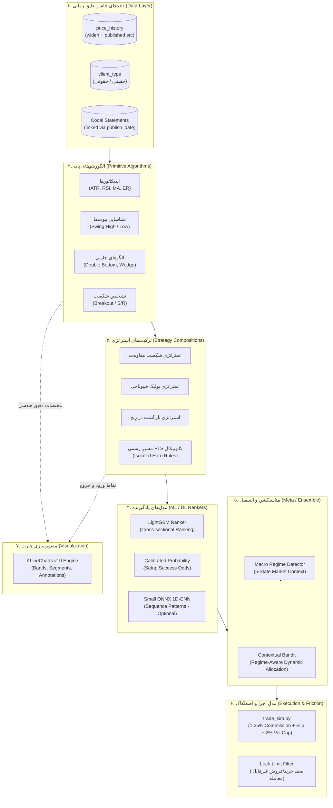
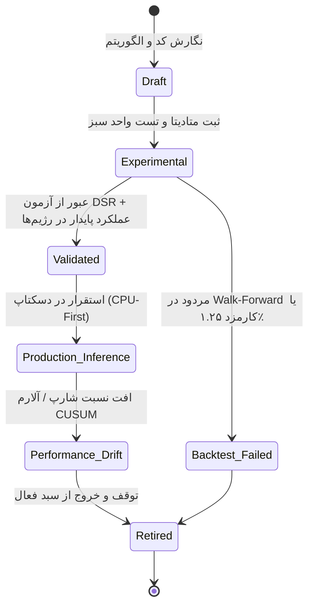
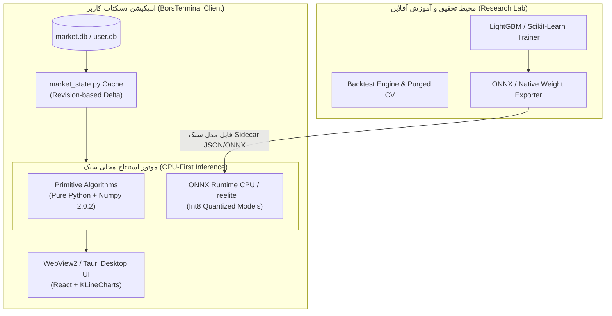
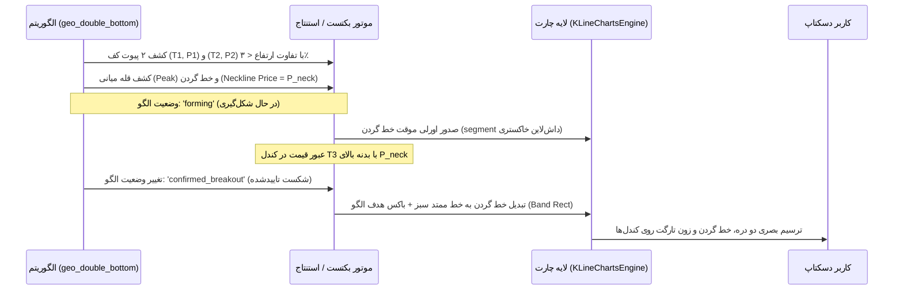

# BorsTerminal — معماری پلتفرم هوش چندالگوریتمی (Multi-Algorithm Intelligence Platform)
## سند طراحی جامع زیرساخت الگوریتم‌ها، راهبردها، مدل‌های یادگیرنده و مصورسازی بورس‌ترمینال

**تاریخ تدوین:** ۲۴ مهر ۱۴۰۵ (2026-10-15)  
**نسخه سند:** 1.0.0 (Architecture Research Specification)  
**محیط هدف:** BorsTerminal Desktop (Windows 10/11 x64 · CPU-First · PyInstaller Onedir · SQLite3 · WebView2)  
**شاخه و کامیت مبنا:** `mission/4-axes-2026-10-10` @ [`e9db359e`](file:///c:/Users/PCMOD/Desktop/BorsTerminal) | **شاخه اصلی:** `github/main` @ [`c0402614`](file:///c:/Users/PCMOD/Desktop/BorsTerminal) (v1.0.89)  
**اسناد پیش‌نیاز:**  
- [`docs/research/PHASE-0-DATA-REALITY-AUDIT.md`](file:///c:/Users/PCMOD/Desktop/BorsTerminal/docs/research/PHASE-0-DATA-REALITY-AUDIT.md) (ممیزی قطعی داده‌های واقعی و اثبات سقف ۵۱۷ روزه)  
- [`docs/research/symbol_coverage_phase0.csv`](file:///c:/Users/PCMOD/Desktop/BorsTerminal/docs/research/symbol_coverage_phase0.csv) (پوشش کامل ۶٬۱۶۹ نماد)  
- [`docs/research/LOCAL-ALGORITHMIC-LEARNING-ARCHITECTURE.md`](file:///c:/Users/PCMOD/Desktop/BorsTerminal/docs/research/LOCAL-ALGORITHMIC-LEARNING-ARCHITECTURE.md) (طرح اولیه یادگیری محلی)

---

## فهرست مطالب

1. [بیانیه مأموریت و مدل مفهومی تفکیک‌شده (Conceptual Model)](#۱-بیانیه-مأموریت-و-مدل-مفهومی-تفکیک‌شده-conceptual-model)
   - [۱.۱ تمایز صریح هفت مؤلفه تحلیلی و معاملاتی](#۱۱-تمایز-صریح-هفت-مؤلفه-تحلیلی-و-معاملاتی)
   - [۱.۲ نمودار مفهومی تفکیک لایه‌ها](#۱۲-نمودار-مفهومی-تفکیک-لایه‌ها)
2. [رجیستری الگوریتم‌های توسعه‌پذیر (Extensible Algorithm Registry)](#۲-رجیستری-الگوریتم‌های-توسعه‌پذیر-extensible-algorithm-registry)
   - [۲.۱ قرارداد و رابط استاندارد الگوریتم (`AlgorithmContract`)](#۲۱-قرارداد-و-رابط-استاندارد-الگوریتم-algorithmcontract)
   - [۲.۲ فراداده و چرخه حیات الگوریتم](#۲۲-فراداده-و-چرخه-حیات-الگوریتم)
   - [۲.۳ الگوی افزونه‌پذیری بدون بازنویسی هسته (Plugin Architecture)](#۲۳-الگوی-افزونه‌پذیری-بدون-بازنویسی-هسته-plugin-architecture)
3. [تاکسونومی جامع الگوریتم‌ها و اولویت‌بندی عملیاتی](#۳-تاکسونومی-جامع-الگوریتم‌ها-و-اولویت‌بندی-عملیاتی)
   - [۳.۱ ماتریس خانواده‌های الگوریتمی ۱۴ گانه](#۳۱-ماتریس-خانواده‌های-الگوریتمی-۱۴-گانه)
   - [۳.۲ تحلیل جزئیات هر خانواده، پیش‌نیازها، محدودیت‌ها و هزینه‌ها](#۳۲-تحلیل-جزئیات-هر-خانواده-پیش‌نیازها-محدودیت‌ها-و-هزینه‌ها)
4. [ترکیب الگوریتم‌ها، مهار انفجار ترکیبیاتی و مدیریت آزمایش‌ها](#۴-ترکیب-الگوریتم‌ها-مهار-انفجار-ترکیبیاتی-و-مدیریت-آزمایش‌ها)
   - [۴.۱ قواعد ترکیب ساختاریافته در برابر ترکیب کورکورانه](#۴۱-قواعد-ترکیب-ساختاریافته-در-برابر-ترکیب-کورکورانه)
   - [۴.۲ کشف افزونگی و خوشه‌بندی سیگنال‌های همبسته](#۴۲-کشف-افزونگی-و-خوشه‌بندی-سیگنال‌های-همبسته)
   - [۴.۳ مانیفست و شناسه یکتای آزمایش‌ها (`ExperimentManifest`)](#۴۳-مانیفست-و-شناسه-یکتای-آزمایش‌ها-experimentmanifest)
   - [۴.۴ مهار برازش بیش‌ازحد و تورم آزمون‌های مکرر (DSR / White's Reality Check)](#۴۴-مهار-برازش-بیش‌ازحد-و-تورم-آزمون‌های-مکرر-dsr--whites-reality-check)
5. [حفظ حاکمیت و استقلال مسیر کانونیکال FTS](#۵-حفظ-حاکمیت-و-استقلال-مسیر-کانونیکال-fts)
   - [۵.۱ مرزبندی غیرقابل‌مذاکره قوانین رسمی جزوه FTS](#۵۱-مرزبندی-غیرقابل‌مذاکره-قوانین-رسمی-جزوه-fts)
   - [۵.۲ سندباکس پژوهشی مستقل (Isolated Research Sandbox)](#۵۲-سندباکس-پژوهشی-مستقل-isolated-research-sandbox)
6. [طراحی استقرار روی رایانه‌های معمولی خانگی (Zero-Cloud Desktop Architecture)](#۶-طراحی-استقرار-روی-رایانه‌های-معمولی-خانگی-zero-cloud-desktop-architecture)
   - [۶.۱ استنتاج CPU-First و بهینه‌سازی بار پردازشی](#۶۱-استنتاج-cpu-first-و-بهینه‌سازی-بار-پردازشی)
   - [۶.۲ محاسبات تنبل و کش چندسطحی](#۶۲-محاسبات-تنبل-و-کش-چندسطحی)
   - [۶.۳ به‌روزرسانی مدل‌ها بدون بازسازی کل بسته EXE](#۶۳-به‌روزرسانی-مدل‌ها-بدون-بازسازی-کل-بسته-exe)
7. [قرارداد پیوند مصورسازی چارت با خروجی الگوریتم‌ها (مطالعه موردی: کف دوقلو)](#۷-قرارداد-پیوند-مصورسازی-چارت-با-خروجی-الگوریتم‌ها-مطالعه-موردی-کف-دوقلو)
   - [۷.۱ چرخه ۶ مرحله‌ای از کشف الگو تا رسم در چارت](#۷۱-چرخه-۶-مرحله‌ای-از-کشف-الگو-تا-رسم-در-چارت)
   - [۷.۲ تطبیق با معماری اورلی‌های KLineCharts v10](#۷۲-تطبیق-با-معماری-اورلی‌های-klinecharts-v10)
8. [نقشه راه اجرایی فازهای ۰ تا ۷ (Implementation Roadmap)](#۸-نقشه-راه-اجرایی-فازهای-۰-تا-۷-implementation-roadmap)
9. [محدودیت‌ها، ریسک‌ها و پرسش‌های نیازمند تصمیم](#۹-محدودیت‌ها-ریسک‌ها-و-پرسش‌های-نیازمند-تصمیم)

---

## ۱. بیانیه مأموریت و مدل مفهومی تفکیک‌شده (Conceptual Model)

هدف بنیادین بورس‌ترمینال تبدیل شدن به یک **سکوی تحلیل الگوریتمی و هوش بازار (Algorithmic Market Intelligence Platform)** است. بورس‌ترمینال:
- یک چت‌بات یا دستیار معاملاتی مبتنی بر LLM نیست.
- یک جعبه‌سیاه پیش‌بینی نقطه قیمت ($P_{t+1}$) نیست.
- بستری ماژولار است که توان میزبانی از صدها و بالقوه هزاران الگوریتم تحلیلی، قطعات استراتژی، روش‌های رتبه‌بندی و ابزارهای اعتبارسنجی آماری را در رایانه معمولی کاربر و بدون نیاز به سخت‌افزارهای گران‌قیمت یا GPU فراهم می‌سازد.

### ۱.۱ تمایز صریح هفت مؤلفه تحلیلی و معاملاتی

یکی از خطاهای رایج در پروژه‌های مالی، یکی دانستن تمام این اجزا تحت عنوان مبهم «مدل ML» است. در این معماری، هفت لایه مفهومی کاملاً متمایز تعریف می‌شوند:

1. **الگوریتم‌های پایه (Primitive Algorithms):**
   توابع کاملاً قطعی (Deterministic)، بدون حالت پنهان و ریاضیاتی که روی سری‌های زمانی قیمت و حجم عمل می‌کنند.
   *نمونه‌ها:* اندیکاتورها (RSI, ATR, Kaufman ER)، الگوریتم‌های تشخیص پیوت سقف/کف (ZigZag, Local Extrema)، تشخیص شکست سطوح، اندازه‌گیری انقباض باندها (Squeeze) و فیلترهای محاسباتی تابلو.
2. **ترکیب‌های استراتژی (Strategy Compositions):**
   اتصال معنادار الگوریتم‌های پایه به قواعد ورود، شرایط تایید، حد ضرر، حد سود، خروج اضطراری و تخصیص ریسک که یک فرضیه معاملاتی آزمودنی تولید می‌کنند.
   *نمونه:* ورود در پولبک فیبوناچی ۰.۶۱۸ مشروط بر روند هفتگی صعودی و نسبت سرانه خریدار برتر.
3. **مدل‌های یادگیری ماشین تبولار (Tabular ML Models):**
   مدل‌های آماری و درختان گرادیان بوستینگ سبک (مانند LightGBM یا Ridge Classifier) که بر روی ویژگی‌های نقطه در زمان آموزش دیده و صرفاً خروجی‌هایی مانند رتبه‌بندی مقطعی (Ranking)، تخمین کیفیت ستاپ یا احتمال لمس تارگت قبل از استاپ را برآورد می‌کنند.
4. **مدل‌های یادگیری عمیق اختیاری (Optional Small DL Models):**
   مدل‌های سبک توالی (نظیر 1D-CNN کوچک یا GRU تک‌لایه با فرمت ONNX)، صرفاً در صورتی که آزمایش‌های دقیق آماری نشان دهند مزیتی فراتر از مدل‌های درختی در کشف الگوهای توالی دارند.
5. **مؤلفه‌های متاسلکشن و انسمبل (Meta-Selection & Ensemble):**
   سازوکارهایی که خروجی چند استراتژی یا مدل را در رژیم‌های مختلف بازار ترکیب یا وزن‌دهی می‌کنند (نظیر الگوریتم‌های راهزن Contextual Thompson Sampling یا میانگین‌گیری بیزی).
6. **مدل‌های شبیه‌سازی اجرا و پر شدن سفارش (Execution & Fill Models):**
   لایه‌ای مستقل که با دریافت سیگنال، اصطکاک‌های دنیای واقعی (کارمزد واقعی بورس تهران ۱.۲۵٪، اسلیپیج، صفوف قفل خرید/فروش، سقف مشارکت حجمی ۲٪) را مدل‌سازی می‌کند ([`trade_sim.py`](file:///c:/Users/PCMOD/Desktop/BorsTerminal/trade_sim.py)).
7. **مؤلفه‌های مصورسازی چارت (Chart Visualization Components):**
   ترجمه دقیق مختصات قیمت و زمان خروجی الگوریتم‌ها به اشکال هندسی (باکس، خط روند، برچسب، زون) روی بستر چارت کلاینت ([`KLineChartsEngine.ts`](file:///c:/Users/PCMOD/Desktop/BorsTerminal/frontend/src/features/technical/engine/klinecharts/KLineChartsEngine.ts)).

---

### ۱.۲ نمودار مفهومی تفکیک لایه‌ها



---

## ۲. رجیستری الگوریتم‌های توسعه‌پذیر (Extensible Algorithm Registry)

برای پشتیبانی از صدها الگوریتم بدون دستکاری فایل‌های هسته، یک معماری ثبت و کشف خودکار (Plugin Registry) طراحی می‌شود.

### ۲.۱ قرارداد و رابط استاندارد الگوریتم (`AlgorithmContract`)

هر الگوریتم تحلیلی یا قطعه محاسباتی باید پروتکل زیر را در پایتون پیاده‌سازی کند:

```python
# -*- coding: utf-8 -*-
"""core/algorithm_contract.py — قرارداد استاندارد تمامی الگوریتم‌های بورس‌ترمینال."""
from __future__ import annotations
from dataclasses import dataclass, field
from enum import Enum
from typing import Any, Mapping, Sequence, Protocol
from backtest_engine import BarView

class AlgorithmCategory(str, Enum):
    INDICATOR = "indicator"
    PRICE_GEOMETRY = "price_geometry"
    MARKET_STRUCTURE = "market_structure"
    CHART_PATTERN = "chart_pattern"
    BREAKOUT = "breakout"
    SUPPORT_RESISTANCE = "support_resistance"
    MOMENTUM = "momentum"
    VOLUME_FLOW = "volume_flow"
    REGIME = "regime"
    FUNDAMENTAL_CONTEXT = "fundamental_context"
    RISK_EXIT = "risk_exit"
    ML_MODEL = "ml_model"
    DEEP_LEARNING = "deep_learning"
    ENSEMBLE = "ensemble"

class ResearchStatus(str, Enum):
    EXPERIMENTAL = "experimental"    # در حال آزمایش در آزمایشگاه
    VALIDATED = "validated"          # گذرانده آزمون Walk-Forward خارج از نمونه
    OFFICIAL_FTS = "official_fts"    # منطبق بر جزوه رسمی FTS
    RETIRED = "retired"              # منسوخ شده به دلیل افت عملکرد (Drift)

class RepaintBehavior(str, Enum):
    NEVER = "never"                  # محاسبه قطعی بر اساس کندل جاری و قبل
    CONFIRMED_DELAY = "delay"        # نیازمند N کندل بعد برای تثبیت (مثل زیگ‌زاگ)
    REPAINTS = "repaints"            # ممنوع در تصمیم‌گیری سیگنال؛ فقط جهت نمایش گذشته

@dataclass(frozen=True)
class AlgorithmMetadata:
    algorithm_id: str                # شناسه یکتا: e.g. "geo_double_bottom"
    version: str                     # نگارش سمانتیک: e.g. "1.0.0"
    name: str                        # نام خوانای فارسی/انگلیسی
    category: AlgorithmCategory
    description: str
    required_inputs: tuple[str, ...] # e.g. ("open", "high", "low", "close", "volume")
    min_bars: int                    # حداقل کندل لازم (e.g. 60)
    parameters: Mapping[str, Any]    # پارامترهای پیش‌فرض و دامنه‌های مجاز
    output_schema: Mapping[str, str] # e.g. {"state": "str", "neckline": "float"}
    timeframes: tuple[str, ...]      # e.g. ("daily", "weekly")
    repainting: RepaintBehavior
    confirmation_bars: int           # تاخیر لازم برای تایید (0 یعنی بدون تاخیر)
    computational_cost_ms: float     # تخمین زمان اجرا روی 1000 کندل (میلی‌ثانیه)
    status: ResearchStatus
    test_suite_ref: str              # مسیر تست واحد تاییدکننده

class Algorithm(Protocol):
    meta: AlgorithmMetadata
    def compute(self, view: BarView, **kwargs) -> Mapping[str, Any]:
        """محاسبه خروجی بر روی پیشوند نقطه در زمان BarView (بدون نشت آینده)."""
        ...
```

---

### ۲.۲ فراداده و چرخه حیات الگوریتم

هر الگوریتم در طول چرخه توسعه خود مراحل زیر را طی می‌کند:



- **قانون عدم استقرار کد نامعتبر:** الگوریتم‌ها تا زمانی که در وضعیت `Validated` قرار نگیرند، هرگز در ترکیب‌های پیش‌فرض دسکتاپ فعال نخواهند شد.
- **ثبت علل رد (Failure Documentation):** اگر الگوریتمی به دلیل فرسایش در برابر کارمزد ۱.۲۵٪ رد شود، در رجیستری با وضعیت `retired` یا `backtest_failed` به همراه دلایل آماری مستند باقی می‌ماند تا از تست مکرر همان ایده توسط سایر محققان جلوگیری شود.

---

### ۲.۳ الگوی افزونه‌پذیری بدون بازنویسی هسته (Plugin Architecture)

برای اضافه کردن الگوریتم شماره ۱۰۱ یا ۲۰۰:
1. الگوریتم در یک فایل مستقل در پوشه `research/algorithms/<category>/<algo_id>.py` نوشته می‌شود.
2. ماژول ثبت‌کننده خودکار (`registry.py`) با استفاده از `importlib` و بازرسی متادیتای `AlgorithmMetadata`، آن را کشف کرده و به دیکشنری سیستم می‌افزاید.
3. هیچ تغییری در موتور چارت، سرور FastAPI یا دیتابیس صورت نمی‌گیرد.
4. در صورت بروز خطا در یک الگوریتم، خطای آن منزوی (Isolate) شده و کل برنامه از کار نمی‌افتد.

---

## ۳. تاکسونومی جامع الگوریتم‌ها و اولویت‌بندی عملیاتی

### ۳.۱ ماتریس خانواده‌های الگوریتمی ۱۴ گانه

بر اساس ممیزی واقعیت داده‌های مخزن ([`docs/research/PHASE-0-DATA-REALITY-AUDIT.md`](file:///c:/Users/PCMOD/Desktop/BorsTerminal/docs/research/PHASE-0-DATA-REALITY-AUDIT.md))، ۱۴ خانواده الگوریتمی اولویت‌بندی شدند:

| ردیف | خانواده الگوریتمی | مثال‌های عینی | اولویت پیاده‌سازی | پیش‌نیاز داده‌ای واقعی | قابلیت تست روی دیتابیس موجود | هزینه پردازشی تخمینی |
| :---: | :--- | :--- | :---: | :--- | :---: | :---: |
| **۱** | **هندسه کندل و پیوت‌ها** | ZigZag ATR, Local Extrema, Shadow Ratios | **P0 (بسیار بالا)** | OHLCV معتبر (`price_history`) | **۱۰۰٪ (روی ۷۳۹ نماد)** | بسیار سبک (< ۰.۵ ms) |
| **۲** | **ساختار و روند تکنیکال** | HH/HL Classifier, ATR Slope, Kaufman ER | **P0 (بسیار بالا)** | OHLCV با سابقه $\ge 60$ کندل | **۱۰۰٪ (روی ۱٬۳۱۷ نماد)** | بسیار سبک (< ۱ ms) |
| **۳** | **سطوح و کانتکست فیبوناچی** | Fib Golden Zone (50-68%), Auto Anchors | **P0 (بسیار بالا)** | پیوت‌های ماژور تاییدشده | **۱۰۰٪ (روی ۸۲۴ نماد)** | سبک (< ۱ ms) |
| **۴** | **تشخیص شکست و پولبک** | Donchian Breakout, Retest Holding, Squeeze | **P1 (بالا)** | OHLCV + حجم معاملات | **۱۰۰٪ (روی ۱٬۳۱۷ نماد)** | سبک (< ۱ ms) |
| **۵** | **رژیم کلان بازار** | 5-State Macro Regime (همت + صفوف + روند) | **P1 (بالا)** | `mstat_engine` + `trend_classify` | **۱۰۰٪ (۵۱۷ نشست)** | متوسط (~ ۵ ms کل بازار) |
| **۶** | **الگوهای چارتی کلاسیک** | Double Bottom/Top, Head & Shoulders | **P1 (بالا)** | پیوت‌های چندگانه + خط گردن | **۱۰۰٪ (روی ۸۲۴ نماد)** | متوسط (~ ۲ تا ۳ ms) |
| **۷** | **تکانه و قدرت نسبی** | RSI-14, Cross-Sectional RS vs Index/Sector | **P2 (متوسط)** | OHLCV هم‌زمان نمادها | **۱۰۰٪ (روی ۷۳۹ نماد)** | سبک (< ۱ ms) |
| **۸** | **نوسان‌گیری و بازگشت میانگین** | Bollinger %B, Mean Reversion in Box | **P2 (متوسط)** | OHLCV در رژیم رِنج | **۱۰۰٪ (روی ۱٬۳۱۷ نماد)** | سبک (< ۱ ms) |
| **۹** | **مدیریت ریسک و اندازه موقعیت** | ATR Volatility Sizing, Structural Stops | **P2 (متوسط)** | ATR + پیوت‌های ماژور | **۱۰۰٪** | آنی (< ۰.۱ ms) |
| **۱۰** | **کانتکست بنیادی نقطه در زمان** | FTS 5 Pillars (EPS Trend, Sales Growth) | **P2 (متوسط)** | صورت‌های مالی کدال + `publish_date` | **۸۰٪ (محدود به ۱٬۱۹۵ نماد)** | سبک (کوئری SQLite) |
| **۱۱** | **رتبه‌بندی مقطعی یادگیرنده (ML)** | LightGBM Quintile Ranker, Ridge Classifier | **P3 (فاز ۳)** | بردار ویژگی‌های ستون‌های ۱ تا ۵ | **امکان‌پذیر در افق سالانه** | متوسط (~ ۵۰ ms آموزش/آفلاین) |
| **۱۲** | **انسمبل و پایش افت (Drift)** | CUSUM Monitor, Contextual Thompson Sampling | **P3 (فاز ۴)** | سوابق بازدهی استراتژی‌ها | **۱۰۰٪** | سبک (< ۲ ms) |
| **۱۳** | **فیلترهای جریان سفارش و صف** | Jet Filter, Queue Sweeping, Smart Money | **P4 (آینده)** | سوابق صف و مظنه (`zd1`, `qd1`) | **تاریخی: ۰٪ / بلادرنگ: بله** | سبک (در رصد بلادرنگ) |
| **۱۴** | **مدل‌های یادگیری عمیق اختیاری** | 1D-CNN Sequence Classifier (ONNX) | **P5 (پژوهشی)** | ماتریس توالی ۲۰ روزه کندل‌ها | **آزمایشی و محدود** | سنگین‌تر (~ ۱۰ ms کلاینت) |

---

### ۳.۲ تحلیل جزئیات هر خانواده، پیش‌نیازها، محدودیت‌ها و هزینه‌ها

#### ۱. هندسه کندل و پیوت‌ها (Candle Geometry & Swings)
- **پیش‌نیاز:** رعایت قرارداد [`candle_contract.py:widen`](file:///c:/Users/PCMOD/Desktop/BorsTerminal/candle_contract.py#L69-L88).
- **محدودیت:** پیوت‌های بدون تاخیر (Zero-lag pivots) همواره Repaint می‌کنند؛ هر پیوتی که در کد ثبت می‌شود باید با پارامتر صریح `confirmation_bars >= 2` تعریف شود.
- **هزینه:** زیر ۰.۵ میلی‌ثانیه برای ۵۰۰ کندل.

#### ۲. الگوهای کلاسیک چارتی (مانند کف دوقلو)
- **الگوریتم کانونیکال:** کشف دو دره با فاصله زمانی حداقل ۱۰ کندل، اختلاف ارتفاع کمتر از ۳٪ دامنه، و عبور از خط گردن (Neckline) با بدنه صعودی.
- **محدودیت:** اتکای صِرف به الگو بدون توجه به روند پیشین و حجم شکست، به سیگنال‌های فیک متعدد در بازارهای فرسایشی می‌انجامد.

#### ۳. فیلترهای صف‌محور و تابلوخوانی (خانواده ۱۳)
- **وضعیت داده:** طبق ممیزی فاز ۰، جدول `tape_flag_day` تنها ۴ روز سابقه دارد و جدول `client_type` تنها ۴۶ روز.
- **محدودیت قطعی:** این خانواده نمی‌تواند وارد بکتست تاریخی سالانه شود. هرگونه استفاده از آن منوط به **جمع‌آوری رو به جلو (Forward Logging)** در طول زمان است.

---

## ۴. ترکیب الگوریتم‌ها، مهار انفجار ترکیبیاتی و مدیریت آزمایش‌ها

### ۴.۱ قواعد ترکیب ساختاریافته در برابر ترکیب کورکورانه

ترکیب دلخواه و بی‌ضابطه ۱۰۰ الگوریتم پایه به ایجاد میلیاردها استراتژی تصادفی و نشت آماری (Data Snooping) منجر می‌شود. بورس‌ترمینال از **الگوی ترکیب ساختاریافته (Slot-Based Grammar)** پیروی می‌کند:

$$\text{Strategy} = \text{Regime\_Filter} \times \text{Setup\_Trigger} \times \text{Confirmation\_Filter} \times \text{Exit\_Rule} \times \text{Sizing\_Model}$$

هر استراتژی آزمودنی موظف است دقیقاً یک مؤلفه از هر خانه (Slot) را مقداردهی کند:
- **Slot 1 (رژیم بازار):** تعیین اینکه استراتژی در چه رژیمی مجاز به اقدام است (مثلاً فقط در Bull Trend یا Range).
- **Slot 2 (محرک ستاپ):** شکست مقاومت، لمس تراز فیبوناچی، یا کف دوقلو.
- **Slot 3 (فیلتر تاییدیه):** سرانه خریدار برتر، یا حجم بالاتر از میانگین ۳۰ روزه، یا فیلتر بنیادی FTS.
- **Slot 4 (قاعده خروج):** خروج بر مبنای حد ضرر ساختاری (پیوت کف قبلی) و حد سود نسبت ۲ به ۱، یا خروج زمانی.
- **Slot 5 (مدل اندازه موقعیت):** حداکثر ۱۰٪ پورتفوی یا اندازه بر مبنای نوسان ATR.

این گرامر مانع ترکیب‌های مهمل (مانند دو الگوریتم خروج بدون نقطه ورود) می‌شود و فضای جستجو را کنترل‌پذیر می‌سازد.

---

### ۴.۲ کشف افزونگی و خوشه‌بندی سیگنال‌های همبسته

پیش از اضافه شدن یک استراتژی جدید به سبد آزمایش‌ها:
1. **ماتریس همبستگی سیگنال‌ها (Signal Correlation Matrix):** همبستگی بردار باینری ورود/خروج استراتژی جدید با تمام استراتژی‌های موجود محاسبه می‌شود:
   $$\rho(S_i, S_j) = \frac{\text{Cov}(S_i, S_j)}{\sigma_{S_i} \sigma_{S_j}}$$
2. **قاعده حذف استراتژی افزوده (Redundancy Pruning):** اگر همبستگی سیگنال‌های استراتژی جدید با یک استراتژی قبلی بیش از ۰.۸۵ باشد، استراتژی جدید افزونه و زائد (Redundant) تلقی شده و رد می‌شود مگر آنکه هزینه یا دراوداون به مراتب بهتری نشان دهد.

---

### ۴.۳ مانیفست و شناسه یکتای آزمایش‌ها (`ExperimentManifest`)

برای تضمین بازتولیدپذیری مطلق، هر آزمایش با ساختار زیر روی دیسک ثبت می‌شود:

```json
{
  "manifest_id": "exp_trend_fib_20261015_01",
  "engine_version": "bot-backtest-2",
  "timestamp": "2026-10-15T23:30:00Z",
  "strategy_spec": {
    "strategy_id": "strat_fib_pullback_v1",
    "slots": {
      "regime": "macro_regime_bull",
      "setup": "geo_fib_golden_zone",
      "confirmation": "ind_kaufman_er_gt_0.6",
      "exit": "risk_structural_swing_stop",
      "sizing": "size_fixed_fraction_0.1"
    },
    "params": {
      "fib_lo": 0.50,
      "fib_hi": 0.68,
      "stop_buffer_atr": 0.5
    }
  },
  "dataset_spec": {
    "date_span": ["2024-08-24", "2026-10-14"],
    "universe_symbol_count": 739,
    "universe_hash": "a4f891b2c3d4",
    "price_basis": "closing"
  },
  "cost_model": {
    "commission_bps": 125.0,
    "slippage_bps": 10.0,
    "max_volume_share": 0.02
  },
  "validation_metrics": {
    "walk_forward_folds": 3,
    "annualized_sharpe": 1.28,
    "deflated_sharpe_ratio": 0.94,
    "max_drawdown": -0.142,
    "profit_factor": 1.54,
    "turnover_annual": 4.2
  },
  "digest": "e4f8b91c2a3d5e7f"
}
```

---

### ۴.۴ مهار برازش بیش‌ازحد و تورم آزمون‌های مکرر (DSR / White's Reality Check)

- **دام بهینه‌سازی پارامتر (Backtest Overfitting):** آزمودن ۱۰٬۰۰۰ ترکیب پارامتری بر روی داده‌های تاریخی بورس تهران به طور خودکار استراتژی‌هایی را تولید می‌کند که تصادفاً سودآور بوده‌اند اما در آینده نابود می‌شوند.
- **آزمون DSR (Deflated Sharpe Ratio):** شارپ محاسبه‌شده با فرمول بیلی و لوپز د پرادو جریمه می‌شود:
  $$DSR = f(\widehat{SR}, N_{\text{trials}}, \text{Var}(SR), \text{Skew}, \text{Kurtosis})$$
  اگر استراتژی پس از ۱٬۰۰۰ بار بهینه‌سازی پارامتر به دست آمده باشد، شارپ ۱.۵ به زیر صفر تعدیل می‌شود و استراتژی مردود می‌گردد.
- **جداسازی سختگیرانه Out-of-Sample:** ۳۰ درصد پایانی داده‌های زمانی تا آخرین مرحله تایید نهایی در گاوصندوق منجمد (Locked Holdout) باقی می‌ماند و کالیبراسیون روی آن مطلقاً ممنوع است.

---

## ۵. حفظ حاکمیت و استقلال مسیر کانونیکال FTS

### ۵.۱ مرزبندی غیرقابل‌مذاکره قوانین رسمی جزوه FTS

موتور کانونیکال FTS ([`fts_engine.py`](file:///c:/Users/PCMOD/Desktop/BorsTerminal/fts_engine.py) و [`funnel_engine.py`](file:///c:/Users/PCMOD/Desktop/BorsTerminal/funnel_engine.py)) یک دارایی تثبیت‌شده و منجمد در بورس‌ترمینال است:
- فیلترهای پنج‌شاخص بنیادی (رشد فروش، روند EPS، سود ناخالص، ارزش بازار، صنعت).
- وتوی نزولی هفتگی تکنیکال (دروازه هفتگی قیف).
- استثنائات رسمی و احکام کانونیکال ثبت‌شده مالک.

**این قوانین هرگز توسط مدل‌های ML یا بهینه‌سازی‌های آماری بازتعریف، بازنویسی یا دستکاری نمی‌شوند.**

### ۵.۲ سندباکس پژوهشی مستقل (Isolated Research Sandbox)

تمام پژوهش‌های جدید، استراتژی‌های هوش مصنوعی و مدل‌های چندالگوریتمی در یک سندباکس جداگانه زندگی می‌کنند:
1. **جداسازی کدهای منبع:**
   کدهای پژوهشی در پکیج مجزای `research/` قرار می‌گیرند و به هیچ فایل موجود در `api/`, `fts_engine.py` یا `tape_flags.py` وابسته نخواهند بود مگر از طریق خواندن صرف توابع کتابخانه‌ای.
2. **نمایش شفاف در رابط کاربری:**
   در رابط کاربری دسکتاپ، خروجی‌های FTS رسمی همواره با برچسب و رنگ کانونیکال FTS نمایش داده شده و رتبه‌بندی‌های پژوهشی با عنوان صریح «آزمایشگاه الگوریتمی (Experimental Sandbox)» و هش مانیفست مربوطه مشخص می‌شوند.
3. **عدم اجبار به قیف FTS:**
   یک استراتژی پژوهشی بازگشت به میانگین در نمادهای رِنج می‌تواند بدون نیاز به پاس کردن فیلترهای سختگیرانه رشد فروش FTS ارزیابی شود، تا دامنه خلاقیت پژوهشگر محدود نگردد.

---

## ۶. طراحی استقرار روی رایانه‌های معمولی خانگی (Zero-Cloud Desktop Architecture)

بورس‌ترمینال باید بدون هیچ‌گونه سرور خارجی و بدون نیاز به کارت گرافیک (GPU) روی سیستم‌های خانگی متوسط اجرا شود.



### ۶.۱ استنتاج CPU-First و بهینه‌سازی بار پردازشی
- **اجرای مدل‌های درختی با Treelite یا کامپایل C:** مدل‌های گرادیان بوستینگ آموزش‌دیده به درخت‌های باینری بهینه‌شده تبدیل می‌شوند که استنتاج هر نماد کمتر از ۵۰ میکروثانیه (۰.۰۵ میلی‌ثانیه) زمان می‌برد. کل نمادهای بازار (۸۰۰ نماد فعال) در کمتر از ۰.۰۵ ثانیه پردازش می‌شوند.
- **استفاده از مدل‌های یادگیری عمیق در صورت نیاز با کوانتیزاسیون Int8:** در صورت استفاده از مدل‌های کوچک توالی، مدل‌ها با فرمت استاندارد ONNX Runtime و کوانتیزاسیون ۸ بیتی (حجم زیر ۵ مگابایت) روی هسته CPU اجرا می‌شوند.

### ۶.۲ محاسبات تنبل و کش چندسطحی
- **کش مبتنی بر ویرایش تابلو (`market_state.py:revision`):** تا زمانی که داده‌های جدید در تیک ۵ ثانیه‌ای به بانک ننشینند یا نمادی معامله نشود، محاسبات تکرار نمی‌شوند ([`market_state.py:10-15`](file:///c:/Users/PCMOD/Desktop/BorsTerminal/market_state.py#L10-L15)).
- **ارزیابی درخواستی (On-Demand / Lazy Evaluation):** الگوریتم‌های پرهزینه فقط برای نمادهایی محاسبه می‌شوند که در واچ‌لیست باز کاربر یا جدول اسکنر صفحه جاری قرار دارند، نه کل ۶٬۰۰۰ نماد به طور مستمر.

### ۶.۳ به‌روزرسانی مدل‌ها بدون بازسازی کل بسته EXE
- فایل‌های وزن مدل‌ها و رجیستری الگوریتم‌ها به صورت فایل‌های منبع داده یا جانبی (Sidecar Artifacts) در کنار فایل EXE قرار می‌گیرند؛ بنابراین بدون نیاز به کامپایل مجدد نصاب Inno Setup یا PyInstaller، به‌روزرسانی مدل‌ها از طریق دانلود مانیفست امکان‌پذیر است.

---

## ۷. قرارداد پیوند مصورسازی چارت با خروجی الگوریتم‌ها (مطالعه موردی: کف دوقلو)

برای اثبات ارتباط میان الگوریتم، اعتبارسنجی و چارت، چرخه ۶ مرحله‌ای الگوریتم **کف دوقلو (Double Bottom)** بر روی معماری موتور چارت مخزن ([`KLineChartsEngine.ts`](file:///c:/Users/PCMOD/Desktop/BorsTerminal/frontend/src/features/technical/engine/klinecharts/KLineChartsEngine.ts)) تعریف می‌شود:



### ۷.۱ ساختار خروجی استاندارد الگوریتم برای چارت

الگوریتم علاوه بر سیگنال، یک شیء استاندارد `VisualOverlayPayload` تولید می‌کند:

```json
{
  "algorithm_id": "geo_double_bottom",
  "symbol": "فولاد",
  "pattern_state": "confirmed_breakout",
  "confidence_score": 0.84,
  "visual_elements": [
    {
      "kind": "segment",
      "group_id": "double_bottom_valley",
      "color": "#38bdf8",
      "width": 2,
      "dashed": false,
      "points": [
        {"timestamp": 1726000000000, "value": 4500},
        {"timestamp": 1727500000000, "value": 4850},
        {"timestamp": 1729000000000, "value": 4530}
      ]
    },
    {
      "kind": "level",
      "group_id": "neckline",
      "color": "#10b981",
      "width": 1.5,
      "dashed": false,
      "points": [{"timestamp": 1727500000000, "value": 4850}]
    },
    {
      "kind": "band",
      "group_id": "target_zone",
      "color": "#10b981",
      "points": [
        {"timestamp": 1729200000000, "value": 5200},
        {"timestamp": 1730500000000, "value": 5150}
      ]
    },
    {
      "kind": "marker",
      "group_id": "breakout_annotation",
      "color": "#10b981",
      "text": "شکست تاییدشده کف دوقلو",
      "points": [{"timestamp": 1729200000000, "value": 4870}]
    }
  ]
}
```

### ۷.۲ انطباق دقیق با کدهای موجود `KLineChartsEngine`
این ساختار خروجی بدون نیاز به هیچ تغییر اساسی، مستقیماً توسط متدهای موجود در [`KLineChartsEngine.ts`](file:///c:/Users/PCMOD/Desktop/BorsTerminal/frontend/src/features/technical/engine/klinecharts/KLineChartsEngine.ts) ترسیم می‌شود:
- `segment`: خطوط اتصال دره‌ها توسط `overlayName('segment')` ([خط ۱۵۱](file:///c:/Users/PCMOD/Desktop/BorsTerminal/frontend/src/features/technical/engine/klinecharts/KLineChartsEngine.ts#L151)).
- `level`: خط افقی خط گردن با `overlayName('level')` ([خط ۱۵۷](file:///c:/Users/PCMOD/Desktop/BorsTerminal/frontend/src/features/technical/engine/klinecharts/KLineChartsEngine.ts#L157)).
- `band`: زون تارگت مستطیلی با اورلی سفارشی `BAND_OVERLAY` (`btsBand`) ([خطوط ۴۴-۸۴](file:///c:/Users/PCMOD/Desktop/BorsTerminal/frontend/src/features/technical/engine/klinecharts/KLineChartsEngine.ts#L44-L84)).
- `marker`: متن روی کندل شکست با `simpleAnnotation` ([خط ۱۵۴](file:///c:/Users/PCMOD/Desktop/BorsTerminal/frontend/src/features/technical/engine/klinecharts/KLineChartsEngine.ts#L154)).

---

## ۸. نقشه راه اجرایی فازهای ۰ تا ۷ (Implementation Roadmap)

| فاز | عنوان فاز | شرح اقدامات و محدوده کاری | سنجه‌ها و معیارهای پذیرش (Acceptance Criteria) |
| :---: | :--- | :--- | :--- |
| **فاز ۰** | **ممیزی واقعیت داده و کد** | ممیزی کامل ۵۱۷ نشست، تولید CSV ۶٬۱۶۹ نماد، ابطال فرض تاریخچه ۳ ساله | تحویل سند ممیزی و CSV کامل؛ راستی‌آزمایی فقط‌خواندنی بدون تغییر کد (**تکمیل شد**) |
| **فاز ۱** | **قراردادها و بست آزمایشی پایه** | پیاده‌سازی پروتکل `AlgorithmContract`، ماژول رجیستری محلی، و مانیفست آزمایش‌ها | امکان ثبت و بارگذاری داینامیک الگوریتم با تست‌های واحد ۱۰۰٪ سبز |
| **فاز ۲** | **مجموعه منتخب الگوریتم‌های قطعی** | پیاده‌سازی ۳ الگوریتم کانونیکال (پیوت زیگ‌زاگ، کف دوقلو، باند فیبوناچی) و اتصال به چارت | ترسیم دقیق مختصات هندسی الگوی کف دوقلو در چارت KLineCharts دسکتاپ |
| **فاز ۳** | **بکتست چنداستراتژی و ردیابی** | اتصال ۵ استراتژی به `backtest_engine.py` با کارمزد اصلاح‌شده ۱.۲۵٪ و مهار صف خرید | تولید هش تکرارپذیر `digest` و گزارش تحلیلی برای تک‌تک استراتژی‌ها |
| **فاز ۴** | **مدل‌های یادگیرنده رتبه‌بندی (ML)** | خط لوله تولید ویژگی‌های نقطه در زمان و آموزش مدل رتبه‌بندی LightGBM آفلاین | ارزیابی Purged Walk-Forward و اثبات معناداری آماری رتبه‌بندی نسبت به سبد تصادفی |
| **فاز ۵** | **مقایسه یادگیری عمیق (اختیاری)** | آموزش یک مدل سبک 1D-CNN برای الگوهای توالی و تبدیل به فرمت ONNX Int8 | مدل فقط در صورتی وارد سبد می‌شود که شارپ آن پس از کارمزد از LightGBM برتر باشد |
| **فاز ۶** | **انسمبل، پایش افت و حساب کاغذی** | فعال‌سازی رصد افت PnL (الگوریتم CUSUM) و اتصال خروجی نهایی به `PaperBroker` | اجرای ۱۰ نشست معاملاتی پیوسته در ساعات بازار بدون خطای سیستمی |
| **فاز ۷** | **توسعه کنترل‌شده کتابخانه الگوریتم‌ها** | فراخوان و افزودن گام‌به‌گام الگوریتم‌های جدید به رجیستری با رعایت آزمون DSR | افزودن الگوریتم‌های جدید بدون بازنویسی یا ریگرسیون در هسته برنامه |

---

## ۹. محدودیت‌ها، ریسک‌ها و پرسش‌های نیازمند تصمیم

### ۹.۱ ریسک‌های فنی و راه‌حل‌های معماری

1. **ریسک بهینه‌سازی تصادفی (Overfitting Risk):**
   *راهکار:* الزام آزمون Deflated Sharpe Ratio (DSR) در موتور مانیفست و رد خودکار استراتژی‌هایی که بیش از ۱۰۰ بار هایپرپارامترهای آن‌ها تغییر داده شده است.
2. **ریسک بار پردازشی کلاینت در شروع برنامه (Cold-Start Lag):**
   *راهکار:* استفاده از کش مادی‌شده و اجرای الگوریتم‌ها صرفاً در زمان درخواست کاربر (On-Demand)، نه اجرای پس‌زمینه برای ۶٬۰۰۰ نماد همزمان.
3. **ریسک عدم تقارن صفوف در بورس تهران (Lock-Limit Asymmetry):**
   *راهکار:* مسدودسازی خرید در صفوف خرید قفل در شبیه‌ساز `trade_sim.py` و پرهیز از توهم پر شدن سفارشات در سقف قیمت.

### ۹.۲ پرسش‌های اساسی نیازمند تصمیم مالک محصول

| ردیف | پرسش اساسی | گزینه‌های موجود | پیشنهاد معماری |
| :---: | :--- | :--- | :--- |
| **۱** | **نحوه مدیریت و نگهداری کدهای پژوهشی در ساختار ریپو** | الف) پکیج مستقل `research/` درون همین ریپو<br/>ب) ریپوی جداگانه با دسترسی ساب‌ماژول | گزینه الف (پکیج مستقل در همین مخزن با تست‌های مجزا) برای سهولت اشتراک قراردادها. |
| **۲** | **قاعده برخورد با نمادهای با سابقه کم در یونیورس پژوهش** | الف) فیلتر کردن و حذف نمادهای با کمتر از ۲۵۲ کندل<br/>ب) ورود تمام نمادها با برچسب داده ناقص | گزینه الف؛ تمرکز صرف بر ۷۳۹ نماد باسابقه جهت پیشگیری از آلودگی آماری. |
| **۳** | **نحوه توزیع وزن‌های مدل به کاربران نهایی** | الف) دانلود خودکار فایل‌های ONNX/JSON سبک از گیت‌هاب ریلیز<br/>ب) الصاق به آپدیت‌های رسمی اپلیکیشن | گزینه الف؛ امکان به‌روزرسانی مدل‌ها بدون انتشار نسخه جدید EXE نصاب. |

---

## جمع‌بندی نهایی

این سند معماری، چشم‌انداز تبدیل بورس‌ترمینال به یک **سکوی جامع، قابل گسترش و چندالگوریتمی** را بدون افتادن در دام ادعاهای بازاریابی، بدون وابستگی به پردازش ابری و بدون تغییر در قوانین کانونیکال FTS تبیین می‌کند. ساختار ارائه‌شده تضمین می‌کند که:
1. الگوریتم‌ها، استراتژی‌ها، مدل‌های یادگیرنده، لایه‌های اجرا و مصورسازی چارت مرزهای شفاف و استانداردی دارند.
2. تمامی محاسبات بر سخت‌افزارهای عادی دسکتاپ به صورت CPU-First و بهینه اجرا می‌شوند.
3. داده‌های واقعی بازار و کارمزد واقعی ۱.۲۵٪ لنگر ارزیابی است و از نتایج غیرواقعی جلوگیری می‌شود.
4. مسیر کانونیکال FTS منجمد و معتبر باقی می‌ماند و آزمایشگاه پژوهشی در محیطی امن و مستقل توسعه می‌یابد.
