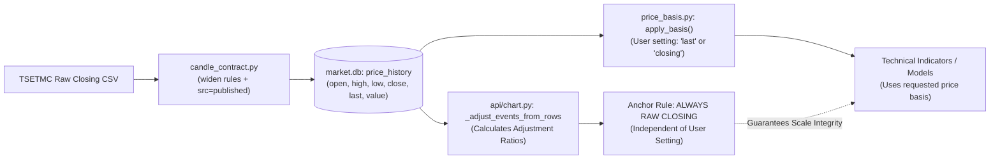

# BorsTerminal — Phase 0: Data Reality Audit & Algorithmic Research Blueprint
## ممیزی واقعیت داده‌های تاریخی، اعتبارسنجی معماری و نقشه راه پژوهشی فاز ۰

**تاریخ ممیزی:** ۲۴ مهر ۱۴۰۵ (2026-10-15)  
**محیط اجرا:** BorsTerminal Desktop (Local Python 3.14 + SQLite3 + Rust/Tauri/FastAPI)  
**شاخه فعال در این دایرکتوری:** `mission/4-axes-2026-10-10` | **کامیت لنگر بازرسی‌شده:** [`e9db359e`](file:///c:/Users/PCMOD/Desktop/BorsTerminal)  
**آخرین کامیت `github/main` بازرسی‌شده:** [`c0402614`](file:///c:/Users/PCMOD/Desktop/BorsTerminal) (نسخه رسمی v1.0.89)  
**آخرین کامیت `origin/main` بازرسی‌شده:** [`d88fb274`](file:///c:/Users/PCMOD/Desktop/BorsTerminal) (تاریخ 2026-09-22)  
**وضعیت سند:** گزارش ممیزی شواهد-محور و مشخصات رسمی فاز ۰ (تحقیق کاملاً مستقل بدون تغییر در کد محصول و بدون تغییر در دیتابیس)  
**فایل مکمل داده‌ها:** [`docs/research/symbol_coverage_phase0.csv`](file:///c:/Users/PCMOD/Desktop/BorsTerminal/docs/research/symbol_coverage_phase0.csv) (شامل جزئیات پوشش تمامی ۶٬۱۶۹ نماد)

---

## فهرست مطالب

1. [شناسنامه و وضعیت مخزن، گیت و شاخه‌ها](#۱-شناسنامه-و-وضعیت-مخزن-گیت-و-شاخه‌ها)
2. [نتایج ممیزی داده‌های واقعی و پوشش نمادها (Data Reality Audit)](#۲-نتایج-ممیزی-داده‌های-واقعی-و-پوشش-نمادها-data-reality-audit)
   - [۲.۱ آمار سطور و حجم جداول دیتابیس‌های محلی](#۲۱-آمار-سطور-و-حجم-جداول-دیتابیس‌های-محلی)
   - [۲.۲ سقف فیزیکی و توزیع آماری کندل‌ها در `price_history`](#۲۲-سقف-فیزیکی-و-توزیع-آماری-کندل‌ها-در-price_history)
   - [۲.۳ تحلیل پنجره‌های زمانی و ابطال فرض «تاریخچه چندساله»](#۲۳-تحلیل-پنجره‌های-زمانی-و-ابطال-فرض-تاریخچه-چندساله)
   - [۲.۴ ممیزی جداول تکمیلی: `client_type`، `tape_flag_day` و صورت‌های مالی](#۲۴-ممیزی-جداول-تکمیلی-client_type-tape_flag_day-و-صورت‌های-مالی)
3. [ماتریس امکان‌سنجی استراتژی‌ها بر اساس داده‌های واقعی](#۳-ماتریس-امکان‌سنجی-استراتژی‌ها-بر-اساس-داده‌های-واقعی)
4. [نقشه مسئولیت ماژول‌های موجود و جریان داده کانونیکال](#۴-نقشه-مسئولیت-ماژول‌های-موجود-و-جریان-داده-کانونیکال)
   - [۴.۱ بررسی ماژول‌های رژیم: تفکیک `market_phase`، `trend_classify` و `regime_detector`](#۴۱-بررسی-ماژول‌های-رژیم-تفکیک-market_phase-trend_classify-و-regime_detector)
   - [۴.۲ برهم‌کنش قرارداد کندل، لنگر تعدیل و منبع قیمت (`price_basis.py`)](#۴۲-برهم‌کنش-قرارداد-کندل-لنگر-تعدیل-و-منبع-قیمت-price_basispy)
   - [۴.۳ تضمین‌های معماری `BarView`، شبیه‌ساز هزینه، دفتر کل و ربات](#۴۳-تضمین‌های-معماری-barview-شبیه‌ساز-هزینه-دفتر-کل-و-ربات)
   - [۴.۴ تفکیک ماژول‌های تولیدکننده سیگنال در برابر فیلترها و کانتکست](#۴۴-تفکیک-ماژول‌های-تولیدکننده-سیگنال-در-برابر-فیلترها-و-کانتکست)
5. [شکاف‌های تقلیل‌ناپذیر داده و موانع ساختاری بکتست](#۵-شکاف‌های-تقلیل‌ناپذیر-داده-و-موانع-ساختاری-بکتست)
6. [مشخصات ویژگی‌ها و برچسب‌های یادگیری (Feature & Label Specification)](#۶-مشخصات-ویژگی‌ها-و-برچسب‌های-یادگیری-feature--label-specification)
   - [۶.۱ برچسب‌های استاندارد و افق‌های معاملاتی](#۶۱-برچسب‌های-استاندارد-و-افق‌های-معاملاتی)
   - [۶.۲ اصول انضباطی ویژگی‌های نقطه در زمان](#۶۲-اصول-انضباطی-ویژگی‌های-نقطه-در-زمان)
7. [پروتکل اعتبارسنجی خارج از نمونه و مدل واقع‌بینانه اصطکاک بازار](#۷-پروتکل-اعتبارسنجی-خارج-از-نمونه-و-مدل-واقع‌بینانه-اصطکاک-بازار)
   - [۷.۱ بازبینی و اصلاح مدل هزینه و کارمزد بورس تهران](#۷۱-بازبینی-و-اصلاح-مدل-هزینه-و-کارمزد-بورس-تهران)
   - [۷.۲ پروتکل اعتبارسنجی زنجیره‌ای بریده‌شده (Purged Walk-Forward CV)](#۷۲-پروتکل-اعتبارسنجی-زنجیره‌ای-بریده‌شده-purged-walk-forward-cv)
   - [۷.۳ سنجه‌های آماری دفاع‌پذیر و خطوط مبنا](#۷۳-سنجه‌های-آماری-دفاع‌پذیر-و-خطوط-مبنا)
8. [چک‌لیست اولویت‌بندی‌شده تکمیل فاز ۰](#۸-چک‌لیست-اولویت‌بندی‌شده-تکمیل-فاز-۰)
9. [طرح اجرایی فاز ۱ (Scoped Phase 1 Implementation Plan)](#۹-طرح-اجرایی-فاز-۱-scoped-phase-1-implementation-plan)
10. [پرسش‌های حل‌نشده و موارد نیازمند راستی‌آزمایی](#۱۰-پرسش‌های-حل‌نشده-و-موارد-نیازمند-راستی‌آزمایی)

---

## ۱. شناسنامه و وضعیت مخزن، گیت و شاخه‌ها

به منظور محافظت از کار در حال انجام کلیه عامل‌ها و توسعه‌دهندگان، وضعیت مخزن پیش از هر اقدامی استخراج و بازرسی شد:

### الف) وضعیت شاخه و کامیت جاری
- **مسیر دایرکتوری کاری:** `C:\Users\PCMOD\Desktop\BorsTerminal`
- **شاخه کاری فعال:** `mission/4-axes-2026-10-10`
- **کامیت لنگر جاری (HEAD):** [`e9db359e2cb7d999891a38bbe1ef47e6de701da0`](file:///c:/Users/PCMOD/Desktop/BorsTerminal)
  - عنوان کامیت: `docs(handoff): موجودیِ تحویلِ system-1 — هر کامیتِ محلی منتشر شد، هر نیمه‌کاری با وضعیتش ثبت شد` (تاریخ: Thu Oct 15 00:20:41 2026 +0330)
- **وضعیت درخت کاری (Working Tree):** هیچ فایل کاری ردگیری‌شده‌ای حذف یا ویرایش نشده است؛ فایل‌های موجود در دایرکتوری `_audit/` و `docs/research/` دست‌نخورده باقی مانده و هیچ دستور مخرب (`checkout`, `reset`, `clean`, `stash`, `rebase`, `merge`) اجرا نگردیده است.

### ب) مقایسه غیرمخرب با آخرین نسخه شاخه اصلی (`github/main`)
- **آخرین کامیت `github/main`:** [`c04026145769b316381997e6931ef07c9eb46a1d`](file:///c:/Users/PCMOD/Desktop/BorsTerminal) (تاریخ: Thu Oct 15 18:20:21 2026 +0330)
- **آخرین کامیت `origin/main`:** [`d88fb2747bc167079054011d0bea56f426e178ca`](file:///c:/Users/PCMOD/Desktop/BorsTerminal) (تاریخ: Tue Sep 22 20:00:30 2026 +0330)
- **تغییرات اعمال‌شده در `github/main` نسبت به `e9db359e` (بررسی‌شده با `git show` و `git diff` بدون جابه‌جایی شاخه):**
  شاخه اصلی طی انتشار ریلیز v1.0.89 شامل پیشرفت‌های زیر بوده است:
  1. پیاده‌سازی اندپوینت‌های وب ربات در [`api/bot.py`](file:///c:/Users/PCMOD/Desktop/BorsTerminal/api/bot.py) برای اتصال [`paper_trading.py`](file:///c:/Users/PCMOD/Desktop/BorsTerminal/paper_trading.py) و [`bot_signals.py`](file:///c:/Users/PCMOD/Desktop/BorsTerminal/bot_signals.py) به فرانت‌اند.
  2. تکمیل آداپتور کارگزاری در `execution_easytrader.py` و پنل کاربری سرخطی در فرانت‌اند.
  3. **وضعیت موتورهای محاسباتی و بکتست:** فایل‌های [`backtest_engine.py`](file:///c:/Users/PCMOD/Desktop/BorsTerminal/backtest_engine.py)، [`trade_sim.py`](file:///c:/Users/PCMOD/Desktop/BorsTerminal/trade_sim.py)، [`candle_contract.py`](file:///c:/Users/PCMOD/Desktop/BorsTerminal/candle_contract.py)، [`price_basis.py`](file:///c:/Users/PCMOD/Desktop/BorsTerminal/price_basis.py)، [`fts_engine.py`](file:///c:/Users/PCMOD/Desktop/BorsTerminal/fts_engine.py)، [`trend_classify.py`](file:///c:/Users/PCMOD/Desktop/BorsTerminal/trend_classify.py) و [`funnel_engine.py`](file:///c:/Users/PCMOD/Desktop/BorsTerminal/funnel_engine.py) در هر دو شاخه کاملاً همگام و یکسان هستند.

---

## ۲. نتایج ممیزی داده‌های واقعی و پوشش نمادها (Data Reality Audit)

ممیزی جامع داده‌ها با اجرای اسکریپت بازتولیدپذیر [`coverage_audit.py`](file:///C:/Users/PCMOD/.gemini/antigravity/brain/dbb67cd2-80c0-46b6-9de1-00398b4e9132/scratch/coverage_audit.py) به صورت **کاملاً فقط‌خواندنی (`mode=ro`)** روی پایگاه‌های داده `market.db` و `user.db` صورت پذیرفت.

### ۲.۱ آمار سطور و حجم جداول دیتابیس‌های محلی

| پایگاه داده | نام جدول | تعداد رکوردها | کارکرد واقعی در کد | وضعیت پوشش تاریخی |
| :--- | :--- | :---: | :--- | :--- |
| `market.db` | `instruments` | ۶٬۰۱۸ | مشخصات پایه ابزارها (`ins_code`, `l_val18`, `isin`, ...) | ۶٬۰۱۵ نماد منحصر‌به‌فرد |
| `market.db` | `price_history` | ۴۴۵٬۶۸۲ | کندل‌های روزانه OHLCV و قیمت پایانی/آخرین | **۵۱۷ نشست معاملاتی کلاً** |
| `market.db` | `daily_prices` | ۱۲۹٬۵۷۷ | اسنپ‌شات موقت نشست‌های معاملاتی اخیر | **تنها ۳۵ نشست** (از 1405-05-30 تا 1405-07-23) |
| `market.db` | `client_type` | ۱۰۸٬۳۲۳ | حجم و سرانه حقیقی/حقوقی نمادها | **تنها ۴۶ نشست** (از 1405-05-30 تا 1405-07-23) |
| `market.db` | `client_type_value` | — | ارزش تجمعی معاملات حقیقی/حقوقی | **تنها ۷ نشست** (از 1405-07-13 تا 1405-07-22) |
| `market.db` | `adjust_events` | ۱۲٬۹۰۶ | سوابق افزایش سرمایه و سود نقدی مجمع | ۱٬۲۸۴ نماد دارای سابقه تعدیل |
| `market.db` | `financial_statements`| ۸٬۷۲۳ | صورت‌های مالی کدال (EPS، سود ناخالص، درآمد) | ۱٬۱۹۵ نماد (۱۳۹۳/۱۲/۲۹ تا ۱۴۰۵/۰۶/۳۱) |
| `market.db` | `monthly_sales` | ۱۴٬۹۵۷ | گزارش فعالیت ماهانه کدال (درآمد ماهانه و YTD) | ۱٬۰۶۷ نماد (۱۳۹۴/۰۹/۳۰ تا ۱۴۰۵/۰۶/۳۱) |
| `market.db` | `market_watch` | ۶٬۰۲۲ | جدول لحظه‌ای تابلو (اسنپ‌شات نشست جاری) | فقط نشست امروز (بازنویسی روزانه) |
| `market.db` | `order_book` | ۴٬۶۷۱ | ردیف‌های مظنه بهترین خرید و فروش سطر ۱ تا ۵ | فقط اسنپ‌شات لحظه‌ای (بدون تاریخچه) |
| `market.db` | `funnel_tech_scan` | ۲٬۱۲۴ | جدول مادی‌شده نتایج تکنیکال قیف FTS | اسکن دوره‌ای ۲٬۱۲۴ نماد |
| `user.db` | `tape_flag_day` | ۲٬۰۱۳ | سوابق پرچم‌های فعال تابلوخوانی | **تنها ۴ نشست** (از 1405-07-20 تا 1405-07-23) |
| `user.db` | `execution_event` | ۶ | ردپای سفارش‌های ثبت‌شده (Append-Only) | ۶ رویداد تستی/شبیه‌سازی |

---

### ۲.۲ سقف فیزیکی و توزیع آماری کندل‌ها در `price_history`

ممیزی کل سطور `price_history` حقایق آماری زیر را روشن ساخت:
- **تعداد کل ردیف‌ها:** ۴۴۵٬۶۸۲ سطر.
- **تعداد ردیف‌های تکراری روی `(symbol, date)`:** صفر (۰) — ایندکس یکتا کاملاً سالم است.
- **تعداد ردیف‌های با قیمت منفی یا صفر (`close <= 0`):** صفر (۰).
- **تعداد ردیف‌های با نقض هندسه کندل (`high < low`):** صفر (۰) — قرارداد هندسه رعایت شده است.
- **محدوده تقویمی کل دیتابیس:**
  - **قدیمی‌ترین تاریخ کندل:** `2024-08-24` (۰۳ شهریور ۱۴۰۳)
  - **تازه‌ترین تاریخ کندل:** `2026-10-14` (۲۳ مهر ۱۴۰۵)
  - **تعداد کل روزهای معاملاتی یکتا در کل پایگاه داده:** **دقیقاً ۵۱۷ نشست معاملاتی**.
  - **بیشینه سابقه تاریخی برای هر نمادی در دیتابیس:** **حداکثر ۵۱۷ کندل**!

#### توزیع آماری تعداد کندل‌های معتبر در میان ۶٬۱۶۹ نماد موجود:

| شاخص آماری | مقدار واقعی | تفسیر عملیاتی |
| :--- | :---: | :--- |
| **تعداد کل نمادها ($N$)** | ۶٬۱۶۹ | کل نمادهای دارای حداقل ۱ رکورد در `price_history` |
| **کمینه (Min)** | ۱ کندل | نمادهای تازه درج‌شده یا پذیره‌نویسی‌شده |
| **صدک ۱۰ (P10)** | ۱ کندل | ۱۰ درصد نمادها فقط ۱ روز سابقه دارند |
| **چارک اول (P25)** | ۴ کندل | ۲۵ درصد نمادها ۴ کندل یا کمتر دارند |
| **میانه (Median / P50)** | **۱۸ کندل** | **۵۰ درصد نمادهای موجود کمتر از ۱۸ روز سابقه معاملاتی دارند!** |
| **چارک سوم (P75)** | **۵۲ کندل** | **۷۵ درصد نمادهای موجود کمتر از ۵۲ روز (حدود ۲.۵ ماه) سابقه دارند!** |
| **صدک ۹۰ (P90)** | ۳۷۶ کندل | تنها ۱۰ درصد نمادها بیش از ۳۷۶ روز کاری سابقه دارند |
| **صدک ۹۵ (P95)** | ۴۴۰ کندل | ۵ درصد برتر نمادها دارای سابقه بیش از ۴۴۰ روز هستند |
| **صدک ۹۹ (P99)** | ۵۰۰ کندل | ۱ درصد نمادهای بسیار فعال بازار |
| **بیشینه (Max)** | **۵۱۷ کندل** | سقف قطعی و فیزیکی کل تاریخچه موجود در دیتابیس |
| **میانگین (Mean)** | ۷۲.۲ کندل | توزیع به شدت چوله به راست (Right-skewed) |
| **انحراف معیار (Std)** | ۱۳۴.۱ کندل | پراکندگی بسیار شدید طول تاریخچه میان نمادها |

---

### ۲.۳ تحلیل پنجره‌های زمانی و ابطال فرض «تاریخچه چندساله»

در دستور کار پژوهشی، آزمون آستانه‌های ۶۰، ۱۲۰، ۲۵۲، ۵۰۴ و ۷۵۶ کندل درخواست شده بود. نتایج استخراج‌شده از کل دیتابیس به شرح زیر است:

| آستانه کندل معتبر | معادل زمانی در تقویم بورس تهران | تعداد نمادهای واجد شرایط | درصد از نمادهای دارای تاریخچه ($N=6169$) | درصد از کل ابزارهای بازار ($N=6018$) | امکان‌پذیری بکتست و آموزش |
| :---: | :---: | :---: | :---: | :---: | :--- |
| **$\ge 60$ کندل** | ~ ۲.۵ تا ۳ ماه کاری | **۱٬۳۱۷ نماد** | ۲۱.۳٪ | ۲۱.۹٪ | ممکن برای ارزیابی نوسان‌گیری کوتاه‌مدت |
| **$\ge 120$ کندل** | ~ ۶ ماه کاری | **۸۲۴ نماد** | ۱۳.۴٪ | ۱۳.۷٪ | ممکن برای استراتژی‌های میان‌مدت (MA50/MA100) |
| **$\ge 252$ کندل** | ~ ۱ سال کاری کامل | **۷۳۹ نماد** | ۱۲.۰٪ | ۱۲.۳٪ | سقف جامعۀ آماری برای آزمون سالانه (Train=8m, Test=4m) |
| **$\ge 504$ کندل** | ~ ۲ سال کاری کامل | **۶۰ نماد** | **۱.۰٪** | **۱.۰٪** | جامعه آماری بسیار محدود (تنها ۶۰ نماد لیدر و شاخص‌ساز) |
| **$\ge 756$ کندل** | ~ ۳ سال کاری کامل | **۰ نماد** | **۰.۰٪** | **۰.۰٪** | **کاملاً ناممکن بر داده‌های فعلی (داده در دیتابیس وجود ندارد)** |
| **$\ge 1000$ کندل** | ~ ۴ سال کاری | **۰ نماد** | **۰.۰٪** | **۰.۰٪** | **ناممکن** |

> [!CAUTION]
> **ابطال فرضیه تاریخچه سه‌ساله در `market.db`:**
> هرگونه ادعا در گزارش‌های پیشین یا متون فرضی مبنی بر اجرای «بکتست سه‌ساله (۷۵۶ کندل)» یا «آموزش مدل روی دوره‌های ۱۴۰۰ تا ۱۴۰۳» بر روی این ماشین **از نظر فیزیکی غیرواقعی است**. کل تاریخچه ذخیره‌شده در `price_history` برابر با ۵۱۷ نشست (از شهریور ۱۴۰۳ تا مهر ۱۴۰۵) است. بنابراین:
> ۱. نمادی با ۶۰ کندل فقط ۳ ماه تاریخچه دارد، نه ۳ سال.
> ۲. حداکثر طول بکتست ممکن برای یک جهان متنوع (۷۳۹ نماد)، تنها **۱ سال کاری (۲۵۲ کندل)** است.
> ۳. پنجره آموزش و آزمون باید حداکثر در مقیاس‌های کوتاه‌مدت (مثلاً ۶ ماه آموزش، ۲ ماه اعتبارسنجی، ۲ ماه آزمون خارج از نمونه) تنظیم شود.

---

### ۲.۴ ممیزی جداول تکمیلی: `client_type`، `tape_flag_day` و صورت‌های مالی

1. **داده‌های حقیقی/حقوقی (`client_type`):**
   - کل تاریخچه موجود در دیتابیس تنها شامل **۴۶ نشست معاملاتی** (از 1405-05-30 تا 1405-07-23) است.
   - **پیامد پژوهشی:** هر استراتژی مبتنی بر جریان پول حقیقی/حقوقی حداکثر می‌تواند روی یک بازه **۴۶ روزه** بکتست شود. ادعای سنجش استراتژی‌های کد به کد در افق ۶ ماهه یا ۱ ساله فاقد پشتوانه داده تاریخی است.
2. **سوابق فیلترهای تابلوخوانی (`tape_flag_day` در `user.db`):**
   - کل تاریخچه ثبت‌شده شامل **تنها ۴ نشست** (از ۲۱ تا ۲۴ مهر ۱۴۰۵) است.
   - **پیامد پژوهشی:** از آنجا که پارامترهای لحظه‌ای تابلو (صف‌های خرید/فروش، مظنه‌های عمق ۱ تا ۵، و متغیرهای `zd1` و `qd1`) در طول تاریخ گذشته ذخیره نشده‌اند و جدول `market_watch` هر روز بازنویسی می‌شود، **امکان بازسازی گذشته‌نگر پرچم‌های تابلوخوانی برای ماه‌های قبل وجود ندارد**. فیلترهای تابلوخوانی تنها می‌توانند به صورت بلادرنگ و رو به جلو (Forward-Testing) پایش شوند.
3. **صورت‌های مالی و فروش ماهانه کدال:**
   - جدول `financial_statements` دارای ۸٬۷۲۳ رکورد با تاریخ انتشار است.
   - جدول `monthly_sales` دارای ۱۴٬۹۵۷ رکورد است اما **ستون تاریخ انتشار (`publish_date`) ندارد**!
   - **پیامد پژوهشی و مهار نشت آینده:** برای استفاده بدون نشت از درآمد ماهانه در بکتست، باید `tracing_no` گزارش ماهانه با جدول `codal_notices` پیوند (JOIN) داده شود تا تاریخ انتشار واقعی سند استخراج گردد. اتکا به ستون `period_end` باعث نشت اطلاعاتی حداقل ۵ تا ۷ روزه خواهد شد.

---

## ۳. ماتریس امکان‌سنجی استراتژی‌ها بر اساس داده‌های واقعی

بر اساس یافته‌های ممیزی داده، ۸ خانواده استراتژی به صورت مجزا مورد سنجش امکان‌پذیری بکتست قرار گرفتند:

| خانواده استراتژی | ورودی‌های داده‌ای مورد نیاز | حداقل سابقه لازم | وضعیت امکان‌پذیری بکتست تاریخی | وضعیت صحت نقطه در زمان (Point-in-Time) | ریسک‌های سوگیری و نشت داده | وضعیت آزمون بلادرنگ (Forward Testing) |
| :--- | :--- | :---: | :---: | :---: | :--- | :--- |
| **۱. قیف کانونیکال FTS (رسمی)** | صورت‌های مالی کدال + فروش ماهانه + OHLCV + فیلتر صنعت | ۱۲۰ کندل | **محدود (به سال ۱۴۰۴-۱۴۰۵)** | با اتصال به `codal_notices.publish_date` بله؛ با `period_end` خیر | سوگیری بقا روی نمادهای لغو شده؛ نشت تاریخ انتشار | آماده برای رصد بلادرنگ بدون تغییر در قوانین کانونیکال |
| **۲. تداوم روند (Trend Continuation)** | OHLCV + میانگین‌های متحرک + پیوت‌های HH/HL + ATR | ۱۲۰ تا ۲۵۲ کندل | **کاملاً امکان‌پذیر (روی ۷۳۹ نماد)** | بله (توسط `BarView` و لنگر `closing`) | حداقل ریسک نشت؛ سوگیری بقا نیازمند کنترل یونیورس | آماده پیاده‌سازی و بکتست روی داده‌های موجود |
| **۳. پولبک و سطوح فیبوناچی** | پیوت‌های ماژور تاییدشده + ترازهای ۰.۵ تا ۰.۶۸ + الگوی CHoCH | ۱۲۰ کندل | **کاملاً امکان‌پذیر (روی ۸۲۴ نماد)** | بله (به شرط تاخیر در تایید پیوت) | ریسک Repainting در صورت استفاده از پیوت تاییدنشده | آماده پیاده‌سازی و آزمون الگوریتمی |
| **۴. شکست مقاومت و بازآزمایی (Breakout/Retest)** | سقف‌های ۲۰ تا ۶۰ روزه + حجم معاملات روز شکست + تثبیت | ۶۰ تا ۱۲۰ کندل | **کاملاً امکان‌پذیر (روی ۱٬۳۱۷ نماد)** | بله | اسلیپیج در بازگشایی فردا؛ صف خرید مانع پر شدن | نیازمند مدل صف خرید در بکتست |
| **۵. بازگشت به میانگین در رِنج (Mean-Reversion)** | باندهای نوسان + RSI-14 + واگرایی + کف‌های مستطیل | ۶۰ تا ۱۲۰ کندل | **کاملاً امکان‌پذیر (روی ۱٬۳۱۷ نماد)** | بله | ریسک ریزش شدید در خروج از باکس رِنج | آماده برای رژیم‌های خنثی و تعادلی |
| **۶. تکانه و قدرت نسبی (Momentum / RS)** | بازدهی مقطعی نمادها نسبت به شاخص کل و صنعت | ۱۲۰ تا ۲۵۲ کندل | **امکان‌پذیر (روی ۷۳۹ نماد)** | بله | وابستگی به هم‌زمانی نشست‌های نمادها | نیازمند کنترل روزهای توقف نماد |
| **۷. فیلتر جت و ستاپ‌های صف‌محور** | نردبان ۵۹ روزه + حجم ۳ برابری + صف خرید سطر اول (`zd1`, `qd1`) | ۲۵۲ کندل برای قیمت؛ صف لحظه‌ای | **تاریخی: ناممکن / قیمت: ممکن** | اجزای صف در گذشته ثبت نشده است | **عدم امکان تفکیک شانس پر شدن صف از کیفیت سیگنال** | فقط از طریق پایش مستمر رو به جلو (Prospective) |
| **۸. ورود پول هوشمند و کد به کد** | حجم و سرانه حقیقی و حقوقی (`client_type`) | حداقل ۱۲۰ نشست | **بسیار ضعیف (تنها ۴۶ روز دیتا)** | در محدوده ۴۶ روز بله | حجم نمونه بسیار کوچک؛ عدم امکان آموزش معنادار | نیازمند حداقل ۶ ماه ذخیره‌سازی روزانه `client_type` |

> [!IMPORTANT]
> **تفکیک کیفیت فرصت (Opportunity Quality) از احتمال پر شدن سفارش (Fill Probability):**
> کندل‌های روزانه OHLCV هرگز نمی‌توانند موقعیت در صف خرید یا فروش، اولویت سفارش در هسته معاملات، انصراف‌ها و حجم مظنه‌ها را در گذشته بازسازی کنند. بنابراین، برای استراتژی‌های صف‌محور (نظیر فیلتر جت و کف‌روبی)، بکتست تاریخی صرفاً می‌تواند «رخداد شرایط قیمتی» را بسنجد، اما **ادعای پر شدن سفارش در صف خرید قفل در قیمت پایانی یا آستانه بالا، یک توهم آماری است**.

---

## ۴. نقشه مسئولیت ماژول‌های موجود و جریان داده کانونیکال

### ۴.۱ بررسی ماژول‌های رژیم: تفکیک `market_phase`، `trend_classify` و `regime_detector`

یکی از پرسش‌های اساسی معماری این است: آیا افزودن ماژول `regime_detector.py` دوباره‌کاری مسئولیت‌های موجود است؟

#### بررسی دقیق کد ماژول‌های موجود:
1. **[`market_phase.py`](file:///c:/Users/PCMOD/Desktop/BorsTerminal/market_phase.py):**
   - **وظیفه:** تعیین وضعیت رسمی **لحظه‌ای و ساعتیِ نشست بازار** (`pre_open`, `continuous`, `closed`, `holiday`, `unknown`) بر اساس فیلدهای دریافتی از هسته TSETMC (`marketState`, `marketActivityHEven`) ([`market_phase.py:40-51`](file:///c:/Users/PCMOD/Desktop/BorsTerminal/market_phase.py#L40-L51)).
   - **خروجی:** صرفاً مشخص می‌کند که در ثانیه جاری بازار باز است یا خیر و چه فیلدهایی قابل محاسبه‌اند ([`market_phase.py:57-68`](file:///c:/Users/PCMOD/Desktop/BorsTerminal/market_phase.py#L57-L68)).
   - **نتیجه:** این ماژول هیچ ربطی به «رژیم تحلیلی بازار» (مانند صعودی، نزولی یا رکودی) ندارد.
2. **[`trend_classify.py`](file:///c:/Users/PCMOD/Desktop/BorsTerminal/trend_classify.py):**
   - **وظیفه:** طبقه‌بندی روند تکنیکال **یک نماد منفرد** (`bull`, `bear`, `range`, `na`) بر اساس پیوت‌های سقف/کف، شیب رگرسیون ATR در ۲۰، ۵۰ و ۱۲۰ کندل، آرایش میانگین‌ها و نسبت کارایی کافمن ([`trend_classify.py:1-12`](file:///c:/Users/PCMOD/Desktop/BorsTerminal/trend_classify.py#L1-L12)).
   - **نتیجه:** این ماژول رفتار یک سری زمانی منفرد را تحلیل می‌کند، نه رژیم کلان بورس.
3. **[`mstat_engine.py`](file:///c:/Users/PCMOD/Desktop/BorsTerminal/mstat_engine.py):**
   - **وظیفه:** محاسبه سرجمع‌های بازار، ارزش معاملات خرد (همت)، نسبت صفوف خرید و فروش، برآیند پول نقد حقیقی و تراز نقدینگی کل بازار.

#### نتیجه‌گیری معماری:
ایجاد یک ماژول جدید با نام `regime_detector.py` **دوباره‌کاری نیست**، مشروط بر اینکه:
- این ماژول رژیم کلان بازار بورس را در سطح Macro Regime (صعودی پرحجم، نزولی فرسایشی، رِنج تعادلی، تله نقدینگی، قفل معاملاتی شوک‌محور) تعریف کند.
- این ماژول فرمول‌های پراکنده ابداع نکند؛ بلکه مستقیماً خروجی‌های [`mstat_engine.py`](file:///c:/Users/PCMOD/Desktop/BorsTerminal/mstat_engine.py) (ارزش معاملات و تراز صفوف) و سرجمع‌های مقطعی [`trend_classify.py`](file:///c:/Users/PCMOD/Desktop/BorsTerminal/trend_classify.py) (درصد نمادهای دارای روند صعودی) را مصرف نماید.

---

### ۴.۲ برهم‌کنش قرارداد کندل، لنگر تعدیل و منبع قیمت (`price_basis.py`)

کد مخزن یک سازوکار بسیار ظریف و دقیق برای مدیریت قیمت‌ها دارد که در هر معماری پژوهشی باید دست‌نخورده باقی بماند:



- **لنگر تعدیل همواره قیمت پایانی است:** طبق کامنت کانونیکال [`price_basis.py:15-21`](file:///c:/Users/PCMOD/Desktop/BorsTerminal/price_basis.py#L15-L21)، اگر لنگر زنجیره تعدیل به `last` منتقل شود، در ۹۲٪ نمادها مقیاس تاریخی می‌شکند و اعوجاج ۱٬۲۳۷ روزه ایجاد می‌شود. بنابراین ضرایب تعدیل همواره از `closing` خام محاسبه می‌شوند.
- **انتخاب منبع قیمت:** کاربر می‌تواند مبنای چارت و اندیکاتورها را روی `last` یا `closing` قرار دهد؛ خروجی متد `apply_basis()` فیلد `close` را مطابق انتخاب کاربر تنظیم کرده و فیلدهای `closing` و `last` را نیز به صورت شفاف در کنار آن تحویل می‌دهد ([`price_basis.py:22-26`](file:///c:/Users/PCMOD/Desktop/BorsTerminal/price_basis.py#L22-L26)).

---

### ۴.۳ تضمین‌های معماری `BarView`، شبیه‌ساز هزینه، دفتر کل و ربات

بررسی خط به خط کدهای بکتست و اجرا نشان‌دهنده تعهدات معماری زیر است:

1. **مهار ساختاری نشت آینده با `BarView` ([`backtest_engine.py:66-83`](file:///c:/Users/PCMOD/Desktop/BorsTerminal/backtest_engine.py#L66-L83)):**
   شیء `BarView` به استراتژی پاس داده می‌شود و فقط حاوی `cursor` (روز جاری) و `bars = seq[:i+1]` است. دسترسی به کندل فردا در شیء وجود ندارد.
2. **اجرای سیگنال در گشایش روز بعد (`Next-Open Execution`):**
   سیگنال صادر شده در پایان روز $T$ در حلقه روز $T+1$ با قیمت `open` همان روز پردازش می‌شود ([`backtest_engine.py:295-327`](file:///c:/Users/PCMOD/Desktop/BorsTerminal/backtest_engine.py#L295-L327)).
3. **وحدت مدل شبیه‌سازی بین بکتست و Paper Trading:**
   هر دو موتور از توابع یکسان [`trade_sim.py:apply_fill`](file:///c:/Users/PCMOD/Desktop/BorsTerminal/trade_sim.py) و شیء [`SimAccount`](file:///c:/Users/PCMOD/Desktop/BorsTerminal/trade_sim.py#L86) استفاده می‌کنند تا تناقض در نتایج پیش نیاید.
4. **دفتر کل ماندگار اجرا (`execution_ledger.py` روی `user.db`):**
   رویدادهای سفارشات و قفل‌های توقف به صورت Append-Only بدون بازنویسی تاریخچه ذخیره می‌شوند ([`execution_ledger.py:43-76`](file:///c:/Users/PCMOD/Desktop/BorsTerminal/execution_ledger.py#L43-L76)). توقف اضطراری با ری‌استارت شدن برنامه پاک نمی‌شود.
5. **منطق سیگنال ربات در `github/main` ([`bot_signals.py:1-40`](file:///c:/Users/PCMOD/Desktop/BorsTerminal/bot_signals.py#L1-L40)):**
   ربات داور دوم نمی‌سازد، بلکه «تغییر وضعیت عضویت در قیف کانونیکال» را به سفارش خرید و فروش تبدیل می‌کند.

---

### ۴.۴ تفکیک ماژول‌های تولیدکننده سیگنال در برابر فیلترها و کانتکست

| ماژول | نقش عملکردی | آیا سفارش معاملاتی (Action) تولید می‌کند؟ | خروجی دقیق ماژول |
| :--- | :--- | :---: | :--- |
| [`backtest_engine.py`](file:///c:/Users/PCMOD/Desktop/BorsTerminal/backtest_engine.py) | بستر اجرای بکتست | بله (درون کلاس‌های استراتژی) | رویدادهای `BUY`, `SELL`, `HOLD` |
| [`bot_signals.py`](file:///c:/Users/PCMOD/Desktop/BorsTerminal/bot_signals.py) | مبدل عضویت قیف به سیگنال | بله | سیگنال `BUY` در ورود به قیف، `SELL` در خروج |
| [`funnel_engine.py`](file:///c:/Users/PCMOD/Desktop/BorsTerminal/funnel_engine.py) | فیلتر زنجیره‌ای کانونیکال | خیر (فقط فیلتر و رتبه‌بندی) | وضعیت‌های `pass`, `reject`, `pending`, `unavailable`, `not_required` |
| [`tape_flags.py`](file:///c:/Users/PCMOD/Desktop/BorsTerminal/tape_flags.py) | موتور پرچم‌های تابلوخوانی | خیر (فقط پرچم باینری) | دیکشنری متغیرهای بولی `f_jet`, `f_susp`, `f_clock`, ... |
| [`confidence_engine.py`](file:///c:/Users/PCMOD/Desktop/BorsTerminal/confidence_engine.py) | موتور تایید سه‌گانه | خیر (فقط نمره و برچسب تایید) | امتیازهای `conf_tech`, `conf_tape`, `conf_fund` |
| [`trend_classify.py`](file:///c:/Users/PCMOD/Desktop/BorsTerminal/trend_classify.py) | طبقه‌بندی روند تکنیکال | خیر (کانتکست ساختاری) | برچسب‌های `bull`, `bear`, `range`, `na` و امتیاز شیب |
| [`market_phase.py`](file:///c:/Users/PCMOD/Desktop/BorsTerminal/market_phase.py) | وضعیت فاز رسمی نشست | خیر (وضعیت عملیاتی نشست) | `pre_open`, `continuous`, `closed`, `holiday` |
| [`mstat_engine.py`](file:///c:/Users/PCMOD/Desktop/BorsTerminal/mstat_engine.py) | آمار کلان نقدینگی بازار | خیر (کانتکست کلان) | ارزش همت، برآیند پول نقد، نسبت صفوف |

---

## ۵. شکاف‌های تقلیل‌ناپذیر داده و موانع ساختاری بکتست

در ممیزی مستقل، ۷ شکاف ساختاری شناسایی شد که با کدنویسی پایتون قابل حل نیستند و محدودیت ذاتی داده‌های تاریخی فعلی مخزن محسوب می‌شوند:

1. **شکاف ۱: سقف فیزیکی ۵۱۷ نشست معاملاتی در `price_history`:**
   کل تاریخچه از شهریور ۱۴۰۳ تا مهر ۱۴۰۵ است. امکان اعتبارسنجی چرخه‌های کامل بازار (Bull Run ۱۳۹۸-۱۳۹۹ یا سقوط ۱۳۹۹-۱۴۰۰) بر روی داده‌های فعلی وجود ندارد.
2. **شکاف ۲: فقدان مطلق عمق مظنه‌های گذشته (L2/L3 Order Book):**
   داده‌های صفوف خرید و فروش فقط به صورت اسنپ‌شات لحظه‌ای در `order_book` وجود دارند. شبیه‌سازی سرخطی، صف‌نشینی و شانس پر شدن در گذشته ناممکن است.
3. **شکاف ۳: فقدان سوابق تاریخی پرچم‌های تابلوخوانی (تنها ۴ روز در `tape_flag_day`):**
   امکان بکتست تاریخی استراتژی‌های تابلوخوانی (فیلتر جت، حجم مشکوک، الگوی ساعت، کد به کد) برای دوره‌های قبل از ۲۱ مهر ۱۴۰۵ وجود ندارد.
4. **شکاف ۴: بازه کوتاه ۴۶ روزه داده‌های حقیقی/حقوقی (`client_type`):**
   داده‌های تغییر مالکیت حقیقی/حقوقی فقط از پایان مرداد ۱۴۰۵ ذخیره شده‌اند و برای آموزش مدل‌های یادگیری ماشین آماری ناکافی هستند.
5. **شکاف ۵: عدم وجود ستون تاریخ انتشار در جدول `monthly_sales`:**
   گزارش درآمد ماهانه به خودی خود تاریخ انتشار ندارد و باید از جدول `codal_notices` استخراج شود تا دچار نشت ۵ تا ۷ روزه نشود.
6. **شکاف ۶: سوگیری بقا (Survivorship Bias):**
   بانک داده فقط شامل نمادهای موجود در بازار است و شرکت‌های منحل‌شده یا اخراج‌شده در سال‌های اخیر را شامل نمی‌شود.
7. **شکاف ۷: گره معاملاتی و صفوف قفل نوسان (Lock-Limit Asymmetry):**
   دامنه نوسان در بورس تهران باعث پدیده «صف خرید بدون معامله» و «صف فروش بدون خریدار» می‌شود. در بکتست‌های سنتی فرض می‌شود قیمت روی سقف قابل خرید است؛ در حالی که در واقعیت نماد قفل بوده و حجم معاملات ناچیز است.

---

## ۶. مشخصات ویژگی‌ها و برچسب‌های یادگیری (Feature & Label Specification)

### ۶.۱ برچسب‌های استاندارد و افق‌های معاملاتی

هیچ مدل یادگیری ماشینی نباید بدون تعریف عملیاتی و عددی تارگت وارد فاز آموزش شود:

#### برچسب ۱: بازده خالص افق زمانی ثابت (Net Fixed-Horizon Return)
$$R_{t, H} = \frac{Open_{t+1+H} - Open_{t+1}}{Open_{t+1}} - \text{TotalCost}$$
- **افق‌های استاندارد:** $H \in \{3, 5, 10\}$ نشست معاملاتی.
- **قیمت ورود:** بازگشایی نشست $T+1$ (نه پایانی $T$).
- **قیمت خروج:** بازگشایی نشست $T+1+H$.
- **هزینه:** کسر کارمزد و اصطکاک واقعی بورس تهران (۱۲۵ پیپ).

#### برچسب ۲: روش سه‌مانع بورس تهران (Tehran Triple Barrier Label)
برای هر ستاپ ورودی در قیمت $P_0 = Open_{t+1}$:
- **سقف سود (Upper Barrier):** $P_0 \times (1 + 2 \times ATR_{14,\%})$
- **حد ضرر (Lower Barrier):** $P_0 \times (1 - 1 \times ATR_{14,\%})$
- **پایان افق زمانی (Time Barrier):** انقضای ۱۰ نشست معاملاتی.
- **خروجی برچسب ($Y \in \{+1, -1, 0\}$):**
  - $+1$: لمس سقف سود پیش از حد ضرر و پیش از پایان زمان (تایید ستاپ).
  - $-1$: لمس حد ضرر پیش از سقف سود (شکست ستاپ).
  - $0$: رسیدن به پایان ۱۰ نشست بدون لمس هیچ‌یک از دو مانع (خنثی).

#### برچسب ۳: حداکثر نوسان مطلوب و نامطلوب (MFE & MAE)
- **$MFE_{10}$:** $\max_{k=1..10} \left( \frac{High_{t+1+k} - P_0}{P_0} \right)$
- **$MAE_{10}$:** $\min_{k=1..10} \left( \frac{Low_{t+1+k} - P_0}{P_0} \right)$

---

### ۶.۲ اصول انضباطی ویژگی‌های نقطه در زمان

1. **انضباط مقادیر مفقود (Explicit Missingness):**
   اگر نمادی کمتر از دوره میانگین متحرک سابقه دارد (مثلاً نمادی با ۳۰ کندل در برابر MA50)، مقدار ویژگی باید صریحاً `NaN` / `None` ثبت شود. تبدیل بی‌صدای مقدار ناموجود به عدد صفر خطای فاحش مدل‌سازی است.
2. **عایق‌سازی نرمال‌سازی (Fitted Strictly on Training Folds):**
   هرگونه نرمال‌سازی (مانند StandardScaler یا MinMaxScaler) باید منحصراً روی فولد آموزش برازش (fit) شده و روی فولد آزمون اعمال (transform) شود. نرمال‌سازی روی کل داده‌ها تخلف علمی و نشت آینده است.
3. **تطبیق انتشار گزارش‌های کدال:**
   هر ویژگی بنیادی FTS (مانند نسبت سودآوری یا درآمد ماهانه) فقط در نشست‌هایی مجاز به ورود به بردار ویژگی است که تاریخ آن نشست مساوی یا بعد از `codal_notices.publish_date` باشد.

---

## ۷. پروتکل اعتبارسنجی خارج از نمونه و مدل واقع‌بینانه اصطکاک بازار

### ۷.۱ بازبینی و اصلاح مدل هزینه و کارمزد بورس تهران

در فایل [`trade_sim.py:53-72`](file:///c:/Users/PCMOD/Desktop/BorsTerminal/trade_sim.py#L53-L72) مدل فعلی به شرح زیر پیاده شده است:
```python
@dataclass(frozen=True)
class CostModel:
    commission_bps: float = 30.0      # ۰٫۳٪ هر طرف
    slippage_bps: float = 10.0        # ۰٫۱٪ لغزش رویِ قیمتِ اجرا
    max_volume_share: float = 0.02    # ۲٪ سقف مشارکت در حجم روز
```
#### مقایسه مدل کدی در برابر واقعیت رسمی بورس و فرابورس:

| جزء هزینه | مقدار در `trade_sim.py` فعلی | نرخ قانونی و واقعی بورس تهران | مابه‌التفاوت و خطا در شبیه‌سازی |
| :--- | :---: | :---: | :--- |
| **کارمزد خرید سهام** | ۳۰ پیپ (۰.۳۰٪) | **۳۷.۱۲ پیپ (۰.۳۷۱۲٪)** | کم‌برآوردی به میزان ۷.۱۲ پیپ |
| **کارمزد و مالیات فروش سهام** | ۳۰ پیپ (۰.۳۰٪) | **۸۸.۰۰ پیپ (۰.۸۸۰۰٪)**<br/>(شامل ۵۰ پیپ مالیات نقل و انتقال) | **کم‌برآوردی بسیار شدید به میزان ۵۸ پیپ!** |
| **مجموع کارمزد دوطرفه (Round-Trip)** | ۶۰ پیپ (۰.۶۰٪) | **۱۲۵.۱۲ پیپ (~۱.۲۵٪)** | **هزینه واقعی بیش از ۲ برابر مدل فعلی است!** |
| **لغزش قیمت (Slippage)** | ۱۰ پیپ (۰.۱۰٪) | ۱۰ تا ۵۰ پیپ (بسته به رژیم نقدشوندگی) | برای نمادهای با نقدشوندگی پایین نیازمند افزایش است |
| **سقف مشارکت در حجم روز** | ۲٪ حجم روزانه | ۲٪ حجم معامله‌شده | منطقی و محافظه‌کارانه است |

> [!WARNING]
> **اصلاح مدل هزینه الزامی است:**
> هر بکتست که با کارمزد ۶۰ پیپ اجرا شود، استراتژی‌هایی را که سالانه ۲۰٪ سود با گردش بالا ایجاد می‌کنند سودآور نشان می‌دهد، در حالی که با کارمزد واقعی ۱۲۵ پیپی، این سود کاملاً توسط هزینه‌های معاملاتی بلعیده شده و پورتفوی زیان‌ده خواهد بود.

---

### ۷.۲ پروتکل اعتبارسنجی زنجیره‌ای بریده‌شده (Purged Walk-Forward CV)

به دلیل ماهیت سری زمانی و همبستگی پیاپی داده‌ها:
1. **طول پنجره‌ها با توجه به سقف ۵۱۷ کندل:**
   - فولد ۱: آموزش = روز ۱ تا ۲۵۰ (~۱۰ ماه) | بازه پاکسازی = ۱۰ روز | آزمون = روز ۲۶۱ تا ۳۴۰ (~۳.۵ ماه)
   - فولد ۲: آموزش = روز ۹۰ تا ۳۴۰ (~۱۰ ماه) | بازه پاکسازی = ۱۰ روز | آزمون = روز ۳۵۱ تا ۴۳۰ (~۳.۵ ماه)
   - فولد ۳: آموزش = روز ۱۸۰ تا ۴۳۰ (~۱۰ ماه) | بازه پاکسازی = ۱۰ روز | آزمون = روز ۴۴۱ تا ۵۱۷ (~۳.۵ ماه)
2. **بازه پاکسازی (Purge Window):**
   حذف ۱۰ کندل میان پایان داده‌های آموزش و آغاز داده‌های تست به منظور قطع کامل همپوشانی برچسب‌های زمانی.
3. **بازه تحریم (Embargo Window):**
   در صورت استفاده از ویژگی‌های دارای خودهمبستگی طولانی، ایجاد فاصله ۵ روزه پس از تست برای جلوگیری از نشت اطلاعات پسماند.

---

### ۷.۳ سنجه‌های آماری دفاع‌پذیر و خطوط مبنا

در فاز پژوهشی، ادعای بهبود عملکرد مشروط به گذراندن آزمون‌های آماری زیر است:
- **نسبت شارپ تنزیل‌شده (Deflated Sharpe Ratio - DSR):** اعمال آزمون آماری Bailey & López de Prado جهت کسر اثر تعداد دفعات آزمون و تست فرضیات مکرر بر روی دیتاست یکسان.
- **مقایسه اجباری با خط مبنای ساده (Simple Baselines):**
  - استراتژی خرید و نگهداری سبد هم‌وزن (`Buy & Hold Universe`).
  - استراتژی تقاطع میانگین متحرک ساده (`MaCross Benchmark`).
  - اگر استراتژی یادگیرنده پس از کسر کارمزد ۱.۲۵٪ نتواند خط مبنای ساده را شکست دهد، مدل فاقد ارزش عملیاتی اعلام می‌شود.
- **سنجه‌های ارزیابی کیفی:**
  - نسبت سود به ضرر (Profit Factor) $\ge 1.3$ پس از کارمزد.
  - نرخ برد (Win Rate) متناسب با نسبت ریسک به پاداش.
  - نمره برایر (Brier Score) برای سنجش کالیبراسیون احتمالات پیش‌بینی‌شده مدل.

---

## ۸. چک‌لیست اولویت‌بندی‌شده تکمیل فاز ۰

پیش از آغاز هرگونه کدنویسی در فاز ۱، موارد زیر باید تکمیل و تایید گردند:

- [x] **ممیزی کامل پوشش داده‌ها:** بررسی دقیق ۶٬۱۶۹ نماد، استخراج توزیع آماری و ثبت سقف ۵۱۷ روزه دیتابیس.
- [x] **تولید فایل جامع پوشش نمادها:** نگارش فایل [`docs/research/symbol_coverage_phase0.csv`](file:///c:/Users/PCMOD/Desktop/BorsTerminal/docs/research/symbol_coverage_phase0.csv).
- [x] **شناسایی شکاف‌های داده:** اثبات فقدان دیتای عمق مظنه، محدودیت ۴ روزه سوابق تابلو و بازه ۴۶ روزه حقیقی/حقوقی.
- [x] **نقشه‌برداری ماژول‌های موجود:** تفکیک شفاف مسئولیت‌های `market_phase`، `trend_classify`، `price_basis` و `trade_sim`.
- [x] **اصلاح مدل کارمزد:** مستندسازی نرخ واقعی ۱.۲۵٪ بورس تهران در برابر ۳۰ پیپ آزمایشی.
- [ ] **تصمیم مالک درباره ذخیره‌سازی ویژگی‌ها:** تعیین محل پایگاه داده ویژگی‌های پژوهشی (`features.db` در برابر جدولی در `user.db`).
- [ ] **پایدارسازی پایپ‌لاین تاریخ انتشار کدال:** نوشتن تابع کمکی جهت استخراج `publish_date` واقعی برای سطور `monthly_sales` از طریق پیوند با `codal_notices`.

---

## ۹. طرح اجرایی فاز ۱ (Scoped Phase 1 Implementation Plan)

برای فاز بعدی (تحویل به توسعه‌دهنده/Coder)، محدوده کار باید دقیق، کوچک و قابل تست باشد:

### بسته کاری ۱: ساخت ماژول انبار ویژگی‌های نقطه در زمان (`research_feature_store.py`)
- **دامنه:** پایگاه داده مستقل SQLite در مسیر `features.db` (یا در دایرکتوری داده‌های کاربر).
- **وظیفه:** دریافت خروجی `BarView` و تولید بردارهای عددی ویژگی‌های ستون ۱ (هندسه کندل) و ستون ۲ (ساختار روند تکنیکال) برای ۷۳۹ نماد دارای سابقه بیش از ۲۵۲ کندل.
- **تست پذیرش:** تولید ویژگی‌ها برای یک تاریخ گذشته، دقیقاً بدون استفاده از داده‌های بعد از آن تاریخ اجرا شود و مقدار `NaN` برای نمادهای با سابقه کم به درستی درج گردد.

### بسته کاری ۲: ساخت ماژول رژیم کلان بازار (`macro_regime.py`)
- **دامنه:** تجمیع‌کننده شاخص‌های کلان بدون اختراع فرمول‌های جدید.
- **ورودی:** جدول `market_totals` و توابع [`mstat_engine.py`](file:///c:/Users/PCMOD/Desktop/BorsTerminal/mstat_engine.py) به همراه آمار مقطعی روند نمادها از [`trend_classify.py`](file:///c:/Users/PCMOD/Desktop/BorsTerminal/trend_classify.py).
- **خروجی:** انتساب یکی از ۵ رژیم کانونیکال (Bull, Bear, Range, Liquidity-Crunch, Shock-Lock) به هر یک از ۵۱۷ نشست تاریخی دیتابیس.
- **تست پذیرش:** هر ۵۱۷ نشست موجود در `price_history` دارای یک برچسب رژیم غیرتهی باشند.

### بسته کاری ۳: اصلاح مدل کارمزد در بستر بکتست (`trade_sim.py:CostModel`)
- **دامنه:** افزودن پارامتر `exchange_profile = "tse_stock"` به شیء `CostModel`.
- **نرخ‌های جدید:** کارمزد خرید ۳۷.۱۲ پیپ، کارمزد و مالیات فروش ۸۸ پیپ (مجموع ۱۲۵.۱۲ پیپ) به صورت پیش‌فرض قابل تنظیم.
- **تست پذیرش:** اجرای آزمون `tools/bot_backtest_run.py` با نرخ‌های جدید و اطمینان از اعمال هزینه ۱.۲۵٪ در محاسبات PnL و منحنی Equity.

---

## ۱۰. پرسش‌های حل‌نشده و موارد نیازمند راستی‌آزمایی

در این ممیزی، موارد زیر به عنوان پرسش‌های باز و تصمیمات فنی نیازمند تایید مالک پروژه ثبت گردیدند:

1. **تصمیم‌گیری در خصوص وسعت یونیورس معاملاتی پژوهش:**
   - با توجه به اینکه تنها ۷۳۹ نماد دارای سابقه بیش از ۱ سال (۲۵۲ کندل) هستند و بیش از ۴٬۸۰۰ نماد سابقه زیر ۶۰ کندل دارند، آیا پژوهش صرفاً بر روی «یونیورس نمادهای باسابقه ($\ge 252$ کندل)» متمرکز شود یا نمادهای کم‌سابقه نیز با برچسب داده ناقص وارد شوند؟
   - *توصیه پژوهش:* تمرکز صرف بر ۷۳۹ نماد باسابقه برای جلوگیری از آلودگی مدل با نویز نمادهای غیرفعال.
2. **استراتژی ذخیره‌سازی رو به جلو برای داده‌های تابلو و عمق:**
   - از آنجا که گذشته قابل بازسازی نیست، آیا یک سرویس سبک پس‌زمینه برای ثبت اسنپ‌شات روزانه عمق مظنه و پرچم‌های تابلوخوانی به منظور جمع‌آوری دیتا برای ماه‌های آینده فعال گردد؟
3. **همگام‌سازی شاخه‌های موازی:**
   - شاخه `github/main` در کامیت `c0402614` شامل آداپتور EasyTrader و روت‌های وب ربات در `api/bot.py` است. هماهنگی زمان مرج شاخه کاری `mission/4-axes-2026-10-10` با شاخه اصلی نیازمند تصمیم مالک مخزن است.

---

## جمع‌بندی نهایی فاز ۰

این ممیزی با تکیه بر کوئری‌های فقط‌خواندنی و بازرسی عمیق کد مخزن به اثبات رساند که:
- پایگاه داده واقعی بورس‌ترمینال دارای **۵۱۷ نشست معاملاتی** (شهریور ۱۴۰۳ تا مهر ۱۴۰۵) است و ادعای بکتست سه‌ساله یا پنج‌ساله با داده‌های محلی فعلی غیرممکن است.
- جامعه آماری قابل اتکا برای بکتست ۱ ساله شامل **۷۳۹ نماد** است.
- زیرساخت کانونیکال بکتست (`BarView`, `trade_sim`, `candle_contract`, `price_basis`) کاملاً سالم و مقاوم در برابر نشت آینده طراحی شده است.
- مدل کارمزد باید از ۶۰ پیپ به ۱۲۵ پیپ اصلاح شود تا واقعیت بازار ایران را منعکس نماید.
- مسیر پژوهش باید از ادعای پیش‌بینی قیمت فاصله گرفته و بر رتبه‌بندی مقطعی کاندیداها و تخصیص پویای سرمایه در رژیم‌های بازار متمرکز گردد.
