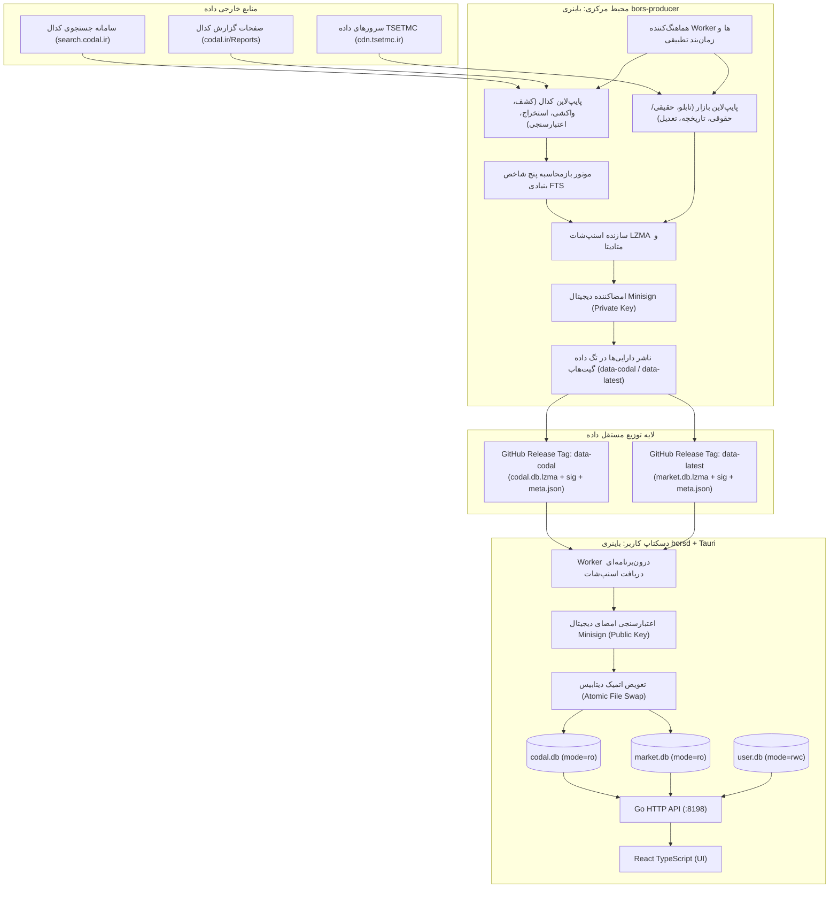

# سند طراحی معماری: موتورهای تولید داده، خط لولهٔ کدال و همگام‌سازی پس‌زمینه در Go (مرحله ۳)
# (Stage 3 Design: Go Data Producers, CODAL Pipeline & Background Ingestion)

- **تاریخ:** ۲۰۲۶-۱۱-۰۸ (۱۷ آبان ۱۴۰۵)
- **شاخه:** `mission/stage3-go-data-producers-2026-11-07`
- **خط مبنا (Baseline):** `aca7c465df207d9e55fccfecf23b3759b110bea7`
- **وضعیت:** طراحی مصوب با تفکیک دو باینری (`borsd` برای کلاینت دسکتاپ و `bors-producer` برای خط لوله مرکزی داده).

---

## ۱. بیانیهٔ مأموریت و اهداف معماری

مرحلهٔ ۲ با موفقیت زمان اجرای کلاینت دسکتاپ را به ترکیب سه‌گانهٔ Go + Frontend-V2 + Tauri منتقل نمود و پایتون را به طور کامل از بسته نصبی حذف کرد. هدف مرحلهٔ ۳، **حذف کامل و قطعی وابستگی‌های عملیاتی پایتون در زنجیرهٔ تأمین، واکشی، استخراج، اعتبارسنجی و انتشار داده‌ها** است.

### اصول بنیادین معماری:
۱. **تفکیک کامل Producer و Client:**
   - باینری `borsd`: کلاینت دسکتاپ کاربران که دیتابیس‌های `market.db` و `codal.db` را منحصراً در حالت فقط‌خواندنی (`mode=ro`) باز می‌کند و فاقد هرگونه اسکرپر یا خزندهٔ تهاجمی به سمت کدال است. کلاینت فقط اسنپ‌شات‌های امضاشده را دریافت و به صورت اتمیک اعمال می‌نماید.
   - باینری `bors-producer`: ابزار مستقل خط فرمان و سرویس دیمن مخصوص سرور/ادمین مرکزی که وظیفهٔ کشف اطلاعیه‌ها، استخراج داده‌ها، اعتبارسنجی، محاسبهٔ مجدد FTS، دریافت داده‌های TSETMC، ساخت اسنپ‌شات‌های فشرده LZMA، امضای دیجیتال با کلید خصوصی minisign و انتشار به مخزن داده را بر عهده دارد.
۲. **کدبیس مشترک در یک مخزن (Monorepo Shared Go Packages):**
   هر دو باینری در پوشه `backend-go/cmd/` قرار داشته و از بسته‌های داخلی مشترک در `backend-go/internal/` (شامل لایه‌های دیتابیس، تحلیل بنیادی FTS، محاسبات دوره‌ای، قرارداد کندل‌ها و توابع رمزنگاری) بهره می‌برند.
۳. **تک‌نویسنده بودن دیتابیس‌ها (Single-Writer Invariant):**
   هیچ دو فرآیندی اجازهٔ نوشتن هم‌زمان بر روی یک دیتابیس را ندارند. اعمال اسنپ‌شات در کلاینت بدون آسیب به خواننده‌های فعال انجام می‌پذیرد.
۴. **حذف ترفندهای ناپایدار (ADB / CAPTCHA Bypass):**
   فرآیند کشف داده‌ها بر پایهٔ کادنس تطبیقی، احترام به سرفصل `Retry-After`، الگوریتم Exponential Backoff با Jitter و Circuit Breaker پایدار پیاده‌سازی می‌شود.

---

## ۲. نمای کلی معماری و توپولوژی سیستم



---

## ۳. طراحی تفصیلی زیرسیستم‌ها (Workstreams)

### بخش ۱: زیرسیستم خط لولهٔ کدال و بازمحاسبهٔ FTS (Workstream A)

این زیرسیستم مسئولیت کامل واکشی، پردازش و اعتبارسنجی اطلاعات کدال را در قالب پکیج `backend-go/internal/codal/` بر عهده دارد:

#### ۱. کشف اطلاعیه‌ها (Discovery Engine):
- **فراخوانی فید سراسری:** درخواست به `https://search.codal.ir/api/search/v2/q` با پارامترهای:
  - `Category=1` (صورت‌های مالی)
  - `Category=3` (گزارش فعالیت ماهانه)
  - `Publisher=false`، `TracingNo=-1`
- **مدیریت نشانک (Incremental Cursor):** نشانک در جدول `pipeline_cursor` نگهداری می‌شود. نشانک تنها پس از تکمیل موفق و کامل یک صفحه جلو می‌رود تا در صورت کرش یا قطعی اینترنت، هیچ اطلاعیه‌ای از قلم نیفتد.
- **حذف تکراری (Deduplication):** کلید `tracing_no` به عنوان شناسهٔ یکتا در جدول `codal_notices` درج می‌گردد (`INSERT OR IGNORE`).

#### ۲. دریافت محتوا و استخراج (Content Fetcher & Extractor):
- **واکشی صفحات:** دریافت مستقیم صفحات HTML از `codal.ir/Reports/Decision.aspx` (عدم نیاز به دانلود PDF یا Excel).
- **استخراج تولید و فروش ماهانه (`monthly_sales`):**
  - استخراج درآمد ماه جاری (`monthly_revenue`)، درآمد تجمعی از ابتدای سال مالی (`ytd_revenue`)، درآمد ماه مشابه سال قبل، حجم فروش و واحد فروش.
- **استخراج صورت‌های مالی (`financial_statements`):**
  - استخراج ارقام ترازنامه و سود و زیان: درآمد عملیاتی (`revenue`)، سود ناخالص (`gross_profit`)، سود عملیاتی (`operating_profit`)، سود خالص (`net_profit`)، جمع دارایی‌ها، بدهی‌ها، حقوق صاحبان سهام، سرمایه ثبت‌شده، سود انباشته و سود هر سهم (`basic_eps`).
  - تشخیص وضعیت حسابرسی‌شده (`is_audited`)، تلفیقی (`is_consolidated`) و طول دوره مالی (`period_months`).

#### ۳. اعتبارسنجی داده‌ها و قوانین دوره‌ها (Validation & Periods Gate):
- **انطباق هویت نماد و ناشر:** اعتبارسنجی با جدول `instruments` دیتابیس مارکت جهت جلوگیری از اتصال گزارش یک نماد به شرکت دیگر.
- **اعمال قرارداد دوره‌های کدال (`codal_periods`):** تاریخ‌های پایان دوره به صورت استاندارد شمسی `YYYY/MM/DD` اعتبارسنجی و نرمال‌سازی می‌شوند.
- **قرنطینه داده‌های معیوب:** در صورت بروز خطای ساختاری یا اعتبارسنجی، ردیف در جدول `codal_quarantine` ذخیره می‌شود و چرخه متوقف نمی‌گردد.

#### ۴. بازمحاسبهٔ هدفمند پنج شاخص بنیادی FTS:
- **نشانه‌گذاری Dirty:** با ورود دادهٔ جدید، تنها نمادهای متأثر در جدول `pipeline_dirty` درج می‌شوند.
- **محاسبه مجدد با موتور Go (`backend-go/internal/fundamental/`):**
  - محور ۱: نرخ رشد فروش ماهانه و فروش تجمیعی ۳ ماهه.
  - محور ۲: پایداری و روند سودآوری EPS (حداقل ۴ تا ۸ دوره گذشته).
  - محور ۳: حاشیه سود ناخالص و پایداری آن.
  - محور ۴: نسبت ارزش بازار به فروش (P/S) و اهرم مالی.
  - محور ۵: داوری صنعت و شروط اختصاصی بانکی/دارویی/بیمه‌ای.
- نتایج در جدول `fts_results` در دیتابیس مارکت به‌روزرسانی می‌شوند.

---

### بخش ۲: زیرسیستم اسنپ‌شات و توزیع دیجیتال (Workstream B)

این زیرسیستم ارتباط میان Producer مرکزی و کلاینت‌های دسکتاپ را مدیریت می‌نماید (`backend-go/internal/snapshot/`):

#### ۱. چرخه ساخت اسنپ‌شات (Snapshot Builder):
- اجرای دستور `VACUUM INTO` روی دیتابیس تولیدی جهت ساخت نسخهٔ تمیز و فاقد لاگ WAL.
- فشرده‌سازی با الگوریتم LZMA2 به فرمت `codal.db.lzma` و `market.db.lzma`.
- محاسبه هش امن SHA-256 فایل فشرده.
- ایجاد سند متادیتا (`codal.meta.json` و `market.db.meta.json`) شامل:
  ```json
  {
    "asset": "codal.db.lzma",
    "size": 3116840,
    "sha256": "3a8c5f...4b",
    "schema_version": 2,
    "data_version": "2026.11.08.01",
    "published_at_utc": "2026-11-08T03:00:00Z",
    "last_notice_date": "2026-11-07"
  }
  ```

#### ۲. امضای دیجیتال با Minisign:
- فایل `codal.db.lzma` توسط کلید خصوصی Producer امضا شده و فایل `codal.db.lzma.sig` تولید می‌شود.
- کلید خصوصی منحصراً در متغیر محیطی یا مسیر امن سرور Producer نگهداری می‌شود (`BORS_MINISIGN_SECRET_KEY`) و هرگز وارد گیت نمی‌شود.

#### ۳. انتشار در تگ‌های مستقل داده:
- اسکریپت و ماژول Publisher فایل‌های `.lzma`، `.sig` و `.meta.json` را در تگ پایدار `data-codal` و `data-latest` در مخزن منتشر می‌کند.

#### ۴. اعمال ایمن و اتمیک در کلاینت دسکتاپ (Client Safe Ingestion):
- دانلود به پوشه موقت سیستم (`%TEMP%/borsterminal_sync/...`).
- بررسی امضای دیجیتال با کلید عمومی تعبیه‌شده در برنامه.
- تست سلامت فایل دیتابیس با اجرای `PRAGMA integrity_check`.
- تعویض اتمیک فایل:
  در ویندوز فایل‌های باز قفل می‌شوند. مکانیزم تعویض شامل:
  1. بستن موقت کانکشن پول کلاینت یا استفاده از نام مستعار و کپی مرحله‌ای.
  2. جایگزینی اتمیک با ساختار `MoveFileExW` با پرچم `MOVEFILE_REPLACE_EXISTING`.
  3. در صورت بروز هرگونه خطا، دیتابیس قبلی سالم باقی مانده و فرآیند Rollback می‌شود.

---

### بخش ۳: زیرسیستم دریافت بازار و رویدادهای شرکتی (Workstream C)

این زیرسیستم در پکیج `backend-go/internal/tsetmc/` پیاده‌سازی می‌شود:

- **واکشی تابلوی بازار:** ارتباط با اندپوینت‌های رسمی CDN تصفیه‌شده TSETMC (`/ClosingPrice/GetMarketWatch`، `/ClientType/GetClientTypeAll`).
- **دریافت تاریخچه و پر کردن شکاف‌ها (Gap Recovery):** واکشی فایل‌های کندل تاریخی و بهینه‌سازی ورود داده‌ها.
- **ثبت رویدادهای شرکتی:**
  - واکشی و بروزرسانی جدول `share_change_events` (افزایش سرمایه‌ها).
  - واکشی و بروزرسانی جدول `price_adjust_events` (تعدیلات قیمتی و سود نقدی).
- **قفل پایدار تک‌نویسنده (Single Writer Lock):**
  استفاده از فایل قفل پایدار `market_writer.lock` و قفل فایلی سیستم‌عامل (`flock` / `LockFileEx`) تا از اجرای هم‌زمان دو Producer یا اختلال در فرآیند نوشتن جلوگیری شود.

---

### بخش ۴: پایداری در برابر ۴۲۹، مدیریت خط لوله و زمان‌بند (Workstreams D & E)

- **احترام کامل به محدودیت‌های منبع:**
  - خواندن هدر `Retry-After` و توقف دقیق بر اساس مدت اعلام‌شده.
  - کنترل نرخ درخواست (Rate Limiter با توکن‌باکت: حداکثر ۲ درخواست در ثانیه).
  - الگوریتم Exponential Backoff با اعمال تصادفی Jitter (شروع از ۵ ثانیه تا سقف ۳۰۰ ثانیه).
- **مدار شکن (Circuit Breaker):**
  - در صورت دریافت ۳ خطای متوالی ۴۲۹ یا ۵xx، مدار به مدت ۱۵ دقیقه باز شده و هیچ درخواستی ارسال نمی‌شود.
- **کادنس تطبیقی بر اساس ساعات انتشار کدال (Adaptive Cadence):**
  - یادگیری خودکار پنجره‌های پرتردد کدال از روی تاریخچهٔ اطلاعیه‌ها (عمدتاً ساعات ۰۹:۰۰ الی ۱۳:۳۰ و ۱۵:۰۰ الی ۱۹:۳۰).
  - در ساعات اوج: فاصلهٔ بررسی فید هر ۱۰ دقیقه.
  - خارج از ساعات اوج و شب‌ها: فاصلهٔ بررسی هر ۲ ساعت.

---

### بخش ۵: ممیزی و حذف کامل ردپای پایتون در عملیات (Workstream F)

| اسکریپت قدیمی پایتون | جایگزین در معماری جدید Go | وضعیت نهایی |
| :--- | :--- | :--- |
| `codal_fetcher.py` | `backend-go/internal/codal/` + `bors-producer codal run` | حذف کامل از عملیات |
| `codal_pipeline.py` | `backend-go/internal/codal/pipeline.go` | حذف کامل از عملیات |
| `codal_periods.py` | `backend-go/internal/period/` | جایگزین شده با پکیج Go |
| `codal_units.py` | `backend-go/internal/codal/units.go` | حذف کامل از عملیات |
| `codal_dividends.py` | `backend-go/internal/codal/dividends.go` | حذف کامل از عملیات |
| `dev/codal_fts_updater.py` | فرمان `bors-producer codal backfill` | حذف کامل از عملیات |
| `scripts/build_codal_snapshot.py` | فرمان `bors-producer codal snapshot` | حذف کامل از عملیات |
| `scripts/publish_codal_snapshot.py` | فرمان `bors-producer codal publish` | حذف کامل از عملیات |
| `test_tsetmc.py` | `backend-go/internal/tsetmc/` + `bors-producer market run` | حذف کامل از عملیات |
| `api/_sync_codal.py` | پکیج Go `internal/sync/` در `borsd` | حذف کامل از عملیات |
| `api/_sync_market.py` | پکیج Go `internal/sync/` در `borsd` | حذف کامل از عملیات |

پایتون پس از پایان این مرحله صرفاً به عنوان **اوراکل مقایسهٔ داده‌ها در ابزارهای تست توسعه (`tools/parity/`)** باقی می‌ماند و هیچ نقشی در تولید یا توزیع داده نخواهد داشت.

---

## ۴. ساختار باینری‌ها، پکیج‌ها و خط فرمان

### ساختار پوشه‌ها در مخزن:
```text
backend-go/
  cmd/
    borsd/                  # باینری اصلی کلاینت دسکتاپ
      main.go
    bors-producer/          # باینری خط لوله و تولیدکننده مرکزی داده
      main.go
  internal/
    codal/                  # خط لوله کدال (کشف، واکشی، استخراج، قرنطینه)
      discovery.go
      fetcher.go
      extractor.go
      units.go
      dividends.go
      validator.go
      pipeline.go
    tsetmc/                 # دریافت داده‌های بازار TSETMC
      fetcher.go
      marketwatch.go
      clienttype.go
      history.go
      adjust_events.go
    snapshot/               # بسته‌بندی، امضا، انتشار و اعمال دیتابیس
      builder.go
      signer.go
      publisher.go
      applier.go
    worker/                 # زمان‌بند، کادنس، ریت‌لیمیتر و مدارشکن
      orchestrator.go
      cadence.go
      ratelimit.go
      breaker.go
    fundamental/            # موتور محاسباتی ۵ شاخص بنیادی FTS (از قبل موجود)
    period/                 # منطق دوره‌های مالی و تقویم جلالی (از قبل موجود)
    chart/                  # موتور چارت و تعدیل رهاورد (تثبیت‌شده در Stage 2)
    sync/                   # هندلرهای وضعیت سینک و مانیتورینگ کلاینت
```

### فرامین باینری `bors-producer`:
```bash
# اجرای یک دور اسکن و دریافت فید افزایشی کدال
bors-producer codal run --mode=update

# استخراج و پر کردن اطلاعیه‌های قدیمی (Backfill)
bors-producer codal backfill --limit=100

# ساخت اسنپ‌شات و امضای دیجیتال
bors-producer codal snapshot --db=codal.db --out=dist/snapshots/

# انتشار اسنپ‌شات در مخزن
bors-producer codal publish --tag=data-codal --token=$GITHUB_TOKEN

# دریافت داده‌های زنده و رویدادهای بازار TSETMC
bors-producer market run --history=true

# اجرای دائم به صورت Daemon هماهنگ با کادنس و زمان‌بند
bors-producer daemon --config=producer_config.json
```

---

## ۵. ماتریس آزمون‌ها و معیارهای پذیرش (Acceptance Gates)

۱. **Gate 3.1 (CODAL Extraction & FTS Parity):**
   انطباق ۱۰۰٪ خروجی داده‌های استخراج‌شده صورت‌های مالی و فروش ماهانه در Go با نسخه پایتون، و تطابق کامل احکام ۵ شاخص FTS روی نمادهای نمونه.
۲. **Gate 3.2 (Snapshot Integrity & Minisign):**
   تولید صحیح فایل `codal.db.lzma`، امضا با کلید آزمایشی، و تایید موفق امضا توسط کلاینت دسکتاپ.
۳. **Gate 3.3 (Atomic Swap):**
   تست تزریق اسنپ‌شات تازه در حالتی که کلاینت در حال خواندن چارت یا تابلوی بازار است، بدون ارور `database is locked` یا کرش پروسه.
۴. **Gate 3.4 (429 Fault-Injection):**
   شبیه‌سازی خطای ۴۲۹ با سرور تست محلی و اثبات فعال‌شدن Circuit Breaker و احترام به زمان بک‌آف.
۵. **Gate 3.5 (Zero Operational Python):**
   اجرای فرآیند تولید داده، محاسبه و انتشار بدون اجرای حتی یک خط کد پایتون.
