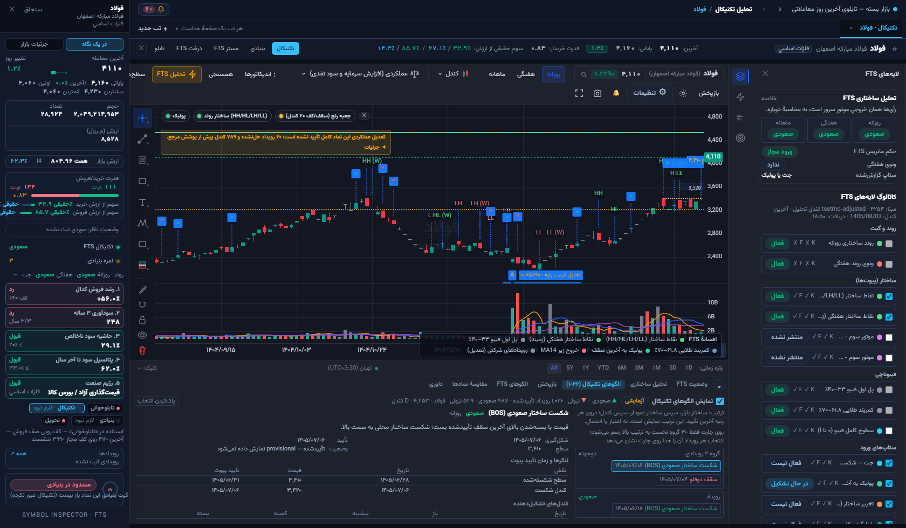
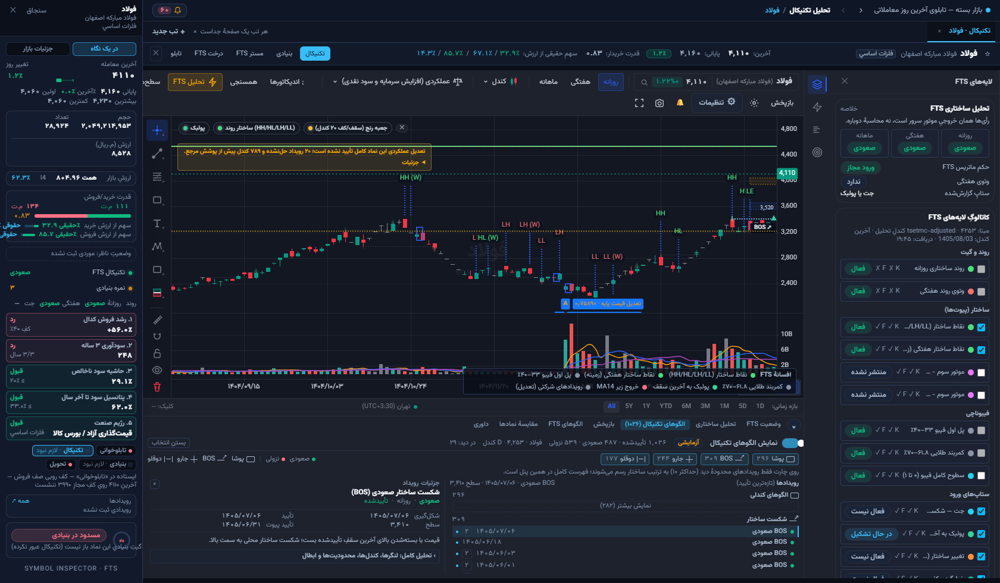
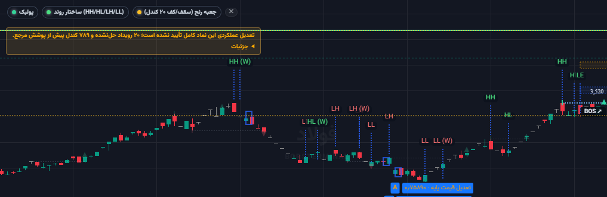

# شاهد بصری بازطراحی CandleEdge — قبل و بعد

**شرایط یکسان:** فولاد، روزانه، پنجرهٔ ۱۶۸۰×۹۸۰، داک باز، لایه روشن، رویداد
`bos_bullish@4233` (سطح ۳٬۴۱۰) انتخاب‌شده، محدودهٔ دید کندل ۴۱۳۲–۴۲۳۵.
**شاخه:** `mission/technical-candleedge-visual-redesign-2026-10-25`
**گزارش:** [CANDLEEDGE-VISUAL-REDESIGN-2026-10-25.md](../../CANDLEEDGE-VISUAL-REDESIGN-2026-10-25.md)

## قبل

برچسب‌های شناور و خطوط پیش‌فرض؛ پنل بلند با تحلیل همیشه‌باز.

## بعد

هندسهٔ خانواده‌ها روی چارت، صفر متن در حالت عادی، یک چیپ کوچک فقط برای انتخاب/هاور،
حداکثر ۱۰ رویدادِ محدودهٔ دید، و پنل فشرده با تحلیل جمع‌شونده.

## بوم چارت (بعد)

## نتیجهٔ بررسی زنده

۳۰/۳۰ بررسی سبز: انتخاب سطح/تیغهٔ پیوت/زمان شکست را جدا نشان می‌دهد؛ هاور چیپ موقت
می‌افزاید؛ پن و زوم هندسه را با محدودهٔ دید عوض می‌کنند و همهٔ نقاط روی کندل واقعی
می‌مانند؛ تغییر تایم‌فریم انتخاب قبلی را پاک می‌کند؛ خاموش‌کردن صفر overlay می‌گذارد.
کنسول فقط ۴۰۴ پیش‌موجود `favicon.ico` دارد.
